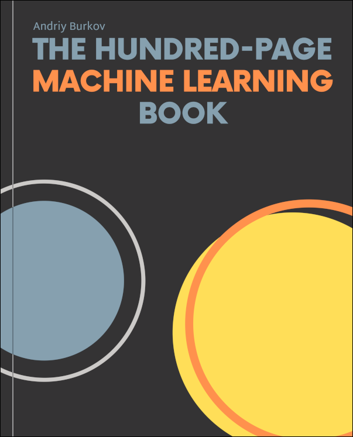

# EE2211 Intro to Machine Learning

## Introduction

* **Full name**: [EE2211 Introduction to Machine Learning](https://nusmods.com/courses/EE2211/introduction-to-machine-learning)
* **Target audience**: NUS Year 2 Engineering Students
* **Purpose of the Course:** As its name suggests, this course provides a basic introduction to machine learning, with some deep learning topics covered towards the end.
* **Notes Content**: View the [EE2211 Notes](https://app.gitbook.com/o/MnEKr5A4lYXtOfhoXGj5/s/62ZyyXgjRhJTApQJB3Eg/)

I took this course in AY26/27 Semester 1 mainly to fill the gaps in my machine learning knowledge, both for my [research vision step 2](https://mendax1234.github.io/#research-vision) and to address what I felt I was missing while working on my EE4218 project in AY25/26 Semester 2.

## Course Content

### Overview of Topics Covered

In this module, I think it's helpful to think of machine learning in terms of different models, where a model can be viewed as a function that takes an input and produces an output. The main models we learned in this course include:

1. **Linear and polynomial regression**
2. **Classification** (which can also be approached using regression-based methods)
3. **Clustering** (mainly K-means clustering)
4. **Multi-layer perceptrons (MLPs)** (the "Hello World" of deep learning) and **convolutional neural networks (CNNs)**

Among these topics, I think the idea of **gradient descent** is super important! It's one of the fundamental techniques in machine learning for optimizing the parameters (or what we often call weights) of a model.

### Depth and Balance of Coverage

#### Theoretical Understanding

As an introductory module to all NUS engineering students, this mod is less math heavy, having a basic knowledge of linear algebra would be very sufficient I guess!

#### Application and real-world examples

As this module is really just a starting point for machine learning and deep learning, I think it's helpful to approach the topics using the [model-based thinking](ee2211-intro-to-machine-learning.md#overview-of-topics-covered) I mentioned earlier. For each model, try to understand the math behind it, particularly how we find the optimal parameters (or weights) for that model.

Building on this, I think having a good understanding of **gradient descent** will be very useful for more advanced courses, especially when learning about **backpropagation** in deep learning.

#### Challenging or Unique Aspects

To be honest, I didn't find too many topics in this course particularly challenging. The only difficult questions I remember from the finals were related to **probability**, which mainly required a bit more mathematical thinking.

## Teaching Style and Materials

### Teaching Style

#### Lecture

Again, there are two professors teaching this course:

1. **Lectures 1-3 and 10-12:** Taught by Prof. Xinchao, a very nice and chill prof! He seems to be quite active in AI research at NUS ECE, and he's also very willing to write recommendation letters for students!
2. **Lectures 4-9:** Taught by Prof. Helen, who I found to be an okay prof. Her explanations of the concepts were generally okay I would say.

#### Tutorial

My tutorials were taught by Mr. Christopher, who I would say is another GOATed TA in NUS ECE! I still remember how he would break down the concepts into a systematic framework to help us understand them better. For example, when teaching [systems of linear equations](https://app.gitbook.com/s/62ZyyXgjRhJTApQJB3Eg/lec/lec-04-systems-of-linear-equations#systems-of-linear-equations), he clearly categorized them into three cases, making it much easier to understand when to use the left inverse and when to use the right inverse. This is just one example of what made his tutorials so helpful. I really like how he made things intuitive!

#### Assessments

This module's assessments consist of:

1. **Midterm & Final:** Both are quite doable.
2. **Assignments:** Quite doable as well.

### Course Book

At the start of the semester, I did spend some time reading the _Hundred-Page Machine Learning Book_ by Andriy Burkov.

<figure><figcaption></figcaption></figure>

However, I think there's really no need to read the textbook for this course unless you have plenty of free time. Understanding the concepts intuitively, either by going through my notes or asking AI to explain them, should be more than enough!

## Learning Experience

### Personal Insights

As an introductory module, I think this course has given me a good intuitive understanding of machine learning, from the different models to gradient descent. It's pretty amazing to me how these ideas work!

If you're interested in the history of AI, it's also fascinating to see how the field has developed, from traditional machine learning to more complex deep learning models and eventually to LLMs, which are trained to predict the next token. Each development builds on earlier ideas in some way. Who knows what will come next!

### Skills Developed

Python is definitely a must-know skill in the field of machine learning. However, to be honest, most of the Python code in this module was written with the help of AI coding agents. So, emmm...

## Workload and Time Management

* **Level of Difficulty:** 5/10
* **Tips for future cohort**: Just enjoy!

## Conclusion

Overall, I think EE2211 does its job quite well, which is to introduce the engineering novices to the amazing world of machine learning!
