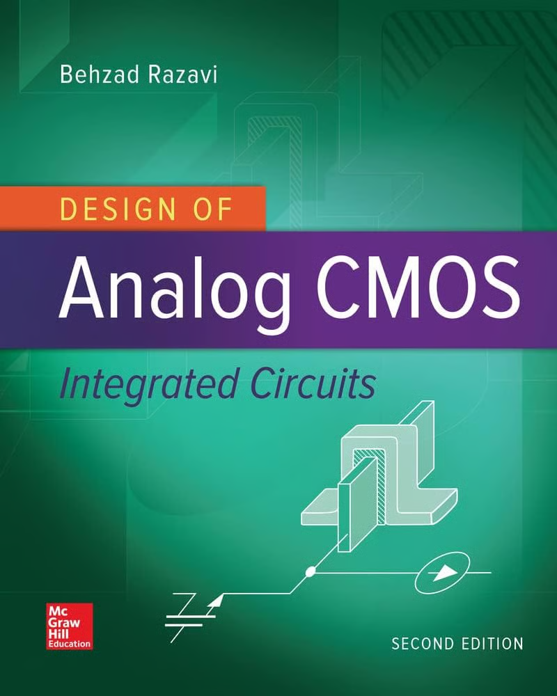

# EE3408C Integrated Analog Design

## Introduction

* **Full name**: [EE3408C Integrated Analog Design](https://nusmods.com/courses/EE3408C/integrated-analog-design)
* **Target audience**: NUS Year 3 EE/CEG Students
* **Purpose of the course**: To provide students with a glimpse of how to use Cadence Virtuoso to design simple analog circuits, like amplifier, etc.
* **Notes Content**: View the [EE3408C Notes](https://app.gitbook.com/o/MnEKr5A4lYXtOfhoXGj5/s/UBWYdYYwvkB8gDH5SdEC/)

I took this course in AY26/27 Semester 1 mainly to gain an understanding of the analog abstraction in the computer system! (The [8 abstractions from DDCA](https://app.gitbook.com/s/jTJFBPtKk6NwweAooH53/textbook/from-zero-to-one#abstraction) come here again!)

## Course Content

### Overview of Topics Covered

This course is divided into two halves:

1. The first half covers small-signal analysis and single-stage amplifier design.
2. The second half builds on the concepts introduced in the first half and covers more advanced amplifier designs, such as differential amplifiers and two-stage op-amps.

One of the most useful techniques I learned from this course is the [**intuitive analysis**](https://app.gitbook.com/s/UBWYdYYwvkB8gDH5SdEC/lec/lec-8-differential-amplifiers#a-recap-for-lec-1-to-lec-7) introduced by Prof. Jang in the second half. I found this approach particularly helpful for quickly calculating voltage gain, and I believe it will also be useful in analog circuit design.

Another useful skill I picked up is how to sketch Bode plots to analyze the frequency response of amplifiers.

### Depth and Balance of Coverage

#### Theoretical Understanding

To be honest, I think this course is a great introduction to analog circuit design. Once again, I really appreciate the intuitive analysis technique introduced by Prof. Jang!

#### Application and real-world examples

As I mentioned in my course notes, one of the most important things to understand in this course is the [**analog IC design flow**](https://app.gitbook.com/s/UBWYdYYwvkB8gDH5SdEC/lec/lec-1-module-introduction#analog-ic-design-flow) (it's even better to compare it with the digital IC design flow we learned in EE4415!). This gives us a bigger picture of what we are doing in this module, which mainly focuses on schematic design, analogous to writing RTL code in digital IC design!

#### Challenging or Unique Aspects

At first, I found analyzing the small-signal model of a circuit quite challenging. However, Prof. Jang's intuitive analysis technique really helped me understand this difficult concept!

Another challenge is choosing the appropriate bias point and overdrive voltage for a MOSFET. I think this might involve quite a bit of trial and error for analog IC designers!

## Teaching Style and Materials

### Teaching Style

#### Lecture

I didn't find Prof. Gao's lectures in the first half particularly interesting, but he is a very nice professor and is always happy to answer questions. Prof. Jang might be another GOATed analog IC design professor at NUS! His intuitive understanding of analog circuits is really insightful!


Both professors are also very willing to clarify questions during the midterms and finals, so if you're unsure about anything, just ask during the exams!


#### Project

The project involves applying what we've learned in lectures to design actual circuit schematics using Cadence Virtuoso. As I mentioned earlier, this is analogous to writing RTL code in digital design, so I think this project is really important! That said, the project itself is not particularly difficult. One piece of advice I would give is to make good use of **parameter sweeps** to find appropriate values when tuning a MOSFET's W/L ratio or resistor values.

#### Assessments

From what I've seen, most of the assessments are largely reused from previous years, so it would be very helpful if you could find some seniors who can share their past-year materials!

1. **Tutorials:** In my semester, we were required to submit 3 out of 4 tutorials for grading. Most of the questions were reused from previous years.
2. **Projects:** To a large extent, the teaching team also reuses past-year projects, with some changes such as switching from a PMOS input to an NMOS input.
3. **Midterm:** Most of the questions were also from previous years, with only 2-3 new questions.
4. **Final:** Same situation, but since the answers haven't been released, who knows how many questions were actually new lol.

### Course Book

As we all know, one of the most famous textbooks in analog IC design is _Design of Analog CMOS Integrated Circuits (2nd Edition)_ by Behzad Razavi. And indeed, this is the coursebook used in EE3408C!

<figure><figcaption></figcaption></figure>


Having said that, I think if you are a master of the **intuitive analysis**, you will be more than enough for the finals!


## Learning Experience

### Personal Insights

Overall, I really appreciate Prof. Jang's intuitive analysis techniques and his explanation of the analog IC design flow. With this bigger picture in mind, I now have a better understanding of what I'm learning in this course and how it might help me deepen my understanding of the analog aspects of computer systems. (Who knows, maybe analog compute-in-memory will become a trend in future domain-specific accelerator design?)

### Skills Developed

Cadence Virtuoso skills, of course! I feel that this course requires much more hands-on experience with Cadence than EE4415. And, of course, a better understanding of the analog IC design flow!

## Workload and Time Management

* **Level of Difficulty:** 5/10 (for those who have past-year materials from seniors) or 8/10 (for those doing everything from scratch).
* **Tips for Future Cohorts:** That said, I do feel that this course is very doable as long as you understand the concepts properly (or, as I like to put it, "intuitively"!). It's not as scary as it might seem to be at the first half. Wait for the highlight moment from Prof. Jang at the second half! Trust!

## Conclusion

I also really want to thank Prof. Gao and Prof. Jang for patiently answering all my dumb questions after each lecture! Thanks for making my analog IC design learning journey much more interesting and, most importantly, genuinely useful hopefully LOL!
