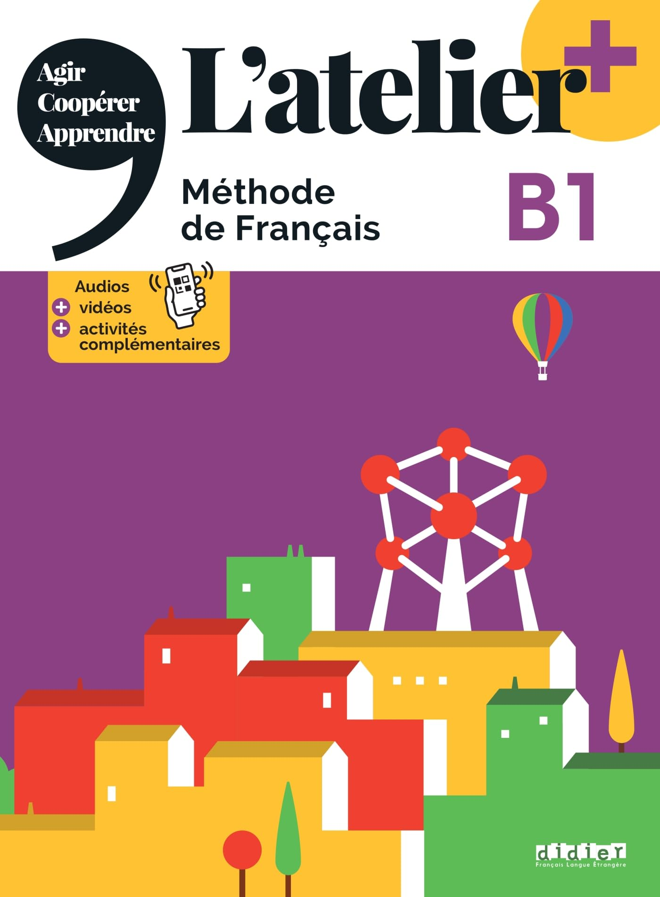
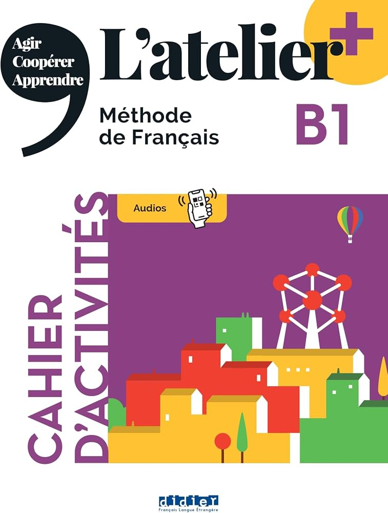

# LAF4201 French 5

## Introduction

* **Full name**: [LAF4201 French 5](https://nusmods.com/courses/LAF4201/french-5)
* **Target audience**: any student who is interested in learning French
* **Purpose of the course**: Rather straightforward, to learn French :joy:
* **Notes Structure**: View the [LAF4201 Lecture Notes](../../../../undergrad-nus/Y3S1/LAF4201)

I took this course in AY26/27 Semester 1 mainly to prepare for my upcoming exchange at EPFL.

## Course Content

### Overview of Topics Covered

In this course, we learn some important French grammar concepts for the DELF B1 level, including:

1. **Le subjonctif présent**
2. **Le plus-que-parfait**
3. **L'accord du participe passé avec le COD au passé composé**

### Depth and Balance of Coverage

Overall, nowadays, with the help of AI tools, these grammars are not that hard.

## Teaching Style and Materials

### Teaching Style

#### Tutorial

Ma professeure s'appelle Sophie. Elle est très intéressante et sympa !

### Course Book

**Textbook**:

<figure><figcaption></figcaption></figure>

**Exercise Book**:

<figure><figcaption></figcaption></figure>

## Learning Experience

I would say French 5 is really interesting! This semester, we had a project where we had to interview a French-speaking person. I met a very nice guy who had also been to EPFL before, so I really enjoyed this experience and appreciated the opportunity provided by LAF4201!

## Workload and Time Management

* **Level of Difficulty**: **4/10**
* **Tips for Future Students**: Same tip as for French 1, 2 and 4 — the mémo at the end of each unit in the textbook is extremely useful for revision and consolidation.

## Conclusion

Amazing experience with all my classmates and my prof Sophie!
