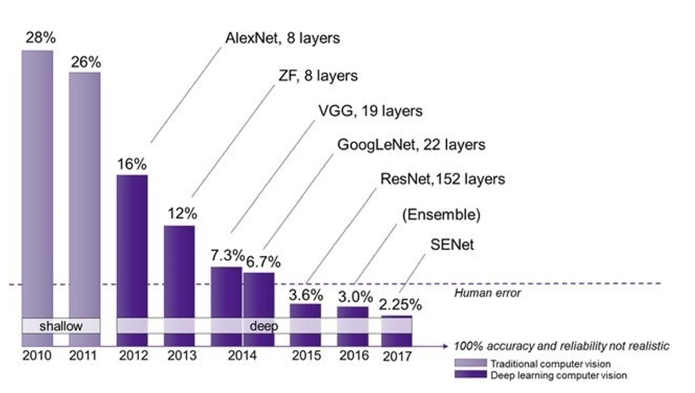

# Introduction

A **neural network** consists of connected units or nodes called **artificial neurons**, which loosely model the neurons in the brain. These neurons are connected by _edges_, which model the synapses in the brain. The flow of a neural network can be summarized as follows:

1. Each artificial neuron receives **signals** from connected neurons, then processes them and sends a signal to other connected neurons. The "signal" is a real number.
2. The output of each neuron is computed by some **non-linear function** of the totality of its inputs, called the **activation function**.
3. The strength of the signal at each connection is determined by a **weight**, which adjusts during the learning process.

Typically, neurons are aggregated into **layers**. Different layers may perform different transformations on their inputs. Signals travel from the first layer (the _input layer_) to the last layer (the _output layer_), possibly passing through multiple intermediate layers (_hidden layers_). A network is typically called a **deep neural network** if it has at least two hidden layers.

<figure><figcaption></figcaption></figure>

We can think of the neural network as a **function**. For example, let's say we want to build a neural network to recognize the image given an $$28\times28$$ pixel image where each pixel is a value between 0 and 1 representing the gray scale of that pixel. Then our neural network will be a function as below.

$$
f(a_0, \ldots, a_{783}) =
\begin{bmatrix}
y_0 \\
\vdots \\
y_9
\end{bmatrix}
$$

where the function inputs at the L.H.S are the $$28\times28=784$$ pixels and the function output at the R.H.S is a **possibility matrix** denoting which number the figure is likely to be (from 0 to 9). e.g., $$[0.98, 0, \dots, 0]^T$$ denotes that the output is likely to be a 0.


As discussed earlier, the output of each neuron is computed by applying a **non-linear activation function** to its weighted sum of inputs. By combining multiple layers of neurons, a neural network effectively forms a **nested non-linear function**, allowing it to learn and approximate **complex non-linear relationships** between inputs and outputs.


Having said that, the neural network can not only be used to recognize the number in an image. Depending its usage, the neural network can have different flavours:

1. [**Multilayer Perceptron (MLP)**](multilayer-perceptron.md): This is the basic version.
2. [**Convolutional Neural Network (CNN)**](convolution-neural-network.md): This is good for image recognition.
3. [**Residual Neural Network**](residual-neural-network.md): This is even better for image recognition.

## History

Neural networks first gained widespread attention through their success in **image recognition**. One of the most influential benchmarks was the **ImageNet Large Scale Visual Recognition Challenge (ILSVRC)**, which began in 2010 and challenged researchers to classify images into thousands of categories. The following chart illustrates how advances in neural network architectures progressively improved image classification accuracy on ImageNet.

<figure><figcaption>
Different Neural Network's Performance on ImageNet
</figcaption></figure>

A major breakthrough came in **2012**, when researchers from the **University of Toronto** introduced **AlexNet**, a deep convolutional neural network (CNN) that dramatically outperformed competing methods. This achievement marked the beginning of the **modern deep learning revolution**, demonstrating the effectiveness of deep neural networks for large-scale image recognition.


Nowadays (as of 2026), **ImageNet is no longer as prominent as a benchmark for cutting-edge AI research**, as modern deep learning architectures, such as **Transformers**, have achieved extremely high classification accuracy on this dataset.

