# Lab 01 - Intro, GPIO, Interrupt

## Introduction to MCXC444

In CG2271, we will use the **MCXC444 microcontroller**, a highly integrated, market-leading **ultra-low-power 32-bit microcontroller** built on the enhanced **ARM Cortex-M0+ (CM0+)** core platform.


In [CG2111A](https://app.gitbook.com/s/o4X8QvQZjJ2YsPgYhJDb/), we use ATMega328p microcontroller.


<details>

<summary>Microcontroller vs. Microprocessor</summary>

Both contain a **CPU core** that executes instructions, but a **microcontroller** integrates essential **on-chip peripherals** (e.g., **analog interfaces, timers, digital I/O**) for embedded control.

For example, the **MCXC444** we use is a microcontroller: besides its **Cortex-M0+ CPU**, it already includes peripherals needed to sense inputs, process timing, and control hardware — without requiring external chips.

<figure>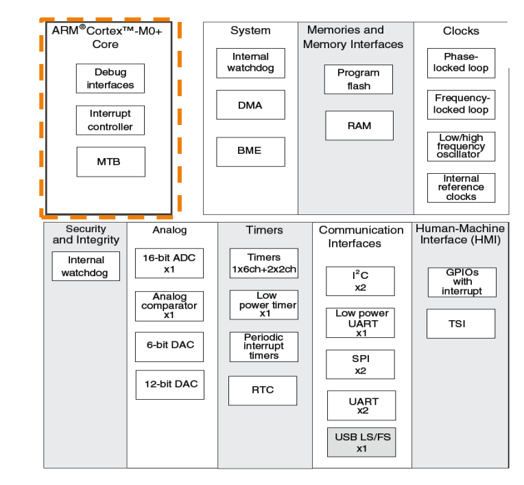<figcaption></figcaption></figure>

</details>

### Instruction Set Architectures

In NUS CG3207, we have already had a glimpse of [what an ISA is](https://app.gitbook.com/s/jTJFBPtKk6NwweAooH53/textbook/from-zero-to-one#architecture-isa). Here, we will briefly have a recap on the types of ISA with some concrete examples. Basically, there are two types of ISAs:

1. Load/Store Architecture
2. Register/Memory Architecture

And each will give us different benefits which we will see soon.


Remember that in DDCA notes, we've already seen how the jargon "[architecture](https://app.gitbook.com/s/jTJFBPtKk6NwweAooH53/textbook/from-zero-to-one#architecture-isa)" is used interchangeably with ISA by computer architects!




#### Load/Store Architecture

Basically, it means arithmetic/data-processing instructions operate only on **registers**. Memory is accessed only through explicit `load` and `store` instructions.


For example, **ARM** and **RISC-V** both use the Load/Store Architecture.


By using this architecture, the hardware CPU design will become simpler but one big issue is the memory wall.



#### Register/Memory Architecture

This basically means an arithmetic/data-processing instruction may use a **memory operand directly**, as well as registers.


An example is the x86 ISA.




### ARM Cortex-M0+ Core

In this part, by looking at the ARM Cortex-M0+ Core, we will have a glimpse of some essential information in an ARM microprocessor. First of all, the following figure demonstrates the structure of the ARM Cortex-M0+ Core.

<figure>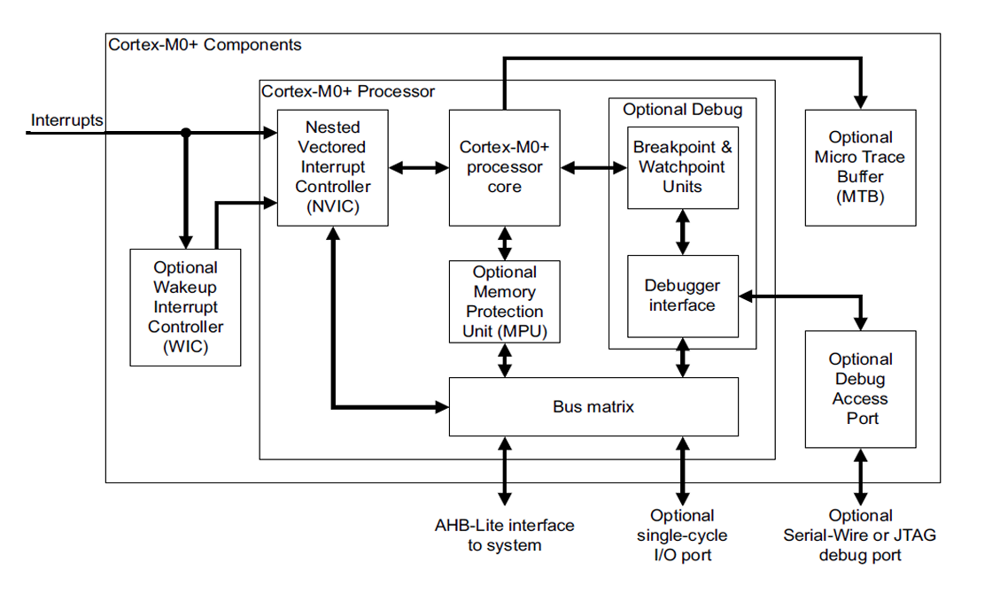<figcaption></figcaption></figure>

#### ARM Processor Core Registers

It's essential for an ARM computer architecture to know what are the registers in an ARM processor. The following figure gives us a brief glimpse of that.

<figure>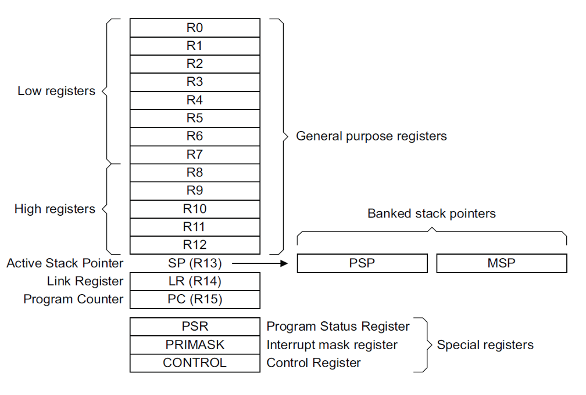<figcaption></figcaption></figure>

These registers can be grouped into the following categories:



#### General Purpose Registers

`R0-R12`: These are general purpose registers used for normal **data processing**. They hold operands, temporary values, addresses, and intermediate results.

* `R0–R7` are often called **low registers**
* `R8–R12` are often called **high registers**



#### Stack Pointer (SP)

`R13`: The **Stack Pointer** points to the top of the current stack. ARM provides two physical stack pointers:

1. **MSP**: Main Stack Pointer
2. **PSP**: Process Stack Pointer

`SP (R13)` refers to whichever one is currently active.



#### Link Register (LR)

`R14`: The **Link Register** stores the **return address** when a function/subroutine is called.



#### Program Counter (PC)

`R15`: The **Program Counter** holds the address associated with the current instruction flow.



#### Program Status Register (PSR)

The **PSR** contains information about the processor's current state. It can be viewed as three parts:

1. **Application Program Status Register (ASPR)**: Contains condition flags produced by arithmetic and logical operations.
   * `N` — Negative
   * `Z` — Zero
   * `C` — Carry
   * `V` — Overflow
2. **Interrupt Program Status Register (IPSR)**: Stores the **exception number** of the currently executing exception/interrupt which also indicates which ISR/exception handler is running.
3. Execution Program Status Register (EPSR): Contains information about the processor's execution state.



#### Memory Map for Cortex-M0+ and MCU

A **memory map** shows how the processor’s **address space** is divided among different types of memory and hardware. In Cortex-M0+, the CPU uses a **32-bit address space**, so addresses range from `0x0000_0000` to `0xFFFF_FFFF`.&#x20;


Different address ranges are reserved for different purposes.


Below is the [MMIO](https://app.gitbook.com/s/jTJFBPtKk6NwweAooH53/lec/lec-08-io-and-exception-handling/lec-08a-embedded-i-o-systems#memory-mapped-i-o) for the ARM Cortex-M0+

<figure>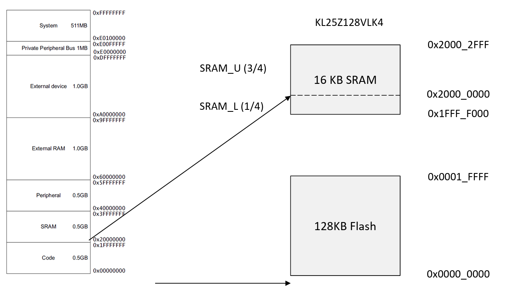<figcaption></figcaption></figure>

Here, we will only cover some of the regions and leave the rest for the interested readers to find out themselves.



#### Code Region

`0x0000_0000 - 0x1FFF_FFFF`: This region maps the **flash memory** and is used mainly for storing **program instructions**.



#### SRAM Region

`0x2000_0000 - 0x3FFF_FFFF`: This region maps the SRAM and is used for **RAM during program execution**.



#### Endianness

We've already learned endianness in [NUS CG2111A](https://app.gitbook.com/s/o4X8QvQZjJ2YsPgYhJDb/studio/studio-13-communication-protocol#endianness). **Endianness** describes how the bytes of a multi-byte value are arranged in memory. So, here, we should know that in ARMv6-M:



#### Instructions are always little-endian

ARMv6-M instructions are always stored and fetched in **little-endian format**. So the processor always interprets instruction bytes using little-endian ordering.



#### Private Peripheral Bus accesses are always little-endian

Loads and stores to the **Private Peripheral Bus (PPB)** are always treated as little-endian. The PPB contains processor/system components such as:

* interrupt-control registers
* system-control registers
* debugging-related registers

So when the CPU accesses these system registers, the byte ordering is fixed as **little-endian**.


Attention here, the registers are above are not in the [#arm-processor-core-registers](lab-01-intro-gpio-interrupt.md#arm-processor-core-registers "mention")!!!




## GPIO Programming

The **MCXC444** organizes its **GPIO pins into five ports**, with **32 pins per port**. This results in a total of **160 GPIO pins** available on the microcontroller.

<details>

<summary>Why 32 pins per port?</summary>

This is because the ARM processor within the MCXC444 microcontroller is 32-bit, thus it possesses a 32-bit ALU, 32-bit general-purpose registers, and a 32-bit internal data bus.

Besides, as the GPIO configuration and data registers are [memory-mapped](https://app.gitbook.com/s/jTJFBPtKk6NwweAooH53/lec/lec-08-io-and-exception-handling/lec-08a-embedded-i-o-systems#memory-mapped-i-o), the CPU reads and writes to them in complete 32-bit chunks over the system bus. Organizing the pins into groups of 32 allows each **bit** within a 32-bit register (such as the Port Data Output Register) to correspond exactly to **one pin** on that port.


GPIO pins provide **binary** input and output!


</details>

MCXC444 uses the format `PT[Bank][Number]` for the pin information. For example,

1. PTA1 -> Port A, Pin 1
2. PTE30 -> Port E, Pin 30

While the memory-mapped registers theoretically support 32 pins per port, **not all 160 pins are physically routed to the outside of the chip**. The actual number of accessible I/O pins depends strictly on the physical footprint of the package

<details>

<summary>The purpose of pins on a microcontroller</summary>

Pins are the **physical interface** between the microcontroller and the **external world**. They allow the microcontroller's **internal peripherals** (e.g., GPIO, ADC, I<sup>2</sup>C, SPI) to **send signals to** and **receive signals from** **external devices**.


For more on pins and pins multiplexing, feel free to refer to my [EE4218 notes](https://app.gitbook.com/s/BcpQMbfvKRcTJoaXhJD0/lab/lab-02-introduction-to-hardware-software-co-design#pins)!


</details>

### GPIO Programming Steps

To correctly use these GPIO pins, we must **strictly follow the configuration steps outlined below**.



#### Power Up

Almost all hardware on the MCXC444 is switched off by default to save power, like I<sup>2</sup>C, SPI, GPIO, etc. So, before using a certain device (or a certain in this case), we must enable the clock for the specific **Port** we are using.


Clock enabling is done in **block level**, which means all the 32 pins in that port will be **enabled**!


To enable the clock for the **GPIO ports (Port A–E)**, we must configure the `SIM_SCGC5` register.


It must be strictly the `SIM_SCGC5` register!


Each GPIO port has a corresponding **bit mask** (e.g., `SIM_SCGC5_PORTA_MASK`) that targets the correct clock-gating bit in this register.


We can **directly use predefined masks** such as `SIM_SCGC5_PORTE_MASK`. These masks are provided by the **device header file** and correspond exactly to the bit that enables the clock for the specified GPIO port in `SIM_SCGC5`.


<figure>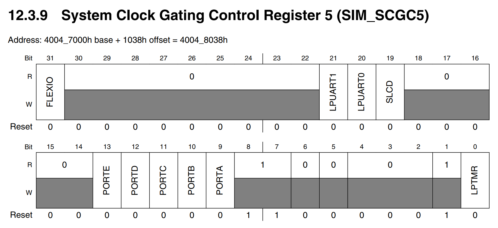<figcaption></figcaption></figure>

**Example:** Enable the clocks for **Port A** and **Port E** and then disable them.

```c
SIM->SCGC5 |= (SIM_SCGC5_PORTA_MASK | SIM_SCGC5_PORTE_MASK); // Enable
SIM->SCGC5 &= ~(SIM_SCGC5_PORTA_MASK | SIM_SCGC5_PORTE_MASK); // Disable
```


Here, enabling the clocking gate of a port is equivalent as **powering up** all the pins in that port. But further configurations are still needed.




#### Pin Multiplexing

We've seen the motivation for pin multiplexing in [EE4218 Labs](https://app.gitbook.com/s/BcpQMbfvKRcTJoaXhJD0/lab/lab-02-introduction-to-hardware-software-co-design#pins) already. As we saw [earlier](lab-01-intro-gpio-interrupt.md#gpio-programming), a microcontroller contains **many GPIO pins**, but the physical chip exposes only a **limited number of external pins**. Besides normal **GPIO**, the MCU may contain peripherals such as:

* UART
* timers
* SPI
* I<sup>2</sup>C
* ADC

If every peripheral function required its own dedicated physical pin, the chip would need far too many pins. So instead, **multiple internal peripheral signals share the same physical pin**. This is called **pin multiplexing**.

> **Pin multiplexing** allows one physical pin to be configured for different internal functions.

For example, the same pin (e.g., Port A Pin 1, namely `PTA1`) might be configured as:

<p align="center"><code>GPIO</code> / <code>UART TX</code> / <code>Timer output</code> / <code>SPI signal</code></p>


Normally **only one function is selected at a time**.


On the **MCXC444**, each physical pin has a **Pin Control Register (PCR)** that determines what function that pin performs. The register is written as:

<p align="center"><code>PORTx_PCRy</code></p>

where `x` is the port letter (e.g., A to E) and `y` is the pin number (e.g., 0-31). For example, `PORTE_PCR1` -> controls **pin 1 of Port E (**`PTE1`**)**. The following is the register field for a `PORTx_PCRy` register (Section 11.7.1).

<figure>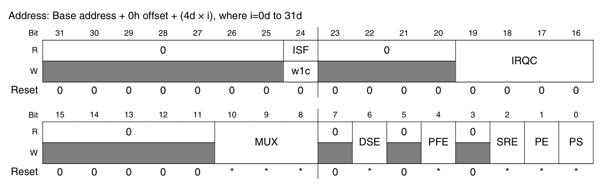<figcaption></figcaption></figure>

Inside each PCR, the **MUX bits** select the pin's function. As we have seen earlier in this stepper point, a pin can support several alternatives, such as:

* GPIO
* UART
* SPI
* I<sup>2</sup>C
* timer signals

The MCU datasheet tells us which `ALT` number corresponds to each function. For example, for `PTE1` (Can look through the manual 10.3.1 for more details)

<figure>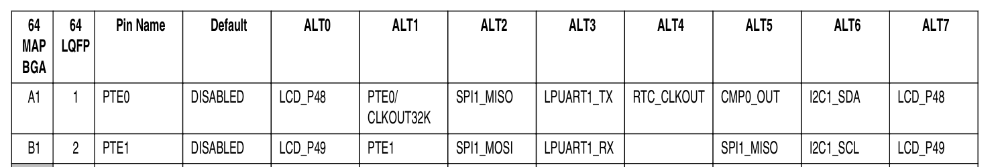<figcaption></figcaption></figure>

So if we want `PTE1` **to behave as GPIO**, we select `MUX = ALT1`.

***

We access a pin control register using:


```c
PORTx->PCR[y]
// For PTE1
PORTE->PCR[1]
```


To configure `PTE1` as GPIO:


```c
// Clear the current MUX setting
PORTE->PCR[1] &= ~PORT_PCR_MUX_MASK;

// Select ALT1 = GPIO
PORTE->PCR[1] |= PORT_PCR_MUX(1);
```



`PORT_PCR_MUX_MASK` is a macro that we are not supposed to change and the `x` in `ALTx` will be the arguments for the function `PORT_PCR_MUX()`.




#### Direction

After configuring a pin to use the **GPIO function**, we still need to decide whether that GPIO pin is an **input** or an **output**. This is controlled by the **Port Data Direction Register**:

<p align="center"><code>GPIOx_PDDR</code></p>

Each **bit** in `PDDR` corresponds to **one pin** in that GPIO port. (`0` -> pin is input; `1` -> pin is output). To set a pin as input/output, we will use the following templates:


```c
GPIOx->PDDR &= ~(1 << pinnum); // Set Port x Pin pinnum as input
GPIOx->PDDR |= (1 << pinnum); // Set Port x Pin pinnum as output
```


For example, to configure `PTE1` as input first and then output, we can use


```c
GPIOE->PDDR &= ~(1 << 1); // Set PTE1 as input first
GPIOE->PDDR |= (1 << 1); // Then set PTE1 as output
```




#### Write

To **write a value to a GPIO pin**, the pin must first be configured as an **output**. Example for `PTE1`:


```c
GPIOE->PDDR |= (1 << 1);
```


There are several registers we can use to control the output value of a GPIO pin:

* `GPIOx_PSOR`: **set** the pin to `1`
* `GPIOx_PCOR`: **clear** the pin to `0`
* `GPIOx_PTOR`: **toggle** the pin
* `GPIOx_PDOR`: directly stores the output value

For example, if we want to write to `PTE1`, we can use:


```c
#define PIN1 1

// Set PTE1 as output
GPIOE->PDDR |= (1 << PIN1);

// Clear PTE1
GPIOE->PCOR |= (1 << PIN1);

// Set PTE1
GPIOE->PSOR |= (1 << PIN1);

// Toggle PTE1
GPIOE->PTOR |= (1 << PIN1);

// Directly Write with PDOR
GPIOE->PDOR |= (1 << 1);      // set PTE1
GPIOE->PDOR &= ~(1 << 1);     // clear PTE1
```




#### Read

To **read the current logic level of a GPIO pin**, the pin should first be configured as an **input**. We then read the **Port Data Input Register**:

<p align="center"><code>GPIOx_PDIR</code></p>

Each bit in `PDIR` corresponds to one GPIO pin. (`0` -> pin is currently LOW; `1` -> pin is currently HIGH). For example, if we want to read the value at `PTB2`, we can use:


```c
#define PIN2 2

GPIOB->PDDR &= ~(1 << PIN2); // make PTB2 as an input

// Read the PTB2 pin value
if (GPIOB->PDIR & (1 << PIN2)) {
    // PTB2 is HIGH
}
```




### A Put-it-All together Example

Suppose now our task is to use the **SW3 push button** on the FRDM-MCXC444 board to **toggle the red LED**. And the connection is as follows:

* SW3 is connected to `PTA4`
* The red LED is connected to `PTE31`

And both the SW3 and red LED are **active-low**, meaning that pressing SW3 we will read `0` from `PTA4` and writing 0 to `PTE31` will turn on the red led.

***

To achieve this, we can do the GPIO programming as follows:


```c
// Define the pins
#define SW_PIN  4
#define LED_PIN 31

// Enable the Port Clocks
SIM->SCGC5 |= (SIM_SCGC5_PORTA_MASK |
               SIM_SCGC5_PORTE_MASK);
               
// Select GPIO Function
// PTA4 -> GPIO
PORTA->PCR[SW_PIN] &= ~PORT_PCR_MUX_MASK;
PORTA->PCR[SW_PIN] |= PORT_PCR_MUX(1);

// PTE31 -> GPIO
PORTE->PCR[LED_PIN] &= ~PORT_PCR_MUX_MASK;
PORTE->PCR[LED_PIN] |= PORT_PCR_MUX(1);

// Set the Pin Directions
GPIOA->PDDR &= ~(1 << SW_PIN); // PTA4 as input
GPIOE->PDDR |= (1 << LED_PIN); // PTE31 as output

// Start with LEF Off
GPIOE->PSOR |= (1 << LED_PIN);

// Poll the Switch
while (1) {
    if (!(GPIOA->PDIR & (1 << SW_PIN))) {
        GPIOE->PTOR |= (1 << LED_PIN);
    }
}
```


## Interrupt Programming

As we have seen earlier about the architecture of the ARM Cortex-M0+ that is used on our MCXC444 microcontroller, we might notice that **all interrupts** generated by devices on the microcontroller unit (MCU) will pass through a "module" called **nested vector interrupt controller (NVIC)**.

<figure>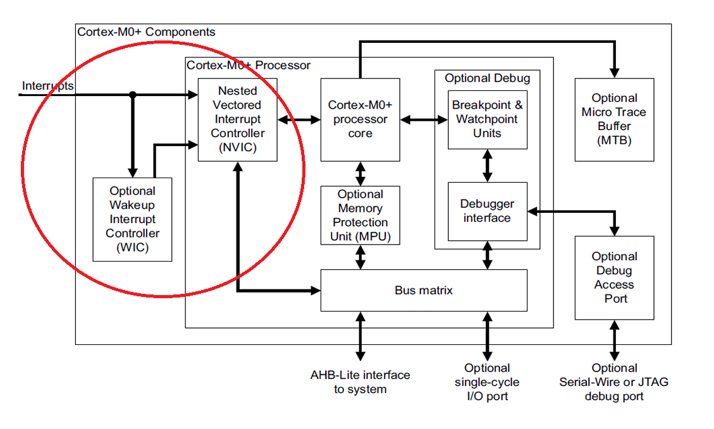<figcaption></figcaption></figure>

### Nested Vectored Interrupt Controller

The NVIC is a **priority interrupt system** and it has two important properties:

* Nested
* Vectored



#### Nested

This means that the interrupts have different priorities.

* A **higher-priority interrupt** can interrupt an lower-priority ISR that is already running.
* A **lower-priority interrupt** must wait until the higher-priority ISR finishes.



#### Vectored

This means each interrupt/exception is assigned a **vector number** and this number identifies which ISR should handle the event. In the ARM Cortex-M0+:

* vector numbers `0–15` are called **core vectors** and are reserved for core/system exceptions
* vector numbers `16+` are called **non-core vectors** and are used for external peripheral interrupts


Sometimes we might use **interrupts** and **vectors** interchangeably and note that the **non-core vectors** include the [#external-interrupts](lab-01-intro-gpio-interrupt.md#external-interrupts "mention") which we will talk about very soon!




#### Vector Table in ARM Cortex-M0+

A **vector table** is an array of 32-bit entries used by the CPU to find exception and interrupt handlers. Each entry is 32-bit long because each entry stores a **32-bit address**.


This is how the [#vectored](lab-01-intro-gpio-interrupt.md#vectored "mention") actually becomes useful!


An example of the vector table used in ARM Cortex-M0+ is shown as follows:

<figure>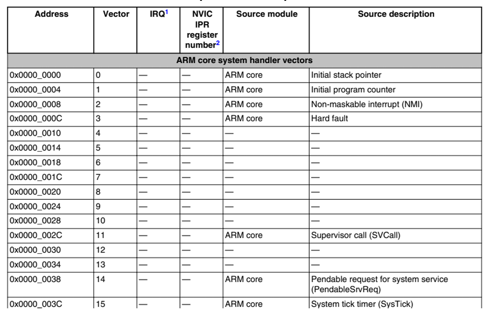<figcaption></figcaption></figure>

In this vector table, the first column is the memory address that stores the address of the ISR. The second column is the **vector number**. And we may notice that, there's a relationship between the first column and second column (this relationship is used quite often even in the real industry's SoC design):

<p align="center">entry address = vector table base + (vector number × 4)</p>

<details>

<summary>How "Vectored" Works</summary>

The CPU uses a **vector table** that stores the addresses of exception/interrupt handlers. Conceptually, the flow when an interrupt/exception happens from a computer architect's view is as follows:

1. An interrupt occurs.
2. The hardware determines its **vector number**.
3. The vector number is used as an **index into the vector table**.
4. The corresponding table entry contains the **address of the ISR**.
5. That ISR address is loaded into the **Program Counter (PC)**.
6. The CPU begins executing the ISR.
7. When the ISR finishes, the CPU returns to the interrupted code.

</details>

#### External Interrupts

As we've seen from above, the **external interrupts** are part of the **non-core vectors** in the ARM Cortex-M0+. These interrupts are generated by the [**GPIO pins**](lab-01-intro-gpio-interrupt.md#gpio-programming-steps) on the MCXC444. And in MCXC444, the external interrupts are divided into the following two groups:

1. Port A
2. Ports C and D are combined into one group.


Pins on Port B cannot generate interrupts!


For GPIO-based external interrupts, each supported port has an **Interrupt Status Flag Register (ISFR)**. For example,

* `PORTA->ISFR`
* `PORTC->ISFR`
* `PORTD->ISFR`

Each **bit** in `ISFR` corresponds to **one pin** in that port. So if an interrupt occurs on `PTA4`, bit 4 of `PORTA->ISFR` becomes `1`. (More info can be found on Section 11.7.4 in the MCXC444 manual)

<figure>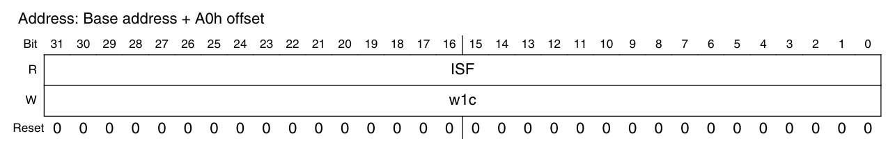<figcaption></figcaption></figure>

For example, let's say we want to check whether there is an interrupt generated at `PTA4`, we can use the following code template:


```c
#define SW_PIN 4

if (PORTA->ISFR & (1 << SW_PIN)) {
    // PTA4 caused an interrupt
} else {
    // PTA4 did not cause an interrupt
}
```


### Configure External Interrupts

Let's use an concrete example to see how to configure external interrupts on MCXC444! Suppose that we want to configure the switch `SW2`, connected to pin `PTC3`, so that pressing the button generates an interrupt.

Firts, as `SW2` is **active-low**, meaning that when it's not pressed, `PTC3=1` and when it's pressed, `PTC3=0`. Therefore, a button press causes a **falling edge**!



#### Define the Pin

Nothing special here, just a definition at the top.


```c
#define SWITCH_PIN 3
```




#### Disable the Interrupt While Configuring

Before modifying its configuration, temporarily disable the interrupt:


```c
NVIC_DisableIRQ(PORTC_PORTD_IRQn);
```


This prevents the CPU from servicing this interrupt while its settings are only partially configured.


The method name `NVIC_DisableIRQ` and its argument `PORTC_PORTD_IRQn` are all predefined and don't need to be changed!


<details>

<summary>What is an IRQ?</summary>

An **IRQ** is a request from a hardware device/peripheral asking the CPU for interrupt service.

</details>



#### Enable the Port C Clock

Before accessing Port C registers:


```c
SIM->SCGC5 |= SIM_SCGC5_PORTC_MASK;
```


The port peripheral must be clocked before its configuration registers can be used.



#### Configure the Pull Resistor

A GPIO input should normally have a defined voltage when nothing else is driving it. Otherwise, the input can **float**, producing an unpredictable `0` or `1`.  That's why we need a pull-up/down resistor.

* **Pull-up**: A pull-up weakly holds the pin at `1`, meaning that when the pin is not driven, it will be 1.
* **Pull-down**: A pull-down weakly holds the pin at `0`.

The MCXC444 has configurable **internal pull resistors** associated with the pin, controlled through that pin's `PCR` register. So, the pull-up/down **is not** fixed for a pin! For each pin, we have two bits that can be configured in the `PORTx_PCRy` **pin configuration register** (PCR):

<figure>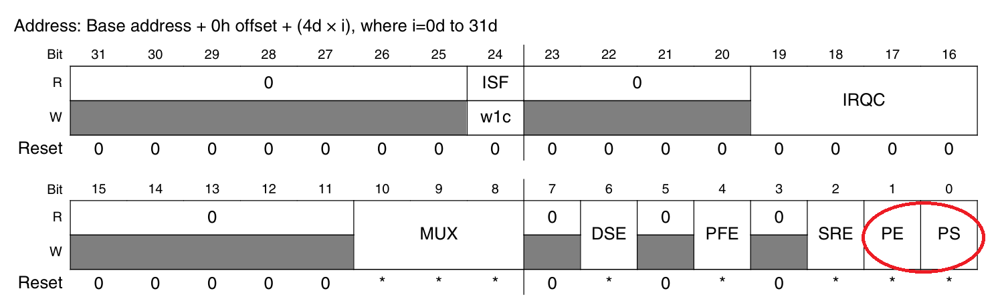<figcaption></figcaption></figure>

* `PE`: **Pull Enable**
  * `0` -> disabled
  * `1` -> enabled
* `PS`: **Pull Select**
  * `0` -> pull-down
  * `1` -> pull-up

Therefore,


```
PE = 0            -> no internal pull
PE = 1, PS = 0    -> pull-down
PE = 1, PS = 1    -> pull-up
```


For `SW2`, we use a **pull-up resistor** so that PTC3 is normally HIGH and is pulled LOW when the switch is pressed. Therefore, the switch input behaves as **active-low**.


```c
PORTC->PCR[SWITCH_PIN] &= ~PORT_PCR_PS_MASK;
PORTC->PCR[SWITCH_PIN] |=  PORT_PCR_PS(1);

PORTC->PCR[SWITCH_PIN] &= ~PORT_PCR_PE_MASK;
PORTC->PCR[SWITCH_PIN] |=  PORT_PCR_PE(1);
```




#### Configure PTC3 as GPIO Input

As we've seen [earlier](lab-01-intro-gpio-interrupt.md#pin-multiplexing), we need to first select the GPIO function through the `MUX` bits.


```c
PORTC->PCR[SWITCH_PIN] &= ~PORT_PCR_MUX_MASK;
PORTC->PCR[SWITCH_PIN] |=  PORT_PCR_MUX(1);
```


Then explicitly configure `PTC3` as an **input**:


```c
GPIOC->PDDR &= ~(1 << SWITCH_PIN);
```




#### Configure What Triggers the Interrupt

The `IRQC` field in the pin's `PCR` determines what electrical event generates an interrupt.

<figure>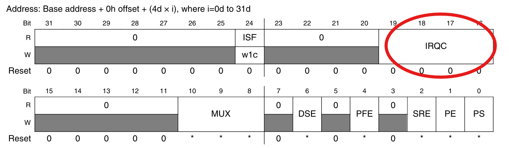<figcaption></figcaption></figure>

And based on the following table (Section 11.7.1), we can know what value to set for the `IRQC` field in the PCR.

<figure>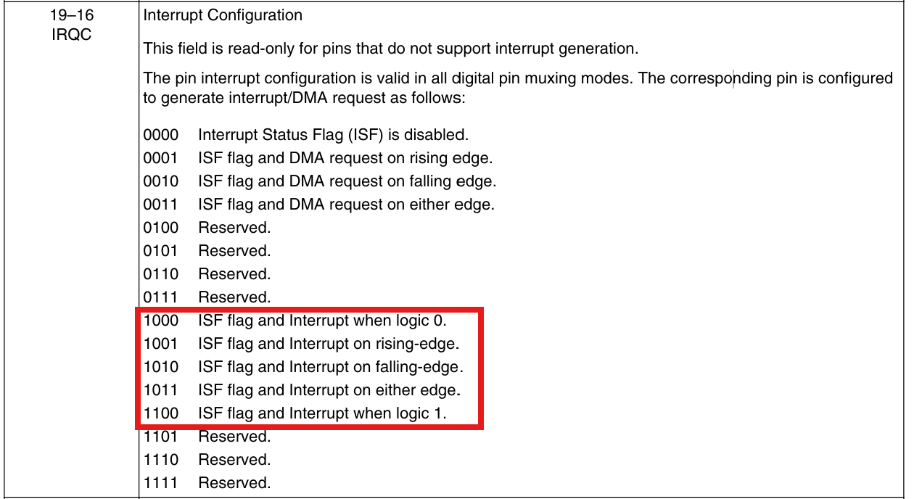<figcaption></figcaption></figure>

As we want a [**falling-edge** triggered interrupt](lab-01-intro-gpio-interrupt.md#configure-external-interrupts), we will use:


```c
PORTC->PCR[SWITCH_PIN] &= ~PORT_PCR_IRQC_MASK;
PORTC->PCR[SWITCH_PIN] |=  PORT_PCR_IRQC(0b1010);
```




#### Set the IRQ Priority

As we've seen earlier, the ARM Cortex-M0+ uses a **priority interrupt system** around the [NVIC](lab-01-intro-gpio-interrupt.md#nested-vectored-interrupt-controller). The actual implementation provides **2 priority bits**, giving four logical priority levels. Lower numerical priority means **higher urgency**. Each priority is represented by a 2 bit number + six 0's.


```
Logical priority     Hardware 8-bit field

00 = 0 highest  ->   00000000 =   0
01 = 1          ->   01000000 =  64
10 = 2          ->   10000000 = 128
11 = 3 lowest   ->   11000000 = 192
```


The corresponding decimal value of the 2 priority bits are the values that are stored in the **interrupt priority registers (IPR)**.

<figure>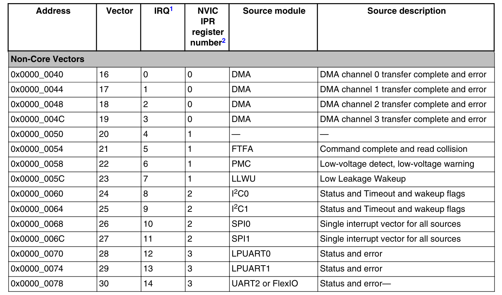<figcaption><p>non-core interrupts for ARM Cortex-M0+</p></figcaption></figure>

The IPR register field is shown below:

<figure>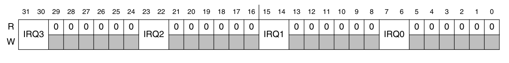<figcaption></figcaption></figure>

In our case, we don't need to know we belong to which IRQ. Instead, we can just use the pre-defined macro `PORTC_PORTD_IRQn`.


```c
NVIC_SetPriority(PORTC_PORTD_IRQn, 192);
```




#### Clear Pending IRQ and Enable It

Before enabling the interrupt, we should clear the pending IRQ so that this removes any interrupt request that may already be pending.


```c
NVIC_ClearPendingIRQ(PORTC_PORTD_IRQn);
```


Then enable the interrupt:


```c
NVIC_EnableIRQ(PORTC_PORTD_IRQn);
```


Now the NVIC is allowed to respond to Port C/D interrupt requests.



So, the full setup code is shown as follows as an extra reference:


```c
#define SWITCH_PIN 3      // SW2 = PTC3

void initSW2Interrupt(void)
{
    // 1. Disable Port C/D IRQ while configuring
    NVIC_DisableIRQ(PORTC_PORTD_IRQn);

    // 2. Enable clock to Port C
    SIM->SCGC5 |= SIM_SCGC5_PORTC_MASK;

    // 3. Enable internal pull-up
    // PS = 1 -> pull-up
    PORTC->PCR[SWITCH_PIN] &= ~PORT_PCR_PS_MASK;
    PORTC->PCR[SWITCH_PIN] |=  PORT_PCR_PS(1);

    // PE = 1 -> enable pull resistor
    PORTC->PCR[SWITCH_PIN] &= ~PORT_PCR_PE_MASK;
    PORTC->PCR[SWITCH_PIN] |=  PORT_PCR_PE(1);

    // 4. Configure PTC3 as GPIO (ALT1)
    PORTC->PCR[SWITCH_PIN] &= ~PORT_PCR_MUX_MASK;
    PORTC->PCR[SWITCH_PIN] |=  PORT_PCR_MUX(1);

    // Configure PTC3 as input
    GPIOC->PDDR &= ~(1 << SWITCH_PIN);

    // 5. Trigger interrupt on falling edge
    // Active-low switch: press = 1 -> 0
    PORTC->PCR[SWITCH_PIN] &= ~PORT_PCR_IRQC_MASK;
    PORTC->PCR[SWITCH_PIN] |=  PORT_PCR_IRQC(0b1010);

    // 6. Set lowest logical NVIC priority
    NVIC_SetPriority(PORTC_PORTD_IRQn, 3);

    // 7. Clear old pending IRQ and enable it
    NVIC_ClearPendingIRQ(PORTC_PORTD_IRQn);
    NVIC_EnableIRQ(PORTC_PORTD_IRQn);
}
```


### Write the ISR

Once the external interrupt is configured and enabled, we need an **Interrupt Service Routine (ISR)** to handle it. For Port C and Port D, the shared interrupt vector is:

<p align="center"><code>PORTC_PORTD_IRQn</code></p>

and the corresponding handler function is:


```c
void PORTC_PORTD_IRQHandler(void)
```


So, when a Port C/D interrupt occurs, the CPU uses the vector table and jumps to this function. The steps to write an ISR is shown as follows:



#### Clear the NVIC Pending IRQ

At the start of the ISR, clear any pending request in the NVIC:


```c
NVIC_ClearPendingIRQ(PORTC_PORTD_IRQn);
```


This clears the NVIC's pending state for the shared Port C/D interrupt.



#### Check Which Pin Caused the Interrupt

Because Port C and Port D share one interrupt vector, we may need to check the port's `ISFR` to find the actual source. For example, for `SW2` on the `PTC3`, we can use:


```c
if (PORTC->ISFR & (1 << SWITCH_PIN)) {
    // PTC3 caused the interrupt
}
```




#### Perform the ISR Action

This depends on what we really want to do.



#### Clear the Pin's ISFR Flag

After servicing the interrupt, clear the corresponding ISFR bit. The ISFR is **write-1-to-clear**:


```c
PORTC->ISFR = (1 << SWITCH_PIN);
```


So writing `1` to the relevant bit clears it back to `0`.



As the reference, the full ISR code is provided below.


```c
void PORTC_PORTD_IRQHandler(void)
{
    // Clear NVIC pending state
    NVIC_ClearPendingIRQ(PORTC_PORTD_IRQn);

    // Check whether PTC3 caused the interrupt
    if (PORTC->ISFR & (1 << SWITCH_PIN))
    {
        // Handle the interrupt
        count = (count + 1) % 6;

        // Clear PTC3 interrupt flag
        PORTC->ISFR = (1 << SWITCH_PIN);
    }
}
```

