# Lab 02 - Timer, PWM, ADC

## Timer Programming

In this section, we will learn how to configure the **Timer/PWM Module (TPM)** on the MCXC444 microcontroller to generate an **interrupt at fixed time intervals**.

The MCXC444 contains **three TPM modules**: `TPM0`, `TPM1`, and `TPM2`. The general architecture of each TPM module is shown below.

<figure>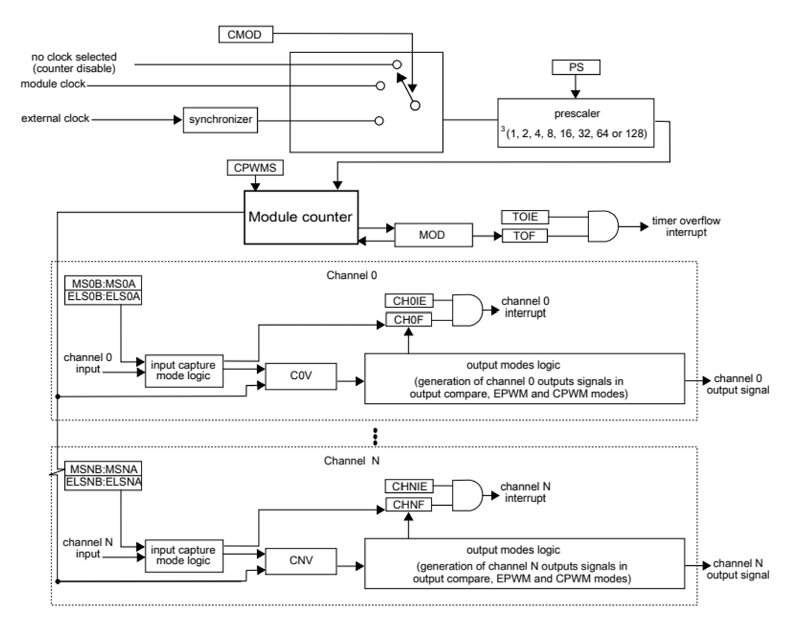<figcaption></figcaption></figure>


There is a **typo in the diagram**: `CMOD` does **not** select the TPM clock source, as we will see later.


We will cover three main parts here:

1. **Configure the TPM clock source**: select and configure the clock signal supplied to the TPM module.
2. **Configure the TPM module:** set parameters such as the prescaler and timer period.
3. **Implement the timer interrupt**: configure and write the interrupt handler that executes whenever the timer counter's value reaches the preset value.

The TPMs have many features but in this lecture we will only focus on generating interrupts at fixed intervals and in the next lecture we will look at using the TPMs to generate PWM signals.

### Clock Source Setup

As shown in the architecture diagram above, the TPM modules can be driven by several **internal and external clock sources**. The following diagram shows how the MCXC444 microcontroller generates difference clock sources:

<figure>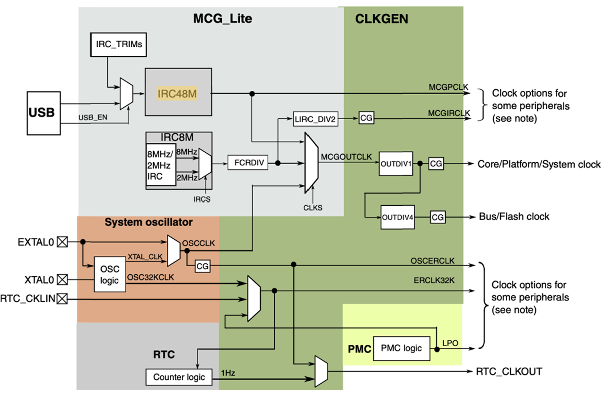<figcaption></figcaption></figure>

Before configuring the TPM itself, we first need to configure the **clock signal that will eventually be supplied to the TPM**. On the MCXC444, this can be done using the **Multipurpose Clock Generator Lite (MCG-Lite)**. Its block diagram is shown as follows:

<figure>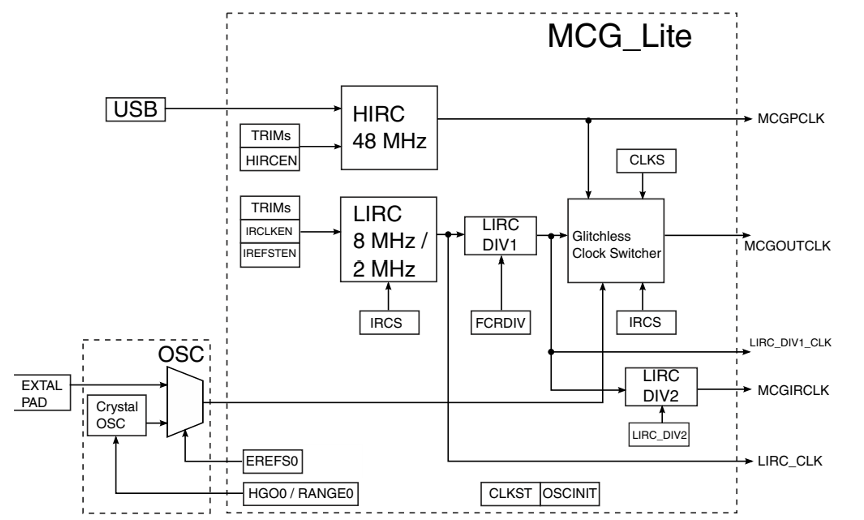<figcaption><p>MCG_Lite block diagram</p></figcaption></figure>

The general procedure is:

<p align="center"><strong>Choose clock source -> Configure source frequency -> Configure clock dividers -> Obtain MCG output clock</strong></p>



#### **Choose the Clock Source**

First, select which clock source the **MCG-Lite** should use. This is controlled by the `CLKS` field in **MCG Control Register 1 (**`MCG_C1`**)**. For the internal reference clocks, the MCXC444 provides:

* **HIRC**: High-Frequency Internal Reference Clock, **48 MHz**
* **LIRC**: Low-Frequency Internal Reference Clock, **2 MHz or 8 MHz**

The appropriate source depends on the clock frequency required by our application.

<figure>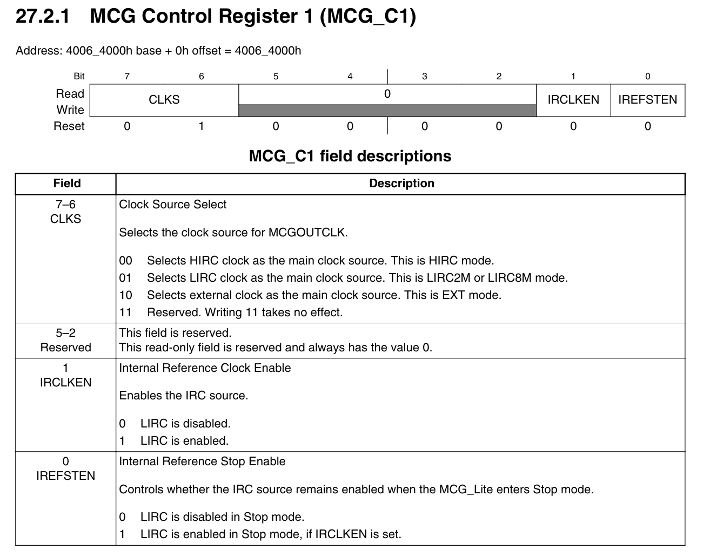<figcaption></figcaption></figure>

For our timer example, we use **LIRC**, so we set `CLKS = 01`. We also set `IRCLKEN = 1` to enable the internal reference clock.

```c
MCG->C1 &= ~MCG_C1_CLKS_MASK;
MCG->C1 |= MCG_C1_CLKS(0b01) | MCG_C1_IRCLKEN_MASK;
```


As a good programming practice, **always clear the bits you intend to modify before setting their new values**. This prevents old register values from interfering with the new configuration and makes the code easier to modify safely in the future.




#### **Configure the Clock Source Frequency**

After selecting the clock source, configure its frequency if the selected source provides multiple frequency options. For **LIRC**, the `IRCS` bit in **MCG Control Register 2 (**`MCG_C2`**)** determines its frequency:

<figure>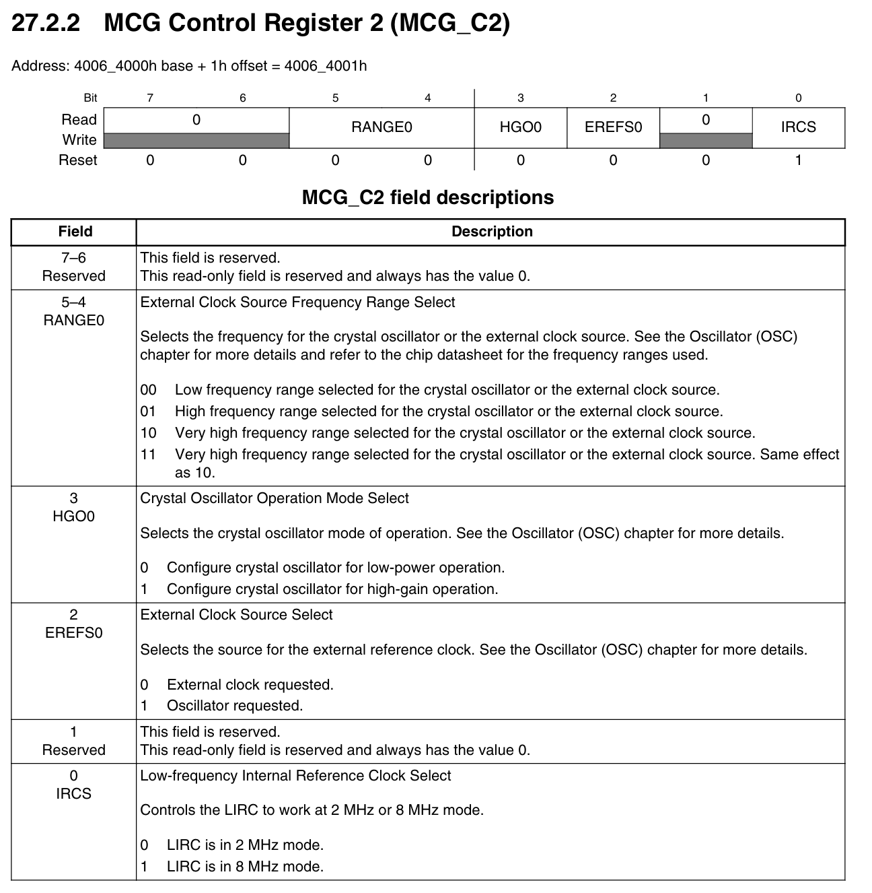<figcaption></figcaption></figure>

So, for example, let's say we want to select 8 MHz LIRC:

```c
MCG->C2 |= MCG_C2_IRCS_MASK;
```

Thus, our selected clock is now:

$$
f_{\text{LIRC}}=8\text{ MHz}
$$



#### Configure the Clock Dividers

The selected clock may pass through additional **clock dividers** before reaching the desired MCG output. These dividers allow us to reduce the clock frequency if necessary. For LIRC, we are able to divide the clock frequency **two more times** so the relevant path is approximately:

```
LIRC -> FCRDIV -> LIRC_DIV2 -> MCGIRCLK
```

where:

$$
f_{\text{MCGIRCLK}} = \frac{f_{\text{LIRC}}} {\text{FCRDIV}\times\text{LIRC\_DIV2}}
$$

`FCRDIV` is configured in **MCG Status and Control Register** (`MCG_SC`).

<figure>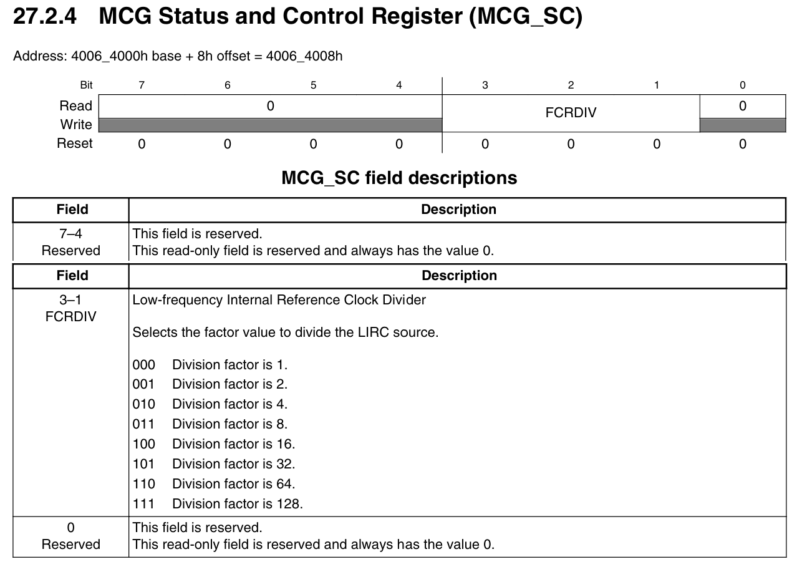<figcaption></figcaption></figure>

`LIRC_DIV2` is configured in **MCG Miscellaneous Control Register** (`MCG_MC`).

<figure>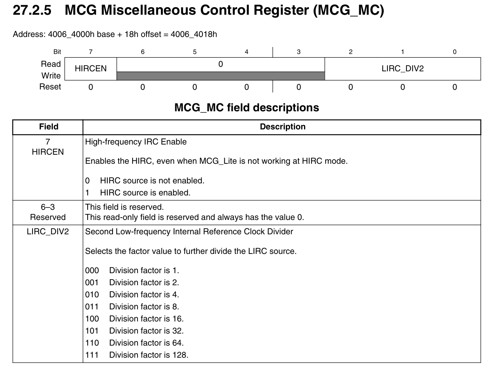<figcaption></figcaption></figure>

For example, we want to keep the clock at 8 MHz, so we will set both dividers to divide by **1**:

```c
// FCRDIV = 000 -> divide by 1
MCG->SC &= ~MCG_SC_FCRDIV_MASK;
MCG->SC |= MCG_SC_FCRDIV(0b000);

// LIRC_DIV2 = 000 -> divide by 1
MCG->MC &= ~MCG_MC_LIRC_DIV2_MASK;
MCG->MC |= MCG_MC_LIRC_DIV2(0b000);
```

Therefore,

$$
f_{\text{MCGIRCLK}} = \frac{8\text{ MHz}}{1\times1} = 8\text{ MHz}
$$



Putting our example together, to configure an 8MHZ LIRC clock, the full code is as follows:


```c
void setMCGIRClk()
{
    // 1. Select LIRC and enable internal reference clock
    MCG->C1 &= ~MCG_C1_CLKS_MASK;
    MCG->C1 |= MCG_C1_CLKS(0b01) | MCG_C1_IRCLKEN_MASK;

    // 2. Select 8 MHz LIRC
    MCG->C2 |= MCG_C2_IRCS_MASK;

    // 3. FCRDIV = 1
    MCG->SC &= ~MCG_SC_FCRDIV_MASK;
    MCG->SC |= MCG_SC_FCRDIV(0b000);

    // 4. LIRC_DIV2 = 1
    MCG->MC &= ~MCG_MC_LIRC_DIV2_MASK;
    MCG->MC |= MCG_MC_LIRC_DIV2(0b000);
}
```


The result is an **8 MHz** `MCGIRCLK`. Note that this only configures the clock **inside the MCG-Lite**; we still need to configure the appropriate clock-routing logic during the [#tpm-setup](lab-02-timer-pwm-adc.md#tpm-setup "mention") to actually feed this clock into the TPM.

### TPM Setup

After configuring the clock source, we can configure the **TPM module itself**. In general, the setup procedure is:

<p align="center"><strong>Disable interrupt -> Enable TPM clock -> Select TPM clock source -> Stop &#x26; initialize TPM -> Choose prescaler and modulo -> Configure interrupt -> Enable interrupt</strong></p>

In the following example, we configure TPM1 to generate an interrupt every **1 second**, using the **8 MHz** `MCGIRCLK` configured previously.



#### Disable the TPM Interrupt

Before modifying the TPM configuration, it is good practice to **temporarily disable its interrupt**. This prevents the TPM from triggering an interrupt while its registers are only partially configured.

For exampe, let's say we want to disable the `TPM1` interrupt:

```c
NVIC_DisableIRQ(TPM1_IRQn);
```

We can then configure the MCG clock as described in the previous section:

```c
setMCGIRClk();
```





#### Enable the TPM Clock

Before accessing a TPM peripheral, we need to enable its **clock gating** through the `SIM_SCGC6` register.

<figure><figcaption></figcaption></figure>

For example, we want to enable `TPM1`:


```c
SIM->SCGC6 |= SIM_SCGC6_TPM1_MASK;
```


This turns on the bus clock supplied to the `TPM1` **peripheral**, allowing it to operate.



#### Select the TPM Clock Source

Next, select the clock that will actually be supplied to the TPM counter. This is controlled by the `TPMSRC` field in **System Options Register 2 (**`SIM_SOPT2`**)**.

<figure>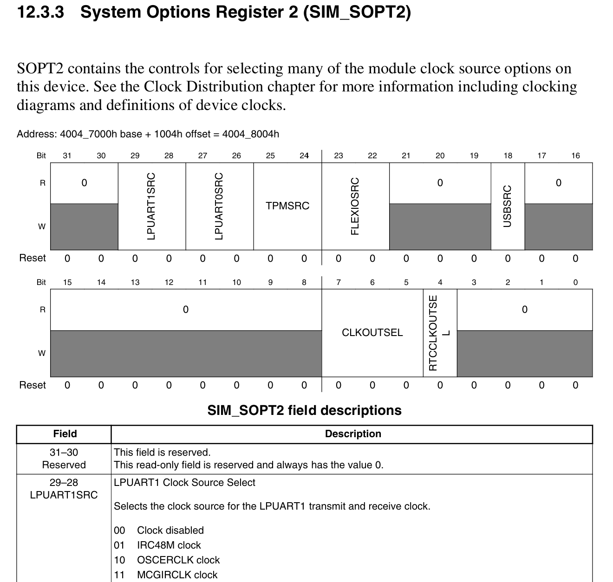<figcaption></figcaption></figure>

For example, we want to select `MCGIRCLK`


```c
SIM->SOPT2 &= ~SIM_SOPT2_TPMSRC_MASK;
SIM->SOPT2 |= SIM_SOPT2_TPMSRC(0b11);
```


Since we previously configured `MCGIRCLK` to **8 MHz,** therefore, the TPM input clock is now:

$$
f_{\text{TPM}}=8\text{ MHz}
$$


This is where we actually **select the TPM clock source**. The `CMOD` field inside the TPM does **not** perform this clock-source selection. Full circle moment here LOL!




#### Stop and Initialize the TPM

Before changing important TPM settings, first **stop the counter** by setting `CMOD = 00`. We should also clear the old prescaler configuration and initialize the counter (`CNT`) to `0`. Both `CMOD` and `PS` are located in the **TPM Status and Control Register (**`TPMx_SC`**)**.

<figure>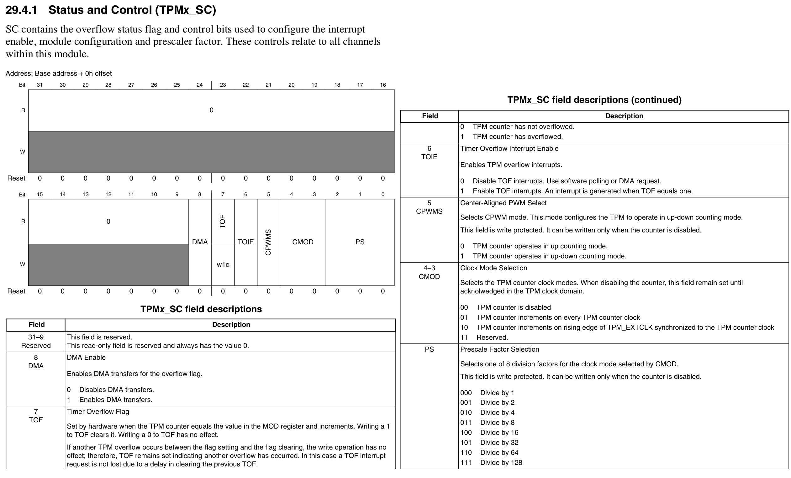<figcaption></figcaption></figure>

The `TPMx_CNT` register field is shown below:

<figure>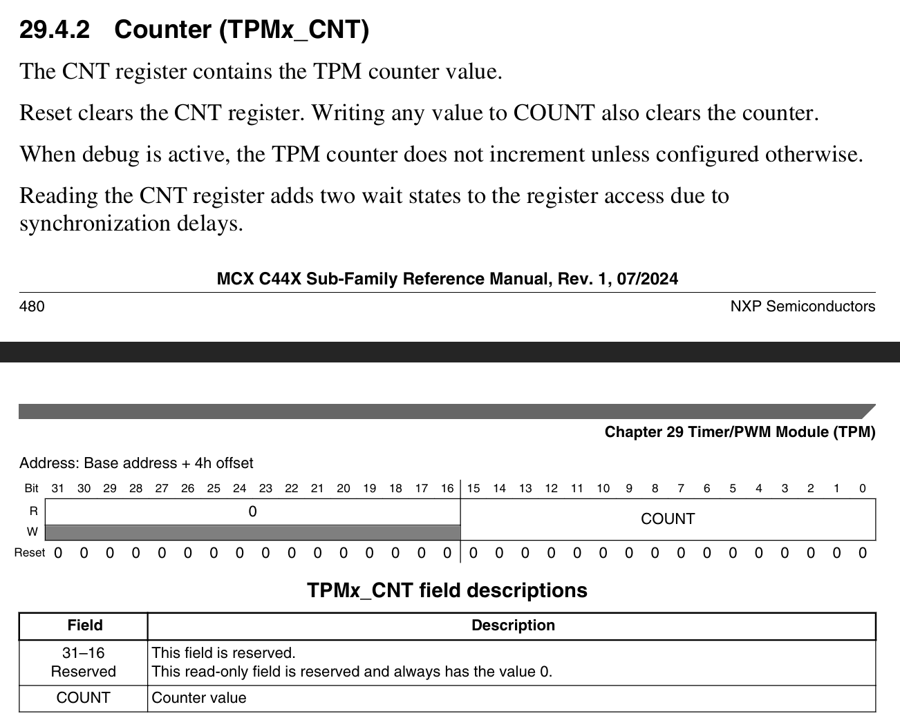<figcaption></figcaption></figure>


Always clear `TPMx_CNT` **before writing `TPMx_MOD`**, as required by the TPM configuration procedure used here.


For rexample, we want to stop and initialize `TPM1`:

```c
// Stop TPM1 and clear the old prescaler
TPM1->SC &= ~(TPM_SC_CMOD_MASK | TPM_SC_PS_MASK);

// Initialize the counter
TPM1->CNT = 0;
```



#### Choose the Prescaler and Modulo

The **prescaler (**`PS`**)** determines how much the TPM input clock is divided before incrementing the counter:

$$
f_{\text{CNT}}=\frac{f_{\text{TPM}}}{PS}
$$

Basically this means that the timer counter (`TPMx_CNT`) is updated (incremented or decremented) every `PS` clock cycles.

The **modulo register (**`TPMx_MOD`**)** then determines when the timer reaches the end of its counting period and sets the **Timer Overflow Flag (**`TOF`**)**. For a desired interrupt period $$T$$, choose `PS` and `MOD` such that approximately

$$
T \approx \frac{\text{PS} \times \text{MOD}}{f_{\text{TPM}}}
$$

For example, if we want to generate a 1-second period with $$f_{\text{TPM}}=8\text{ MHz}$$ and a prescalar of 128:

$$
T_{\text{CNT}} = \frac{128}{8\times10^6} = 16\,\mu s = 0.016\text{ ms}
$$

For a 1-second period:

$$
MOD=\frac{1000\text{ ms}}{0.016\text{ ms}}=62500
$$

Thus, our code will be


```c
// PS = 111 → divide by 128
TPM1->SC |= TPM_SC_PS(0x7);

// Set timer period
TPM1->MOD = 62500;
```



Ideally, choose a prescaler that makes the required `MOD` value an integer while keeping `MOD` within the register's supported range.




#### Enable the TPM Overflow Interrupt

To generate an interrupt when the timer reaches its modulo value, set the **Timer Overflow Interrupt Enable (`TOIE`)** bit in `TPMx_SC`.


The `TOIE` and `TOF` fields are shown in the `TPMx_SC` **documentation inserted in** [**Step 4**](lab-02-timer-pwm-adc.md#choose-the-prescaler-and-modulo).


For example, to enable the `TPM1` overflow interrupt:


```c
TPM1->SC |= TPM_SC_TOIE_MASK;
```




#### Configure and Enable the NVIC Interrupt

Finally, configure the interrupt priority and enable the corresponding TPM interrupt in the **Nested Vectored Interrupt Controller (NVIC)**. For example, to configure `TPM1` for the NVIC:

```c
NVIC_SetPriority(TPM1_IRQn, 0);
NVIC_EnableIRQ(TPM1_IRQn);
```

At this point, TPM1 is configured to generate an interrupt whenever its timer period expires.



Below is the full code to configure and enable a 1-second periodic overflow interrupt on Timer/PWM Module 1 (`TPM1`) using the internal reference clock (`MCGIRCLK`).


```c
void initTimer() {
    // Disable TPM1 interrupt
    NVIC_DisableIRQ(TPM1_IRQn);

    // Initialize the MCG Internal Reference Clock
    setMCGIRClk();

    // Turn on the clock gating
    SIM->SCGC6 |= SIM_SCGC6_TPM1_MASK;

    // Set clock source
    SIM->SOPT2 &= ~SIM_SOPT2_TPMSRC_MASK;

    // Use MCGIRCLK
    SIM->SOPT2 |= SIM_SOPT2_TPMSRC(0b11);

    // Turn off TPM1 and clear the prescalar mask
    TPM1->SC &= ~(TPM_SC_CMOD_MASK | TPM_SC_PS_MASK);

    // Initialize the count to 0
    TPM1->CNT = 0;

    // Set a prescalar of 128, and the TOIE mask
    TPM1->SC |= ((TPM_SC_TOIE_MASK) | TPM_SC_PS(0x7));

    // Initialize modulo.
    // For a PS of 128, time is 128/8000 ms = 0.016 ms
    // For 1 second = 1000 ms, MOD = 1000/0.016 = 62500
    TPM1->MOD = 62500;

    // Set priority to high
    NVIC_SetPriority(TPM1_IRQn, 0);
    NVIC_EnableIRQ(TPM1_IRQn);
}
```


### Timer Interrupt Programming

After configuring the TPM, the final part is to write the **Interrupt Service Routine (ISR)** and start the timer. The general procedure is:

<p align="center"><strong>Define ISR -> Identify interrupt source -> Handle event -> Clear interrupt flag -> Start timer</strong></p>



#### Define the Interrupt Service Routine

Each TPM module has **one interrupt vector** and therefore one corresponding ISR:


```
TPM0_IRQn -> TPM0_IRQHandler()
TPM1_IRQn -> TPM1_IRQHandler()
TPM2_IRQn -> TPM2_IRQHandler()
```


Whenever an enabled interrupt event occurs within a TPM module, the processor executes the corresponding `TPMx_IRQHandler()`. For example, to write ISR for `TPM1`:


```c
void TPM1_IRQHandler(void)
{
    // Handle TPM1 interrupt
}
```




#### Identify the Interrupt Source

Since multiple events can trigger the same TPM ISR, we need to check the appropriate **status flag** to determine what caused the interrupt. For our timer example, we are interested in the **Timer Overflow Flag (`TOF`)**. It is available in the `TPMx_STATUS` register.

<figure>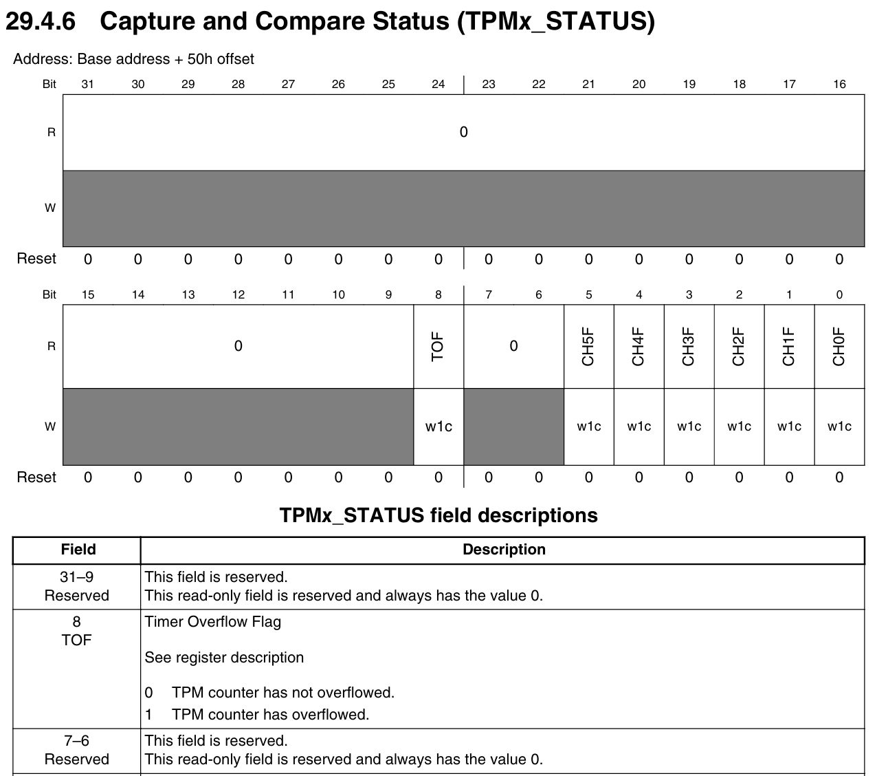<figcaption></figcaption></figure>

For example, to check whether `TPM1` overflowed:


```c
if (TPM1->STATUS & TPM_STATUS_TOF_MASK)
{
    // Timer overflow occurred
}
```




#### Handle the Timer Event

Once we have confirmed that the desired interrupt event occurred, we can perform the required action inside the ISR. For example,


```c
if (TPM1->STATUS & TPM_STATUS_TOF_MASK)
{
    // Perform the required periodic action
}
```


For example, this could be used to update a software counter, set a flag for the main program, or perform another periodic operation.



#### Clear the Interrupt Flag

After handling the event, we must **clear its interrupt flag**. Otherwise, the interrupt may remain pending or immediately trigger again. For `TOF`, the flag is **write-one-to-clear (W1C)**:


```c
TPM1->STATUS |= TPM_STATUS_TOF_MASK;
```


The complete ISR therefore becomes:


```c
void TPM1_IRQHandler(void)
{
    NVIC_ClearPendingIRQ(TPM1_IRQn);

    if (TPM1->STATUS & TPM_STATUS_TOF_MASK)
    {
        // Perform the required periodic action

        // Clear the timer overflow flag
        TPM1->STATUS |= TPM_STATUS_TOF_MASK;
    }
}
```




#### Start the Timer

After both the TPM and its ISR have been fully configured, we can finally **start the timer**. The `CMOD` field in [`TPMx_SC`](lab-02-timer-pwm-adc.md#stop-and-initialize-the-tpm) controls **how the TPM counter is clocked**. For example, to start `TPM1`:


```c
TPM1->SC |= TPM_SC_CMOD(0b01);
```




For TPM1, the final interrupt code is:


```c
void TPM1_IRQHandler(void)
{
    NVIC_ClearPendingIRQ(TPM1_IRQn);

    if (TPM1->STATUS & TPM_STATUS_TOF_MASK)
    {
        // Perform the required periodic action

        // Clear timer overflow flag
        TPM1->STATUS |= TPM_STATUS_TOF_MASK;
    }
}
```


After the TPM and ISR have been configured, start the timer with:


```c
TPM1->SC |= TPM_SC_CMOD(0b01);
```


With the previous example configuration, `TPM1` **will now periodically trigger** `TPM1_IRQHandler()` **approximately once every second**.

## PWM Programming

In this part, we extend the **TPM timer setup** from above to generate **PWM signals**. The TPMs provide a total of **10 PWM outputs**, which can be configured as either **edge-aligned** or **centre-aligned PWM**.


The edge-aligned mode and centre-aligned PWM mode are equivalent to ATMega328P's fast PWM and phase-correct PWM respectively! See more from my notes for [EPP2](https://app.gitbook.com/s/o4X8QvQZjJ2YsPgYhJDb/studio/studio-4-pwm-programming#pwm-concepts) to understand PWM intuitively!


The overall PWM setup can be thought of as:

<p align="center"><strong>Set PWM period -> Configure PWM mode &#x26; polarity -> Set duty cycle -> Start PWM</strong></p>

Before configuring PWM, we need to know **which TPM channel is connected to the desired pin**.

<figure>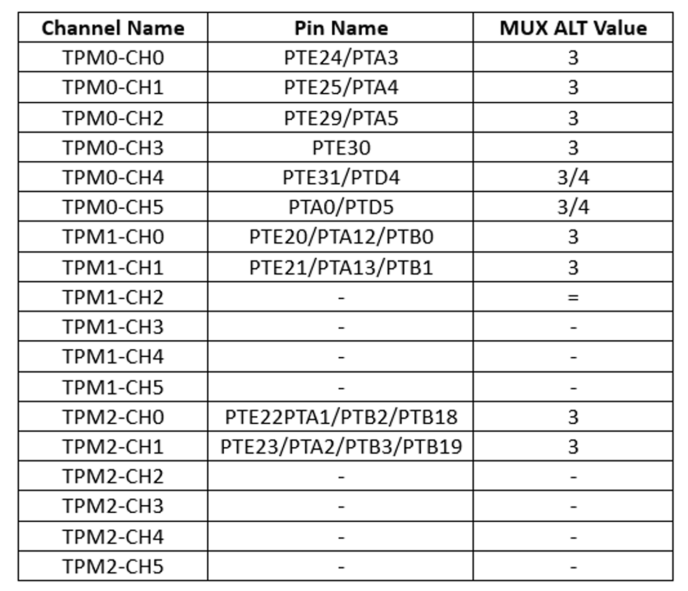<figcaption></figcaption></figure>

For this example, we use **PTE21**, which is connected to:

* **TPM1-CH1**
* Pin multiplexer: **ALT3**

Therefore, all PWM channel settings will be made using **TPM1 Channel 1**.

1. Set PWM Period
2. Set Duty Cycle
3. Set PWM Polariy

### Set PWM Period

The first step is essentially the same as setting up a timer. We configure:

1. **MCG** to provide an **8 MHz** clock.
2. **TPM clock source** to use `MCGIRCLK`.
3. **Prescaler** to divide the clock by **128**.
4. `TPMx_CNT = 0`.
5. `TPMx_MOD` to determine the PWM period.

With an 8 MHz TPM clock and a prescaler of 128:

$$
T_{\text{CNT}}=\frac{128}{8\times10^6}=16\ \mu s
$$

For a desired PWM frequency of [**250 Hz**](#user-content-fn-1)[^1]:

$$
T_{\text{PWM}}=\frac{1}{250}=4\ ms
$$

Because we are using **centre-aligned PWM**, the counter counts **up and down**, so:

$$
T_{\text{PWM}}=2\times MOD\times T_{\text{CNT}}
$$

Therefore,

$$
MOD=\frac{4\ ms}{2\times0.016\ ms}=125
$$

So we use:

```c
TPM1->MOD = 125;
```

Centre-aligned PWM effectively gives **half the frequency** for the same `MOD` compared with ordinary up-counting operation.

<details>

<summary>One difference between Timer Programming: Set center-aligned PWM</summary>

Unlike the timer setup, PWM requires one additional configuration: selecting the **PWM counting mode**. The `CPWMS` bit in `TPMx_SC` determines whether the TPM uses:

* `CPWMS = 0` -> **up-counting / edge-aligned PWM**
* `CPWMS = 1` -> **up-down counting / centre-aligned PWM**

For our example:

```c
TPM1->SC |= TPM_SC_CPWMS_MASK;
```

We therefore use **centre-aligned PWM**.

</details>

So far, the full setup code is as follows:


```c
void initPWM() {
    // Set up MCG and TPM clock source
    setMCGIRClk();

    // Turn on TPM1 clock
    SIM->SCGC6 |= SIM_SCGC6_TPM1_MASK;

    // Select MCGIRCLK as TPM clock source
    SIM->SOPT2 &= ~SIM_SOPT2_TPMSRC_MASK;
    SIM->SOPT2 |= SIM_SOPT2_TPMSRC(0b11);

    // Stop TPM1 and clear prescaler
    TPM1->SC &= ~(TPM_SC_CMOD_MASK | TPM_SC_PS_MASK);

    // Initialize counter
    TPM1->CNT = 0;

    // Prescaler = 128
    TPM1->SC |= TPM_SC_PS(0x7);

    // Centre-aligned PWM
    TPM1->SC |= TPM_SC_CPWMS_MASK;

    // PWM period = 250 Hz
    TPM1->MOD = 125;
}
```



The `setMCGIRClk()` is exactly the same as the one we've seen in the [Timer programming section](lab-02-timer-pwm-adc.md#tpm-setup)!


### Set PWM Duty Cycle

Once the PWM period is fixed by `TPMx_MOD`, we can control **how long the PWM output stays active within each period** by changing the channel value `CnV`. For **TPM1 Channel 1**, the relevant register is:

```c
TPM1->CONTROLS[1].CnV
```

The duty cycle is approximately determined by:

$$
\text{Duty Cycle} \approx \frac{CnV}{MOD}\times100\%
$$

Therefore, we can calculate the required `CnV` from the desired duty cycle:

$$
CnV=\frac{\text{Duty Cycle}}{100}\times MOD
$$

For example, with `MOD = 125`:

* 25% duty cycle -> `CnV ≈ 31`
* 50% duty cycle -> `CnV ≈ 62`
* 75% duty cycle -> `CnV ≈ 93`


Thus, `MOD` **controls the PWM period, while** `CnV` **controls the duty cycle**.


We can wrap this calculation into a helper function:


```c
void setPWM(int percent) {
    int value = (int)((percent / 100.0) * (double)TPM1->MOD);
    TPM1->CONTROLS[1].CnV = value;
}
```


For example `setPWM(50);` sets the PWM to approximately **50% duty cycle**. At this point, the combined example code is as follows:


```c
void initPWM() {
    // Set up MCG and TPM clock source
    setMCGIRClk();

    // Turn on TPM1 clock
    SIM->SCGC6 |= SIM_SCGC6_TPM1_MASK;

    // Select MCGIRCLK as TPM clock source
    SIM->SOPT2 &= ~SIM_SOPT2_TPMSRC_MASK;
    SIM->SOPT2 |= SIM_SOPT2_TPMSRC(0b11);

    // Stop TPM1 and clear prescaler
    TPM1->SC &= ~(TPM_SC_CMOD_MASK | TPM_SC_PS_MASK);

    // Initialize counter
    TPM1->CNT = 0;

    // Prescaler = 128
    TPM1->SC |= TPM_SC_PS(0x7);

    // Centre-aligned PWM
    TPM1->SC |= TPM_SC_CPWMS_MASK;

    // PWM period = 250 Hz
    TPM1->MOD = 125;

    // Set 50% duty cycle
    setPWM(50);
}
```


### Configure PWM Output Mode & Polarity

The period and duty cycle determine the **timing** of the PWM signal. We now need to configure **how the TPM channel drives the physical pin**. For our example:

<p align="center"><strong>PTE21 -> TPM1_CH1 -> ALT3</strong></p>

Therefore, we first configure PTE21 to use the TPM1 channel rather than its normal GPIO function. This is done through the [**pin-multiplexing**](lab-01-intro-gpio-interrupt.md#pin-multiplexing) we've learned in Lab 01!

```c
SIM->SCGC5 |= SIM_SCGC5_PORTE_MASK;

PORTE->PCR[PWM_PIN] &= ~PORT_PCR_MUX_MASK;
PORTE->PCR[PWM_PIN] |= PORT_PCR_MUX(0b11);
```

We then configure the channel through:

```c
TPM1->CONTROLS[1].CnSC
```

The important fields are:

* `MSnB:MSnA` -> selects the **PWM mode**
* `ELSnB:ELSnA` -> selects the **PWM polarity**

<figure>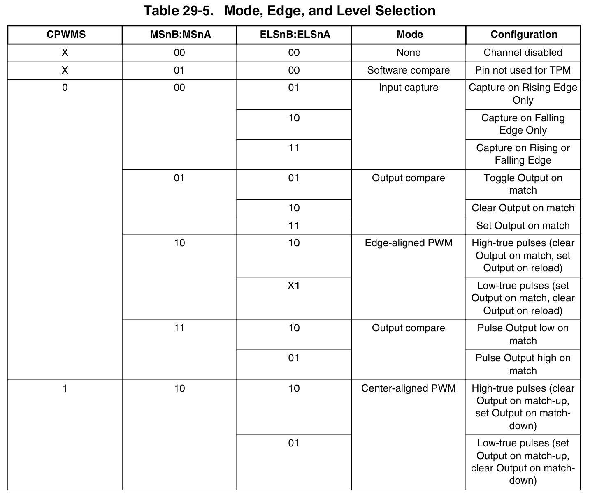<figcaption></figcaption></figure>

Since we are using centre-aligned PWM:

$$
MS_nB:MS_nA=0b10
$$

This selects **centre-aligned PWM output**. For a conventional **high-true PWM** signal:

$$
ELS_nB:ELS_nA=0b10
$$

With this setting, the output is active during the appropriate part of the up/down count, producing a conventional PWM waveform. Setting `ELS = 01` would instead produce the opposite polarity, i.e. **low-true PWM**.

<details>

<summary>High-True vs. Low-True</summary>

High-true PWM **clears the pin when the counter matches** `CnV` **while counting up**, whereas low-true PWM **sets the pin at the same point**. The two modes are illustrated in the following image.

<figure>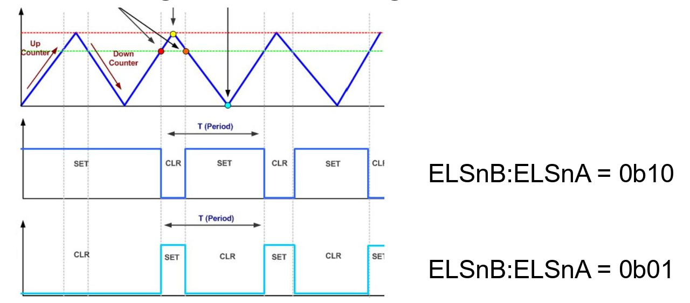<figcaption></figcaption></figure>

Importantly, in both modes, **increasing `CnV` increases the duty cycle**. The difference is simply the **polarity of the output signal**: high-true PWM is active-high, while low-true PWM is active-low.

</details>

For TPM1 Channel 1, we therefore configure:


```c
// Configure TPM1 Channel 1
// MS = 10: Centre-aligned PWM
// ELS = 10: High-true PWM
TPM1->CONTROLS[1].CnSC &= ~(TPM_CnSC_MSA_MASK | TPM_CnSC_ELSA_MASK);
TPM1->CONTROLS[1].CnSC |= TPM_CnSC_MSB_MASK | TPM_CnSC_ELSB_MASK;
```


Combining this with the previous sections:


```c
void initPWM() {
    // Set up MCG and TPM clock source
    setMCGIRClk();

    // Turn on TPM1 clock
    SIM->SCGC6 |= SIM_SCGC6_TPM1_MASK;

    // Select MCGIRCLK as TPM clock source
    SIM->SOPT2 &= ~SIM_SOPT2_TPMSRC_MASK;
    SIM->SOPT2 |= SIM_SOPT2_TPMSRC(0b11);

    // Configure PTE21 as TPM1_CH1 (ALT3)
    SIM->SCGC5 |= SIM_SCGC5_PORTE_MASK;
    PORTE->PCR[PWM_PIN] &= ~PORT_PCR_MUX_MASK;
    PORTE->PCR[PWM_PIN] |= PORT_PCR_MUX(0b11);

    // Stop TPM1 and clear prescaler
    TPM1->SC &= ~(TPM_SC_CMOD_MASK | TPM_SC_PS_MASK);

    // Initialize counter
    TPM1->CNT = 0;

    // Prescaler = 128
    TPM1->SC |= TPM_SC_PS(0x7);

    // Centre-aligned PWM
    TPM1->SC |= TPM_SC_CPWMS_MASK;

    // PWM period = 250 Hz
    TPM1->MOD = 125;

    // Configure Channel 1:
    // MS = 10: Centre-aligned PWM
    // ELS = 10: High-true PWM
    TPM1->CONTROLS[1].CnSC &= ~(TPM_CnSC_MSA_MASK |
                                 TPM_CnSC_ELSA_MASK);
    TPM1->CONTROLS[1].CnSC |= TPM_CnSC_MSB_MASK |
                              TPM_CnSC_ELSB_MASK;

    // Set 50% duty cycle
    setPWM(50);
}
```


At this point, the PWM is **configured**, but it is not yet running. We finally start the TPM by setting `CMOD = 01`:


```c
TPM1->SC |= TPM_SC_CMOD(0b01);
```


## ADC Programming

An **Analog-to-Digital Converter (ADC)** converts an analog input voltage into a **digital value** that can be processed by the microcontroller.


For a detailed knowledge of what is an ADC, please feel free to go to my [EPP2 notes](https://app.gitbook.com/s/o4X8QvQZjJ2YsPgYhJDb/studio/studio-8-adc-module#adc-concepts)!


The MCXC444 ADC supports up to **16-bit resolution** and multiple input channels. In this section, we use the onboard **visible-light sensor**, which is connected to:

<p align="center">PTE22 -> ADC0_SE3</p>

The overall procedure is:

1. Configure ADC
2. Start Conversion
3. Wait for Conversion Complete
4. Read Result

### ADC Setup

Before performing any conversion, we first configure the **ADC peripheral, input pin, and conversion settings**. The general setup procedure is:

1. Enable clocks
2. Configure ADC pin
3. Configure conversion mode
4. Configure resolution
5. Configure trigger & reference
6. Configure conversion behavior
7. Configure interrupt

#### Enable ADC and Port Clocks

Just like the TPM and GPIO peripherals, we must first enable **clock gating** before using the ADC. For `ADC0`:

```c
SIM->SCGC6 |= SIM_SCGC6_ADC0_MASK;
```

Since our light sensor is connected to **PTE22**, we also enable Port E:

```c
SIM->SCGC5 |= SIM_SCGC5_PORTE_MASK;
```

#### Configure the ADC Input Pin

Next, configure PTE22 for its ADC function. For: `PTE22 -> ADC0_SE3`, the required multiplexer setting is **ALT0**:


```c
#define ADC_PIN 22

PORTE->PCR[ADC_PIN] &= ~PORT_PCR_MUX_MASK;
PORTE->PCR[ADC_PIN] |= PORT_PCR_MUX(0);
```


The following table shows the mapping between physical pins and ADC channels.

<figure>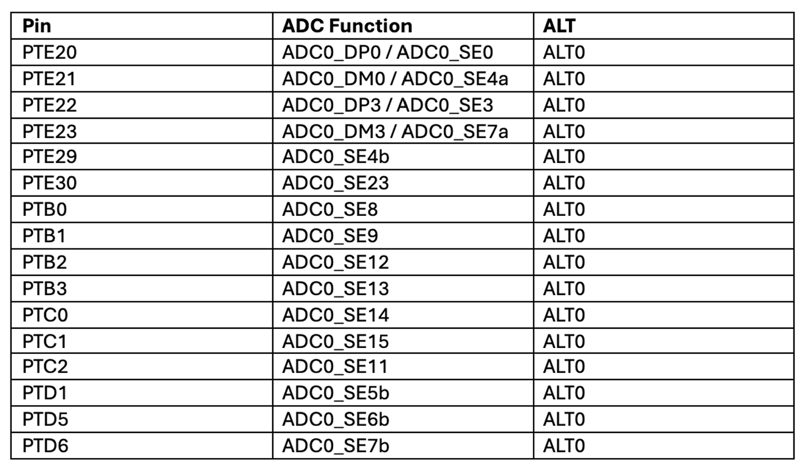<figcaption></figcaption></figure>

#### Configure the Conversion Mode

The **Status and Control Register 1 (**`ADC0_SC1`**)** controls several basic properties of a conversion.

<figure>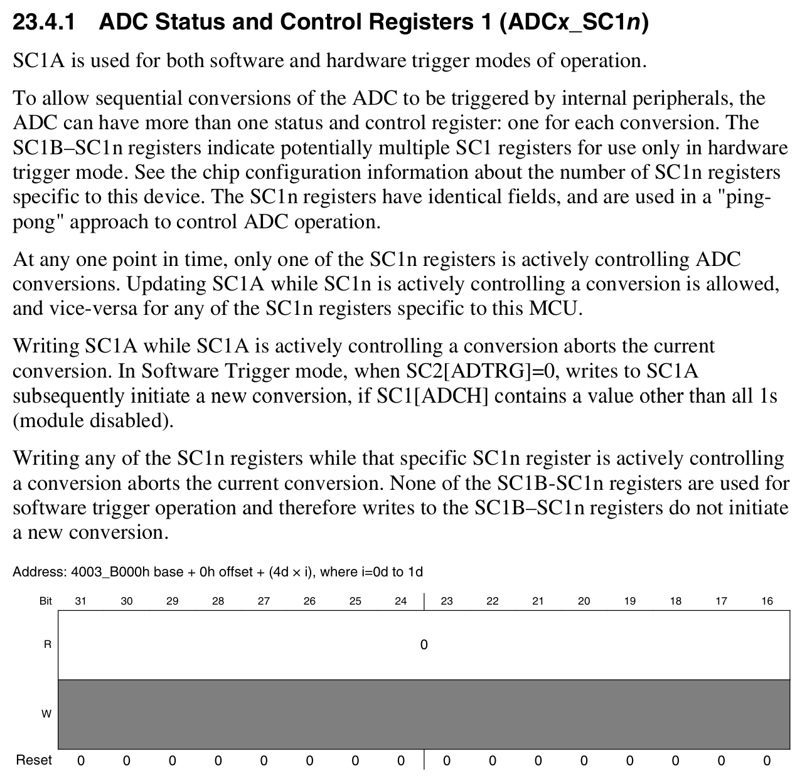<figcaption></figcaption></figure>

For `ADC0_SE3`, we use:

```c
ADC0->SC1[0]
```

because `SE3` is not one of the special `"b"` channels. For our application:

* `AIEN = 1` -> enable **conversion-complete interrupt**
* `DIFF = 0` -> use **single-ended conversion**


```c
// Enable ADC interrupt
ADC0->SC1[0] |= ADC_SC1_AIEN_MASK;

// Use single-ended ADC
ADC0->SC1[0] &= ~ADC_SC1_DIFF_MASK;
ADC0->SC1[0] |= ADC_SC1_DIFF(0b0);
```


#### Configure ADC Resolution

The **ADC Configuration Register 1 (**`ADC0_CFG1`**)** controls properties such as the ADC resolution, clock divider, power mode and sample time.

<figure>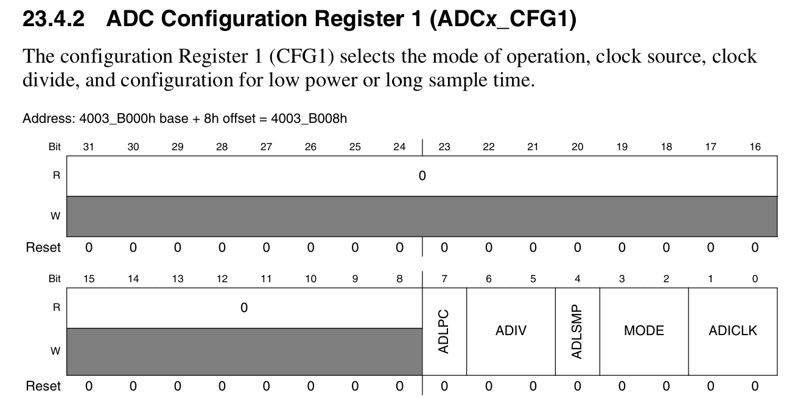<figcaption></figcaption></figure>

For this section, we leave the other settings at their defaults and configure:

$$
MODE=01
$$

which gives **12-bit single-ended conversion**.


```c
ADC0->CFG1 &= ~ADC_CFG1_MODE_MASK;
ADC0->CFG1 |= ADC_CFG1_MODE(0b01);
```


With a 12-bit ADC, the conversion result therefore has $$2^{12}=4096$$ possible digital levels. The following table summarizes the `MODE` register field in the `ADCx_CFG1` register.

<figure>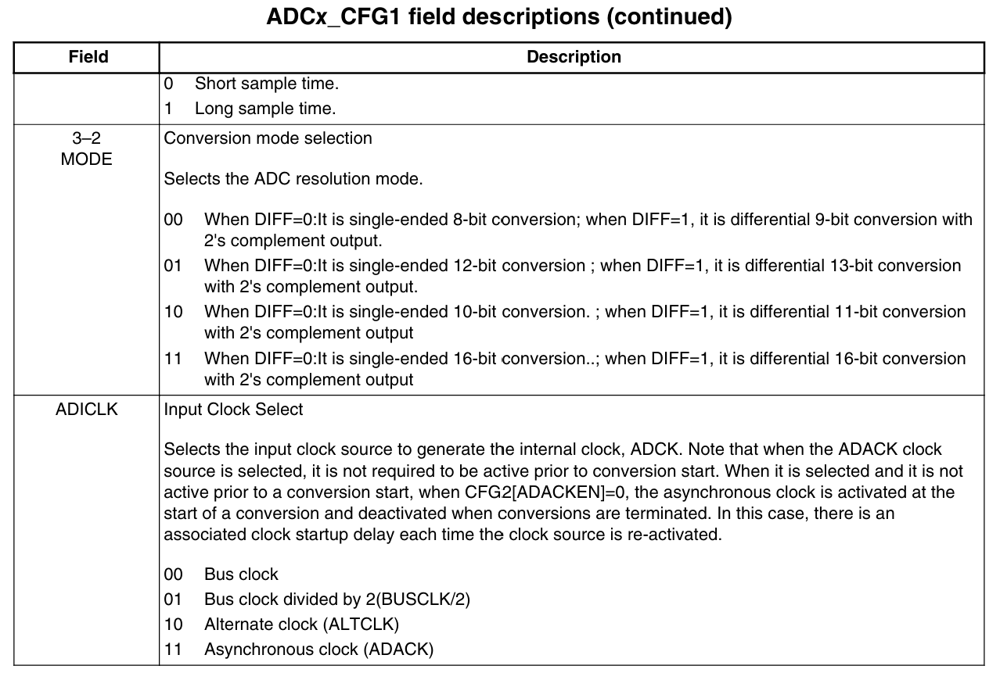<figcaption></figcaption></figure>


The reason why `DIFF` (differential mode) has one more bit is for it to represent the negative value!


#### Configure Trigger and Voltage Reference

The **Status and Control Register 2 (**`ADC0_SC2`**)** controls, among other things:

* `ADTRG` -> **how a conversion is triggered**
* `REFSEL` -> **which reference voltages the ADC uses**

<figure>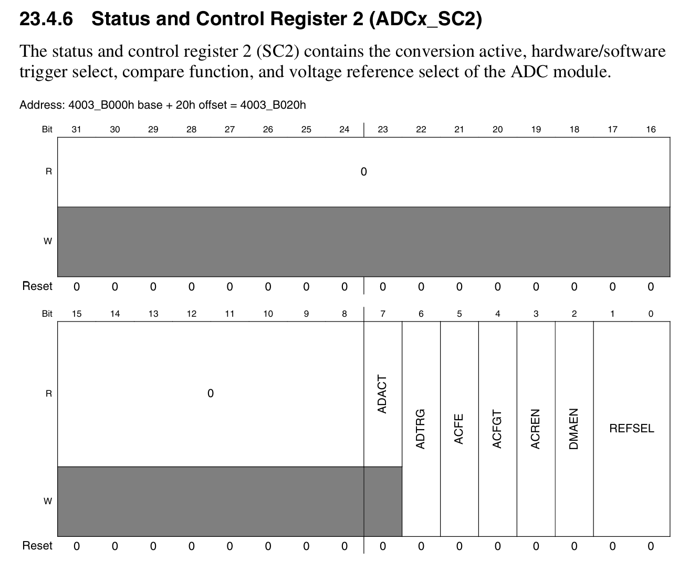<figcaption></figcaption></figure>

For our example, we want to start conversions through **software**, so:

$$
ADTRG=0
$$

```c
ADC0->SC2 &= ~ADC_SC2_ADTRG_MASK;
```

We also select the board's alternate reference voltages **VALTH and VALTL**:

$$
REFSEL=01
$$

```c
ADC0->SC2 &= ~ADC_SC2_REFSEL_MASK;
ADC0->SC2 |= ADC_SC2_REFSEL(0b01);
```

The following table gives the full register field description for `ADCx_SC2`:

<figure>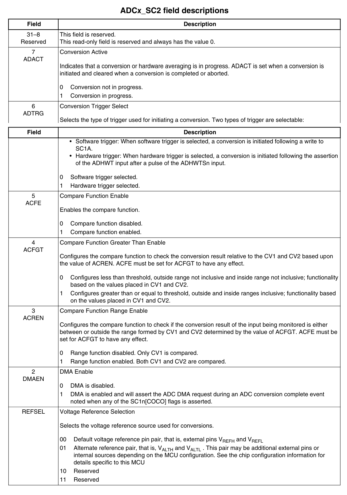<figcaption></figcaption></figure>

#### Configure Conversion Behavior

Finally, `ADC0_SC3` controls features such as:

* hardware averaging
* continuous conversion
* calibration

<figure>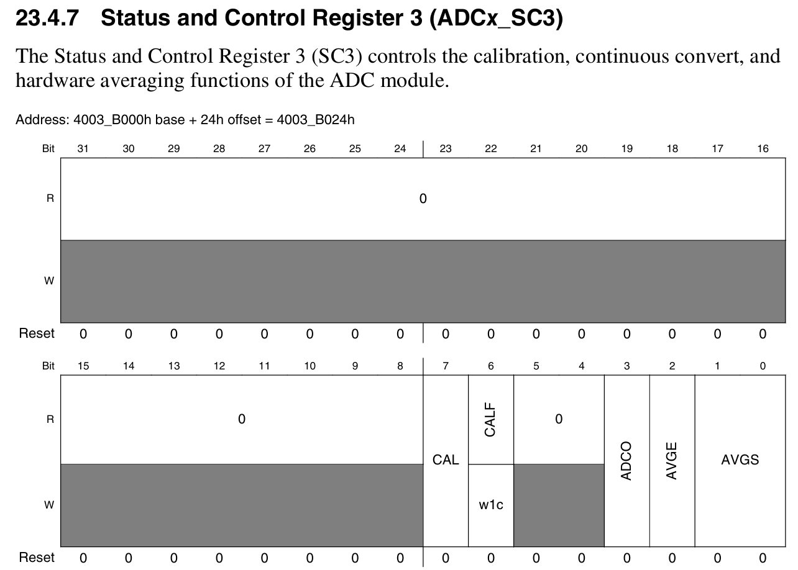<figcaption></figcaption></figure>

For this section, we **disable hardware averaging**:

```c
ADC0->SC3 &= ~ADC_SC3_AVGE_MASK;
ADC0->SC3 |= ADC_SC3_AVGE(0);
```

and enable **continuous conversion** so that **another conversion automatically begins after the previous conversion finishes**.

```c
ADC0->SC3 &= ~ADC_SC3_ADCO_MASK;
ADC0->SC3 |= ADC_SC3_ADCO(1);
```

The following table summarizes the register field for `ADCx_SC3`:

<figure>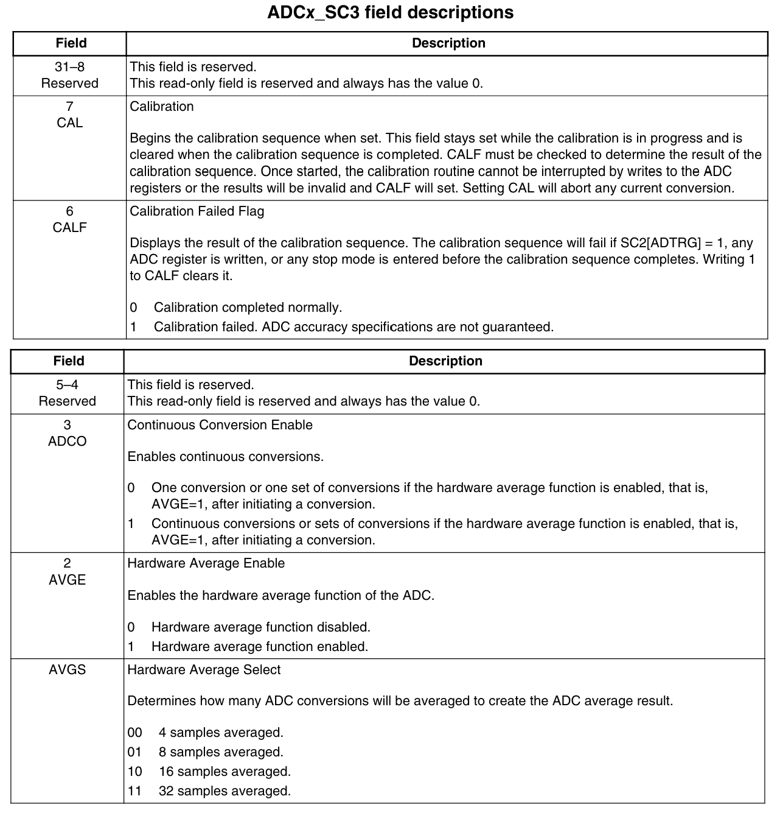<figcaption></figcaption></figure>

#### Configrue ADC Interrupt

Since we previously set `AIEN = 1`, `ADC0` can generate an `ADC0_IRQn` whenever a conversion completes. We therefore configure and enable the corresponding NVIC interrupt:


```c
NVIC_DisableIRQ(ADC0_IRQn);
NVIC_ClearPendingIRQ(ADC0_IRQn);

NVIC_SetPriority(ADC0_IRQn, 192);
NVIC_EnableIRQ(ADC0_IRQn);
```


#### Combined ADC Setup

The combined ADC Setup code for reference is shown as follows:


```c
void initADC() {

    // Enable clock gating to ADC0 and Port E
    SIM->SCGC6 |= SIM_SCGC6_ADC0_MASK;
    SIM->SCGC5 |= SIM_SCGC5_PORTE_MASK;

    // Configure PTE22 as ADC0_SE3 (ALT0)
    PORTE->PCR[ADC_PIN] &= ~PORT_PCR_MUX_MASK;
    PORTE->PCR[ADC_PIN] |= PORT_PCR_MUX(0);

    // Enable conversion-complete interrupt
    ADC0->SC1[0] |= ADC_SC1_AIEN_MASK;

    // Use single-ended conversion
    ADC0->SC1[0] &= ~ADC_SC1_DIFF_MASK;
    ADC0->SC1[0] |= ADC_SC1_DIFF(0);

    // Use 12-bit resolution
    ADC0->CFG1 &= ~ADC_CFG1_MODE_MASK;
    ADC0->CFG1 |= ADC_CFG1_MODE(0b01);

    // Use software trigger
    ADC0->SC2 &= ~ADC_SC2_ADTRG_MASK;

    // Use VALTH and VALTL as voltage reference
    ADC0->SC2 &= ~ADC_SC2_REFSEL_MASK;
    ADC0->SC2 |= ADC_SC2_REFSEL(0b01);

    // Disable hardware averaging
    ADC0->SC3 &= ~ADC_SC3_AVGE_MASK;
    ADC0->SC3 |= ADC_SC3_AVGE(0);

    // Enable continuous conversion
    ADC0->SC3 &= ~ADC_SC3_ADCO_MASK;
    ADC0->SC3 |= ADC_SC3_ADCO(1);

    // Configure ADC interrupt
    NVIC_DisableIRQ(ADC0_IRQn);
    NVIC_ClearPendingIRQ(ADC0_IRQn);
    NVIC_SetPriority(ADC0_IRQn, 192);
    NVIC_EnableIRQ(ADC0_IRQn);
}
```


### Start ADC Conversion

Once the ADC is configured, we still need to tell it **which analog channel to convert**. This is controlled by the `ADCH` field in `ADC0_SC1`:

* `ADCH = 11111` -> disable/stop conversions
* Any valid ADC channel -> **select that channel and start conversion**

Therefore, starting a conversion is essentially:


```c
ADC0->SC1[0] &= ~ADC_SC1_ADCH_MASK;
ADC0->SC1[0] |= ADC_SC1_ADCH(channel);
```



Writing the channel number into `ADCH` does two things at once:

1. it selects the ADC input channel and
2. starts the software-triggered conversion.


Because we enabled **continuous conversion (**`ADCO = 1`**)**, once this first conversion is started, a new conversion automatically begins whenever the previous one finishes.

### ADC Interrupt & Read Result

Since we enabled `AIEN`, completing a conversion generates an interrupt that will be routed to and handled by the ISR. Inside the ISR, we first check the **Conversion Complete (`COCO`)** flag in `ADC0_SC1`. If `COCO = 1`, the ADC conversion has completed and the digital result can be read from: `ADC0->R[0]`. Therefore,


```c
void ADC0_IRQHandler(void)
{
    NVIC_ClearPendingIRQ(ADC0_IRQn);

    if (ADC0->SC1[0] & ADC_SC1_COCO_MASK)
    {
        int result = ADC0->R[0];

        // Use ADC result
    }
}
```


[^1]: This is a magic number that we prefer.
