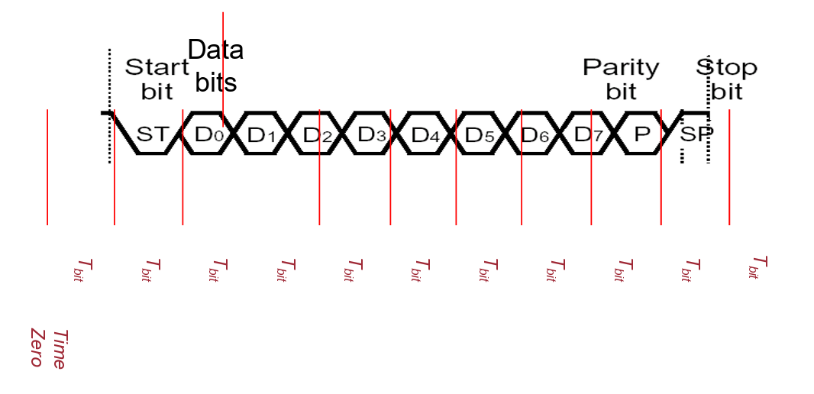
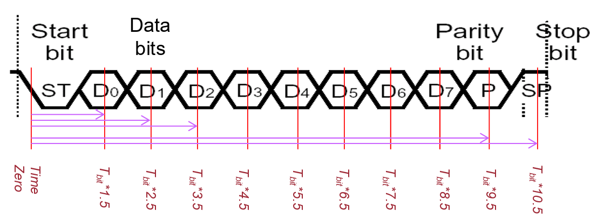
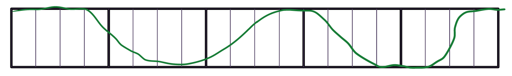
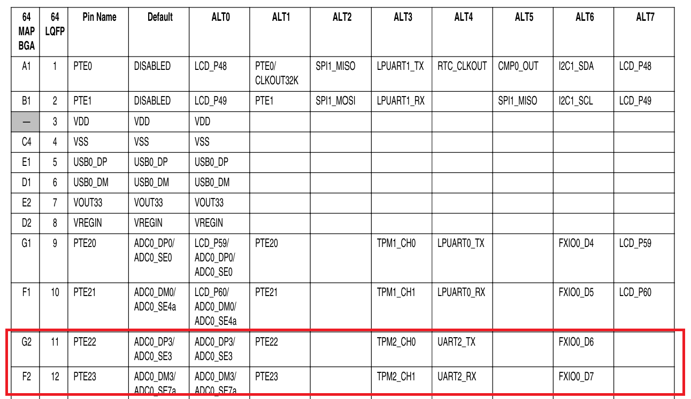
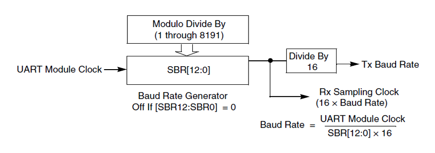
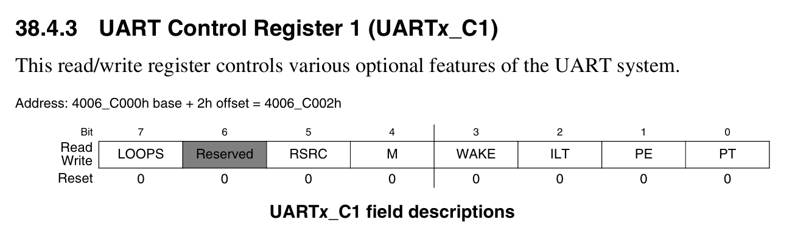
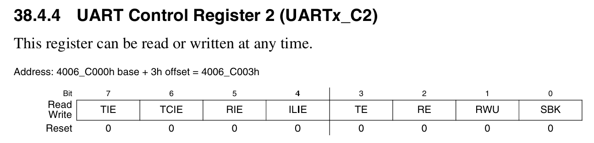

# Lab 03 - RTOS & UART

In this Lab, we are going to introduce two main things:

1. RTOS
2. UART

## RTOS

We are already familiar with **mainstream operating systems** such as macOS, Windows, and Linux. They make computer hardware easy to use:

* **Hardware abstraction:** We do not need to program hardware such as keyboards and screens directly.
* **Device drivers:** We can use hardware from different manufacturers through device drivers provided by the OS.
* **User interaction:** Users interact with the computer through the OS, often via a **shell**.
* The **OS starts and manages applications**.

A **Real-Time Operating System (RTOS)** has a different focus. It is designed for **small size, high speed, reliability, and guaranteed deadlines**.

* **Small size:** Most hardware still needs to be programmed **bare-metal**, but the RTOS provides facilities for managing tasks and synchronizing/communicating between them.
* **Tasks:** An RTOS manages multiple **tasks**, which are similar to [threads](https://app.gitbook.com/s/5cfVJRHhgDkjMTtQIPfW/concurrency/introduction) and are usually implemented as functions with infinite loops.
* **High speed & reliability:** The RTOS is designed to provide predictable and dependable execution.
* **Guaranteed deadlines:** We've already seen this in the [RTOS scheduling lecture](https://app.gitbook.com/s/5cfVJRHhgDkjMTtQIPfW/virtualization/cpu-virtualization/scheduling#real-time-systems). For example, we can use **critical-instance analysis** to determine whether a set of tasks is schedulable.
* **No shell:** An RTOS does not focus on user interaction, so there is typically no shell.


A key differnce between Normal OS and RTOS is that in **normal OS:** OS starts the application, while in **RTOS:** The application creates its tasks and then **starts the OS**.


### RTOS Tasks

In an RTOS, **tasks** are mainly used for three types of work:

1. **Controlling actuators**: Each actuator can have its own task, but **groups of similar actuators** may be easier to control with a single task. e.g., _controlling four motors of a robot with one task._
2. **Polling sensors that do not support interrupts**: A task can periodically check the sensor for new data. _General rule: one task per sensor, although similar sensors may share a task._
3. **Handling data from sensors that trigger interrupts**: An ISR can detect the event, while a task handles the actual data processing. e.g., _radios, networking cards, and microswitches._

> But why use a task? Why not do everything inside the ISR?

Don't worry, we will answer this in the next section! For now, let's first learn how to use the **FreeRTOS API** to create and manage tasks.

#### Create FreeRTOS Tasks

As we've already mentioned earlier, RTOS tasks are very similar to threads. Thus, creating tasks in RTOS is very similar to creating threads using the `pthread` library in POSIX. In FreeRTOS, we use `xTaskCreate()` to create a task and `xTaskCreate()` has the following parameters:


```c
xTaskCreate(taskfun, taskname, stacksize, handle, priority, parameter);
```


1. `taskfun`: Pointer to the **task function** to be executed.
2. `taskname`: Name of the task, mainly for **debugging**. It is recommended to use a **unique name** for each task to make debugging easier.
3. `stacksize`: Amount of stack allocated to the task, measured in **words**, not bytes. Thus, `configMINIMAL_STACK_SIZE + 100` allocates the minimum stack size plus **100 words**.
4. `handle`: Pointer used to store the **task handle**, which allows us to refer to the task later. Use `NULL` when the handle is not needed.
5. `priority`: Priority of the task. **Larger number = higher priority** in FreeRTOS.
6. `parameter`: Parameter passed to the task function. It can be used to pass task-specific data to the same task function.

The code below creates **10 tasks using the same task function** `dosum()`, but gives each task a different name and parameter.&#x20;


```c
static void dosum(void *param) {
    while(1) {
        sum++;
        vTaskSuspend(NULL);
    }
}

int main() {
    char taskname[20];

    for(i=0; i<10; i++) {
        sprintf(taskname, "dosum_%d", i);
        xTaskCreate(dosum, taskname,
                    configMINIMAL_STACK_SIZE+100,
                    NULL, 1, (void *) i);
    }
}
```


This is similar to using the same function to create multiple POSIX threads.


#### One-shot Tasks

Although RTOS tasks generally run inside an infinite `while(1)` loop, a task can terminate its execution after completing its work by calling `vTaskSuspend(NULL)`. Thus, a task that runs only once (without an infinite loop) is sometimes called a **one-shot task**.


Regarding the RTOS tasks, there are two very important tips as follows:

* **Pre-emption is enabled by default** on the ARM Cortex-M0+ version of FreeRTOS.
  * A **higher-priority task** will pre-empt a lower-priority task as soon as it becomes **Ready**.
* **Time-slicing is disabled by default**.
  * Therefore, if two tasks have the **same priority**, FreeRTOS will **not automatically switch between them**.
  * If the current task never gives up the CPU, the other task may **never get a chance to run**.


```c
static void task1(void *p) {
    while(1) {
        PRINTF("TASK 1\r\n");
    }
}

static void task2(void *p) {
    while(1) {
        PRINTF("TASK 2\r\n");
    }
}

int main() {
    xTaskCreate(task1, "task1",
                configMINIMAL_STACK_SIZE+100,
                NULL, 1, NULL);

    xTaskCreate(task2, "task2",
                configMINIMAL_STACK_SIZE+100,
                NULL, 1, NULL);
}
```


For example, in the code above, let's assume both `task1` and `task2` have priority `1` and both run continuously inside `while(1)`. Since time-slicing is off and neither task gives up the CPU, **one task can occupy the CPU indefinitely while the other does not run**.


This leads directly to the next section: **how a task can yield the CPU**, for example by calling `vTaskDelay()`.


#### Yield the CPU

To solve the problem mentioned above, a task needs to **yield the CPU** (e.g. by calling `vTaskDelay()`) to allow another task at the **same or lower priority** to run. For example, in the code above, we can add `vTaskDelay()` inside each task:


```c
static void task1(void *p) {
    while(1) {
        PRINTF("TASK 1\r\n");
        vTaskDelay(pdMS_TO_TICKS(250)); // Delay for 250 ms
    }
}

static void task2(void *p) {
    while(1) {
        PRINTF("TASK 2\r\n");
        vTaskDelay(pdMS_TO_TICKS(250)); // Delay for 250 ms
    }
}
```


Here, after printing, each task enters the **Blocked state** for 250 ms and therefore gives up the CPU. This allows the other task, which has the same priority, to run.


`vTaskDelay()` does not merely create a delay. It also **gives the CPU to other ready tasks** while the current task is blocked.


The delay is specified in **FreeRTOS ticks**, so we normally use `pdMS_TO_TICKS()` to convert milliseconds into ticks:


```c
vTaskDelay(pdMS_TO_TICKS(250)); // Delay for 250 ms
```


### Integrating Interrupts with Tasks

In this section, we focus on one question left from above:

> Why use a task? Why not do everything (including processing) inside the ISR?

In an RTOS, **tasks have software-managed priorities**. With pre-emption enabled, a **higher-priority task can pre-empt a lower-priority task**.


In FreeRTOS, a **larger priority number means a higher priority**.


Interrupts, however, have their own **hardware-managed priorities** through the NVIC. For example, in the MCXC444:

$$
00\;(\text{highest}),\quad 64,\quad 128,\quad 192\;(\text{lowest})
$$

This creates an important issue when integrating **interrupts with RTOS tasks**. A hardware interrupt can occur at any time and is handled directly by the CPU, **bypassing the RTOS task scheduler**. Therefore, an ISR can temporarily prevent tasks from running, regardless of their task priorities.


In the worst case, even a **low-priority ISR can delay a high-priority task**.


Therefore, when designing ISRs in an RTOS, we need to follow several important principles to ensure that interrupts do not unnecessarily interfere with task scheduling.

#### Rules for designing ISRs

The main rules for designing ISRs are:

1. **Keep the ISR as short as possible**: The ISR should perform only the **essential, time-critical work** and defer other processing to a task. This addresses the question raised at the start!
2. **Do not make blocking calls inside an ISR**: An ISR must never call operations such as `wait(semaphore)`.
3. **Avoid functions that may make blocking calls**: Do not call library or wrapper functions whose internal behaviour makes a blocking call.
4. **Avoid slow operations**: An ISR should not perform time-consuming operations, such as sending large amounts of data through a serial port. This naturally follows from the first rule: **the ISR should finish as quickly as possible**.

Following these rules **reduces the time for which an ISR can interfere with tasks or other interrupts**.


"Reduce" does not mean that interrupts will never block other tasks or interrupts. An ISR will still temporarily pre-empt normal execution; the goal is simply to ensure that this interruption lasts for as **short a time as possible**.


#### Binary Semaphores in FreeRTOS

In **FreeRTOS**, which we use in **NUS CG2271**, we will mainly work with **binary semaphores**. As we've already seen from the [lecture](https://app.gitbook.com/s/5cfVJRHhgDkjMTtQIPfW/concurrency/semaphores#binary-semaphores), a binary semaphore has a value of either **0 or 1** and maintains a **queue of tasks waiting for the semaphore**. The equivalent FreeRTOS operations corresponding to the `wait()` and `signal()` operations from the lecture are:



#### `take()` — equivalent to `wait()`

When a task tries to **take** the semaphore:

* **Semaphore = 1:** the task takes it, changing the value from **1 -> 0**, and continues execution.
* **Semaphore = 0:** the semaphore is unavailable, so the task is **blocked** and placed in the semaphore's waiting queue.



#### `give()` — equivalent to `signal()`

When a task **gives** the semaphore:

* **Semaphore = 0, waiting queue empty:** change **0 -> 1** and continue.
* **Semaphore = 0, waiting queue not empty:** unblock one waiting task. The semaphore remains unavailable to other tasks.
* **Semaphore = 1:** do nothing, since the semaphore is already available.



> Why do we need to use semaphores to interface between ISRs and tasks? What resources do they share?

An **ISR and a task often need to coordinate the occurrence of an event or access to related data/resources**. Since the ISR should remain short, it can **give a semaphore** to notify a task that an event has occurred, and the task can then **take the semaphore** and perform the actual processing. For example, this may involve a button press, timer expiration, data arrival, or DMA completion. The shared resource is not necessarily a physical variable; it may simply be the **event itself or data associated with the event**, such as a received-data buffer or DMA buffer.


In FreeRTOS, a binary semaphore is typically created with an **initial value of 0**, so it must first be `give()`n before a task can successfully `take()` it. And we will see the exact name for `take()` and `give()` used in FreeRTOS in the following example soon!


#### An Example

In FreeRTOS, we usually use the following steps to use binary semaphores to interface between ISRs and tasks.

1. Create a binary semaphore initialized to 0 (default in FreeRTOS)
2. Tasks waits on the semaphore.
   1. If the semaphore has not yet triggered, the semaphore is 0 and the task blocks.
   2. If the ISR has already been triggered, the semaphore is 1 and the task proceeds. (Unlike the lecture notes, ISR don't need to call `wait(semaphore)` at start)
3. ISR gives (signals) on the semaphore
   1. If there is a task waiting, it is unblocked and allowed to run. (that unblocked task will also call `signal()` to make sure that the semaphore is 1 when it finishes)
   2. If no task is waiting, the semaphore is simply incremented to 1.

For example, to implement a task waiting for a string coming over the UART.


```c
SemaphoreHandle_t sema;    // Semaphore

// Data received from UART
char recvBuffer[128];

void UART2_FLEXIO_IRQHandler(void)
{
    static int currpos = 0;
    char data;

    NVIC_ClearPendingIRQ(UART2_FLEXIO_IRQn);

    if (UART2->S1 & UART_S1_RDRF_MASK)
    {
        data = UART2->D;    // Read serial
        recvBuffer[currpos++] = data;

        if (data == '\0')
        {
            BaseType_t hpw;

            // End of string. Signal task.
            currpos = 0;    // Reset position

            xSemaphoreGiveFromISR(sema, &hpw);
            portYIELD_FROM_ISR(hpw);
        }
    }
}

static void uartTask(void *p)
{
    while (1)
    {
        // Wait on semaphore
        if (xSemaphoreTake(sema, portMAX_DELAY) == pdTRUE)
        {
            // ... Code to handle data
            //     in recvBuffer ...
        }
    }
}

int main()
{
    // ... other code ...

    sema = xSemaphoreCreateBinary();

    // ... create uartTask and start scheduler ...
}
```


This follows exactly the **ISR -> semaphore -> task** flow:



#### Create Semaphore


```c
sema = xSemaphoreCreateBinary();
```


The binary semaphore starts at **0** as specified in FreeRTOS.



#### Task Waits


```c
xSemaphoreTake(sema, portMAX_DELAY);
```


Since the semaphore is initially 0, `uartTask` **blocks** and does not waste CPU time waiting.



#### ISR Recevies Uart Data


```c
data = UART2->D;recvBuffer[currpos++] = data;
```


The ISR only performs the **urgent UART operation** and stores the received data in `recvBuffer`.



#### ISR Gives Semaphores


```c
xSemaphoreGiveFromISR(sema, &hpw);
```


**When the complete message arrives**, detected by `'\0'`, the ISR calls the following `give()` to let the task process these data:



#### **Task wakes up and processes the data**


```c
// ... Code to handle data in recvBuffer ...
```


The longer processing is performed in the **task rather than the ISR**, keeping the ISR short.




As aligned with our rules mentioned before, the ISR does not process the received message. It only **collects the data and signals the task** when the complete message is available. This is exactly why we use a semaphore to interface between an ISR and a task and the shared resource here is the `recvBuffer`!


### \*The FreeRTOS Interface

In this section, we are going to talk about the several interfaces provided by FreeRTOS to **create and control tasks** and to **synchronize tasks with each other or with ISRs**. Before using these interfaces, we need to include the following important header files:

```c
#include "FreeRTOS.h"    // Basic FreeRTOS functions
#include "task.h"        // Task management, e.g. vTaskDelay()
#include "semphr.h"      // Semaphores and mutexes
#include "queue.h"       // Queues
```


As Prof. Colin said, even though this part is not examinable, it is crucial for a good computer engineer!


#### Task Creation

We've already mentioned this part in the notes [above](lab-03-rtos-and-uart.md#create-freertos-tasks).

#### Start RTOS Scheduler

After all required tasks have been created, start the RTOS scheduler using:


```c
vTaskStartScheduler();
```


Once the scheduler starts, FreeRTOS begins scheduling the created tasks according to their priorities. For example, we first define a task as follows:


```c
static void task(void *p) {
    while(1) {
        PRINTF("I am task %d\r\n", (int) p);
        vTaskSuspend(NULL); // Stop the task
    }
}
```


We can then create two instances of this task with different priorities:

```c
...
int tasknum = 157;

// Create a task with priority 2
xTaskCreate(task, "task_1", configMINIMAL_STACK_SIZE+100,
            (void *) taskNum, 2, NULL);

// Create a higher priority task with priority 4
xTaskCreate(task, "task_2", configMINIMAL_STACK_SIZE+100,
            (void *) (taskNum+1), 4, NULL);

// Start the RTOS
vTaskStartScheduler();
...
```

Here, `task_2` has priority **4**, so it has a higher priority than `task_1`, whose priority is **2**. And at the end we start the RTOS scheduler.

#### Pause a Task

We've also seen this from the notes [above](lab-03-rtos-and-uart.md#yield-the-cpu) and this is useful for the task to yield the CPU for other tasks to use the CPU.

#### Suspend a Task

A task can also be suspended by using the following FreeRTOS interface:


```c
vTaskSuspend(taskhandle);
```


This suspends a task **indefinitely**. Passing `NULL` (`vTaskSuspend(NULL);`) means that the caller will be suspended itself.


Unlike `vTaskDelay()`, a suspended task does **not** automatically wake up. And as we've seen in the many examples above, this is usually used to at the end of a the task **definition**.


#### **Resume a Task**

To wake up a suspended a task, we can use the following FreeRTOS interface


```c
vTaskResume(handle);
```


This makes a previously suspended task ready to run again. `handle` **must** be a valid `TaskHandle_t` obtained when creating the task.

#### Create a Binary Semaphore

In FreeRTOS, a binary semaphore can be created using the following interface:


```c
SemaphoreHandle_t sema;
sema = xSemaphoreCreateBinary();
```


As we've already seen in the lab lecture and the main lecture, a binary semaphore has values **0 or 1** and is created with an initial value of **0**. It is especially useful for **event synchronization**, such as signalling from an ISR to a task.

#### Create a Mutex

In FreeRTOS, a mutex can be created by using:


```c
xSemaphoreCreateMutex();
```


A mutex is created in the **available state**, meaning that its initial value is 1 and is intended for **mutual exclusion** when multiple tasks access a shared resource.


In FreeRTOS, the difference between mutex and binary semaphores besides the different initial values is that mutex also has priority inheritance!


#### **Create a counting semaphore**

In Free RTOS, a counting semaphores can be create by using:


```c
xSemaphoreCreateCounting(max, init);
```


As we've already seen in the main lecture, unlike a binary semaphore, a counting semaphore can hold values greater than 1. Thus, the parameters in this function have the following meanings:

* `max`: maximum count.
* `init`: initial count.

For example:


```c
// Maximum value of 100, initial value of 0.
sema = xSemaphoreCreateCounting(100, 0);
```


#### Take a Semaphore

We've already seen a detailed explanation of `take()` in the [notes](lab-03-rtos-and-uart.md#take-equivalent-to-wait) above! In FreeRTOS, a task waits for a semaphore using:


```c
xSemaphoreTake(sema, timeout);
```


* If the semaphore is available, the task **takes it and continues**.
* Otherwise, the task **blocks for up to** `timeout` **ticks**.
* `portMAX_DELAY` can be used when the task should wait indefinitely.

For example,

<pre class="language-c" data-line-numbers data-expandable="true"><code class="lang-c">SemaphoreHandle_t sema;
<strong>// ...
</strong>
if (xSemaphoreTake(sema, portMAX_DELAY) == pdTRUE) {
    // Perform action
}
</code></pre>

#### Give a Semaphore

A normal task can give a semaphore using:


```c
xSemaphoreGive(sema);
```


If another task is waiting for the semaphore, it can be **unblocked** (the unblocked task will also call its `take()`).

<details>

<summary>Give a Semaphore from an ISR</summary>

If we want to give the semaphore from an ISR, we **must use the ISR-safe version**:

```c
xSemaphoreGiveFromISR(sema, &hpw);
```

rather than the normal `xSemaphoreGive()`. Here, `hpw` (_higher-priority task woken_) tells us whether giving the semaphore has awakened a task with a higher priority than the task that was interrupted. So, a typical ISR therefore follows this pattern:


```c
SemaphoreHandle_t sema;

void porta_IRQHandler() {
    NVIC_ClearPendingIRQ(PORTA_IRQn);

    if (PORTA->ISFR & (1 << SW_PIN)) {
        BaseType_t hpw = pdFALSE;

        xSemaphoreGiveFromISR(sema, &hpw);
        portYIELD_FROM_ISR(hpw);
    }

    // Clear ISFR
    PORTA->ISFR |= (1 << SW_PIN);
}
```


`portYIELD_FROM_ISR(hpw)` determines whether a **context switch is needed when the ISR finishes**:

* `hpw == pdTRUE`: the ISR has awakened a task with **higher priority** than the previously running task -> perform a context switch so the higher-priority task can run **immediately after the ISR**.
* `hpw == pdFALSE`: [no higher-priority task was awakened](#user-content-fn-1)[^1] -> **no immediate context switch is needed**, so the previously running task continues after the ISR.

Thus, `xSemaphoreGiveFromISR()` **wakes the waiting task**, while `portYIELD_FROM_ISR()` ensures that a newly awakened **higher-priority task gets CPU time immediately**.

</details>

## UART Programming

**UART (Universal Asynchronous Receiver/Transmitter)** is a **serial, asynchronous** communication interface.

* **Serial:** data is transmitted **one bit at a time**.
* **Asynchronous:** transmitter and receiver **do not share a clock signal**.
* Instead, both sides agree beforehand on the transmission settings, especially the **baud rate** (bit rate).
* The **start bit** provides the receiver with a timing reference for each transmitted word.


We've first learned UART in our [EPP2](https://app.gitbook.com/s/o4X8QvQZjJ2YsPgYhJDb/studio/studio-9-serial-communication), feel free to go back and review my notes there!


### UART Intro

In this part, we will give a brief intro into some basic but important concepts regarding UART.

#### UART Frame

When nothing is being transmitted, the UART line stays at logic **1 (idle)**. A typical transmission is:

<figure><figcaption></figcaption></figure>

* **Start bit = 0:** indicates that a new word is beginning.
* **Data bits:** contain the actual data; typically shifted out from a **transmit buffer/shift register**.
* **Parity bit:** optional error-detection bit.
* **Stop bit = 1:** marks the end of the word and returns the line to the idle state.

#### UART Receiver

Since there is **no shared clock**, the receiver must determine when to sample the incoming bits. So, basically, the receiver will do the following in sequence:

1. Detect the **falling edge** from idle `1` to the start bit `0`.
2. Wait about $$\frac{1}{2}$$ **bit time** to reach the middle of the start bit.
3. Then sample every **1 bit time**, placing each received data bit into the **receive buffer/shift register**.
4. After the data/parity bits, sample the **stop bit**:
   * `1` -> valid stop bit.
   * `0` -> framing error.

The key idea is that UART tries to **sample near the middle of each bit**, where the signal is most stable.

<figure><figcaption></figcaption></figure>

#### UART Configuration

For communication to work correctly, the transmitter and receiver must use the **same protocol settings**, including:

* baud rate / bit duration,
* number of data bits,
* data-bit order,
* start and stop-bit convention,
* parity configuration, if used.

Because the start bit is the receiver's timing reference and the two sides have **independent clocks**, their baud rates must be sufficiently close. Otherwise, the receiver's sampling point gradually **drifts away from the centre of each bit**.

#### Oversampling

In practice, the UART receiver does not usually sample the input only once per bit. Instead, it **oversamples** the incoming signal. For example, with **16x oversampling**:

$$
f_{\text{sample}}=16f_{\text{baud}}
$$

so the receiver takes approximately **16 samples during each bit period**. Oversampling helps the UART:

* locate the bit centre more accurately,
* synchronize to the incoming signal,
* improve [noise immunity](#user-content-fn-2)[^2], potentially using multiple samples/voting.

<figure><figcaption></figcaption></figure>

#### MCXC444 UARTs

The MCXC444 provides two types of UART peripherals:

* **LPUART0 / LPUART1:** low-power UARTs with configurable **4x-32x oversampling**.
* **UART2:** simpler UART with fixed **16x oversampling**; it is associated with **FlexIO**, which can implement interfaces such as UART, I<sup>2</sup>C, SPI, and PWM.

For LPUART0/1, the oversampling ratio is configured through the **OSR field**, with the programmed value corresponding to the desired oversampling factor minus one.


FYI, this FlexIO thing might be helpful for the [2026 Janestreet ASIC challenge](https://blog.janestreet.com/protocol-emulator-asic-competition/).


### UART2 Programming on MCXC444

Before UART2 can transmit or receive data, we need to configure its **clock, pins, baud rate, and frame format**. The overall flow should be:

* Disable UART / interrupts
* Enable UART2 and PORT clocks
* Configure TX/RX pin MUX
* Calculate and set SBR (baud-rate divisor)
* Configure frame format (`C1`)
* Enable TX/RX (`C2`)
* Check UART status (`S1`)
* Read/write data (`D`)

#### Enable the UART2 and Port Clocks

During configuration, UART interrupts and the transmitter/receiver should first be disabled so that UART2 does not operate with incomplete settings. The peripherals cannot operate until their clocks are enabled.


```c
NVIC_DisableIRQ(UART2_FLEXIO_IRQn);

/* Enable UART2 and PORTE clocks */
SIM->SCGC4 |= SIM_SCGC4_UART2_MASK;
SIM->SCGC5 |= SIM_SCGC5_PORTE_MASK;

/* Disable Tx and Rx while configuring */
UART2->C2 &= ~(UART_C2_TE_MASK | UART_C2_RE_MASK);
```


Here:

* `SCGC4` enables the **UART2 peripheral clock**.
* `SCGC5` enables the **PORTE clock**, allowing its pin-control registers to be configured.
* `TE = 0` and `RE = 0` temporarily disable the transmitter and receiver.

#### Configure the UART Pins

As we've seen in the previous lectures as well as in EE4218, the MCU pins are **multiplexed** so that

> the same physical pin can perform different functions depending on its `MUX` setting.

Part of the pin-multiplexing table is shown below (but feel free to refer to the complete one from Section 10.3.1 of the MCXC444 datasheet):

<figure><figcaption></figcaption></figure>

For our UART2, we will use `PTE22` as `UART2_TX` and `PTE23` as `UART2_RX`. Both need to be multiplexed to **ALT4**:


```c
/* PTE22 -> UART2_TX */
PORTE->PCR[UART_TX_PTE22] &= ~PORT_PCR_MUX_MASK;
PORTE->PCR[UART_TX_PTE22] |= PORT_PCR_MUX(4);

/* PTE23 -> UART2_RX */
PORTE->PCR[UART_RX_PTE23] &= ~PORT_PCR_MUX_MASK;
PORTE->PCR[UART_RX_PTE23] |= PORT_PCR_MUX(4);
```


The first operation clears the old `MUX` selection, while `PORT_PCR_MUX(4)` selects **ALT4**.

#### Configure the Baud Rate

UART2 uses **16x oversampling**, so its baud-rate generator uses the **SBR (Baud Rate Modulo Divisor)** register to divide the UART module clock. The value of `SBR` therefore determines how fast the UART transmits and receives bits.


Keep in mind that a larger `SBR` gives a lower baud rate!


The baud rate is given by

$$
\text{Baud Rate} = \frac{f_{\text{Bus Clock}}} {16\times SBR}
$$

Therefore,

$$
SBR= \frac{f_{\text{Bus Clock}}} {16\times\text{Baud Rate}}
$$

<figure><figcaption><p>Tx,Rx Baud Rate Relationship</p></figcaption></figure>

The bus clock can be obtained using:


```c
uint32_t bus_clk = CLOCK_GetBusClkFreq();
```



According to Prof. Colin, even though most of the times our MCXC444 uses 24MHz for the bus clock, we should still use the `CLOCK_GetBusClkFreq()` to get the bus clock frequency!




#### Integer Rounding

Since `SBR` must be an **integer**, simply performing integer division always rounds down. For example,

$$
3.75 \rightarrow 3
$$

instead of the desired `4`. Normally we could round using

$$
SBR= \left\lfloor \frac{f_{\text{Bus}}} {16B}+0.5 \right\rfloor
$$

where $$B$$ is the baud rate. But we can avoid floating-point arithmetic:

$$
\begin{aligned} SBR &= \left\lfloor \frac{f_{\text{Bus}}}{16B} +\frac12 \right\rfloor \\[2mm] &=  \left\lfloor \frac{f_{\text{Bus}}+8B}{16B} \right\rfloor  \end{aligned}
$$

Hence:


```c
uint32_t sbr =
    (bus_clk + baud_rate * 8) /
    (baud_rate * 16);
```


This performs proper rounding using **integer arithmetic only**.



#### Storing SBR

`SBR` is a **13-bit value**, split across two registers:

$$
\underbrace{SBR[12:8]}_{\text{BDH}} \quad \underbrace{SBR[7:0]}_{\text{BDL}}
$$

<figure><figcaption><p>UARTx_BDL/H from Section 38.4.1&#x26;2 in MCXC444 datasheet</p></figcaption></figure>

We use the following code to store the SBR into the correct place.


```c
UART2->BDH &= ~UART_BDH_SBR_MASK;
UART2->BDH |= ((sbr >> 8) & UART_BDH_SBR_MASK);
UART2->BDL  = (uint8_t)(sbr & 0xFF);
```



BDH must be written before BDL!




#### Configure the UART Frame Format

Next, configure what one UART frame looks like

<figure><figcaption></figcaption></figure>

The important settings are in **UART2\_C1**:


```c
/* Normal Tx/Rx mode */
UART2->C1 &= ~UART_C1_LOOPS_MASK;
UART2->C1 &= ~UART_C1_RSRC_MASK;

/* No parity */
UART2->C1 &= ~UART_C1_PE_MASK;

/* 8-bit data */
UART2->C1 &= ~UART_C1_M_MASK;
```


Therefore, our configuration is essentially:

$$
\text{8 data bits + no parity + normal TX/RX}
$$

The important `C1` fields to recognize are:

* `M`: selects **8-bit / 9-bit** data mode.
* `PE`: enables **parity**.
* `PT`: selects **even/odd parity** when parity is enabled.
* `LOOPS/RSRC`: control loopback/single-wire operation.

#### Enable the Transmitter and Receiver

After configuration is complete, UART operation can be enabled through **UART2\_C2**:


```c
UART2->C2 |= UART_C2_TE_MASK;   // Enable transmitter
UART2->C2 |= UART_C2_RE_MASK;   // Enable receiver
```


<figure><figcaption></figcaption></figure>

The most useful `C2` fields are:

| Bit    | Purpose                                        |
| ------ | ---------------------------------------------- |
| `TE`   | Enable transmitter                             |
| `RE`   | Enable receiver                                |
| `TIE`  | Interrupt when transmit data register is empty |
| `TCIE` | Interrupt when transmission completes          |
| `RIE`  | Interrupt when received data is ready          |

This distinction becomes especially important later when implementing **interrupt-driven UART under an RTOS**. So, basically `TE/RE` enable hardware while `TIE/RIE` enable interrupts.

#### Transmitting and Receiving Data

Once UART2 is running, the two most important registers are:

1. UARTx\_S1: Status
2. UARTx\_D: Data

<figure><figcaption></figcaption></figure>



#### Transmitting

Before writing a new byte, check `TDRE`:


```c
if (UART2->S1 & UART_S1_TDRE_MASK)
{
    UART2->D = data;
}
```


`TDRE = 1` means the **Transmit Data Register is Empty**, so another byte can be written.



#### Receiving

Similarly, `RDRF` tells us when received data is available:

```c
if (UART2->S1 & UART_S1_RDRF_MASK)
{
    data = UART2->D;
}
```



The other useful status flags in `UARTx_S1` include:

* `TC`: transmission completely finished.
* `OR`: receive overrun.
* `NF`: noise detected.
* `FE`: framing error, e.g. invalid stop bit.
* `PF`: parity error.


Notice how these errors correspond directly to the UART concepts from the previous section. For example, `FE` occurs when the expected **stop bit is not received correctly**.


### UART Programming Examples

I would make this section flow from **polling → why polling is inefficient → interrupts → RX interrupt → TX interrupt → complete UART ISR**. That connects naturally to your RTOS material because the key motivation is to avoid wasting CPU time in busy-wait loops.

## UART Programming Examples

After configuring UART2, there are two main ways to handle transmission and reception:

* **Polling:** CPU repeatedly checks whether UART is ready.
* **Interrupts:** CPU performs other work; UART interrupts the CPU when service is needed.

#### Polling

The simplest approach is to repeatedly check the UART status flags.



#### Transmitting

Before writing data, wait until `TDRE = 1`, indicating that the **Transmit Data Register is Empty**:


```c
void UART2_Transmit_Poll(uint8_t data)
{
    while (!(UART2->S1 & UART_S1_TDRE_MASK));
    UART2->D = data;
}
```




#### Receiving

Similarly, wait until `RDRF = 1`, indicating that the **Receive Data Register is Full**:

```c
uint8_t UART2_Receive_Poll(void)
{
    while (!(UART2->S1 & UART_S1_RDRF_MASK));
    return UART2->D;
}
```

The problem is the `while` loop: the CPU is **busy-waiting** and cannot perform useful work while waiting for UART.




Polling is simple, but inefficient when the CPU has other tasks to execute, especially in an RTOS.


#### Interrupt-Driven UART

Instead of continuously checking UART, we can configure UART2 to **generate an interrupt when something happens**. For UART2, the relevant events share the same interrupt:

```c
UART2_FLEXIO_IRQn
```

and are handled by:

```c
UART2_FLEXIO_IRQHandler()
```

For example, an interrupt may be caused by:

* `RDRF = 1` -> received data is ready.
* `TDRE = 1` -> transmitter is ready for another byte.
* UART errors.

Therefore, because several events share **one ISR**, the ISR must check the status flags to determine what actually caused the interrupt:

```
UART interrupt
      ↓
UART2_FLEXIO_IRQHandler()
      ↓
Check S1 flags
   ↙       ↘
 RDRF      TDRE
   ↓         ↓
Receive   Transmit
```

#### Enabling UART Interrupts

Recall the important `C2` bits:

* **`RE`**: Receiver Enable
* **`TE`**: Transmitter Enable
* **`RIE`**: Receive Interrupt Enable
* **`TIE`**: Transmit Interrupt Enable

For example, to use **receive interrupts**:


```c
/* Enable RX interrupt and receiver */
UART2->C2 |= UART_C2_RIE_MASK;
UART2->C2 |= UART_C2_RE_MASK;

/* Configure and enable UART2 IRQ */
NVIC_SetPriority(UART2_FLEXIO_IRQn, UART2_INT_PRIO);
NVIC_ClearPendingIRQ(UART2_FLEXIO_IRQn);
NVIC_EnableIRQ(UART2_FLEXIO_IRQn);
```



`RIE/TIE` determines whether UART generates the interrupt, while the **NVIC** determines whether the CPU accepts that interrupt.


#### Receiving with Interrupts

When a new character arrives:

$$
\text{Character received} \rightarrow RDRF=1 \rightarrow \text{Interrupt} \rightarrow \text{ISR reads UART2->D}
$$

Inside the ISR:


```c
if (UART2->S1 & UART_S1_RDRF_MASK)
{
    rx_data = UART2->D;
    recv_buffer[recv_ptr++] = rx_data;
}
```


Unlike polling, the CPU **does not sit waiting for `RDRF`**. It can run other code until UART2 signals that data has arrived. Because UART data can arrive asynchronously, the received characters are normally stored in a **receive buffer** until the application is ready to process them.

#### Transmitting with Interrupts

Interrupt-driven transmission requires a slightly different approach. Instead of waiting for each character to be transmitted, first place the message into a **transmit buffer**:


```c
void sendMessage(char *message)
{
    strncpy(send_buffer, message, MAX_MSG_LEN);

    UART2->C2 |= UART_C2_TIE_MASK;
    UART2->C2 |= UART_C2_TE_MASK;
}
```


Then:

$$
\text{Copy message to buffer} \rightarrow \text{Enable TE + TIE} \rightarrow \text{UART interrupts when ready}
$$

Each time `TDRE = 1`, the ISR sends **one character**:


```c
if (UART2->S1 & UART_S1_TDRE_MASK)
{
    UART2->D = send_buffer[send_ptr++];
}
```


The hardware then transmits that character. When it is ready for another one, `TDRE` becomes `1` again and another interrupt occurs.

Once the end of the message (`'\0'`) is reached, meaning that the message is finished:


```c
send_ptr = 0;

UART2->C2 &= ~UART_C2_TIE_MASK;
UART2->C2 &= ~UART_C2_TE_MASK;
```


The transmit interrupt must be disabled because `TDRE` remains true whenever the data register is empty. Leaving `TIE` enabled when there is nothing more to send could therefore cause **unnecessary repeated interrupts**.


Enable the TX interrupt when there is data to send, and disable it when the transmit buffer becomes empty.


#### Putting RX and TX Together

Since both receive and transmit events use the same UART ISR, the handler checks for **both conditions**:


```c
void UART2_FLEXIO_IRQHandler(void)
{
    /* TX: UART is ready for another character */
    if (UART2->S1 & UART_S1_TDRE_MASK)
    {
        if (send_buffer[send_ptr] == '\0')
        {
            send_ptr = 0;
            UART2->C2 &= ~UART_C2_TIE_MASK;
            UART2->C2 &= ~UART_C2_TE_MASK;
        }
        else
        {
            UART2->D = send_buffer[send_ptr++];
        }
    }

    /* RX: a new character has arrived */
    if (UART2->S1 & UART_S1_RDRF_MASK)
    {
        rx_data = UART2->D;
        recv_buffer[recv_ptr++] = rx_data;
    }
}
```


The overall behavior is:

```
                 UART2 Interrupt
                        │
                        ▼
             UART2_FLEXIO_IRQHandler
                  /             \
           TDRE = 1?           RDRF = 1?
               │                   │
               ▼                   ▼
        Send next byte       Read received byte
               │                   │
               ▼                   ▼
        More data?           Store in RX buffer
          /       \
        Yes       No
         │         │
       Return   Disable TIE
```

Also, the full UART Setup Code for this example is shown below:


```c
void initUART2(uint32_t baud_rate)
{
    /* 1. Disable UART2 interrupt during configuration */
    NVIC_DisableIRQ(UART2_FLEXIO_IRQn);

    /* 2. Enable clocks to UART2 and PORTE */
    SIM->SCGC4 |= SIM_SCGC4_UART2_MASK;
    SIM->SCGC5 |= SIM_SCGC5_PORTE_MASK;

    /* 3. Disable transmitter and receiver during configuration */
    UART2->C2 &= ~(UART_C2_TE_MASK | UART_C2_RE_MASK);

    /* 4. Configure UART pins:
     *    PTE22 -> UART2_TX (ALT4)
     *    PTE23 -> UART2_RX (ALT4)
     */
    PORTE->PCR[UART_TX_PTE22] &= ~PORT_PCR_MUX_MASK;
    PORTE->PCR[UART_TX_PTE22] |= PORT_PCR_MUX(4);

    PORTE->PCR[UART_RX_PTE23] &= ~PORT_PCR_MUX_MASK;
    PORTE->PCR[UART_RX_PTE23] |= PORT_PCR_MUX(4);

    /* 5. Calculate baud-rate divisor (SBR)
     *    UART2 uses fixed 16x oversampling.
     *    + baud_rate * 8 performs integer rounding.
     */
    uint32_t bus_clk = CLOCK_GetBusClkFreq();

    uint32_t sbr =
        (bus_clk + (baud_rate * 8)) /
        (baud_rate * 16);

    /* 6. Set SBR:
     *    SBR[12:8] -> BDH
     *    SBR[7:0]  -> BDL
     *
     *    BDH MUST be written first.
     */
    UART2->BDH &= ~UART_BDH_SBR_MASK;
    UART2->BDH |= ((sbr >> 8) & UART_BDH_SBR_MASK);
    UART2->BDL  = (uint8_t)(sbr & 0xFF);

    /* 7. Configure frame format */

    /* Normal Tx/Rx mode (disable loopback) */
    UART2->C1 &= ~UART_C1_LOOPS_MASK;
    UART2->C1 &= ~UART_C1_RSRC_MASK;

    /* No parity */
    UART2->C1 &= ~UART_C1_PE_MASK;

    /* 8-bit data mode */
    UART2->C1 &= ~UART_C1_M_MASK;

    /* 8. Enable receive interrupt */
    UART2->C2 |= UART_C2_RIE_MASK;

    /* 9. Enable receiver */
    UART2->C2 |= UART_C2_RE_MASK;

    /* 10. Configure and enable UART2 interrupt in NVIC */
    NVIC_SetPriority(UART2_FLEXIO_IRQn, UART2_INT_PRIO);
    NVIC_ClearPendingIRQ(UART2_FLEXIO_IRQn);
    NVIC_EnableIRQ(UART2_FLEXIO_IRQn);
}
```


[^1]: This part needs to pay attention, basically it means that "No task with a higher priority than the previously running task was awakened."

[^2]: This is done using a technique called **voting**, where the receiver takes multiple samples of a bit and chooses the **most frequently observed value** as the final received bit value.
