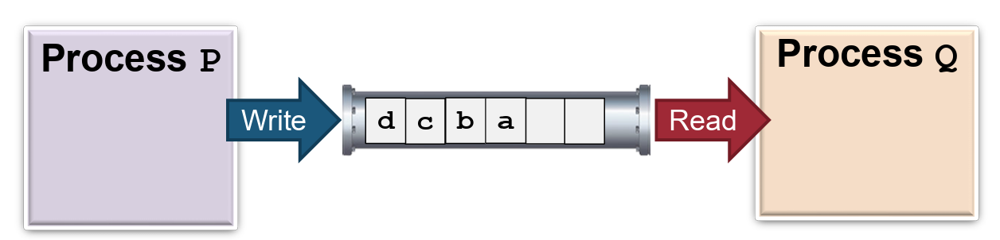
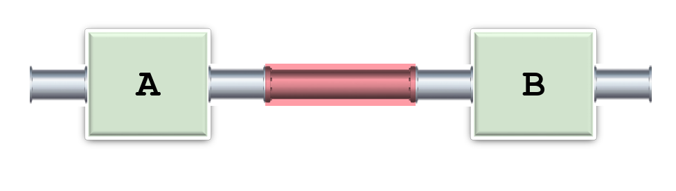
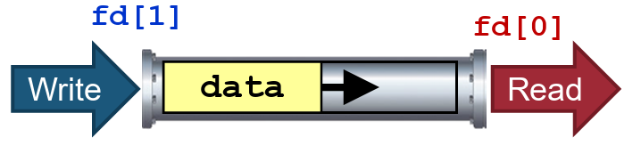
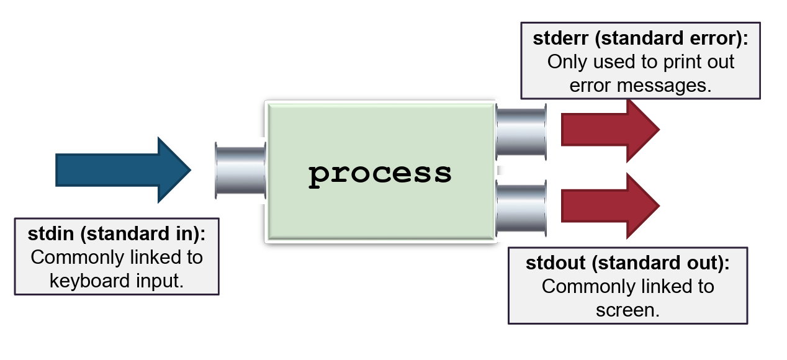

# Lec 05 - Inter-Process Communication

In this section, we will introduce how processes communicate with each other, known as **Inter-Process Communication (IPC)**.

> Why is it hard for processes to communicate with each other?

This is because each process has its own **memory space (address space,** remeber the memory context of a process that we introduced earlier?**)**. Therefore, one process cannot directly access or modify the memory of another process.

## Common Communication Mechanisms

Basically, there are two common IPC mechanisms:

1. Shared-Memory
2. Message Passing

### Shared-Memory

The basic idea behind **shared-memory IPC** is:

1. **Master process P1** creates a shared memory region **M**. This region behaves similarly to heap memory and can be accessed directly using pointers without entering kernel mode.
2. **Slave process P2** attaches **M** to its own address space.
3. **P1 and P2** can now communicate by reading from and writing to **M**.

### Message Passing

The basic idea behind **message-passing IPC** is:

1. **Process P1** prepares a message **M** and sends it to **process P2**.
2. **Process P2** receives the message **M**.
3. Sending and receiving are usually provided through **system calls**, so the OS handles the communication.


Unlike shared memory, the message must be handled by the **kernel**, meaning every send/receive operation involves the OS.


Some additional properties about message passing are:

* **Naming:** Defines how one process identifies the other process it wants to communicate with.
* **Synchronization:** Defines the behavior of the **send** and **receive** operations, such as whether they block until the other operation is ready.

#### Naming

There are two main naming schemes in **message-passing IPC**:



#### Direct Communication

The sender and receiver **explicitly name each other**.

* `Send(P2, Msg)`: Send message `Msg` to process **P2**.
* `Receive(P1, Msg)`: Receive message `Msg` from process **P1**.

**Characteristics:**

* Each pair of communicating processes has a **direct communication link**.
* Each process needs to **know the identity of the other process**.



#### Indirect Communication

Messages are sent to and received from a **message storage object**, usually called a **mailbox** or **port**.

* `Send(MB, Msg)`: Send message `Msg` to mailbox **MB**.
* `Receive(MB, Msg)`: Receive message `Msg` from mailbox **MB**.

**Characteristics:**

* A single mailbox can be **shared by multiple processes**.
* Processes communicate through the **mailbox**, rather than naming each other directly.



#### Synchronization

There are also two main synchronization behaviors for message passing:



#### **Blocking Primitives (Synchronous)**

The **send or receive operation blocks** the process until the required communication can take place.

* The process waits until the operation can proceed.
* This provides **synchronization** between the sender and receiver.


For an example of blocking primitives, can see [#pipe-behavior](lec-05-inter-process-communication.md#pipe-behavior "mention").




#### **Non-Blocking Primitives (Asynchronous)**

The **send or receive operation returns immediately** without waiting for the other process.

* The process can **continue executing** while the communication is handled.
* This allows processes to run more independently.



## UNIX Examples

We will now look at two **UNIX mechanisms for Inter-Process Communication (IPC)**:

1. UNIX Pipes
2. UNIX Signals

### UNIX Pipes

**UNIX pipes** are one of the earliest mechanisms for **Inter-Process Communication (IPC)**. They provide a simple communication channel that allows one process to send data to another.

<figure><figcaption></figcaption></figure>

#### Basic Idea

A pipe is a **communication channel with two ends**:

* **Write end:** where data is inserted into the pipe.
* **Read end:** where data is retrieved from the pipe.

The pipe internally stores the data written by the sender until it is read by the receiver. A pipe can therefore be viewed as a **buffer between two processes**:

<figure><figcaption></figcaption></figure>

#### Pipes in the UNIX Shell

The familiar `|` symbol in the UNIX shell is implemented using pipes. For example:

```bash
A | B
```

means that the **output of process A becomes the input of process B**. So, instead of displaying A's output directly, the shell connects process A and B in the following manner:

<figure><figcaption></figcaption></figure>

#### Pipes as an IPC Mechanism

A pipe can be **shared between two processes**, allowing them to exchange data. It naturally forms a **Producer-Consumer relationship**:

* The **producer** writes data into the pipe.
* The **consumer** reads data from the pipe.

The pipe acts as the **buffer** between them.


This is similar to how I design the ping-pong buffer in my EE4218 project! Oof, full circle moment here!


#### Pipe Behavior

A UNIX pipe behaves like a **circular bounded byte buffer** with **implicit synchronization**:

* When the pipe is **full**, writers wait.
* When the pipe is **empty**, readers wait.

Therefore, the pipe automatically synchronizes the producer and consumer.

#### Pipe Variants

Depending on the UNIX implementation, pipes may support:

* **Half-duplex:** communication is one-way, with one write end and one read end.
* **Full-duplex:** both ends can be used for reading and writing.

A pipe may also be shared among **multiple readers or writers**, depending on the implementation and usage.

#### Creating a Pipe

In C, a pipe is created using:


```c
#include <unistd.h>

int pipe(int fd[]);
```


On success, `pipe()` returns two **file descriptors**:

* `fd[0]` -> **read end**
* `fd[1]` -> **write end**

<figure><figcaption></figcaption></figure>

So, in a code snippet, a common pattern is:

1. The **parent creates a pipe** using `pipe()`.
2. The process creates a **child using `fork()`**.
3. After `fork()`, **both processes inherit the pipe's file descriptors**.
4. Each process **closes the end it does not use**.
5. The **parent writes** data to the pipe, while the **child reads** it.

For example:


```c
#define READ_END  0
#define WRITE_END 1

int main()
{
    int pipeFd[2], pid, len;
    char buf[100], *str = "Hello There!";

    pipe(pipeFd);

    if ((pid = fork()) > 0) {          // Parent
        close(pipeFd[READ_END]);      // Close unused read end

        write(pipeFd[WRITE_END], str, strlen(str) + 1);

        close(pipeFd[WRITE_END]);     // Done writing
    }
    else {                            // Child
        close(pipeFd[WRITE_END]);     // Close unused write end

        len = read(pipeFd[READ_END], buf, sizeof(buf));
        printf("Proc %d read: %s\n", pid, buf);

        close(pipeFd[READ_END]);      // Done reading
    }
}
```


* `pipe(pipeFd)` creates the pipe, where `pipeFd[0]` is the **read end** and `pipeFd[1]` is the **write end**.
* `fork()` creates the child, and both processes inherit these file descriptors so now both processes are pointing to the same pipe because the child process will copy the parent's process's local variables, which is `pipeFd[2]`.
* The **parent closes the read end** and uses `write()` to put `"Hello There!"` into the pipe.
* The **child closes the write end** and uses `read()` to retrieve the message.
* Finally, both processes close the end they were using.

#### Redirecting Standard Input/Output

Pipes can also be connected to the standard communication channels:

* `stdin`: standard input
* `stdout`: standard output
* `stderr`: standard error

System calls such as `dup()` and `dup2()` can be used to **redirect these standard streams to a pipe**, which is how shell commands such as

```bash
A | B
```

can be implemented.

<figure><figcaption></figcaption></figure>

### UNIX Signals

A **UNIX signal** is a form of **Inter-Process Communication (IPC)** used to asynchronously notify a process or thread that a particular event has occurred.

* A signal is an **asynchronous notification** sent to a **process or thread**.
* The recipient must handle the signal using either:
  * a **default handler** provided by the OS, or
  * a **user-defined handler**, for signals that allow customization.

Common UNIX signals include those for **termination** (`SIGTERM`, `SIGKILL`)**, stopping** (`SIGSTOP`)**, continuing** (`SIGCONT`)**, memory errors** (`SIGSEGV`)**, and arithmetic errors** (`SIGFPE`).

#### Custom Signal Handler

A process can register its own function to handle certain signals using `signal()`.


```c
#include <stdio.h>
#include <signal.h>
#include <unistd.h>

void myOwnHandler(int signo)
{
    if (signo == SIGSEGV) {
        printf("Memory access blows up!\n");
        exit(1);
    }
}

int main()
{
    int *ip = NULL;

    if (signal(SIGSEGV, myOwnHandler) == SIG_ERR)
        printf("Failed to register handler\n");

    *ip = 123;    // Causes a segmentation fault

    return 0;
}
```


In this example above,

* `myOwnHandler()` is the **user-defined signal handler**.
* `signal(SIGSEGV, myOwnHandler)` registers this function to handle `SIGSEGV`.
* `SIGSEGV` is generated when the program performs an invalid memory access.

Since `ip` is `NULL`, so:

```c
*ip = 123;
```

causes a **segmentation fault**. Instead of using the default behavior, the registered handler is invoked and prints a message before terminating the program.
