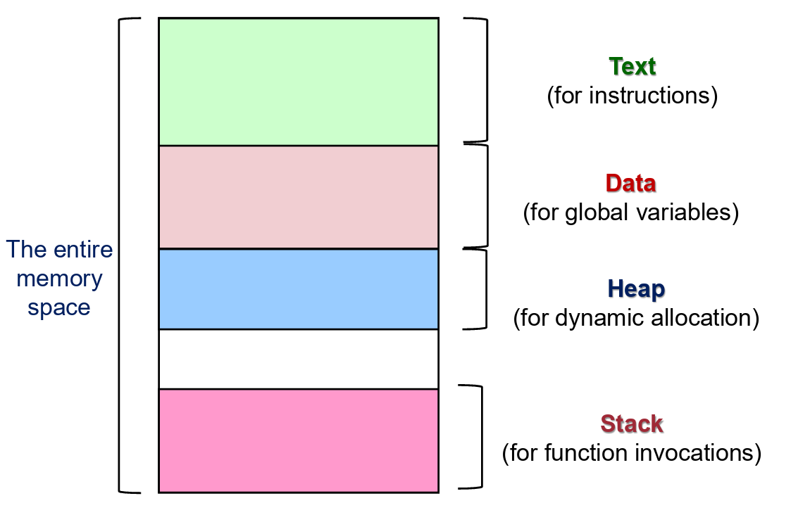
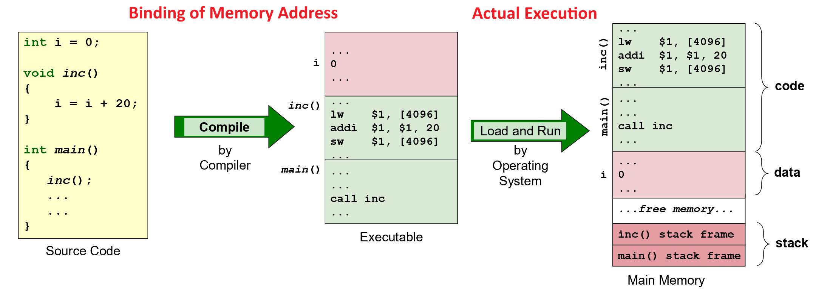
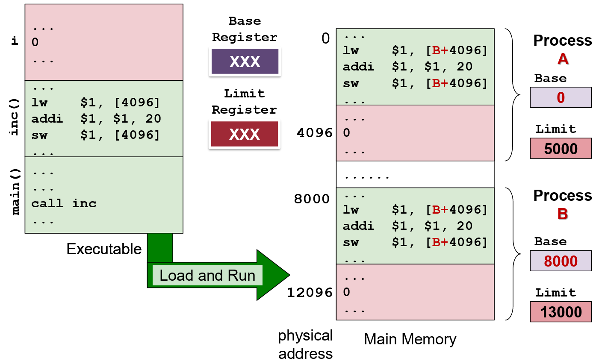
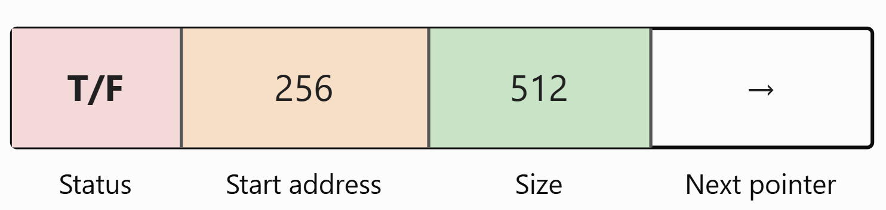
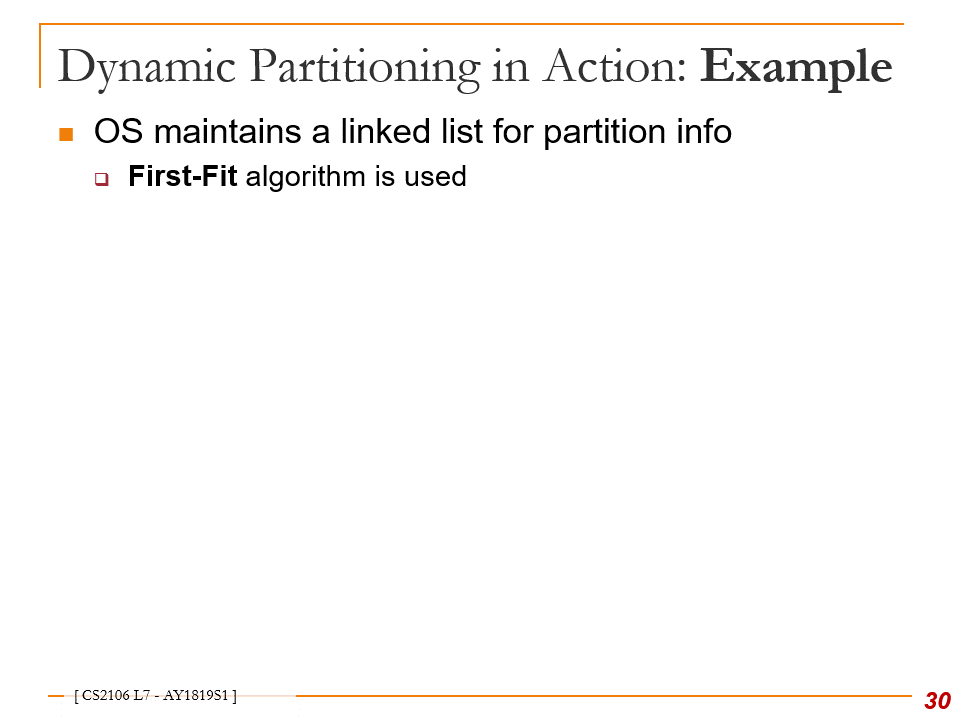
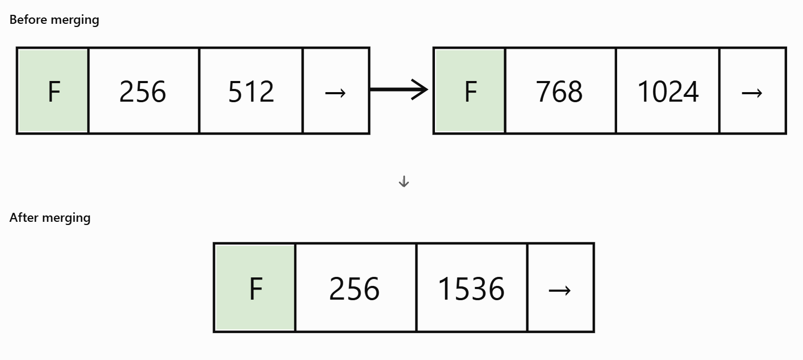
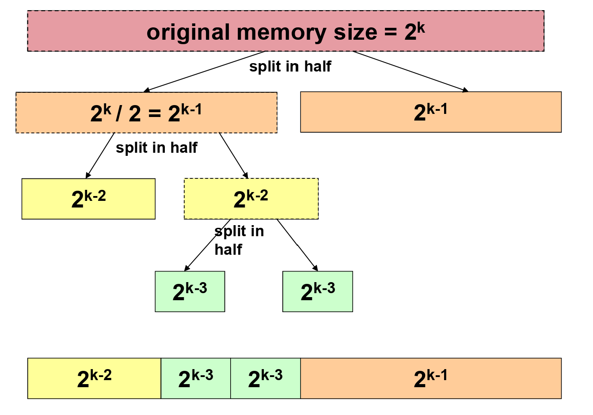
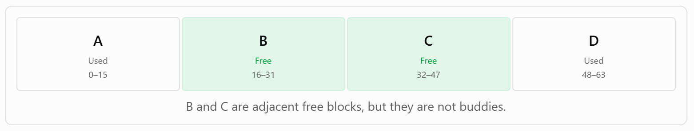

# Lec 07 - Memory Abstraction

In this lecture and the following two lectures, we will learn how the OS manages memory, including how memory is allocated to processes, how free and occupied memory regions are tracked, and how virtual addresses are mapped to physical addresses.

## Basics of Memory

This section introduces the fundamentals of memory, how a process uses memory, and how the operating system (OS) manages it.

### Hardware

Physical memory refers to the RAM used to store instructions and data while programs execute.

* RAM can be viewed as a large array of bytes.
* Each **byte** has a unique address, called its physical address.
* A contiguous memory region consists of consecutive memory addresses.

For example, a memory region spanning addresses `1000` to `1999` contains 1000 consecutive bytes and is considered as a **contiguous memory region**. However, memory regions `1000-1009` and `1011-1999` are not considered as **contiguous** as the address `1010` is missing.

<details>

<summary>Memory Hierarchy</summary>


We've learned in in NUS CG3207 as well as the two very important rules on locality! Feel free to go back to my [DDCA notes](https://app.gitbook.com/s/jTJFBPtKk6NwweAooH53/lec/memory-systems#two-principles-of-locality)!


Computer systems use different types of storage to balance speed, capacity, and cost.

| Memory        | Speed     | Capacity   |
| ------------- | --------- | ---------- |
| CPU registers | Fastest   | Smallest   |
| Cache         | Very fast | Small      |
| RAM           | Moderate  | Larger     |
| SSD/HDD       | Slow      | Very large |

Generally, faster memory is smaller and more expensive per byte, while slower storage offers greater capacity at a lower cost.

</details>

### Memory Usage of Process

Still remember the memory context of a process in [lec 2](https://app.gitbook.com/s/5cfVJRHhgDkjMTtQIPfW/virtualization/cpu-virtualization/the-process#memory)? When a process executes, its memory space is divided into several regions, each serving a different purpose.

<figure><figcaption></figcaption></figure>

So what happens when the source code is compiled into an executable and then load into the memory by the OS? (The second part is also covered in [Lec 02](https://app.gitbook.com/s/5cfVJRHhgDkjMTtQIPfW/virtualization/cpu-virtualization/the-process#process-creation-a-little-more-detail)!)

<figure><figcaption></figcaption></figure>

1. **Compilation**: The compiler translates source code into machine instructions and produces an executable. (Usually this executable will be stored on the disk)
2. **Loading**: The OS loads or maps the executable's instructions and data into the process's memory space. (Usually the loading is from the disk to the physical memory)
3. **Execution**: The CPU executes the instructions, while the process uses its stack and heap as needed.

During execution, data can also be classified according to its lifetime:

* **Transient data**: Exists temporarily, such as local variables and passed parameters in function calls.
* **Persistent data**: Remains available for a longer period, such as heap.

Both type of data can grow/shrink during execution. For example, The stack and heap can grow or shrink during execution as functions are called or return, and as memory is allocated or released.


Note that persistent here refers to the lifetime of data **within the process**, not permanent storage after the process terminates.


### Role of OS

The OS is responsible for managing memory safely and efficiently across multiple processes. Its main responsibilities include:

1. Allocation: Provide memory to newly created processes.
2. Management: Track memory usage and handle allocation or deallocation.
3. Protection: Prevent processes from accessing one another's memory without permission.
4. System calls: Provide interfaces for processes to request memory-related services.
5. Internal use: Manage memory required by the OS itself.

The key idea is that processes do not directly manage physical memory allocation. Instead, the OS coordinates memory usage and protection, with support from hardware.

## Memory Abstractions

Memory abstraction allows each process to use its own logical address space, independently of where it is actually stored in physical memory.

### Physical Address

A physical address identifies the actual location of a byte in RAM.

> What will happen without memory abstraction?

Suppose a process (let's just called it A) directly uses physical addresses in its instructions:


```asm
lw   $1, [4096]
addi $1, $1, 20
sw   $1, [4096]
```


Here, process A reads and writes directly to physical address `4096`. This works for a single process, but problems arise when multiple processes share memory:

* **Address conflicts**: Different processes may reference the same physical address, unintentionally accessing each other's data.
* **Relocation**: A process cannot easily run at a different memory location because its addresses are hardcoded.
* **Protection**: Preventing unauthorized memory access becomes difficult.

We will introduce two attempts to solve this problem:



#### Address Relocation

One solution is to recalculate all memory references when loading a program so that they match its actual physical location.


For example, if Process B is loaded at physical address `8000`, its reference to offset `4096` must be changed to physical address `12096`.


However, this approach has two limitations:

* **Slow loading**: Memory references must be adjusted during loading.
* **Difficult identification**: It can be difficult to distinguish an address from an ordinary integer constant.



#### Base + Limit Registers

A better approach is to use two special hardware registers:

* **Base register:** Stores the starting physical address of the process.
* **Limit register:** Stores the last valid physical address of the process's allocated memory region.

Instead of hardcoding physical addresses, instructions use offsets relative to the base address. During execution, hardware translates and validates each address. For a logical address `A`:

$$
\text{Physical Address}=\text{Base}+A
$$

The address is valid only if:

$$
\text{Base}\le\text{Physical Address}<\text{Limit}
$$


According to Prof. Colin, in this lecture, the limit register represents the _exclusive upper bound_ of the physical memory region (i.e., the first invalid address). In the next lecture, the convention changes to represent the _size of the allocated memory region_.


For example, suppose Process B has:

* Base = `8000`
* Limit = `13000`
* Logical address = `4096`

Then:

$$
\text{Physical Address}=8000+4096=12096
$$

Since $$8000\le12096<13000$$, the access is **valid**.

<figure><figcaption></figcaption></figure>

This approach provides a simple form of **memory abstraction and protection**, but requires address translation and bounds checking for **each** memory access.



### Logical Address

A **logical address** is the address generated by a program, independent of its actual physical memory location.


In short, logical address is how the process view it's address space!


Rather than embedding physical addresses directly into instructions, each process operates within its own logical address space.

* **Independence**: Different processes can use the same logical addresses without accessing the same physical locations.
* **Relocation**: A process can be loaded at different physical locations without changing its logical addresses.
* **Protection**: Hardware address translation and access checks help prevent processes from accessing unauthorized memory.

For example, using base registers:

|                  | Process A | Process B |
| ---------------- | --------- | --------- |
| Logical address  | 4096      | 4096      |
| Base register    | 0         | 8000      |
| Physical address | 4096      | 12096     |

Thus, the same logical address can correspond to different physical addresses for different processes. Physical addresses specify where data actually resides, while logical addresses specify where a process thinks its data resides.


The Memory Management Unit (MMU) is the hardware responsible for translating logical addresses into physical addresses and enforcing memory access protection.


## Contiguous Memory Allocation

**Contiguous memory allocation** is a memory management scheme in which each process occupies a single, continuous region of physical memory. In this scheme, we assume that:

* A process must reside in physical memory while executing.
* Physical memory is large enough to hold the **complete memory spaces** of one or more processes. This assumption is mainly used to support **multitasking**.
  * To support multitasking, the OS keeps multiple processes in memory so the CPU can switch between them through context switching. When physical memory becomes full, the OS may free memory by terminating processes or swapping inactive/blocked processes to secondary storage. A swapped-out process must be brought back into memory before it can resume execution.

Memory is managed through partitions, each representing a contiguous region allocated to a process. There are two main allocation schemes: **fixed-size** and **variable-size partitioning**.

### Fixed Size Partition

In fixed-size partitioning, physical memory is divided into a predetermined number of partitions, each capable of holding one process.

* **Allocation**: A process is assigned an available partition large enough to accommodate it.
* **Advantage**: Simple management and fast allocation, especially when all partitions have the same size.
* **Disadvantage**: Unused space within an allocated partition is wasted, causing internal fragmentation.
  * For example, if an 8 KB partition is assigned to a 6 KB process, the remaining 2 KB cannot be used by another process.

### Variable Size Partition

In variable-size partitioning (also called **dynamic partitioning**), partitions are created according to the actual memory requirements of processes. Unlike fixed-size partitioning, the OS must dynamically track occupied partitions and free memory regions, known as holes.

* **Advantage**: More flexible allocation with little or no **internal fragmentation** when allocating the requested size exactly.
* **Disadvantage**: More complex memory management and **external fragmentation**, where free memory becomes scattered into separate holes.

<details>

<summary>What are partitions and Why are there holes in variable size partition?</summary>

In dynamic partitioning, **partitions** are not predefined but are created when processes are allocated memory. Each allocated process occupies a partition sized according to its requirements, while unallocated memory regions are called holes. Initially, processes can be allocated consecutively without gaps. However, when processes terminate or are swapped out, their partitions become **holes**, potentially causing external fragmentation. Besides, allocating a process into a hole and leaving a smaller remainder can also contribute to the external fragmentation!

</details>

**External fragmentation** occurs as processes are created, terminated, or swapped out. Even if the total free memory is sufficient, a new process may not fit because no individual hole is large enough (This sentence is important!). To solve or minimize this problem, we introduce two partitioning algorithm for dynamic partitioning:

1. Normal Dynamic Partitioning
2. Buddy System

#### **Normal Dynamic Partitioning**

When allocating a process requiring $$N$$ bytes, the OS searches its list of free **holes** for a sufficiently large region. Three common strategies are:

| Algorithm | Strategy                               |
| --------- | -------------------------------------- |
| First-Fit | Choose the first hole large enough.    |
| Best-Fit  | Choose the smallest hole large enough. |
| Worst-Fit | Choose the largest available hole.     |

If a selected hole has size $$M\ge N$$, it is split into:

* An allocated partition of size $$N$$.
* A remaining free hole of size $$M-N$$, if nonzero.

Example: Suppose the available holes have sizes `[3, 8, 7, 11]` KB, and a process requests 6 KB.

| Algorithm | Selected hole | Remaining hole |
| --------- | ------------- | -------------- |
| First-Fit | 8 KB          | 2 KB           |
| Best-Fit  | 7 KB          | 1 KB           |
| Worst-Fit | 11 KB         | 5 KB           |

First-Fit is often faster because it can stop at the first suitable hole. Best-Fit minimizes leftover space for the current allocation, but does not necessarily minimize overall fragmentation.

<details>

<summary>Merging and Compaction</summary>

To reduce external fragmentation, the OS can reorganize free memory using two techniques:

* **Merging (coalescing)**: When a partition is freed, combine it with any adjacent free holes to form a larger contiguous region.
* **Compaction**: Relocate occupied partitions to consolidate scattered holes into one large free region.

Merging is relatively inexpensive, whereas compaction involves moving process data and updating address mappings, making it time-consuming.

</details>

<details>

<summary>Example of Dynamic Partitioning using First-Fit (The idea of Linked List)</summary>

In dynamic partitioning, the OS can maintain a linked list to track both allocated partitions and free memory regions (holes). Each node in the linked list contains four fields:

* **Status** (`T/F`): `T` indicates an allocated partition (taken), while `F` indicates a free memory region.
* **Starting Address**: The starting memory address of the partition or hole.
* **Size**: The size of the contiguous memory region represented by the node, indicating either allocated memory (`T`) or available free memory (`F`). For example,
  * `T | 256 | 512` means an allocated region covering addresses `256–767`.
  * `F | 768 | 3328` means a free region covering addresses `768–4095`.
* **Next Pointer**: Points to the next node in the linked list, or `NULL` if it is the last node.

<figure><figcaption><p>Linked List notation for a process of size 512 bytes which will be stored at address 256</p></figcaption></figure>

In the following example, memory addresses range from `0` to `4095`, with the first `256` units reserved for the OS.

<figure><figcaption></figcaption></figure>

An example of merging free memory in the linked list notation is shown as follows:

<figure><figcaption></figcaption></figure>

</details>

#### **Buddy System**

The **Buddy System** is a dynamic memory allocation scheme that simplifies splitting, allocation, and merging by using memory blocks whose sizes are powers of two. Its main idea is:

* **Splitting**: Repeatedly divide a free block into two equal-sized blocks, called buddies, until an appropriate block size is obtained.
* **Allocation**: Allocate the smallest power-of-two block large enough for the request.
* **Merging**: When a block is freed, merge it with its buddy if that buddy is also free. Repeat until no further merging is possible.

<figure><figcaption></figcaption></figure>



#### Implementation

The OS maintains an array of free lists:

$$
A[0],A[1],\ldots,A[K]
$$

where each free **linked list** `A[j]` stores the starting addresses of available blocks of size $$2^j$$. Since the block size is implied by the list index, there is no need to store it separately for each block.

For example, `A[7]` stores the starting addresses of free 128-byte blocks, so an entry of `256` represents the memory region from address `256` to `383`, which is free-to-use.


However, during the exam, I recommend to draw the kind of buddy system memory layout in the [tutorial 7](../tut/tut-07-contiguous-memory-allocation.md#id-04.-buddy-system)!




#### Allocation Algorithm

To allocate $$N$$ bytes:

1. Find the smallest integer $$S$$ such that $$2^S\ge N$$, i.e. $$S=\lceil\log_2 N\rceil$$.
2. Check the free linked list $$A[S]$$.
3. If a block is available, allocate it. Otherwise, find a larger free block and repeatedly split it in half until a block of size $$2^S$$ is obtained.
4. Return the unused buddy blocks to their corresponding free lists.

For example, a request of 100 bytes requires a block of size:

$$
2^{\lceil\log_2 100\rceil}=2^7=128\text{ bytes}
$$

The remaining 28 bytes inside the allocated block are unused, causing internal fragmentation.



#### Deallocation Algorithm

When freeing a block of size $$2^S$$:

1. Identify its buddy of the same size.
2. If the buddy is also free, merge the two blocks into a block of size $$2^{S+1}$$.
3. Repeat the merging process at the next level until the buddy is unavailable or the maximum block size is reached.
4. Insert the resulting block into the appropriate free linked list.

<details>

<summary>How to locate a buddy?</summary>

For a block of size $$2^S$$ starting at address $$A$$, its buddy's starting address is:

<p align="center"><span class="math">\text{Buddy Address}=A\oplus 2^S</span></p>

where $$\oplus$$ represents bitwise XOR. For example, a 32-byte block starting at address `11000000`<sub>`2`</sub> is split into two 16-byte buddy blocks:

* Block B: `11000000`<sub>`2`</sub> (`11000000`<sub>`2`</sub> to `11001111`<sub>`2`</sub> )
* Block C: `11010000`<sub>`2`</sub> (`11010000`<sub>`2`</sub> to `11011111`<sub>`2`</sub> )

Since each buddy has size $$2^4=16$$ bytes:

<p align="center"><span class="math">11000000_2\oplus 00010000_2=11010000_2</span></p>

Thus, buddy addresses differ only in the bit corresponding to their block size (bit $$S$$, counting from 0).

</details>



#### Advantages and Limitations

* **Advantages**: Efficient block splitting, fast free-list lookup, and straightforward merging through buddy relationships.
* **Limitations**: Rounding requests up to powers of two causes internal fragmentation. Free blocks may also remain separated when they are not buddies, even if they are adjacent.

<figure><figcaption><p>Example for the limitations</p></figcaption></figure>




For a visual illustration of the buddy system, please go to my [CG2271 tutorial 07 notes](../tut/tut-07-contiguous-memory-allocation.md#id-04.-buddy-system)!


### Summary

| Feature                | Fixed-Size                              | Variable-Size        | Buddy System             |
| ---------------------- | --------------------------------------- | -------------------- | ------------------------ |
| Partition sizes        | Predetermined                           | Based on request     | Powers of two            |
| Internal fragmentation | Yes                                     | Minimal              | Yes                      |
| External fragmentation | Generally no, for equal-size partitions | Yes                  | Possible                 |
| Allocation             | Simple                                  | Requires hole search | Free lists by block size |
| Merging                | Not required                            | Adjacent holes       | Free buddy blocks        |

The key trade-off is between memory utilization and management complexity. Fixed-size partitioning is simple but wastes space within partitions. Variable-size partitioning improves flexibility but suffers from external fragmentation. The Buddy System provides a structured compromise, making allocation and merging more efficient at the cost of some internal fragmentation.
