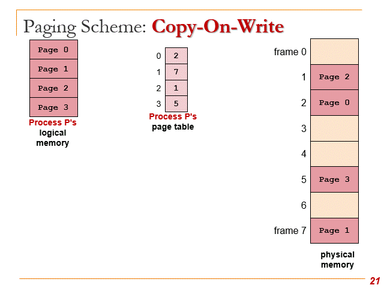
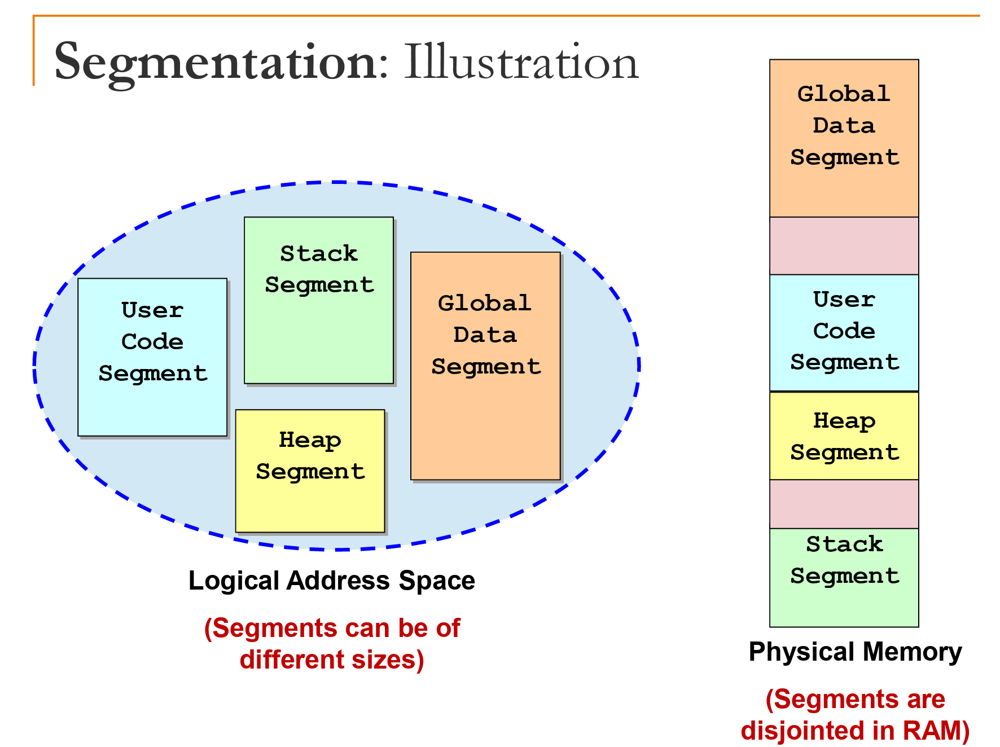
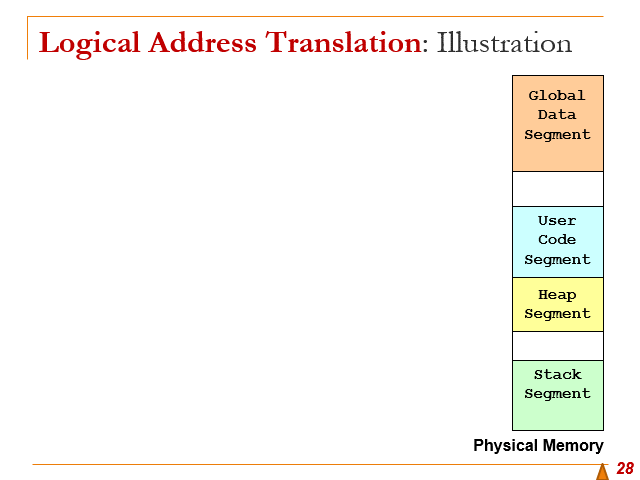
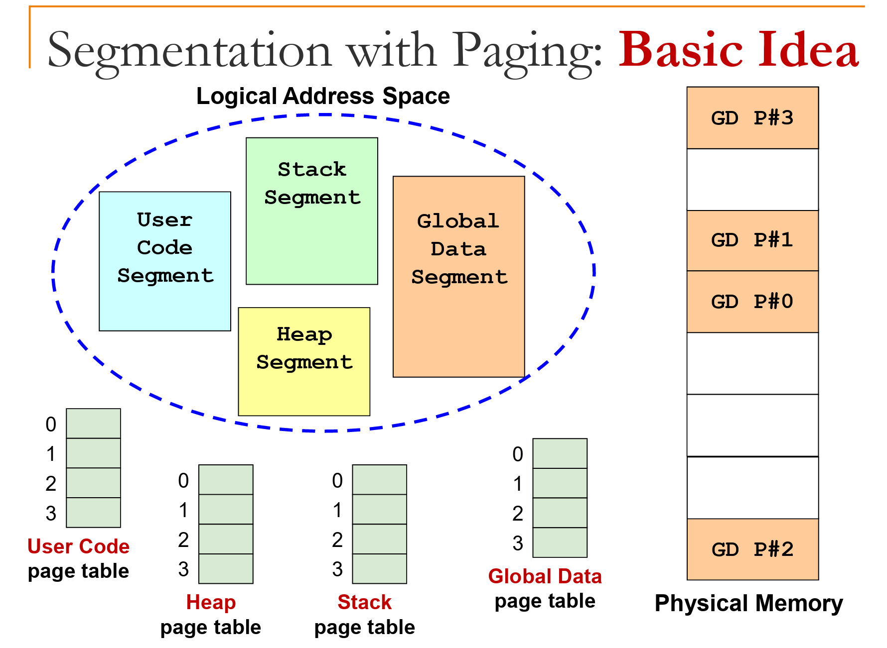
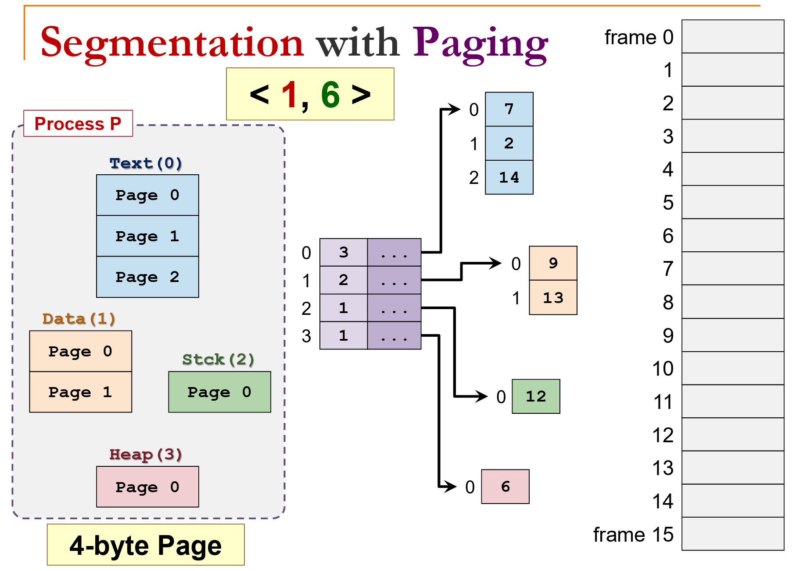

# Lec 08 - Disjoint Memory Schemes

In the previous lecture, we explored how a process's logical memory space is mapped to physical memory using **contiguous memory allocation**, where each process occupies a single contiguous region of physical memory. In this lecture, we will introduce **disjoint memory allocation schemes**, which allow a process's logical memory space to be mapped to multiple, non-contiguous regions of physical memory.


In a computer system, a process's logical address space is typically contiguous, but its corresponding physical memory does not have to be contiguous (we are relaxing the first assumption made in [Lec 7](lec-07-memory-abstraction.md#contiguous-memory-allocation)!). This is the main **motivation** behind disjoint memory allocation schemes we are going to introduce here!


We will focus on two main schemes:

1. **Paging:** Divides logical and physical memory into fixed-size pages and frames, respectively.
2. **Segmentation:** Divides a process's logical memory space into variable-sized segments based on their usage.

We will explore how these two schemes work, examine their respective advantages and limitations, and finally discuss how **segmentation and paging can be combined** to take advantage of both approaches.

## Paging

For this section, I highly recommend referring to **Harris & Harris's** DDCA, which provides one of the clearest explanations of how paging works. In particular, refer to the sections from [**Virtual Memory**](https://app.gitbook.com/s/jTJFBPtKk6NwweAooH53/lec/memory-systems#vitural-memory) to [**Memory Protection**](https://app.gitbook.com/s/jTJFBPtKk6NwweAooH53/lec/memory-systems#memory-protection) in my DDCA notes. These sections explain the fundamental concepts of paging, virtual-to-physical address translation, and the role of the TLB in accelerating address translation.


The terms _logical address_ and _logical memory_ used in this lecture are equivalent to _virtual address_ and _virtual memory_, respectively.


If we want to calcualte the physical address expressed in **decimal**, we can use the following formula

$$
PA=F\times\text{Page Size}+D
$$

where $$F$$ denote the frame number and $$D$$ denotes the offset which is the same for both page and frame.

### Observations

In the **paging scheme**, we observe that **external fragmentation is eliminated** because logical memory and physical memory are divided into fixed-size pages and frames, respectively, with both having the same size. Therefore, we no longer need to worry about finding a sufficiently large contiguous region of physical memory to accommodate a process.

However, **internal fragmentation still exists** because a process may not fully utilize its allocated pages. For example, if the size of a process is not an exact multiple of the page size, its last page will be only partially filled, leaving some allocated memory unused.

### Page Sharing

One important advantage of paging is that **multiple processes can share the same physical memory frame**. This is one of the things that is **not covered** in my DDCA notes. Page sharing is achieved by mapping their logical pages to the same physical frame through their respective page tables. It is particularly useful in two scenarios:

1. **Shared Code:** Multiple processes can share the same physical frames containing common code, such as standard libraries, instead of storing duplicate copies in memory.
2. **Copy-on-Write (CoW):** When a process creates a child process using `fork()`, the OS does not immediately duplicate the parent's entire memory space, as this would consume a significant amount of physical memory.

Instead, the parent and child initially **share the same physical frames**, with their page tables pointing to the same frames. These shared pages are typically marked as read-only to prevent either process from modifying the shared data directly. When either process attempts to modify a shared page, a **page fault** occurs. The OS then creates a separate copy of that page, updates the corresponding page table, and allows the modification to proceed. For example, suppose **Process Q wants to modify Page 2**, which is initially shared with Process P. Instead of modifying the shared page directly, the OS creates a separate copy in **physical frame 3** and updates Process Q's page table to map Page 2 to this new frame. As a result, Process Q can modify its own copy without affecting Process P.

<figure><figcaption></figcaption></figure>

In this way, **physical memory is only duplicated when necessary**, significantly reducing the memory overhead of `fork()`.

## Segmentation

In the previous section, we introduced **paging**, which divides a process's logical memory space into **fixed-size** pages. However, paging treats the process's memory space as a single entity, without considering that different memory regions serve different purposes.

Recall that a process's logical memory space typically consists of several regions, including **Text (Code), Data, Heap, and Stack**. These regions have different characteristics and memory requirements. For example, the **heap and stack may grow or shrink during execution**, while the code region generally remains unchanged.

Therefore, instead of treating the entire logical memory space as one entity, we can divide it into multiple **segments** based on their purposes. This is the basic idea behind **segmentation**.

<figure><figcaption></figcaption></figure>

Under the segmentation scheme:

* A process's logical memory space consists of multiple **variable-sized segments**, such as Code, Data, Heap, and Stack.
* Each segment has its own **name** and **limit (size)**.
* A memory address is specified using a **segment name and an offset** within that segment.

For example, `Heap + 245` refers to the memory location at offset 245 within the Heap segment.


Unlike paging, which divides memory into fixed-size pages, **segmentation divides memory into logical regions based on their usage**, allowing each segment to be managed independently.


### Address Translation

Unlike paging, where logical pages can be mapped to any available physical frames, **each segment must be mapped to a contiguous region of physical memory**. However, different segments of the same process do not need to be physically adjacent.

To keep track of where each segment is located in physical memory, the OS maintains a **segment table**, where each entry contains:

* **Base:** The starting physical address of the segment.
* **Limit:** The size of the segment, which determines the valid range of offsets.

Each segment is identified by a **Segment ID (SegID)**, which is used to look up its corresponding base and limit in the segment table. Therefore, a logical address in segmentation consists of two components:

$$
\text{Logical Address}=\langle\text{SegID},\text{Offset}\rangle
$$

To translate a logical address into a physical address:

1. Use the **SegID** to look up the corresponding base and limit in the segment table.
2. Check whether the offset is within the segment's limit:
   * If **Offset < Limit**, the memory access is valid.
   * Otherwise, an **addressing error** occurs.
3. For a valid access, calculate the physical address:

$$
\text{Physical Address}=\text{Base}+\text{Offset}
$$


In segmentation, the Segment ID (SegID) is analogous to the page number in paging, while the base address is analogous to the starting physical address of a frame. And the segment table is similar to the page table. However, unlike paging, segments have variable sizes, so their base addresses are not necessarily multiples of a fixed page size.


<figure><figcaption>
Segmentation Address Translation Example
</figcaption></figure>

Suppose we want to access logical address $$\langle 2,500\rangle$$, where Segment 2 represents the Heap. From the segment table:

* Base = 2400
* Limit = 1100
* Offset = 500

Since (500 < 1100), the access is valid. Therefore,

$$
PA=2400+500=2900
$$

However, if we try to access $$\langle 2,1600\rangle$$, the access is invalid because $$1600 \geq 1100$$, resulting in an **addressing error**.

### Observation

One important advantage of **segmentation** is that each segment can grow or shrink independently by **simply** adjusting its limit in the segment table. However, since each segment must occupy a **contiguous region of physical memory**, segmentation can still suffer from **external fragmentation**, as free memory may become scattered into small, non-contiguous holes.

This highlights the different motivations behind the two memory management schemes:

* **Paging** mainly aims to eliminate external fragmentation by dividing memory into fixed-size pages and frames, allowing a process's pages to be stored in non-contiguous physical locations.
* **Segmentation** mainly aims to allow each segment in the memory context of a proces (Code, Data, Heap and Stack) to be managed independently, including supporting their growth and shrinkage (for Heap and Stack).

## Paging with Segmentation

In the previous sections, we introduced paging and segmentation and we observe that each of these two schemes has their limits and advantages. So, as modern computer scientists will always do, we can combine the advantages of both schemes. Voila, let's introduce the paging with segmentation scheme!

### Basic Idea

Instead of mapping each segment to a contiguous region of physical memory, we further **divide each segment into fixed-size pages**, which can then be mapped to any available physical frames. As a result:

1. Each process is still divided into logical segments, such as Code, Data, Heap, and Stack.
2. Each segment is further divided into fixed-size pages and has its **own page table**.
3. The pages of each segment can be stored in **non-contiguous physical frames**, eliminating external fragmentation at the page allocation level.

<figure><figcaption></figcaption></figure>

### Address Translation

Since we now have both segmentation and paging, a logical address consists of three components:

$$
\text{Logical Address}=\langle S,P,D\rangle
$$

where:

* **S (Segment ID):** Identifies the segment to access.
* **P (Page Number):** Identifies the page within that segment.
* **D (Offset):** Identifies the byte within that page.

To translate a logical address into a physical address:

1. Use **S** to look up the segment table, which contains the page limit and the starting address of that segment's page table.
2. Check whether **P < Page Limit**. If not, an addressing error occurs.
3. Use **P** to index the corresponding page table and retrieve the physical frame number **F**.
4. Combine **F** with the unchanged offset **D** to obtain the physical address.

$$
PA=F\times\text{Page Size}+D
$$

Therefore, segmentation determines **which page table to use**, while paging determines **which physical frame contains the requested page**.

<figure><figcaption>
Segmentation with Paging Example
</figcaption></figure>

Consider Process P, which consists of four segments: **Text (0), Data (1), Stack (2), and Heap (3)**. Each segment has its own page table, and the page size is **4 bytes**. Suppose we want to access the logical address:

$$
\langle S,P,D\rangle=\langle1,1,2\rangle
$$

1. **Segment lookup:** Segment ID = 1 refers to the **Data segment**. From the segment table, its page limit is 2, so Page 1 is valid $$(1<2)$$.
2. **Page table lookup:** Using Page 1 in the Data segment's page table, we obtain **Frame 13**.
3. **Physical address calculation:** Since the page size is 4 bytes and the offset is 2:

$$
PA=13\times4+2=54
$$

Therefore, the logical address $$\langle1,1,2\rangle$$ is translated to **physical address 54**.


Notice that the Data segment's two pages are stored in **Frames 9 and 13**, respectively. This demonstrates how segmentation with paging allows pages within the same segment to occupy non-contiguous physical memory locations.


### Observation

By combining segmentation and paging, we retain the logical organization and independent management of segments while avoiding the external fragmentation associated with allocating variable-sized contiguous physical regions.

However, **internal fragmentation may still occur**, since the last page of a segment may not be fully utilized.
