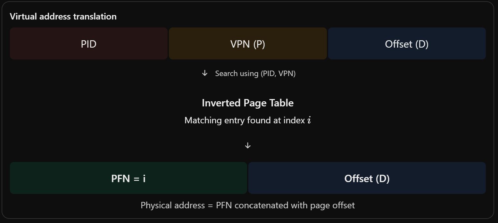
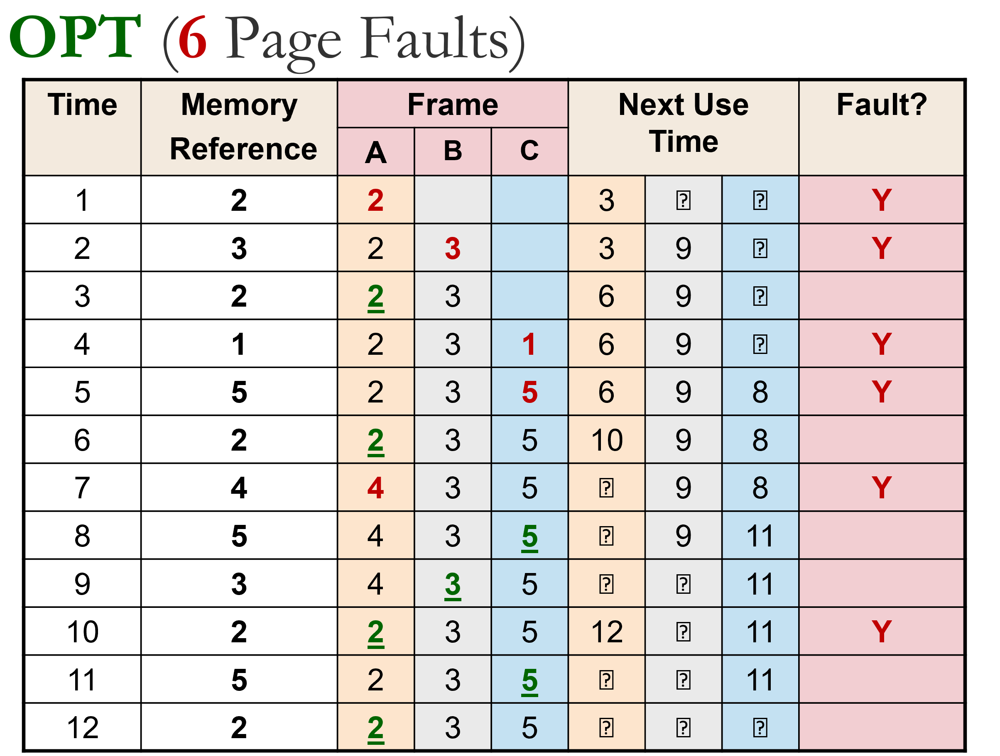
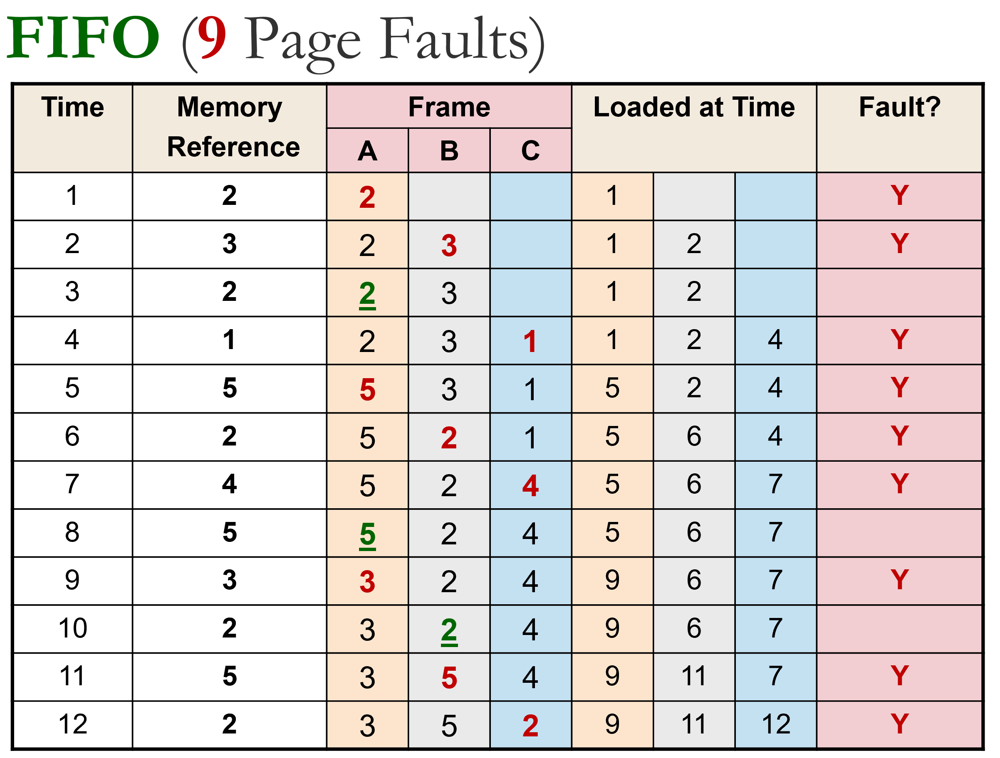
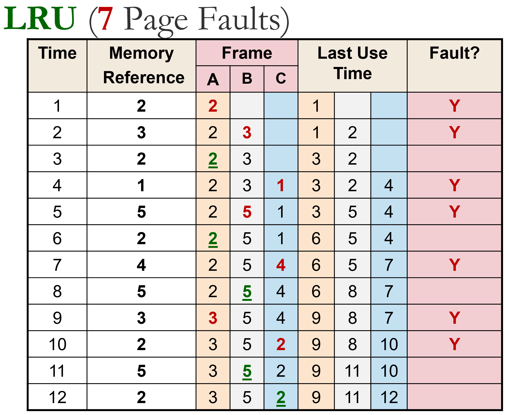
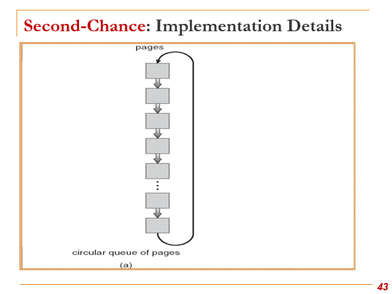
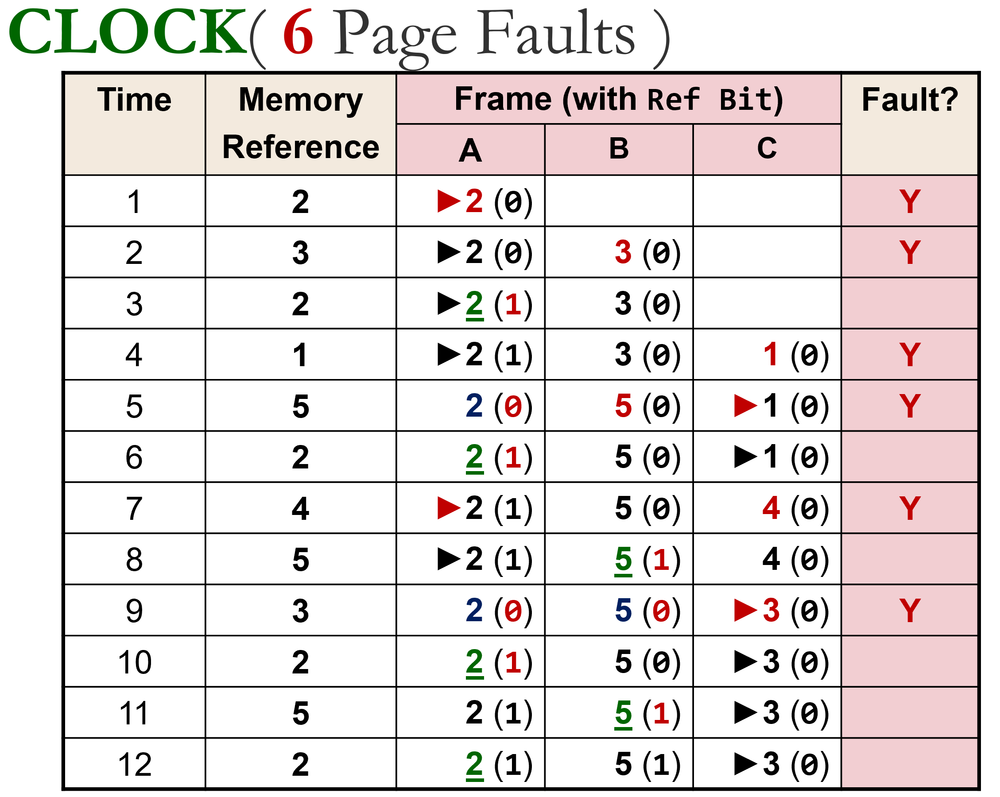
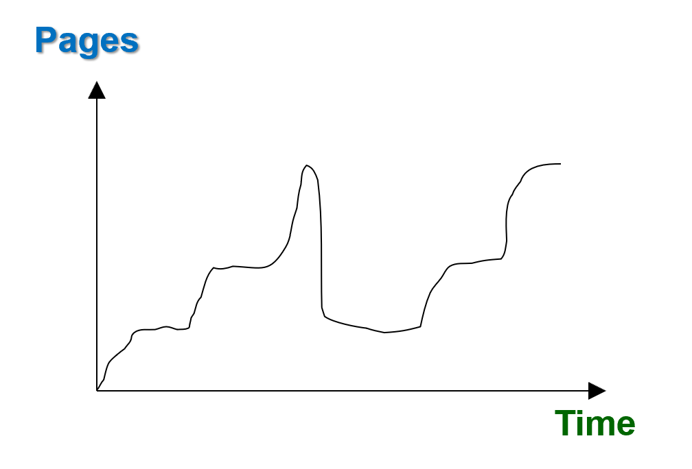
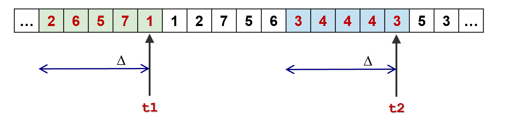

# Lec 09 - Virtual Memory Management

## Virtual Memory

In virtual memory, we relax the **second assumption** made at the beginning of [Lec 7](lec-07-memory-abstraction.md#contiguous-memory-allocation):

> physical memory must be large enough to hold the complete memory space of one or more processes.&#x20;

More specifically, virtual memory allows the logical address space to be **larger than** the available physical memory, we will see how it achieves this soon!


Again, virtual memory is already covered in great detail in Harris & Harris' [DDCA](https://app.gitbook.com/s/jTJFBPtKk6NwweAooH53/lec/memory-systems#vitural-memory). Therefore, I will mainly focus on the important points highlighted in Prof. Colin's lecture to deepen our understanding of how virtual memory works in a computer system.


1. Whenever the CPU accesses memory, it generates a **virtual address**. For an **instruction fetch**, the virtual address comes from the **Program Counter (PC)**, whereas for a **data access (load/store)**, the virtual address is calculated by the CPU, typically using a base register and an immediate offset. This virtual address is then translated into a physical address by the hardware, typically the Memory Management Unit (MMU). The physical address is then used to access the corresponding location in main memory.
2. The CPU can directly access registers and perform memory operations through the cache and main memory (RAM). However, it cannot directly read from or write to **secondary storage**, such as an SSD, using ordinary memory load/store instructions. Instead, the CPU relies on **device drivers** (a special program) to communicate with the storage device by accessing its hardware control registers, similar to what we did in the CG2271 labs.
   1. When data is needed from secondary storage, the OS works with the storage driver and controller to transfer it into RAM, often using **Direct Memory Access (DMA)**. Once the data is in RAM, the CPU can access it through normal memory instructions.
3. The main point behind the [two principles of localities](https://app.gitbook.com/s/jTJFBPtKk6NwweAooH53/lec/memory-systems#two-principles-of-locality) is that: in a computer system, the memory access is **not random**!
4. The portion of **secondary storage (e.g., SSD or HDD)** used to temporarily store memory pages that are not currently resident in RAM is called **swap space**. Different operating systems manage swap space differently:
   1. Windows: Uses a paging file called `pagefile.sys` to store pages moved out of RAM. Its size is configurable but is usually as large as physical memory.
   2. Linux: Traditionally uses a dedicated **swap partition** on the disk.

### Demand Paging

In this section, we will discuss an interesting question:

> When a new process is launched, should ALL its text (instructions) and data (global variables, etc.) pages be loaded into RAM?

The answer is no, because loading all pages into RAM before execution introduces two major problems:

1. **Large startup overhead**: Allocating and loading all pages takes time, especially for large processes, even though some pages may never be accessed.
2. **Large memory footprint**: Each process occupies more physical memory, reducing the number of processes that can reside in RAM simultaneously.

> However, if we do not load all pages into RAM, how do we know which pages will actually be needed?

This motivates **demand paging**, where pages are loaded into RAM only when they are needed.

#### How Demand Paging Works

The idea is simple:

1. a process can initially start with no user-space pages resident in RAM. Whenever the CPU attempts to access a page that is not currently in physical memory, a **page fault** occurs.
2. The OS then handles the page fault by allocating a physical frame and loading or initializing the required page. Once the page is ready, the interrupted instruction/process can be restarted.

Thus, instead of loading the entire process into RAM at startup, we load pages on demand, as the process executes.

#### Advantages and Disadvantages

* Advantages:
  * **Faster startup**: No need to load all pages before execution.
  * **Smaller memory footprint**: Only the required pages occupy RAM, allowing more processes to remain memory-resident.
* Disadvantages:
  * **Initial slowdown**: The process may experience multiple page faults when it first accesses its pages, making execution appear sluggish.
  * **Potential** [**thrashing**](#user-content-fn-1)[^1]: When physical memory is insufficient, frequent page faults and page replacements may cause excessive data transfers between RAM and secondary storage, significantly reducing system performance and potentially affecting other processes.

<details>

<summary>Compiler Instruction Hoisting and Superscalar Architecture</summary>

A related optimization idea introduced by Prof. Colin during the lecture is **instruction scheduling** (including **load hoisting**), where the compiler moves independent load instructions (`lw`) earlier in the instruction sequence, provided that doing so preserves the program's correctness.


However, this correctness is usually hard to preserve because of the data dependencies, such as RAW, WAR and WAW.


In a [superscalar processor](https://app.gitbook.com/s/jTJFBPtKk6NwweAooH53/lec/lec-06-advanced-processor#superscalar-processors), multiple independent instructions can be issued or executed in parallel. However, a load instruction may take several cycles to retrieve data, especially if it misses in the cache.


This optimization is particularly beneficial for **in-order superscalar processors**, although it can also improve the performance of out-of-order superscalar processors, which already support dynamic instruction scheduling.


By moving load instructions earlier, the compiler can overlap their memory-access latency with the execution of other independent instructions. This reduces pipeline stalls caused by data dependencies and improves instruction-level parallelism (ILP), allowing better utilization of the superscalar architecture. So, the connection to demand paging:

> Both ideas concern when data is made available, but they operate at different levels.

* **Demand paging** delays loading memory pages until they are needed to save physical memory, whereas
* **compiler load hoisting** brings memory accesses forward to hide latency and improve execution performance.

</details>

## Aspects of VMM

In this section, we will further explore virtual memory management, focusing on three key aspects:

1. **Page Table Structure**: How page tables are organized to minimize the physical memory usage for page tables themselves.
2. **Page Replacement Algorithms**: How the OS decides which page to evict from physical memory when a new page needs to be loaded.
3. **Frame Allocation**: How the OS determines the number of physical frames allocated to each process.

### Page Table Structure

Recall that each process has its **own page table**, which stores the mapping between virtual pages and physical frames. The page table is maintained by the OS and stored in **physical memory** (RAM), meaning that it also consumes memory space.

Modern computer systems support very large virtual address spaces. For example, a 32-bit virtual address can represent up to 4 GiB of address space, while modern 64-bit systems can support much larger address spaces. However, a larger virtual address space also means more virtual pages, each requiring a **Page Table Entry (PTE)** to store its mapping information!


Recall that the in [NUS CG3207](https://app.gitbook.com/s/jTJFBPtKk6NwweAooH53/lec/lec-03-risc-v-isa-and-microarchitecture#what-if-word-length-and-instruction-length-doesnt-match), Prof. Rajesh told me that the **word length** of a processor and its **address width** are not necessarily the same. For example, a 64-bit processor typically has 64-bit general-purpose registers and an ALU capable of 64-bit operations, but it may implement only 48 bits of virtual addressing.


Consequently, a conventional page table that contains an entry for every virtual page can become extremely large, introducing two major problems:

1. **High memory overhead**: The page table itself consumes a significant amount of physical memory, even when many virtual pages are unused.
2. **Large page table size**: The page table may span multiple physical memory pages, making it impractical to store the entire table in a single physical frame.

Therefore, we need more efficient page table structures to reduce memory overhead while maintaining efficient address translation.

#### Direct Paging

The **direct paging** scheme is the simplest page table structure, where all Page Table Entries (PTEs) are stored in a single, linear page table. However, since the page table contains an entry for every virtual page, its size can become extremely large, even when many virtual pages are not being used.

For example, consider a system with the following specifications:

* Virtual address width = 32 bits
* Page size = 4 KiB = $$2^{12}$$ bytes
* Size of each PTE = 2 bytes (assumed)

Since the lower 12 bits represent the page offset, the number of bits used for the Virtual Page Number (VPN) is: $$P=32-12=20\text{ bits}$$. Therefore, the total number of virtual pages is $$2^{20}$$, and the page table size is:

$$
\begin{aligned} \text{Page Table Size} &=\text{Number of Pages}\times\text{PTE Size}\\ &=2^{20}\times 2\text{ bytes}\\ &=2\text{ MiB} \end{aligned}
$$

This means that **each process** requires a 2 MiB page table, even if it only uses a small portion of its virtual address space. Furthermore, with a page size of 4 KiB, the page table itself occupies:

$$
\frac{2\text{ MiB}}{4\text{ KiB}}=512\text{ physical frames}
$$

Hence, direct paging introduces significant physical memory overhead, motivating more efficient structures which we will introduce later!

#### 2-Level Paging

Recall that in [direct paging](lec-09-virtual-memory-management.md#direct-paging), we maintain a single page table containing a PTE for every virtual page. However, a process may only use a small portion of its virtual address space, meaning that many PTEs are unused, resulting in unnecessary memory overhead.

To solve this problem, 2-level paging divides the original page table into multiple smaller page tables, which are allocated only when needed. The basic idea is:

1. Split the original page table into $$2^M$$ smaller page tables, each containing $$2^{P-M}$$ entries, where $$P$$ is the number of bits in the Virtual Page Number (VPN).
2. Introduce a page directory containing $$2^M$$ entries to keep track of these smaller page tables.
3. When translating a virtual address, first use the page directory to locate the corresponding smaller page table, then use that page table to find the physical frame.

Therefore, the virtual address is divided into three fields:

<figure><figcaption></figcaption></figure>

The key advantage is that unused page directory entries do not require corresponding smaller page tables to be allocated, significantly reducing physical memory overhead. For example, consider the same system as our direct paging example:

* Virtual address width = 32 bits
* Page size = 4 KiB = $$2^{12}$$ bytes
* PTE size = 2 bytes
* VPN width = $$32-12=20$$ bits

Suppose we divide the original page table which contains $$2^{20}$$ entries into smaller page tables, each containing $$2^{11}$$ entries (This is because we assume maximum use one page to store the PTEs of one small page table). The number of smaller page tables is:

$$
2^M=\frac{2^{20}}{2^{11}}=2^9
$$

Therefore, the page directory contains $$2^9$$ entries, and the virtual address is divided into:

<figure><figcaption></figcaption></figure>

Now, assume the process only uses **3 smaller page tables**. The total memory overhead is:

1. Page directory size: $$2^9\times2\text{ bytes}=1\text{ KiB}$$
2. Smaller page tables size: $$3\times(2^{11}\times2\text{ bytes})=12\text{ KiB}$$
3. Total memory overhead: $$1+12=13\text{ KiB}$$

Compared with the 2 MiB required by direct paging, 2-level paging reduces the page table overhead to just 13 KiB, assuming only three smaller page tables are needed.


Hence, 2-level paging trades an additional level of address translation for significantly lower memory overhead, especially when a process uses only a small portion of its virtual address space. For a more vivid understanding, please go to my notes in [Tut 9 Qn 2](../tut/tut-09-virtual-memory-management.md#id-2.-multi-level-page-table).


#### Inverted Page Table

Recall that in [direct paging](lec-09-virtual-memory-management.md#direct-paging) and [2-level paging](lec-09-virtual-memory-management.md#id-2-level-paging), each process maintains its own page table. Therefore, if there are $$M$$ processes, we need at least $$M$$ independent page tables, which can still consume a significant amount of physical memory. However, consider an interesting observation:

> the number of physical frames is limited, meaning that only a limited number of virtual pages can reside in RAM at any given time.

Instead of maintaining separate page tables for every process, why not maintain a single page table for the entire physical memory system, with one entry for each physical frame? This motivates the **inverted page table**, which reverses the conventional mapping:

* **Conventional page table**: Virtual Page Number (VPN) -> Physical Frame Number (PFN).
* **Inverted page table**: Physical Frame Number (PFN) -> (Process ID, VPN).

In other words, each entry in the inverted page table corresponds to a physical frame and records which process and virtual page currently occupy that frame.


Since different processes may have the same VPN, we need both the Process ID (PID) and VPN to uniquely identify a virtual page belonging to a particular process.




#### Address Translation

As we've seen above, unlike conventional page tables, whose entries are indexed by the VPN, the inverted page table is indexed by the physical frame number. Therefore, when the CPU generates a virtual address, the translation proceeds as follows:

1. Obtain the **PID**, **VPN (P)**, and **page offset (D)**.
2. Search the inverted page table for an entry matching the pair `(PID, VPN)`.
3. If a matching entry is found at index $$i$$, the corresponding physical frame number is $$i$$.
4. Combine the physical frame number $$i$$ with the original page offset $$D$$ to obtain the physical address.

<figure><figcaption></figcaption></figure>


In the inverted page table, the logical address generated by the CPU should still be (P, D), however, it will retrieve the PID info when doing the look up in the inverted page table.




#### Advantages and Disadvantages

* **Advantage:** Significantly reduced memory overhead. Only one inverted page table is maintained for the entire system, with the number of entries proportional to the number of physical frames rather than the total number of virtual pages across all processes.
* **Disadvantage**: Slower address translation. Unlike conventional paging, we cannot directly index the table using the VPN. A naive implementation requires searching the table for the matching `(PID, VPN)` pair, which can be very slow.



### Page Replacement Algorithms

Recall that in [demand paging](lec-09-virtual-memory-management.md#demand-paging), a page is loaded into physical memory only when it is needed.

> However, what happens if a page fault occurs when there are no free physical frames available?

In this case, the OS must select an existing page to **evict (remove) from RAM**, freeing a physical frame for the requested page. Depending on whether the selected page has been modified, we have two cases:

1. **Clean page**: The page has not been modified since it was loaded (or last written back), so it can be discarded without writing it back to secondary storage.
2. **Dirty page**: The page has been modified, so its contents must be written back to the appropriate backing storage before its frame can be reused, if those changes need to be preserved.

Therefore, we need page replacement algorithms to determine which page should be evicted when physical memory is full.


In this way, the CPU writes data to main memory (RAM), and when a modified (dirty) page is evicted, the OS arranges for its contents to be written back to secondary storage. Another mechanism we discussed previously is Direct Memory Access (DMA), which allows the storage controller to transfer data directly between RAM and secondary storage without requiring the CPU to copy each byte.




#### Modeling Memory References

Recall that a virtual address consists of a Virtual Page Number (VPN) and a page offset. However, when evaluating page replacement algorithms, we only care about the VPN, since all addresses within the same page refer to the same physical frame.

Thus, memory accesses are commonly represented using a page reference string, which is simply a sequence of virtual page numbers accessed by a process.

For example, the reference string `1, 2, 3, 2, 4, 1` represents six consecutive memory accesses, where pages 1 and 2 are accessed more than once.



#### Evaluating Page Replacement Algorithms

The main objective of a good page replacement algorithm is to **minimize the number of page faults**, since handling a page fault is significantly slower than accessing a page already in RAM. In NUS CG2271, we can evaluate its performance using the Effective Memory Access Time (EMAT):

$$
T_{\text{access}}=(1-p)T_{\text{mem}}+pT_{\text{page fault}}
$$

where:

* $$p$$: Probability of a page fault.
* $$T_{\text{mem}}$$: Memory access time when the page is resident in RAM.
* $$T_{\text{page fault}}$$: Total access time when a page fault occurs, including fault handling and any required page loading.

Since $$T_{\text{page fault}}\gg T_{\text{mem}}$$, even a very small page fault probability can significantly increase the average memory access time.


This EMAT is different from the [AMAT](https://app.gitbook.com/s/jTJFBPtKk6NwweAooH53/lec/memory-systems#memory-system-performance-analysis) that we've learned in NUS CG3207!




In the following sections, we will explore several page replacement algorithms, including

1. Optimal (OPT),
2. First-In-First-Out (FIFO),
3. Least Recently Used (LRU), and
4. Second-Chance (Clock),

and compare how they select pages for eviction.

#### **Optimal Page Replacement (OPT)**

The **Optimal Page Replacement (OPT)** algorithm replaces the page that will not be used again for the longest period of time. In other words, when a page fault occurs and all physical frames are occupied, OPT looks at **future memory references** and evicts the page whose next use is furthest in the future (or will never be used again).

This guarantees the minimum possible number of page faults for a given page reference string and a fixed number of physical frames.


However, OPT is not practically implementable, since the OS cannot predict the exact sequence of future memory accesses. This is one of the main ideas that we've learned in NUS CG3207 [Branch Prediction](https://app.gitbook.com/s/jTJFBPtKk6NwweAooH53/lec/lec-06-advanced-processor#branch-prediction)! We cannot predict based on the future! We can only predict based on the current and the history!


Nevertheless, OPT is still useful as a benchmark for evaluating other page replacement algorithms. The closer an algorithm's page fault count is to OPT, the better its performance in terms of minimizing page faults.

Let's see an example of an OPT page replacement algorithm. Consider a system with 3 physical frames and the following page reference string:

```
2, 3, 2, 1, 5, 2, 4, 5, 3, 2, 5, 2
```

Initially, all three frames are empty.

<figure><figcaption></figcaption></figure>

For example, at time 5, page 5 is requested, but all three frames are occupied by pages 2, 3, and 1. Looking at future references:

* Page 2 will next be used at time 6.
* Page 3 will next be used at time 9.
* Page 1 will never be used again.

Therefore, page 1 is evicted, since it will not be needed again. Following OPT throughout the reference string gives a total of **6 page faults**. This is the minimum number of page faults achievable for this reference string with 3 physical frames.

#### **First-In-First-Out (FIFO) Page Replacement**

Unlike OPT, which requires knowledge of future memory references, the First-In-First-Out (FIFO) algorithm selects pages for eviction based on when they were **first** loaded into physical memory. The idea is simple:

> evict the oldest page in RAM, regardless of how frequently or recently it has been accessed.

FIFO can be implemented using a queue maintained by the OS:

1. Whenever a new page is loaded into RAM, add it to the **back** of the queue.
2. When a page fault occurs and all frames are occupied, evict the page at the front of the queue (the oldest page).
3. Load the requested page and add it to the rear of the queue.

Therefore, FIFO is simple to implement and requires no special hardware support for tracking page usage.


Note that accessing a page already in RAM does not change its position in the queue.


For example, consider the same system as our OPT example, with 3 physical frames and the page reference string:

```
2, 3, 2, 1, 5, 2, 4, 5, 3, 2, 5, 2
```

Initially, all three frames are empty.

<figure><figcaption></figcaption></figure>

For example, at time 5, page 5 is requested, but all three frames are occupied by pages 2, 3, and 1. Since page 2 was loaded first (at time 1), page 2 is evicted, even though it was accessed again at time 3. Following FIFO throughout the reference string gives a total of 9 page faults.

This is higher than the 6 page faults under OPT, illustrating that FIFO does not always make the best replacement decision.

<details>

<summary>FIFO's Limitation: Belady's Anomaly</summary>

Intuitively, increasing the number of physical frames should reduce (or at least not increase) the number of page faults. However, FIFO does not always follow this intuition. Consider the reference string:

```
1, 2, 3, 4, 1, 2, 5, 1, 2, 3, 4, 5
```

Using FIFO:

| Number of physical frames | Total page faults |
| ------------------------- | ----------------- |
| 3 frames                  | 9                 |
| 4 frames                  | 10                |

Surprisingly, increasing the number of frames from 3 to 4 increases the number of page faults from 9 to 10! This phenomenon is known as **Belady's Anomaly**, where allocating more physical frames can unexpectedly result in more page faults.

The underlying problem is that FIFO does not exploit **temporal locality**. It only considers when a page was loaded, ignoring how recently or frequently it has been accessed. As a result, even a heavily used page may be evicted simply because it has been in RAM for a long time.

This motivates more intelligent page replacement algorithms, such as Least Recently Used (LRU), which considers the recent access history of pages rather than their loading order.

</details>

#### **Least Recently Used (LRU) Page Replacement**

Recall that FIFO does not exploit temporal locality, since it evicts the oldest page regardless of how recently it has been accessed. To address this limitation, the **Least Recently Used (LRU)** algorithm makes use of **temporal locality**, which suggests that a page accessed recently is likely to be accessed again in the near future. The idea is simple:

> evict the page that **has not been** accessed for the longest period of time.

Unlike OPT, which looks into the future, LRU uses **past memory references** to predict which page is least likely to be needed soon. Therefore, LRU attempts to approximate OPT and generally performs well.


Furthermore, LRU does not suffer from Belady's Anomaly, meaning that increasing the number of physical frames cannot increase the number of page faults for the same reference string.


For example, consider the same system as our previous examples, with 3 physical frames and the page reference string:

```
2, 3, 2, 1, 5, 2, 4, 5, 3, 2, 5, 2
```

Initially, all three frames are empty.

<figure><figcaption></figcaption></figure>

For example, at time 5, page 5 is requested, but all three frames are occupied by pages 2, 3, and 1. Their last access times are:

* Page 2: Time 3
* Page 3: Time 2
* Page 1: Time 4

Therefore, page 3 is evicted, since it was accessed least recently. Following LRU throughout the reference string gives a total of 7 page faults. This is fewer than FIFO's 9 page faults and close to OPT's minimum of 6 page faults.

***

Although LRU generally performs well, implementing exact LRU is challenging, since the system must track the most recent access to every resident page. Two common approaches are:

1. Counter-based implementation
2. Stack-based implementation



#### Counter-based implementation

Maintain a logical time counter that increments whenever a memory reference occurs. Each page table entry stores a timestamp representing the page's last access time.

* Whenever a page is accessed, update its timestamp to the current counter value.
* When replacement is needed, evict the page with the smallest timestamp (oldest access).

However, this approach has two main limitations:

1. searching for the smallest timestamp requires examining the candidate pages, and the counter may eventually overflow.
2. It also requires hardware support or substantial overhead to update timestamps on memory accesses.



#### Stack-based implementation

Maintain an ordered list (conceptually a stack) of resident page numbers, arranged by their most recent access times.

* Whenever a page is accessed, remove it from its current position (if present) and move it to the top of the stack.
* When replacement is needed, evict the page at the bottom of the stack, which is the least recently used page.

This eliminates the need to search for the least recently used page during replacement, since it is always at the bottom.

However, the stack must be updated on every memory reference, including page hits. Furthermore, it is not a conventional LIFO stack, since entries may need to be removed from the middle, making efficient hardware implementation difficult.



Hence, although LRU offers better replacement decisions by exploiting temporal locality, its implementation overhead motivates simpler approximations, such as the Second-Chance (Clock) algorithm, which we will discuss next.

#### **Second-Chance (Clock) Page Replacement**

Recall that LRU exploits temporal locality by evicting the least recently accessed page. However, implementing exact LRU requires tracking the access history of every page, which introduces significant hardware and computational overhead. To simplify this, the **Second-Chance (Clock)** algorithm modifies FIFO by giving recently accessed pages a second chance before eviction.


This is also the page replacement algorithm that is talked about in [DDCA](https://app.gitbook.com/s/jTJFBPtKk6NwweAooH53/lec/memory-systems#replacement-policies), where Harris & Harris says that the essence of this algorithm is that: "It does not necessarily replace the **least recently used** page, just one of the least recently used pages."


The idea is simple:

> each page maintains a reference bit (R), typically stored in its Page Table Entry (PTE):

* `R = 1`: The page has been accessed since its reference bit was last cleared.
* `R = 0`: The page has not been accessed since its reference bit was last cleared.

The reference bit is set to 1 by hardware whenever the page is accessed, allowing the OS to approximate recent page usage without tracking exact access times.



#### How the Clock Algorithm Works

The OS maintains a circular queue of resident pages, together with a clock pointer indicating the next candidate for replacement. When a page fault occurs and all physical frames are occupied:

1. Check the page pointed to by the clock pointer.
   * If `R = 0`, evict the page and replace it with the requested page.
   * If `R = 1`, give the page a second chance by clearing its reference bit to 0 and advancing the pointer.
2. Repeat until a page with `R = 0` is found.
3. After replacement, advance the clock pointer to the next frame.

When an existing page is accessed, its reference bit is simply set to 1, without moving the clock pointer. The figure below illustrates how the clock pointer moves through the circular queue, clearing reference bits until a suitable page is found for eviction.

<figure><figcaption></figcaption></figure>



#### Example

Consider the same system as our previous examples, with 3 physical frames and the page reference string:

```
2, 3, 2, 1, 5, 2, 4, 5, 3, 2, 5, 2
```

Initially, all three frames are empty. Following the lecture's convention, newly loaded pages start with `R = 0`, while accessing an already resident page sets its reference bit to 1.

<figure><figcaption></figcaption></figure>

For example, at time 5, page 5 is requested, but all three frames are occupied:

| Frame | Page | Reference bit |
| ----- | ---- | ------------- |
| A     | 2    | 1             |
| B     | 3    | 0             |
| C     | 1    | 0             |

The clock pointer initially points to page 2.

1. Page 2 has `R = 1`, so it is given a second chance. Its reference bit is cleared to 0, and the pointer advances.
2. Page 3 has `R = 0`, so it is evicted and replaced by page 5.
3. The pointer advances to page 1.

Following the Clock algorithm throughout the reference string gives a total of 6 page faults. This matches OPT's 6 page faults for this particular reference string, although Clock does not guarantee optimal performance.



#### Advantages and Limitations

* **Advantages**:
  * Simple and efficient: Requires only a reference bit per page and a circular pointer, avoiding the need to track exact access times.
  * Exploits temporal locality: Recently accessed pages are given a second chance, making it generally more effective than FIFO.
* **Limitations**:
  * Approximate LRU: A single reference bit only indicates whether a page was accessed, not how recently or frequently it was used.
  * May behave like FIFO: If all pages have `R = 1`, the algorithm clears their bits during a full scan and eventually evicts the original oldest candidate.

Hence, Clock provides a practical compromise between FIFO's simplicity and LRU's ability to exploit temporal locality, making it a useful page replacement strategy used in many modern OS.


CLOCK is implemented in OS, not hardware!




### Frame Allocation

Suppose our **physical memory is divided into** $$N$$ **frames**, and there are $$M$$ **processes** competing for these frames.

> How should the OS distribute the available frames among the processes?

This problem is known as **frame allocation**, which determines how many physical frames should be allocated to each process. There are two simple allocation strategies:

1. **Equal Allocation:** Each process receives an equal number of frames, regardless of its memory requirements. $$N_p=\frac{N}{M}$$.
2. **Proportional Allocation:** Processes may have different memory requirements, so frames are allocated proportionally to their sizes. Let $$S_p$$ be the size of process p, and $$S_{\text{total}}$$ be the total size of all processes. Then, process p receives: $$N_p=\frac{S_p}{S_{\text{total}}}\times N$$.

In the [page replacement algorithms](lec-09-virtual-memory-management.md#page-replacement-algorithms) discussed previously, we implicitly assumed that the victim page must be selected from the pages belonging to the process that caused the page fault. This is known as **local replacement**.

However, it is also possible to select a victim page from **any eligible physical frame**, regardless of which process owns it. This is known as **global replacement**. For example, if process P encounters a page fault, it may evict a page belonging to process Q and reuse that physical frame for itself. Both **local and global replacement** have their own advantages and disadvantages:

1. **Loca Replacement**
   1. **Advantage:** The number of frames allocated to each process remains fixed, making its performance more predictable and preventing other processes from evicting its pages.
   2. **Disadvantage:** If a process has insufficient frames, it may experience frequent page faults (**thrashing**) but cannot obtain additional frames from other processes through page replacement.
2. **Global Replacement**
   1. **Advantage:** Allows **dynamic frame allocation**, where processes requiring more memory can obtain frames from other processes, potentially improving overall memory utilization.
   2. **Disadvantage:** A process may evict pages belonging to other processes, making their performance less predictable and potentially causing **cascading thrashing**.

<details>

<summary>Thrashing</summary>

We've already learned thrashing at the [start](lec-09-virtual-memory-management.md#advantages-and-disadvantages) of this notes. **Thrashing** occurs when a process has insufficient physical frames to hold its frequently accessed pages, resulting in excessive page faults and I/O operations between RAM and secondary storage. The impact depends on the replacement strategy:

* **Global Replacement:** A thrashing process may repeatedly evict pages belonging to other processes, causing them to experience more page faults and potentially leading to **cascading thrashing**.
* **Local Replacement:** Thrashing is generally confined to the affected process in terms of page eviction. However, its excessive I/O operations may still consume storage bandwidth and degrade the performance of other processes because we only have one disk drive and physical memory!

Hence, **local replacement provides better performance isolation**, whereas **global replacement offers greater flexibility in frame allocation**, but may allow memory pressure from one process to affect others.

</details>

#### Working Set Model

So, how do we determine the **right number of physical frames** to allocate to each process? Recall that due to **two principles of locality**, a process tends to access a relatively small and stable set of memory pages over a period of time. This set of frequently referenced pages is associated with a **locality**.


For example, when executing a `for` loop, the CPU repeatedly accesses the instructions within the loop, along with the data used by those instructions, forming a locality. However, as the program executes and eventually exits the loop, the set of frequently accessed pages may change, causing the process to transition into a **new locality**.


This observation motivates the **Working Set Model**, which aims to allocate enough physical frames to hold the pages actively used by a process. The idea is simple:

> when a process enters a new locality, it may initially experience several **page faults** as the required pages are loaded into RAM. Once these pages are resident in memory, the process should experience relatively few page faults until it transitions into another locality.

To estimate the number of frames required, we define a **working set window** $$\Delta$$, representing a fixed interval of recent memory references (or time). The **working set** at time $$t$$, denoted by $$W(t,\Delta)$$, is the set of **distinct pages referenced within the most recent** $$\Delta$$ **memory references**. Therefore, the number of frames required by the process can be estimated as:

$$
N_p=|W(t,\Delta)|
$$

where $$|W(t,\Delta)|$$ represents the number of distinct pages in the working set. By allocating enough frames to accommodate the current working set, the OS can reduce the likelihood of page faults and prevent **thrashing**. The effectiveness of the Working Set Model depends heavily on the choice of $$\Delta$$:

1. **Too small:** The working set may exclude pages that are still part of the current locality, causing insufficient frame allocation and more page faults.
2. **Too large:** The working set may include pages from previous localities that are no longer needed, resulting in unnecessary frame allocation.

As a process moves between different localities, its working set may change in size. We can therefore distinguish between **stable regions** (the relatively flat portions of the curve below), where the working set remains relatively constant, and **transient regions** (the relative steep regions in the curve below), where the working set changes as the process transitions between localities.

<figure><figcaption><p>Working Set Model Stable and Transient Regions</p></figcaption></figure>

For example, let's consider the page reference string shown below, with a working set window of $$\Delta=5$$ **memory references**.

<figure><figcaption><p>Memory Reference String Example</p></figcaption></figure>

At time $$t_1$$, the five most recent page references are:

```
2, 6, 5, 7, 1
```

Therefore $$W(t_1,5)={1,2,5,6,7}$$ Since there are **5 distinct pages**, the process requires approximately **5 physical frames** to accommodate its current working set. Similarly, at time $$t_2$$, the five most recent page references are:

```
3, 4, 4, 4, 3
```

Therefore: $$W(t_2,5)={3,4}$$. Since there are only **2 distinct pages**, the process requires approximately **2 physical frames**.


The window size is usually chosen arbitrarily! The **Working Set Model** is one approach used by the OS to implement **dynamic frame allocation**!



At this point of time, we are done with the the memory virtualization part of the OS! Here's also a [bonus content](https://app.gitbook.com/s/5cfVJRHhgDkjMTtQIPfW/virtualization/memory-virtualization) on the big picture of the memory virtualization we've learned so far!


[^1]: Thrashing happens if memory access results in **page fault** most of the time.
