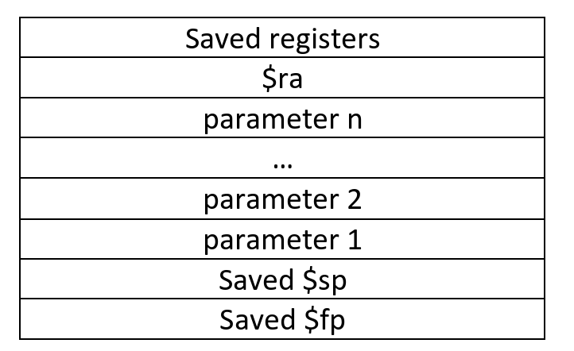

# Tut 01 - More on MIPS Assembly

## Problems

### 1. Basic C to MIPS Assembly

The key idea in this problem is that variables declared **outside `main()` are global variables**, so they are stored in the **Data memory region**. For example:


```c
int a = 3, b = 4, y;  // Global variables

int main() {
    // ...
}
```


Because the number of registers is limited, passing all parameters through registers can become restrictive. To overcome this limitation, we use the [**stack**](https://app.gitbook.com/s/5cfVJRHhgDkjMTtQIPfW/virtualization/cpu-virtualization/the-process#user-stack) to store and pass parameters between functions. This is the main motivation for using a stack.

### 2. A Sneak Preview of Frame Pointer

We've already seen the motivation of using a frame pointer in our [lecture notes](https://app.gitbook.com/s/5cfVJRHhgDkjMTtQIPfW/virtualization/cpu-virtualization/the-process#frame-pointer), please feel free to go back and have a relook if necessary.

### \*4. Full Calling Convention

In this problem, we will see how the compiler follows the [**calling convention**](https://app.gitbook.com/s/5cfVJRHhgDkjMTtQIPfW/virtualization/cpu-virtualization/the-process#calling-convention) **defined by the ABI** of the ISA being used. Suppose our calling convention is:

1. **Caller**
   1. Push `$fp` and `$sp` onto the stack.
   2. Copy `$sp` to `$fp`. (Now `$fp` and `$sp` both point to the bottom of the newly added stack frame, which is the location of the saved `$fp`)
   3. Reserve enough stack space for the parameters by adjusting `$sp`.
   4. Store the parameters on the stack using offsets from `$fp`.
   5. Use `jal` to call the callee.
2. **Callee**
   1. Push `$ra` onto the stack.
   2. Allocate enough space for local variables.
   3. Push any registers that will be used.
   4. Use `$fp` to access the parameters.
   5. Compute the result.
   6. Store the result on the stack.
   7. Restore the saved registers.
   8. Restore `$ra` from the stack.
   9. Return to the caller using `jr $ra`.


Note that **2.b and 2.c are not redundant**. Although the local variables will eventually be loaded into registers for computation, we still need to **allocate stack space for them** in the newly created stack frame.


3. **Caller (after the function returns)**
   1. Retrieve the result from the stack.
   2. Restore `$sp` and `$fp`.


The assembly instructions for creating a new stack frame are generated by the **compiler**. The compiler can inspect the function prototype in the `.h` header file, such as `int f(int, int)`, to determine **how much space is needed for the parameters**.


The newly created **stack frame** for the callee therefore contains the parameters, return address, and saved registers, which can be shown as follows:

<figure><figcaption></figcaption></figure>

In the diagram above, **saved** `$fp` **marks the bottom (start) of the newly created stack frame**. Therefore, the frame pointer `$fp` for this stack frame should point to this location.


Technically, the compiler could also reserve a separate area in the stack frame for the function's return value. However, in this example, we assume that the function uses the space originally allocated for the **first parameter** to store the returned result.


So, the answer for this question is as follows:




```c
int f(int x, int y) {
    return 2 * (x + y);
}

int a = 3, b = 4, y;

int main(void) {
    y = f(a, b);
    return 0;
}
```




This question requires some planning. The caller needs to reserve:

* **8 bytes** to save `$sp` and `$fp`
* **8 bytes** to pass parameters `a` and `b`
* **4 bytes** for the callee to save `$ra`

Therefore, the caller must reserve a total of **20 bytes** for the stack frame. The resulting stack layout is:

| Offset from $fp | Contents    |
| --------------- | ----------- |
| 0               | Saved `$fp` |
| 4               | Saved `$sp` |
| 8               | `a`         |
| 12              | `b`         |
| 16              | Saved `$ra` |

And the final MIPS Assembly code is as follows:


```mipsasm
f:      sw $ra, 16($fp)         ; Save $ra
        addi $sp, $sp, 8        ; Reserve 8 bytes on stack to store registers
                                ; we want to use
        sw $t0, 20($fp)         ; Save $t0 and $t1 which we intend to use
        sw $t1, 24($fp)
        lw $t0, 8($fp)          ; Load value of a
        lw $t1, 12($fp)         ; Load value of b
        addi $t1, $t0, $t1      ; a + b
        sll $t1, $t1, 1         ; 2(a + b)
        sw $t1, 8($fp)          ; Write result back to stack frame
        lw $t0, 20($fp)         ; Restore $t0 and $t1
        lw $t1, 24($fp)
        addi $sp, $sp, -8       ; Deallocate space on stack for $t0, $t1
        lw $ra, 16($fp)         ; Restore $ra
        jr $ra                  ; Return to caller

main:   sw $fp, 0($sp)          ; Save $fp
        mov $fp, $sp            ; Copy $sp to $fp. Can also use addi $fp, $sp, 0
        sw $sp, 4($sp)          ; Save $sp to stack frame
        addi $sp, $sp, 20       ; Reserve 20 bytes for stack frame
        la $t0, a               ; Load a
        lw $t0, 0($t0)
        sw $t0, 8($fp)          ; Write a to stack
        la $t0, b               ; Load b
        lw $t0, 0($t0)
        sw $t0, 12($fp)         ; Write to stack
        jal f                   ; Call f
        lw $t0, 8($fp)          ; Retrieve result
        la $t1, y               ; Store to y
        sw $t0, 0($t1)
        lw $sp, 4($fp)          ; Restore $sp. We don’t need to explicitly subtract 20 from sp.
        lw $fp, 0($fp)          ; Restore $fp
        li $v0, 10              ; Return to OS
        syscall
```



To **restore a register value** previously saved on the stack, we simply load it back into the register using `lw $regName, location`. In other words, restoring a register is just **loading its saved value from the stack back into the register**.




### 7. Memory Context of the Process

The question is that in the following C code, where are `a` and `*a` stored among the four memory regions of a process?


```c
#include <stdlib.h>

int fun1(int x, int y) {
    int z = x + y;
    return 2 * (z - 3);
}

int c;

int main(void) {
    int *a = NULL;
    int b = 5;

    a = (int *)malloc(sizeof(int));
    *a = 3;

    c = fun1(*a, b);

    free(a);
    return 0;
}
```


In this code, we can observe that:

1. **`a`** is a pointer variable declared inside `main()`. Since it is a local variable, `a` itself is stored in the **stack frame** of `main()`.
2. **`*a`** refers to the value stored at the address held by the pointer variable `a`. Since this memory (address) is allocated using `malloc()`, the value  `*a` is located on the **heap**.
