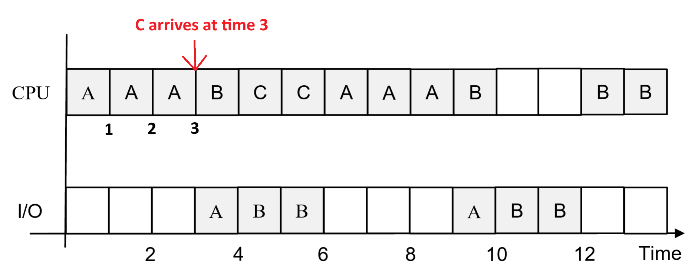

# Tut 03 - Process Scheduling

## Problems


Before attempting this tutorial, it's highly recommended to go through my notes on [Scheduling](https://app.gitbook.com/s/5cfVJRHhgDkjMTtQIPfW/virtualization/cpu-virtualization/scheduling "mention")!


### 1. Time Quantum

In modern operating systems, the **time quantum can be dynamic** rather than fixed. The scheduler may adjust it based on the system load and scheduling policy: when the CPU is heavily loaded, processes may receive **shorter effective CPU time slices**, while lighter loads may allow them to run for longer.

### \*2. Walk Through the Scheduling Algorithms

In **NUS CG2271**, we follow these conventions when scheduling tasks:

1. The task that **arrives earlier** is scheduled first.
2. If two tasks arrive at the **same time**, choose the task according to **alphabetical order**.
3. A task arriving at time $$x$$ becomes ready **exactly at time** $$x$$ (on the horizontal axis), as illustrated below.

<figure><figcaption></figcaption></figure>

Another useful relationship to remember is:

$$
\text{Waiting Time}=\text{Turnaround Time}-\text{Service Time}
$$

where **service time** is the total time during which the task is actually running on the CPU.


The part C of this problem (RR scheduling) is worth trying again before exams!

