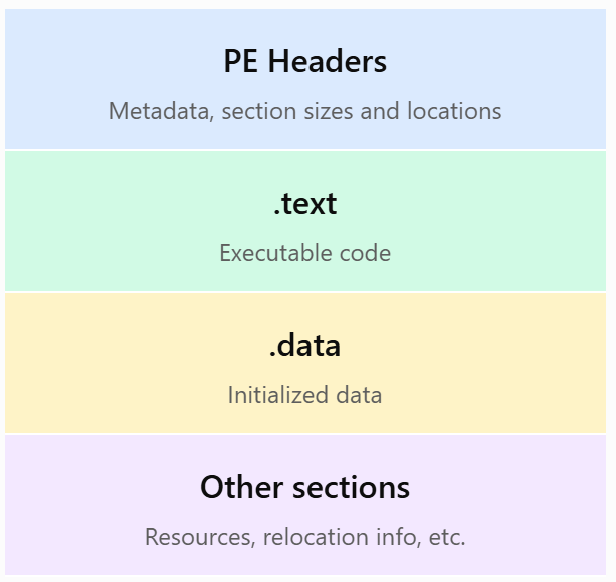
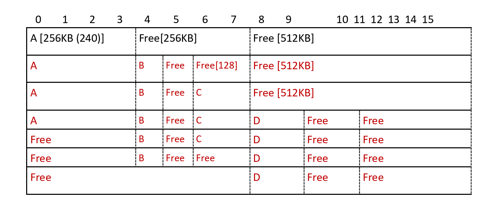

# Tut 07 - Contiguous Memory Allocation

## Problems





### 01. Linked List Dynamic Partitioning

A Windows `.exe` file typically uses the Portable Executable (PE) format, which contains headers describing how the executable is organized.

<figure><figcaption></figcaption></figure>

### 02-03. Dynamic Partitioning

1. In some cases, Worst-Fit can be faster than Best-Fit. If free holes are maintained in descending order of size, Worst-Fit can select the largest hole in $$O(1)$$ time, while Best-Fit may require searching for the smallest hole large enough to satisfy the request.
2. Modern operating systems generally do not use simple contiguous dynamic partitioning to allocate an entire process because contiguous dynamic partitioning doesn't support **virtual memory well**!
3. But freertos uses contiguous memory allocation because in FreeRTOS, the tasks usually never exit, so there is no or very few deallocation, thus the holes are very few.
4. In real-time systems using [Rate Monotonic Scheduling (RMS)](https://app.gitbook.com/s/5cfVJRHhgDkjMTtQIPfW/virtualization/cpu-virtualization/scheduling#rate-monotonic-scheduling), dynamic memory allocation can introduce unpredictable execution times. With First-Fit, repeated allocations and deallocations may increase fragmentation and the number of holes, potentially increasing the time required to find a suitable free region. This increases a task's worst-case execution time (WCET), potentially causing it to miss its deadline.
   1. When analyzing memory allocation algorithms in an RTOS, the total memory size may be treated as a known constant. Consequently, even an algorithm that traverses all memory blocks has a bounded execution time, which can technically be considered $$O(1)$$ for a fixed memory configuration.

### \*04. Buddy System

The key idea here is to know how to draw the linked list in a buddy system, which is vividly shown as follows:

<figure><figcaption></figcaption></figure>

Or, I think it will be faster to draw the following kind of diagram during the exam:

<figure><figcaption></figcaption></figure>

### 05. Overhead

The **minimum memory management** overhead occurs when the entire available memory region is free and contiguous, as the OS only needs one linked-list node to store its information.
