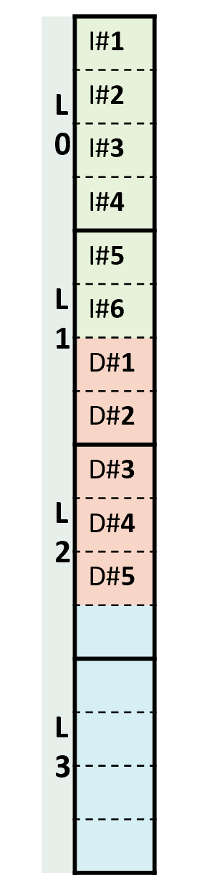

# Tut 08 - Disjoint Memory Allocation

## Problems

### \*1. Walkthrough Paging/Segmentation/Combine both

For simplicity, we will use word-addressable memory in this question, even though memory is typically byte-addressable. To solve this type of question more efficiently, I recommend writing down the logical address of each data item according to the memory allocation scheme:

1. **Paging**: Write the logical address as $$\langle P,D\rangle$$, where P is the page number containing the data and D is the offset within that page.
2. **Segmentation**: Write the logical address as $$\langle \text{SegID},\text{Offset}\rangle$$, where SegID identifies the segment containing the data and Offset is the offset within that segment. The physical address is simply: PA=Base\[SegID]+Offset.
3. **Segmentation with Paging**: Write the logical address as $$\langle S,P,D\rangle$$, where S is the segment number, P is the page number within that segment, and D is the offset within that page.

Most importantly, before applying paging, segmentation, or their combination, always write out the data in its **original sequential order in logical memory**! This makes it much easier to identify the correct page numbers, segment numbers, and offsets when performing address translation, as illustrated in the following figure.

<figure><figcaption>
Paging with illustration
</figcaption></figure>

FYI: Segementation in early Intel CPUs

The original Intel 8086 was a 16-bit processor, meaning its general-purpose registers were 16 bits wide. However, Intel wanted it to address up to 1 MB of physical memory, which requires 20-bit addresses.

To overcome this limitation, Intel introduced **memory segmentation**, where each logical address consists of a 16-bit segment value and a 16-bit offset:

\text{PA}=(\text{Segment}\times 16)+\text{Offset}

This allows the processor to generate 20-bit physical addresses using 16-bit registers.


For more on how modern CPUs support backward-compatibility, can go to see my [DDCA notes](https://app.gitbook.com/s/jTJFBPtKk6NwweAooH53/lec/lec-03-risc-v-isa-and-microarchitecture#risc-v-features)!


### 4. Buddy System

Not sure why this contiguous memory allocation algorithm appears here. However, there are a few interesting points worth noting:

1. **Worst-case internal fragmentation**: Assuming the Buddy System can divide memory into blocks as small as 1 byte, the worst-case internal fragmentation occurs when a process requests just over half of a block's size. For a block of size $$2^n$$ bytes, the maximum wasted space is: $$2^{n-1}-1\text{ bytes}$$.
   1. Thus, the worst-case internal fragmentation rate approaches 50% as the block size increases. This is because if a request can fit into half of the current block, the Buddy System will split the block further.
2. Average internal fragmentation: If we assume that the internal fragmentation rate is uniformly distributed between 0% and 50%, we can estimate the average as:

$$
\text{Average Internal Fragmentation Rate}\approx\frac{0\%+50\%}{2}=25\%
$$


However, in real-world scenario, the OS usually cannot divide memory into blocks all the way down to 1 byte!

