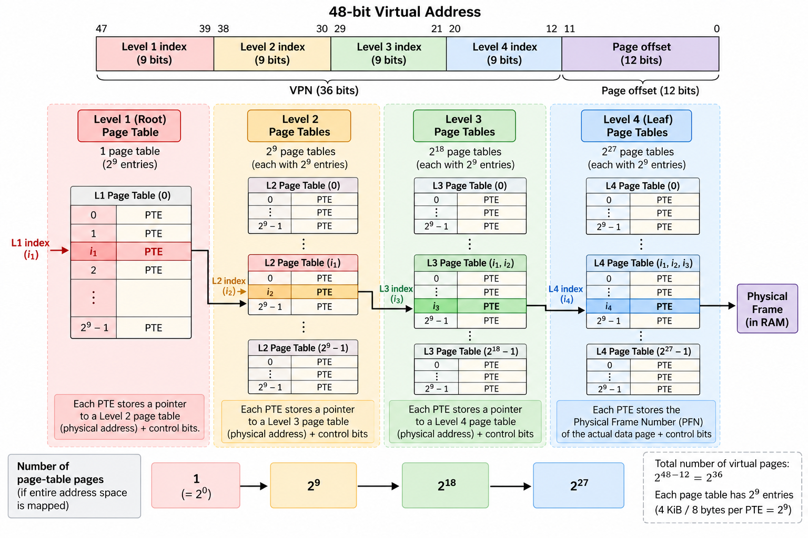

# Tut 09 - Virtual Memory Management

## Problems

### \*1. Connect Everything

1. In **NUS CG2271**, we adopt the convention that the **valid bit** in a Page Table Entry (PTE) indicates whether the corresponding virtual page belongs to the process's valid virtual address space.
2. When considering the **worst-case page fault handling time**, suppose a page fault occurs when all physical frames are occupied. The OS must first evict an existing page to make room for the requested page. In the worst case, the selected page is **dirty (modified)**, meaning that its contents must first be written back to secondary storage before the requested page can be loaded into RAM. Therefore, this requires **two secondary storage transfers: one write and one read**, significantly increasing the page fault handling time.
3.  **(Connecting Everything!)** When a **page fault** occurs because the requested page is not resident in RAM, the OS may need to perform an **I/O operation** to load the page from secondary storage.

    In this case, the OS typically **blocks the faulting process** while waiting for the I/O operation to complete. During this time, the OS scheduler can switch the CPU to another ready process, improving CPU utilization. Once the required page has been loaded into RAM, the blocked process becomes ready again and can eventually resume execution.


Prof. Colin emphasized in this tutorial that CG2271 is a course where we should constantly try to **connect the concepts we have learned**. As we have seen throughout DDCA, different components of a computer system are deeply interconnected, and understanding these connections helps us appreciate how the entire system works together! Full circle moment here!


1. The main motivation for **multi-level paging** is to reduce the physical memory overhead required to store page tables. Instead of allocating a complete page table, we divide it into smaller tables and allocate them only when needed.
   1. In a **multi-level paging scheme**, if all page tables are resident in RAM, a page fault requires at most **two secondary storage accesses** for page replacement: one to write back the dirty victim page and another to load the requested page.
   2. However, if a **lower-level page table is itself not resident in RAM**, accessing it may cause an additional page fault. Therefore, under this assumption, **two or more page faults** may occur: one for the missing page-table page and another for the requested data page, potentially requiring **four secondary storage accesses** in total.

### \*2. Multi-Level Page Table

In this question, we are asked to **construct a multi-level page table**. The idea is quite simple:

> we start by calculating the total number of virtual pages in the address space, then progressively divide the page table into smaller tables that can each fit within a single page.

For example, suppose we have a **48-bit virtual address**, a **page size of 4 KiB (**$$2^{12}$$ **bytes)**, and a **PTE size of 8 bytes**. The total number of virtual pages is:

$$
2^{48-12}=2^{36}
$$

Suppose we are doing progressive multi-level paging here, since each page table must fit within a single 4 KiB page (assume we use one page to store the page table), the number of PTEs that each page table can hold is:

$$
\frac{2^{12}}{2^3}=2^9
$$

Therefore, we can progressively divide the original $$2^{36}$$ PTEs into smaller page tables:

* **Level 4 (leaf):** Each page table contains $$2^9$$ PTEs, mapping up to $$2^9$$ virtual pages. Requires $$2^{36-9}=2^{27}$$ page tables to reference all virtual pages.
* **Level 3:** Requires $$2^{27-9}=2^{18}$$ page tables to reference all Level 4 tables.
* **Level 2:** Requires $$2^{18-9}=2^9$$ page tables to reference all Level 3 tables.
* **Level 1 (root):** Requires only **one page table**, containing $$2^9$$ entries.

Hence, we obtain a **4-level page table**, with each level using 9 bits of the virtual address for indexing. This hiearachy is thus shown as follows:

<figure><figcaption></figcaption></figure>

It is important to understand what each PTE stores at different levels of the page table:

* **Intermediate levels:** Each entry is selected using the corresponding virtual address index and contains a **pointer (physical address) to the next-level page table**, together with relevant control bits.
* **Last level (leaf):** Each entry is selected using the final index and contains the **Physical Frame Number (PFN)** of the actual data page

Thus, multi-level paging works by repeatedly using portions of the virtual address to locate the next-level page table until the final PTE provides the physical frame number.


In [**direct paging**](../lec/lec-09-virtual-memory-management.md#direct-paging), the page table index corresponds directly to the **Virtual Page Number (VPN)**. However, in [**multi-level paging**](../lec/lec-09-virtual-memory-management.md#id-2-level-paging), the VPN is divided into several smaller indices, each used to select an entry at a particular level of the page table. The indices at intermediate levels locate the next-level page tables, while the final index selects the PTE containing the **Physical Frame Number (PFN)**. Thus, **the concatenation of all page table indices forms the complete VPN**.


### 3. Page Replacement

In this question, we assume that **global page replacement** is used, meaning that when a process needs to evict a page, it can select a victim page from **any process**, including other processes, rather than being restricted to its own allocated frames.
