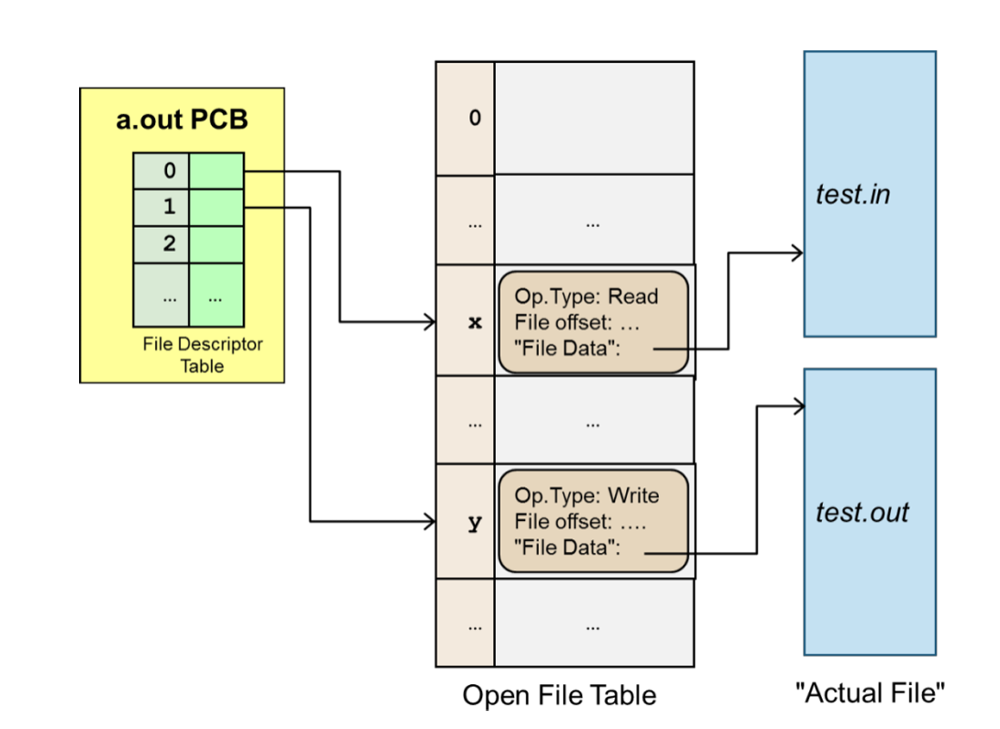

# Tut 10 - File Abstraction

## Problems

### 1. Working Set Model

Nothing too much to note down here. It suffices to know the motivation of the working set model, which is well written in my [Lecture notes](../lec/lec-09-virtual-memory-management.md#working-set-model)!

### 2. Wrapping File Operation

The given program here is just to let us find out the size of our buffer. But, if we run it on different platforms, we might not get the expected output as we want bucause the implementation is different!

### 3. Open File Table

1. This question is a bit wrong I think. As in the lecture, we've learned that the open-flie object in the system-wide open-file table is **per-open** not per-file!
2. Process A cannot accidentally access Process B's open-file entries using Process B's file descriptors, because each process has its own file descriptor table.
3. In Unix, **file descriptor 0 (stdin)** normally refers to the terminal's standard input (typically the keyboard), while **file descriptor 1 (stdout)** normally refers to the terminal's standard output (typically the screen). (Full circle moment from [Lec 5](../lec/lec-05-inter-process-communication.md#redirecting-standard-input-output)!)
   1. However, Unix supports **I/O redirection**, allowing a process's standard input and output to be redirected to other files. As shown in the figure, the process's file descriptor table can be configured so that `stdin` (FD 0) reads from `test.in`, while `stdout` (FD 1) writes to `test.out`, instead of using the terminal.

<figure><figcaption></figcaption></figure>
