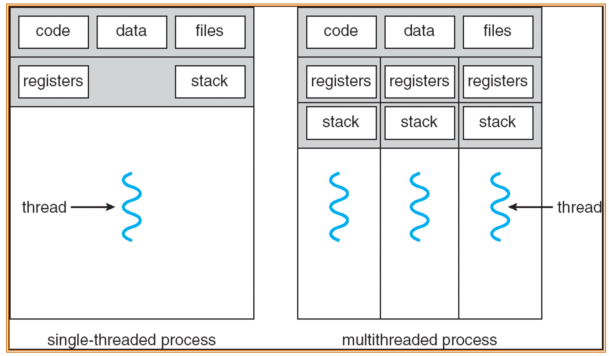
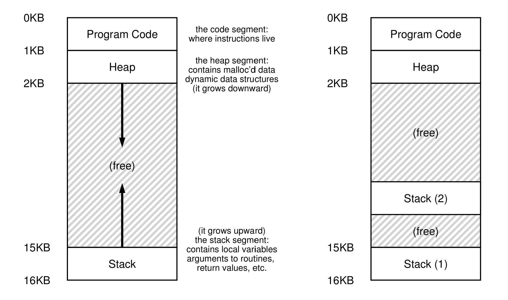

# Introduction

We have already seen how a single physical CPU can be abstracted into multiple **virtual CPUs**, creating the illusion that multiple programs are running simultaneously. This is known as **virtualization**.

In this section, let's start the second pillar of our OS journey — Concurrency and we start by introducing another abstraction within a single running process: the **thread**. Instead of the traditional view of a program having a **single point of execution** (one PC fetching and executing instructions), a **multithreaded program** has multiple points of execution, with each thread having its own PC. Another way to think about this is that each thread is similar to a **separate process**, except that

> threads within the same process share the same address space and can therefore access the same data.

The state of a **thread** is similar to that of a process. Each thread has its own **program counter (PC)** and a private set of **registers** used for computation.

<figure><figcaption></figcaption></figure>

When switching between threads, a [**thread context switch**](#user-content-fn-1)[^1] is required: the current thread's register state must be saved, and the next thread's register state restored (sometimes including the SP and FP). Similar to how processes save states to [Process Control Blocks (PCB)](../virtualization/cpu-virtualization/the-process.md#process-control-block), this state can be stored in a **Thread Control Block (TCB)**.


The key difference is that threads within the same process **share the same address space**. Therefore, unlike a process context switch, there is **no need to switch the page table** (Don't worry if you don't know that is a page table, we will know it in the later chapters!)


Another major difference between **threads and processes** is the **stack**. In a traditional [**single-threaded process**](#user-content-fn-2)[^2], there is only **one thread of execution**, so only **one stack** is needed in the process's address space (Figure 26.1, left)

<figure><figcaption>
Figure 26.1: Single-Threaded and Multi-Threaded Address Spaces
</figcaption></figure>

However, in a **multithreaded process**, each thread executes independently and may call different functions. Therefore, each thread needs its **own private stack** to store its function calls, local variables, and other execution information. For example, in Figure 26.1, right, a process with two threads will have **two separate stacks within the same shared address space**.


Thus, we say each thread has its own registers and user stacks! This knowledge point will be tested in [CG2271 Tutorial 4](https://app.gitbook.com/s/U2H1IohCa1n4UnV3qHk8/tut/tut-04-introduction-to-posix-threads#id-2.-find-the-maximum-of-a-large-array)!


This also complicates the **address space layout**. In a single-threaded process, the stack and heap can grow independently, with a problem only arising when they run out of available address space. In a multithreaded process, each thread has its own stack, leaving less contiguous space for the heap and other regions.


Fortunately, this is usually not a major issue because **thread stacks are typically small**, except in programs that make heavy use of recursion.


[^1]: This is different but very similar to the **process context switch**.

[^2]: This is the classic process that we've seen in the first pillar.
