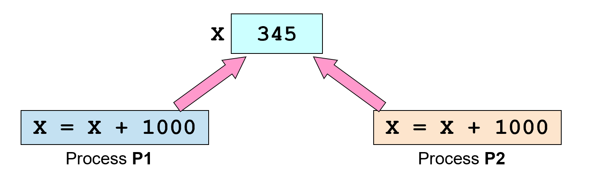
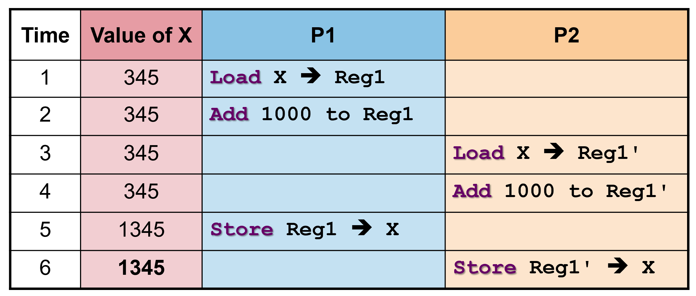
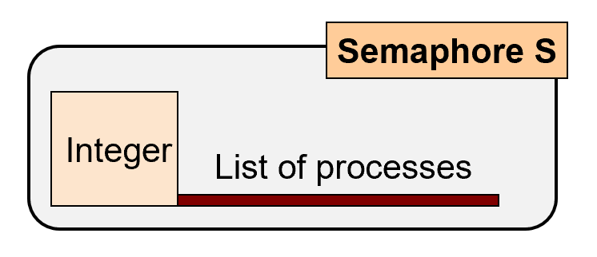
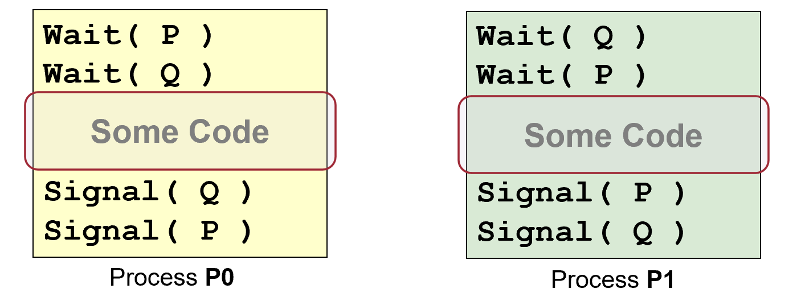
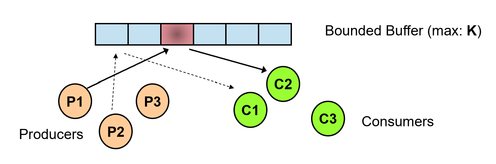
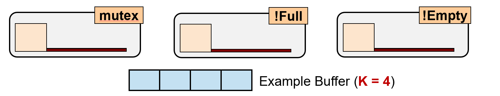
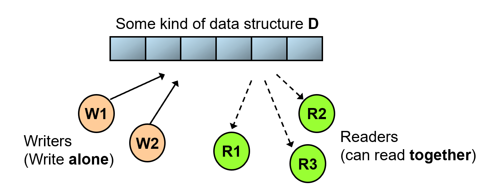

# Semaphores

In this section, we introduce **semaphores**, a general synchronization primitive used to coordinate the execution of multiple threads and prevent problems caused by concurrent access to shared resources. The notes will follow this flow:

1. **Motivation for synchronization and key concepts**
   * Why synchronization is needed in multithreaded programs
   * **Critical section** and the requirements for protecting it
2. **Implementing synchronization**
   * **Atomic instructions (Test-and-Set)**: first understand synchronization at the software/instruction level
   * **Semaphores:** a general-purpose synchronization mechanism built on top of atomic operations
3. **Classic semaphore problems**
   * Three standard problems that illustrate how semaphores are used to solve synchronization issues.

## Motivation

In this part, we discuss **why synchronization is needed** in multithreaded programs and introduce the concept of a **critical section**.

### Race Condition

One of the biggest problems in multithreaded programs is the **race condition**. It occurs when:

1. Two or more processes/threads execute **concurrently**, with their instructions potentially interleaving.
2. They **share a modifiable resource**.


If concurrent processes/threads do not share a modifiable resource, there is **no** race condition.


A sequential program is **deterministic**: repeated executions with the same input produce the same result.

> In contrast, concurrent programs can be **non-deterministic** because the outcome may depend on the order in which threads access or modify the shared resource.

This situation is known as a **race condition**.

<details>

<summary>Race Condition Example</summary>

Consider two processes, **P1** and **P2**, that both execute:

<figure><figcaption></figcaption></figure>

With the initial value `x = 345`, both P1 and P2 satisfy the conditions for a **potential race condition**. Although `x = x + 1000` looks like a single operation, it is actually executed as three steps:

1. **Load** `x` into a register.
2. **Add** `1000` to the register.
3. **Store** the result back into `x`.

Because P1 and P2 execute concurrently, these instructions may be **interleaved**. For example, both processes may load the same old value of `x` before either one stores its updated result.

<figure><figcaption></figcaption></figure>

As a result, one process may **overwrite the update made by the other process**, causing the final value of `x` to be incorrect. This is the **race condition problem**.

</details>

### Critical Section

To solve the **race condition** problem, we designate the part of the program that accesses a shared resource as the **critical section (CS)**.


A critical section can be any code that **reads or modifies a shared resource**, such as a global variable or a shared register in an MCU such as the MCXC444.


The key rule is:

> **At any point in time, only one process/thread can execute in the critical section.**

Thus a typical program can be structured as:


```c
// Normal code

Enter CS

// Critical section
// Access/modify shared resource

Exit CS

// Normal code
```


The purpose of **Enter CS** and **Exit CS** is to ensure that concurrent processes do not access the critical section at the same time.


We will talk more about the implementation of the `EnterCS()` and `ExitCS()` soon!


### Symptoms of Incorrect Synchronization

Incorrect synchronization can lead to three common problems:

1. Deadlock
2. Livelock
3. Starvation

We first introduce their basic ideas here and will see more concrete examples when discussing the **implementation of entering and exiting critical sections**.

#### **Deadlock**

A **deadlock** occurs when a group of processes/threads are **blocked waiting for one another**, so none of them can make further progress.

#### **Livelock**

A **livelock** occurs when processes/threads are **not blocked and keep changing their states**, often in an attempt to avoid a conflict, but still make **no useful progress**. For example, suppose two devices try to transmit over a shared medium at the same time:

1. Both detect a conflict and back off.
2. Both wait for the same amount of time.
3. Both retry simultaneously and conflict again.
4. The cycle repeats indefinitely.

The processes remain **active**, but neither completes its work.


**Deadlock:** processes are blocked and make no progress. **Livelock:** processes are active but still make no progress.


#### **Starvation**

**Starvation** occurs when a particular process/thread is **indefinitely prevented from making progress** because other processes repeatedly get access to the resource it needs.

## Critical Section Implementations

To implement a critical section correctly, we need to implement the `EnterCS()` and `ExitCS()` operations so that they properly handle concurrent access to shared resources.

We will first introduce **atomic instructions**, specifically the **Test-and-Set instruction**, as a basic mechanism for achieving mutual exclusion. We will then see how **semaphores** provide a more flexible and practical synchronization mechanism.

### Atomic Instructions

We have already seen the concept of **atomic instructions** in [NUS CG3207](https://app.gitbook.com/s/jTJFBPtKk6NwweAooH53/lec/lec-08-io-and-exception-handling/lec-08a-embedded-i-o-systems#data-transfer-models). An atomic instruction is executed as a **single indivisible operation**: no other process/thread can observe or interrupt it halfway through. A common atomic instruction used for synchronization is **Test-and-Set**. Different architectures provide their own versions, for example:

* **x86:** `XCHG`
* **RISC-V:** `AMOOR.W`

Conceptually, a Test-and-Set instruction can be written in C as:

```c
int TestAndSet(int *old_ptr, int new)
{
    int old = *old_ptr;  // Fetch old value
    *old_ptr = new;      // Store new value
    return old;          // Return old value
}
```

The operation does two things **atomically**:

1. **Test** the old value by returning it.
2. **Set** the memory location to `new`.


The important point is that **fetching the old value and updating the memory location happen as one atomic machine operation**. This allows Test-and-Set to be used to implement mutual exclusion and protect a critical section.


We can use **Test-and-Set** to implement `EnterCS()` and `ExitCS()`. Let `lock` indicate whether the critical section is currently occupied:

* `lock = 0`: critical section is **available**
* `lock = 1`: critical section is **occupied**

The implementation is as follows;


```c
void EnterCS(int *lock)
{
    while (TestAndSet(lock, 1) == 1)
        ;   // Keep waiting
}

void ExitCS(int *lock)
{
    *lock = 0;
}
```


Initially, we set:

```c
int lock = 0;
```

When a process calls `EnterCS()`, `TestAndSet(lock, 1)` **atomically reads the old value of** `lock` **and sets it to** `1`:

* If the returned value is `0`, the process successfully acquires the lock and enters the critical section.
* If the returned value is `1`, another process already holds the lock, so it repeatedly executes `TestAndSet()` until the lock becomes available.

When the process finishes the critical section, it calls `ExitCS()`, which sets `lock = 0`, allowing another waiting process to enter.


#### **Busy Waiting**

A major disadvantage of the Test-and-Set approach is **busy waiting**. When a process cannot acquire the lock, it continuously executes the `while` loop to check whether the lock is available. Thus, its **CPU time quantum is wasted** while waiting, instead of giving up the CPU to another process that could perform useful work. To solve this problem, let's introduce semaphores!


### Semaphores

First proposed by the computer scientist **Edsger Dijkstra**, a **semaphore** is an object with a **non-negative integer value** that provides a general mechanism for synchronization. It is manipulated using two atomic operations:

* `wait(S)`: If $$S \le 0$$, the process **blocks**; otherwise, $$S$$ is decremented.
* `signal(S)`: Increment the available semaphore count. And then if processes are waiting, **wake one waiting process**.

Conceptually:


```
wait(S):
    if S <= 0:
        block
    S = S - 1

signal(S):
    S = S + 1
    wake up a waiting process, if any
```


The operations are designed so that the semaphore value **never becomes negative**.


In Dijkstra's original notation, `wait()` and `signal()` are also called `P()` and `V()`, respectively.


For protecting a critical section, we can think of `wait()` and `signal()` to be exactly the `EnterCS()` and `ExitCS()` that we've seen before so both of them are executed **atomically**, meaning that the `wait()` and `signal()` will be implemented using the atomic instructions! Thus, the basic usage is:


```c
// Initialize semaphore to a non-negative value
wait(S)
// Critical section
signal(S)
```



In **NUS CG2271**, we use the convention that a semaphore's value is always **non-negative**. Therefore, the semaphore value **does not indicate how many threads/processes are currently blocked** because of this semaphore.


<details>

<summary>Better understand Semaphores</summary>

To aid our understanding, a semaphore can be visualized as an object containing:

* An **integer value** $$S$$, representing the available permits.
* A **waiting list** of processes/threads that are blocked on the semaphore.

<figure><figcaption></figcaption></figure>

The behavior of `wait(S)` and `signal(S)` can then be understood as follows:

* `wait(S)`
  * If $$S>0,$$ decrement $$S$$ and **continue execution**.
  * If $$S=0$$, the process **blocks and is added to the waiting list**.
* `signal(S)`
  * increment $$S$$.
  * If processes are waiting in the queue, **wake one waiting process** from the waiting queue, allowing it to proceed.

Suppose semaphore S is initialized to 1, and two threads T0 and T1 want to enter the same critical section.

<table><thead><tr><th width="42.5" align="right">S</th><th width="229.5">Thread T0</th><th width="90">State</th><th width="230">Thread T1</th><th width="90">State</th></tr></thead><tbody><tr><td align="right">0</td><td><code>wait(S)</code> -> check S>0, decrement S:1->0</td><td>Running</td><td></td><td>Ready</td></tr><tr><td align="right">0</td><td><code>wait(S)</code> returns -> enter CS</td><td>Running</td><td></td><td>Ready</td></tr><tr><td align="right">0</td><td><strong>Context switch -> T1</strong></td><td>Ready</td><td></td><td>Running</td></tr><tr><td align="right">0</td><td></td><td>Ready</td><td><code>wait(S)</code> -> check  <span class="math">S\leq0</span>, block</td><td>Running</td></tr><tr><td align="right">0</td><td></td><td>Ready</td><td><strong>block / sleep</strong></td><td>Sleeping</td></tr><tr><td align="right">0</td><td><strong>Context switch -> T0</strong></td><td>Running</td><td></td><td>Sleeping</td></tr><tr><td align="right">0</td><td>finish critical section</td><td>Running</td><td></td><td>Sleeping</td></tr><tr><td align="right">1</td><td><code>signal(S)</code> -> increment 0->1, wake T1</td><td>Running</td><td></td><td><strong>Ready</strong></td></tr><tr><td align="right">1</td><td>continues executing</td><td>Running</td><td></td><td>Ready</td></tr><tr><td align="right">1</td><td><strong>Context switch -> T1</strong></td><td>Ready</td><td></td><td>Running</td></tr><tr><td align="right">0</td><td></td><td>Ready</td><td><code>wait(S)</code> -> check S>0, decrement S:1->0</td><td>Running</td></tr><tr><td align="right">0</td><td></td><td>Ready</td><td><code>wait(S)</code> returns -> enter CS</td><td>Running</td></tr><tr><td align="right">0</td><td></td><td>Ready</td><td>finish critical section</td><td>Running</td></tr><tr><td align="right">1</td><td></td><td>Ready</td><td><code>signal(S)</code> -> increment 0->1</td><td>Running</td></tr></tbody></table>

</details>

#### Types of Semaphores

Based on the range of **non-negative values** a semaphore can take, semaphores can be categorized into two types:

1. Counting Semaphore
2. Binary Semaphore



#### Counting Semaphores

A **counting semaphore**, also called a **general semaphore**, can take any non-negative integer value:

$$
S=0,1,2,3,\ldots
$$

It is useful when **multiple instances of a resource** are available, where $$S$$ represents the number of available permits/resources.


#### [Conditional Variables](the-thread/thread-api.md#conditional-variables) vs. Counting Semaphores

A key difference between a **condition variable** and a **counting semaphore** is how waiting threads are awakened:

* **Condition variable:** `broadcast()` can wake up **all waiting threads** at once.
* **Counting semaphore:** a single `signal()` operation wakes up **at most one waiting thread**.

Therefore, condition variables provide a **broadcast mechanism**, while semaphores do not.




#### Binary Semaphores

A **binary semaphore** can take only two values:

$$
S\in\{0,1\}
$$

It is commonly used to enforce **mutual exclusion**, allowing only one thread/process to access a critical section at a time.


#### Mutex vs. Binary Semaphores

In NUS CG2271, or in FreeRTOS, the difference between [mutex](https://app.gitbook.com/s/U2H1IohCa1n4UnV3qHk8/lab/lab-03-rtos-and-uart#create-a-mutex) and a [binary semaphore](https://app.gitbook.com/s/U2H1IohCa1n4UnV3qHk8/lab/lab-03-rtos-and-uart#create-a-binary-semaphore) is that a mutex is nothing but a binary semaphore which is initialized to 1, while a binary semaphore in FreeRTOS is always intialized to 0.




<details>

<summary>Incorrect Use of Semaphore: Deadlock</summary>

Although semaphores can prevent race conditions, **incorrect use of semaphores can itself cause** [**deadlock**](semaphores.md#deadlock). For example, suppose semaphores P=1 and Q=1 initially.

<figure><figcaption></figcaption></figure>

* Process P0 executes `wait(P)` and acquires P, then before it executes `wait(Q)`, it gets context switched to process P1.
* Process P1 executes `wait(Q)` and acquires Q, then executes `wait(P)`.

Now, P1 holds Q and waits for P.  P0 holds P and waits for Q. Neither process can proceed to its `signal()` operations, so both remain **blocked forever**.


Deadlock can occur when processes acquire multiple semaphores in **different orders**, causing each process to wait for a resource held by the other. According to Prof. Colin, deadlocks created by this issue is almost impossible to eliminate and very hard to debug, so as a multi-threaded programmer, we should try our best to ensure the order of semaphores are correct.


</details>

## Classical Synchronization Problems

In this part, we introduce three classic synchronization problems that illustrate how **semaphores can be used to coordinate concurrent processes/threads**:

1. Producer-Consumer (Bounded Buffer) Problem
2. Reader-Writer Problem
3. Dining Philosophers Problem

### Producer-Consumer Problem

The **Producer-Consumer Problem**, also known as the **Bounded Buffer Problem**, was first posed by **Edsger Dijkstra**.


A fun fact about this problem is that it was this very producer/consumer problem that led Dijkstra and his co-workers to invent the generalized semaphore!


So, the producer-consumer problem is: consider one or more **producer threads** and **consumer threads** sharing a finite **buffer**:

* **Producers** generate data and place it into the buffer **only when the buffer is not full**.
* **Consumers** remove and consume data **only when the buffer is not empty**.

Since producers and consumers **share and modify the same bounded buffer**, their concurrent execution can lead to a **race condition**!

<figure><figcaption></figcaption></figure>

We will first see how to solve this problem using **busy waiting**, and then use **semaphores** to achieve synchronization without wasting CPU time.

#### Busy-Waiting Solution

A first attempt is to use a shared **circular buffer** of size $$K$$, with:

* `count`: number of items currently in the buffer.
* `in`: position where the producer inserts the next item.
* `out`: position where the consumer removes the next item.

The producer inserts only when `count < K`, while the consumer removes only when `count > 0`.


```c
// Producer
if (count < K) {
    buffer[in] = item;
    in = (in + 1) % K;
    count++;
}

// Consumer
if (count > 0) {
    item = buffer[out];
    out = (out + 1) % K;
    count--;
}
```


The modulo operation makes the buffer **circular**:

$$
\text{in}=(\text{in}+1)\%K, \text{out}=(\text{out}+1)\%K
$$

so the indices wrap back to 0 after reaching the end. However, there is still a problem!

> The Shared Data Is Still Unprotected

This solution is **not thread-safe**. The producer and consumer concurrently access shared variables such as `count`, `in`, `out`, and `buffer`. For example, `count++` and `count--` are not atomic, so interleaved execution can cause a **race condition**. Therefore, the operations that access the shared buffer must be placed inside a **critical section**:


```c
wait(mutex);

// Access/modify buffer, count, in, out

signal(mutex);
```


where `mutex` is initialized to 1. This ensures that **only one producer/consumer can modify the shared buffer at a time**. However, we also need to determine **when** each side is allowed to try:

* `canProduce`: producer may try when the buffer is **not full**.
* `canConsume`: consumer may try when the buffer is **not empty**.

The producer/consumer waits using:


```c
while (!canProduce);   // Producer
while (!canConsume);   // Consumer
```


These loops solve the synchronization condition, but they use **busy waiting**.


```c
// Producer
while (TRUE) {
    Produce Item;
    while (!canProduce);
    wait( mutex );
    if (count < K) {
        buffer[in] = item;
        in = (in + 1) % K;
        count++;
        canConsume = TRUE;
    } else {
        canProduce = FALSE;
    }
    signal( mutex );
}

// Consumer
while (TRUE) {
    while (!canConsume);
    wait( mutex );
    if (count > 0) {
        item = buffer[out];
        out = (out + 1) % K;
        count--;
        canProduce = TRUE;
    } else {
        canConsume = FALSE;
    }
    signal( mutex );
    Consume Item;
}
```


It correctly coordinates the producer and consumer, but `while (!canProduce)` and `while (!canConsume)` continuously consume CPU time while waiting.


The solution is correct, but **busy waiting wastes CPU resources**. This motivates replacing these waiting loops with **semaphores**, where a thread can sleep until it is able to proceed.


#### Semaphores Solution

To eliminate **busy waiting**, we replace `canProduce` and `canConsume` with two counting semaphores, while keeping a binary semaphore `mutex` to protect the shared buffer. For a buffer of size $$K$$, initialize:

* `mutex = 1`: ensures **mutual exclusion** when accessing the buffer.
* `notFull = K`: number of **empty slots** available.
* `notEmpty = 0`: number of **items** available to consume.



The producer becomes:


```c
while (TRUE) {
    Produce Item;

    wait(notFull);       // Wait until an empty slot exists
    wait(mutex);         // Enter critical section

    buffer[in] = item;
    in = (in + 1) % K;
    count++;

    signal(mutex);       // Exit critical section
    signal(notEmpty);    // One more item is available
}
```




The consumer follows the opposite flow:


```c
while (TRUE) {
    wait(notEmpty);      // Wait until an item exists
    wait(mutex);         // Enter critical section

    item = buffer[out];
    out = (out + 1) % K;
    count--;

    signal(mutex);       // Exit critical section
    signal(notFull);     // One more empty slot is available

    Consume Item;
}
```




The three semaphores therefore have distinct purposes:

1. `mutex`: Protect the shared buffer
2. `notFull`: count available empty slots
3. `notEmpty`: count available items

<figure><figcaption></figcaption></figure>

When the buffer is **full**, `wait(notFull)` blocks the producer. When it is **empty**, `wait(notEmpty)` blocks the consumer. Therefore, unlike the previous solution, waiting threads **sleep instead of busy-waiting**, so CPU time is not wasted.


The order of the `wait()` operations is critical. For example, if the producer executes `wait(mutex)` **before** `wait(notFull)` and the buffer is full, it may go to sleep **while holding `mutex`**. The consumer then cannot acquire `mutex` to remove an item and signal `notFull`, resulting in a **deadlock**. Therefore, always **check/acquire the resource-count semaphore (**`notFull` **/** `notEmpty`**) before acquiring** `mutex`.


So, the main key takeaway from this producer-consumer example is that:

> Binary semaphores are commonly used for **mutual exclusion**, while counting semaphores are used to **track the number of available resources/conditions** and block threads when none are available.


This might help the re-design of ping-pong buffer in my EE4218 project?!


### Reader-Writer Problem

In the **Reader–Writer Problem**, multiple processes/threads share the same data structure $$D$$:

* A **reader** only retrieves information from $$D$$.
* A **writer** modifies information in $$D$$.

Since reading does not modify the data, **multiple readers can access** $$D$$ **simultaneously**. However, a writer must have **exclusive access.**

<figure><figcaption></figcaption></figure>

#### **Semaphore Solution**

To solve this problem, we will use 3 semaphores as follows

* `roomEmpty = 1`: controls access to the shared data $$D$$. If a writer or a group of readers occupies $$D$$, it becomes unavailable.
* `nReader = 0`: keeps track of the number of active readers.
* `mutex = 1`: protects `nReader` itself from race conditions.



The **writer** is straightforward:


```c
while (TRUE) {
    wait(roomEmpty);

    // Modify data

    signal(roomEmpty);
}
```


Thus, once a writer acquires `roomEmpty`, **no reader or other writer can access** $$D$$.



The **reader** requires slightly more logic:


```c
while (TRUE) {
    wait(mutex);
    nReader++;
    if (nReader == 1)
        wait(roomEmpty);      // First reader locks the room
    signal(mutex);

    // Read data

    wait(mutex);
    nReader--;
    if (nReader == 0)
        signal(roomEmpty);    // Last reader releases the room
    signal(mutex);
}
```


The key idea is that readers behave like a **group**:

* The **first reader** (`nReader: 0 -> 1`) executes `wait(roomEmpty)`, preventing writers from entering.
* Additional readers can then enter **without waiting on `roomEmpty`**, so multiple readers can read simultaneously.
* The **last reader** (`nReader: 1 -> 0`) executes `signal(roomEmpty)`, allowing a waiting writer to enter.

Therefore:

$$
\text{First reader locks }D \rightarrow \text{readers share }D \rightarrow \text{last reader unlocks }D
$$



Although this solution satisfies the basic Reader–Writer requirements, it gives **priority to readers**, which might cause writer [starvation](semaphores.md#starvation). Suppose a writer is waiting for `roomEmpty`, but new readers continuously arrive. As long as at least one reader remains:

$$
\text{nReader}>0
$$

`roomEmpty` is never released. The writer may therefore remain blocked **indefinitely**.


This is a **reader-preference solution**. It allows high reader concurrency, but a writer may starve if readers keep arriving.


### Dining Philosophers Problem


This problem is the most famous concurrency problem but since it is not discussed in detail in NUS CG2271, I will leave it as a FYI thing.


## References

1. OSTEP, Section 28.7 Building working spin locks with Test-And-Set
