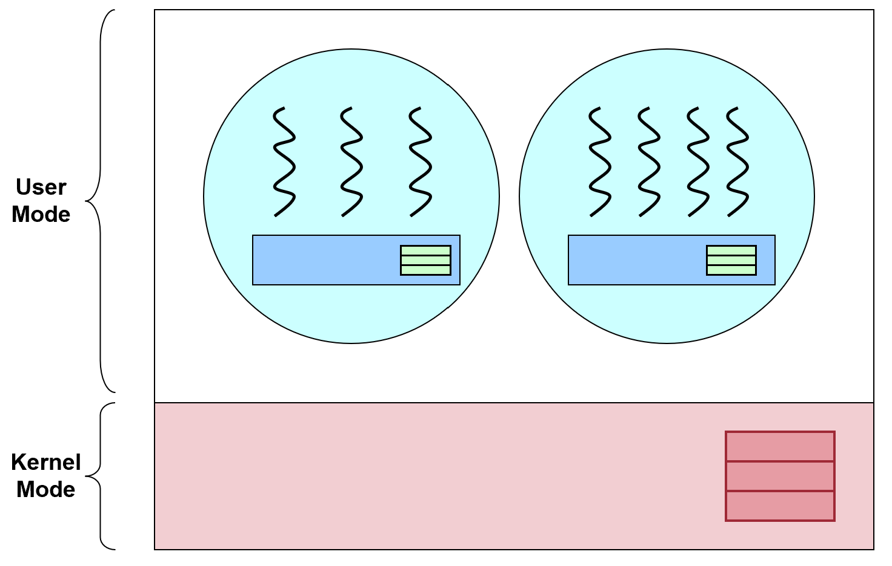
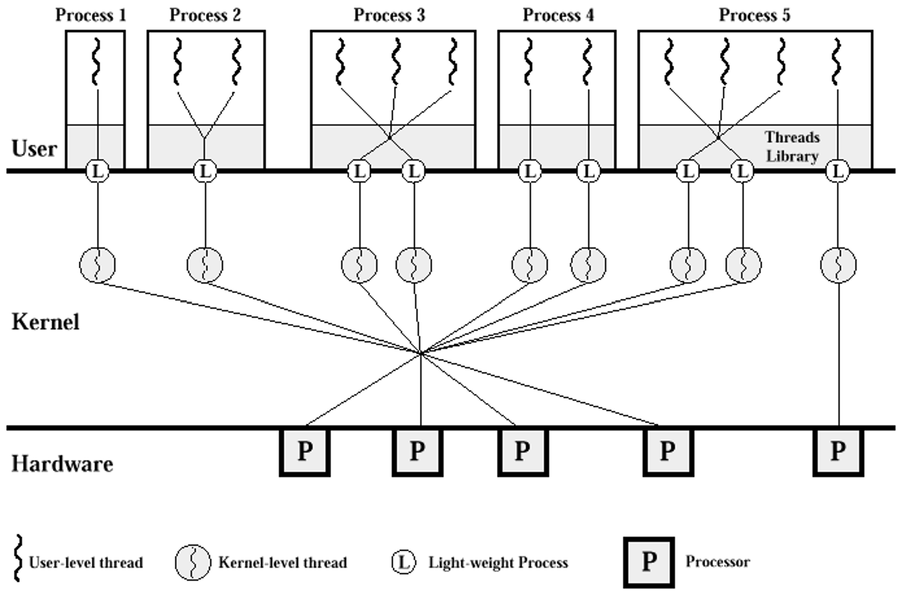

# The Thread

## Motivation

There are three main motivations for using **threads**:

1. **Parallelism**
2. **Avoiding blocking due to slow I/O**
3. **Process is expensive**

### Parallelism

Suppose we have a **single-threaded program** and multiple CPUs available. To speed up the program, we can use **parallelization**: divide the work into multiple threads and let different CPUs execute different portions of the work **at the same time**.


This allows the program to take advantage of multiple CPUs and potentially finish much faster.


### Avoid Blocking by I/O

Suppose a thread becomes **blocked while waiting for I/O**. Instead of leaving the CPU idle, we can use multiple threads so that while one thread waits for I/O, the scheduler switches to another **ready-to-run thread**.


Thus, threading allows a program to **overlap I/O with other useful work**, improving CPU utilization and overall responsiveness.


> But what if a load instruction experiences a cache miss and is waiting for the data to come from DDR memory to cache and then to register files? How can we increase the performance then? (This is the question asked by Citadel Securities, find more info in my notes [here](https://app.gitbook.com/s/yDyAQjoA5rGJ3MvuN1ek/techinical-questions#id-1.-ooo-architecture))

### Process is expensive

Remember the [`fork()`](../../virtualization/cpu-virtualization/process-api.md#the-fork-system-call) system call used to create a new **process**. Since each process has its **own address space**, creating processes generally has higher overhead, and sharing data between processes requires explicit **inter-process communication (IPC)**.

In contrast, threads within the same process **share the same address space**, making data sharing much easier. Therefore, threads are a natural choice for tasks that need to work closely together and frequently share data.


Processes, on the other hand, are more suitable for **logically separate tasks** that require **little** sharing of in-memory data.


## Thread Models

Threads introduce several **design issues** because multiple threads within the same process can execute concurrently and share the same address space. For example, multiple threads may enter the kernel at the same time, and system calls such as `fork()`, `exit()`, and `exec()` raise questions about how they should affect the other threads in the process. There are two main ways to implement threads:

1. **user-level threads**
2. **kernel-level threads**

### **User Threads**

A **user thread** is implemented by a **thread library in user space**, so the kernel is **not aware of individual threads** and it only sees a process is running. The library and its runtime system manage thread creation, switching, and scheduling.

* **Advantages:** thread operations are fast because they are just library calls, the scheduling policy can be customized, and user threads can run on almost any OS.
* **Disadvantages:** because the kernel schedules at the **process level**, one blocked thread can block the entire process, and the process cannot exploit multiple CPUs by running its threads in parallel.

<figure><figcaption></figcaption></figure>

### Kernel Thread

A **kernel thread** is implemented and managed by the **OS**. Thread operations are handled through system calls, and the kernel can schedule individual threads. In other words, the kernel now has the knowledge of which **thread** within a proecss is runnable. This solves the main limitations of user threads:

> if one thread blocks, other threads can continue running, and **multiple threads from the same process can run simultaneously on multiple CPUs**.

The trade-off is that thread operations are more expensive because they require kernel involvement, and the implementation is generally less flexible.

### Hybrid Thread

A **hybrid model** combines user threads and kernel threads. The OS schedules **kernel threads**, while user threads can be mapped onto these kernel threads. This provides more flexibility:

> a program can create many user threads while limiting how many can execute simultaneously by controlling the number of kernel threads.

One example is **Solaris**, which used a hybrid model in which multiple user threads could be mapped onto a smaller or equal number of kernel threads.

<figure><figcaption>
Solaris-hybrid-thread-example
</figcaption></figure>

Threads on Modern Processors

Threads originally started as a **software mechanism**, implemented through thread libraries and later supported directly by the OS. Modern processors can also provide **hardware support for multiple threads**.

The processor essentially maintains **multiple sets of registers**, allowing multiple threads to make progress on the same physical core. This is known as **Simultaneous Multithreading (SMT)**. So, the bigger picture when combining **superscalar architecture** with **hardware multithreading** is:

1. **Hardware Multithreading:** A processor may have multiple sets of registers that share one datapath or use multiple datapaths. Its goal is to allow the hardware to **execute multiple threads concurrently**.
2. **Superscalar Architecture:** This focuses on a **single thread context** and allows one processor to execute **multiple instructions in parallel** within the same cycle. This improves the execution speed of a single thread.


Feel free to go back to my notes for [NUS CG3207](https://app.gitbook.com/s/jTJFBPtKk6NwweAooH53/lec/lec-06-advanced-processor#multithreading) as this hardware multi-threading in processor design is covered in great details there! In NUS EE4415, Prof. Massimo does give a glimpse on how SMT is implemented by using [**time interleaving**](https://app.gitbook.com/s/Sp0XaarBjbEX3JIMrRaR/part-1-lec-digital-design-flow/lec-2b-rtl-transformations#a-microprocessor-example)!


