---
layout:
  width: default
  title:
    visible: true
  description:
    visible: true
  tableOfContents:
    visible: true
  outline:
    visible: true
  pagination:
    visible: true
  metadata:
    visible: true
  tags:
    visible: true
  actions:
    visible: true
  anchors:
    visible: true
---

# File System Implementation

To understand how a file system works, it is helpful to first develop a **mental model** of it. We can approach this from two key aspects:

1. **Data Structures:** What types of on-disk structure are utilized by the file system to organize its data and metadata.
2. **Access Methods:** How does the file system translate system calls such as `open()`, `read()`, and `write()` into operations on these structures? Which structures are read during the execution of a particular system call? Which are written? How efficiently are all of these stpes performed?

By understanding both aspects, we can build a solid mental model of **how a file system organizes data and handles file operations**. Keep these two questions in mind as we proceed through the lecture.


Build a mental model to understand any system! This might be a very useful take away from this lecture!


## Organization

In this section, we will explore the **data structures** used by a file system to organize and store its data and metadata. To simplify our discussion, we will use a model called **vsfs (Very Simple File System)**.

### Overall Organization

The first step in designing a file system is to divide the disk partition into fixed-size **blocks**, which serve as the basic units of storage and allocation.


In vsfs, we assume a single block size of **4 KB**.


Thus, the disk partition can be viewed as a sequence of 4 KB blocks. For simplicity, suppose we have a very small disk partition containing only **64 blocks**, giving us a total storage capacity of $$64 \times 4 = 256\text{ KB}$$, as illustrated below.

<figure>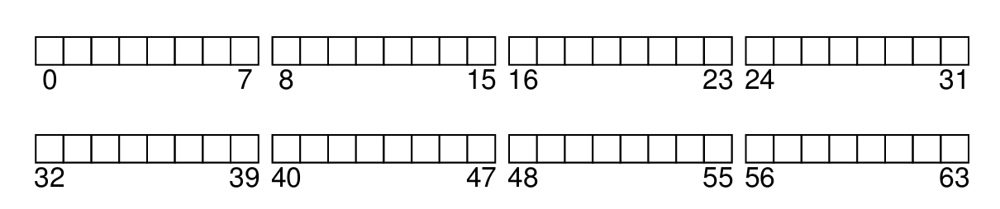<figcaption></figcaption></figure>

#### Data Region

Now, let's consider what we need to store in these blocks to build a file system. The most obvious requirement is **user data**, such as the contents of files and directories. In our vsfs example, we reserve **blocks 8 to 63** for storing this data. This portion of the disk is called the **data region**, which contains a total of 56 blocks.

<figure>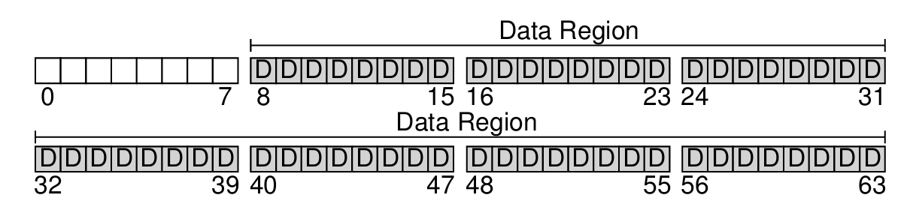<figcaption></figcaption></figure>

<details>

<summary>Will a big file which needs multiple blocks be stored consecutively in the data region?</summary>

Since each file is associated with one inode number, which is one inode block, what if the file is very big, the file will be stored in consecutive data blocks?

***

**Ans**: not necessarily, since inside each inode, we will have multiple pointers, each pointer will point to a block which is part of that file. You can find more from [#data-block-pointers](file-system-implementation.md#data-block-pointers "mention").


When the file size is **not equal to** the multiple of logical blocks, the last block may have **internal fragmentation**!


</details>

#### Inode Table

As discussed in the previous chapter, a file system must also maintain [**metadata**](files-and-directories.md#file-metadata) about each file, such as its size, ownership, permissions, and the locations of its data blocks. This information is stored in a structure called an **inode**, which we will explore in more detail later.


#### Inode number vs. Inode

As discussed in the previous chapter, each file or directory is associated with an **inode number**, which identifies its inode within the file system. The distinction is simple: the **inode number** is an index used to locate an entry in the inode table, while the **inode** is the actual data structure stored at that entry, containing the file's metadata. Hopefully, we will have a better visualizationfor this [soon](file-system-implementation.md#inode)!


To store these inodes, we reserve a portion of the disk called the **inode table**, which contains an array of on-disk inodes. In our vsfs example, we allocate **5 blocks** for this purpose and on current on-disk image will be as follows:

<figure>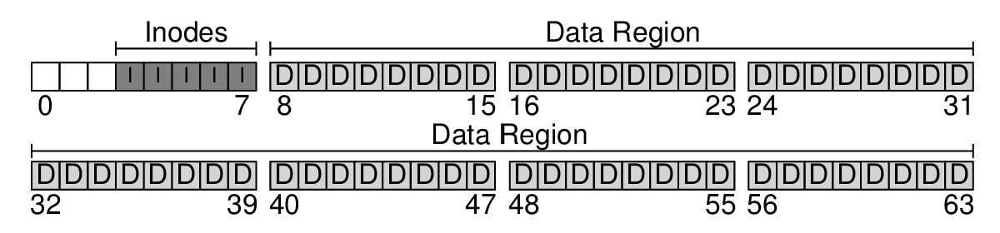<figcaption></figcaption></figure>

Typically, each inode occupies 128 or 256 bytes. Assuming an inode size of 256 bytes, each 4 KB block can hold $$4096\div256=16$$ inodes. Thus, our 5-block inode table can store a maximum of **80 inodes**.


As we've seen in the previous chapter, each file or directory requires an inode, the **number of inodes determines the maximum number of files and directories** that the file system can support.


#### Bitmaps

In our vsfs example, we use two **bitmaps** to track free and allocated space: an **inode bitmap (i)** for the inode table and a **data bitmap (d)** for the data region.

> A **bitmap** is a simple data structure in which each bit indicates whether the corresponding inode or data block is **free (0)** or **allocated (1)**.


As emphasized by Prof. Colin, the meaning of `0` and `1` may vary during the final exam! Always check which value represents free or allocated space in the finals!


Our updated on-disk layout now includes an inode bitmap (i) and a data bitmap (d), as illustrated below.

<figure>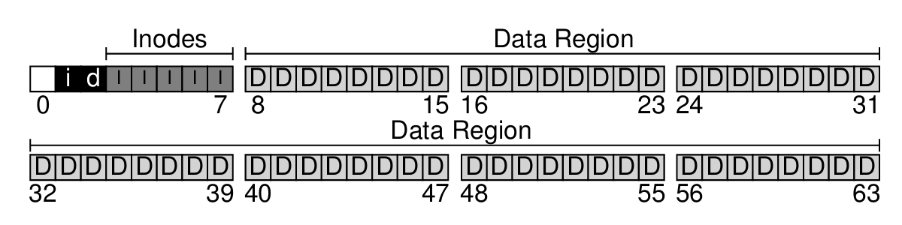<figcaption></figcaption></figure>


Notice that allocating an entire **4 KB block** to each bitmap is somewhat excessive. Each bitmap can track $$4096 \times 8 = 32,768$$ objects, whereas our file system contains only **80 inodes** and **56 data blocks**. Nevertheless, we dedicate one block to each bitmap for simplicity.


#### Superblock

We now have **one block remaining** in our disk partition, which we reserve for the **superblock (S)**.

<figure>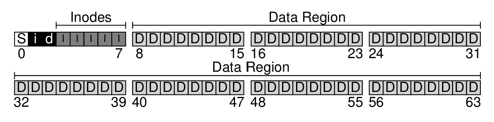<figcaption></figcaption></figure>

The superblock stores essential information about the file system, such as the **number of inodes and data blocks** (80 and 56, respectively, in our vsfs example), the **location of the inode table** (starting at block 3), and other file-system parameters.


When [**mounting a file system**](files-and-directories.md#mount-a-file-system), the OS reads the superblock to obtain the information needed to interpret its on-disk structures. Once the file system is successfully mounted, it becomes accessible through the unified directory tree, and the OS knows where to locate the necessary structures when accessing files.


### Inode

One of the most important on-disk structures in a file system is the **inode (index node)**. Each inode is identified by an **inode number (i-number)**, which we previously referred to as the file's low-level name.


An important property is that, given an inode number, the file system can **directly calculate the on-disk location of the corresponding inode**, without searching through the inode table.


For example, consider our vsfs inode table with the following properties:

* **Inode table size:** 20 KB (5 blocks × 4 KB)
* **Number of inodes:** 80 (256 bytes per inode)
* **Starting address:** 12 KB (disk block 3)

In vsfs, we thus have the following layout for the beginning of the file system partition.

<figure>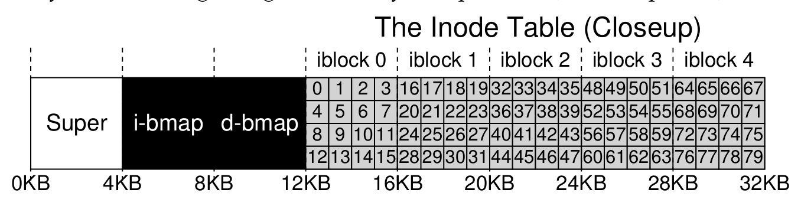<figcaption></figcaption></figure>

For example, to locate **inode 32**, we first calculate its byte offset from the beginning of the inode table:

$$
\text{Offset}=32\times256=8192\text{ bytes}=8\text{ KB}
$$

Adding this offset to the starting address of the inode table gives:

$$
\text{Inode Address}=12+8=20\text{ KB}
$$

However, disks are typically addressed in **sectors** rather than individual bytes. Assuming a sector size of 512 bytes, the sector containing inode 32 is:

$$
\text{Sector Number}=\frac{20\times1024}{512}=40
$$

Thus, the file system can locate inode 32 in **sector 40**, which is the beginning of disk block 5.


The **sector size** is determined by the storage device's hardware and interface, whereas the **block size** is determined by the file system. These two sizes are not necessarily equal.


#### Data Block Pointers

As discussed earlier, an inode stores the file's **metadata.** Most importantly, this includes information about where its data blocks are located on disk.

One simple approach is to store several **direct pointers** inside the inode, where each pointer contains the disk address of a data block belonging to the file. However, this approach limits the maximum file size. If an inode contains $$N$$ direct pointers and each block has size $$B$$, the maximum file size supported by direct pointers alone is:

$$
\text{Maximum File Size}=N\times B
$$

For example, with 12 direct pointers and a 4 KB block size, the maximum file size would be only $$12\times4=48\text{ KB}$$


This motivates us to explore the multi-level indexing, which we will introduce later!


#### Multi-Level Indexing

To support bigger files, file system designers have had to introduce different structures within inodes. One common idea is to have a special pointer known as an **indirect pointer**.

> The idea is quite simple: instead of pointing to a **block** that contains user data, it points to a **block** that **contains more pointers**, each of which point to user data.

Thus, an inode may have **some direct pointers** and **a single indirect pointer**. If a file grows large enough, an indirect block is allocated (from the data-block region of the disk), and the inode's slot for an indirect point is set to point to it.


Assume 4-KB blocks and 4-byte disk addresses, that adds another 1024 pointers; the file can grow to be $$(12+1024)\cdot4\text{K}=4144\text{ KB}$$.


Not surprisingly, in such an approach, you might want to support even larger files. To do so, just add another pointer to the inode: the **double indirect pointer**.

> Similarly, this double indirect pointer refers to a block that contains **pointers** to **indirect blocks**, each of which contain pointers to data blocks.

A **double indirect pointer** thus adds the possibility to grow files with an additional $$1024\cdot1024$$ or 1 million 4-KB blocks, in other words supporting files that are over 4GB in size!


And yes, you may want even more, though, and we bet you know where this is headed: the **triple indirect pointer**.


Overall, this **imbalanced** tree is referred to as the **multi-level index** approach to pointing to file blocks. For example, we have 12 director pointers, 1 indirect pointer and 1 double indirect pointer. This structure can accommodate a file of just over 4GB in size (e.g., $$(12+1024+1024\cdot1024)\times4\text{ KB}$$).


#### Why do we prefer this flavor of imbalanced tree?

This is mainly because of the fact that **most files are small**!


#### More Allocation Tracking Methods

The inode that we've introduced above is only one of the allocation tracking methods. Indeed, there are many allocation-tracking methods available. The bitmap we introduced above is just a way to do the [#free-space-management](file-system-implementation.md#free-space-management "mention"). However, in terms of the block allocation algorithm, we also have the following methods which are introduced in CG2271:



#### Contiguous

In this case, we allocate consecutive disk blocks to a file. The illutration can be shown as follows.

<figure>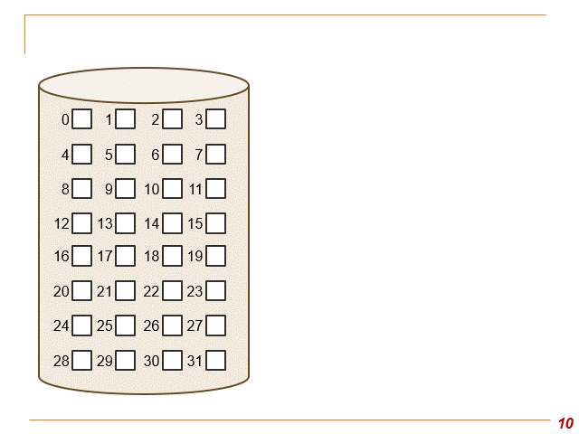<figcaption></figcaption></figure>

The disadvantage is very obvious, which is the external fragementation!



#### Linked List V1

The second approach is **linked allocation**, where the data blocks belonging to a file are organized as a **linked list**. Each data block stores both the file's data and a pointer to the next block, allowing the file system to follow the chain of blocks. This can be illustrated as follows:

<figure>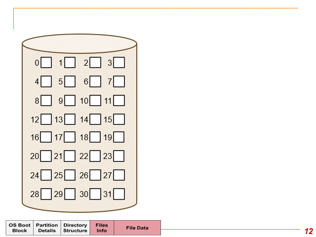<figcaption></figcaption></figure>

* **Advantage:** No external fragmentation, since data blocks can be allocated anywhere on the disk without needing to be contiguous.
* **Disadvantage:** Slow random access, since the file system must traverse the linked list from the beginning to locate a particular block (A lot of disk accesses!). In addition, each block requires some space to store the pointer.



#### Linked List V2

Building upon **linked allocation**, we can improve random access by moving the pointers from individual data blocks into a separate table called the **File Allocation Table (FAT)**. Instead of storing a pointer inside each data block, the FAT maintains an entry for each data block, indicating the next disk block in the file's chain. Thus, the file system can follow the chain by accessing the FAT without reading each intermediate data block.

<figure>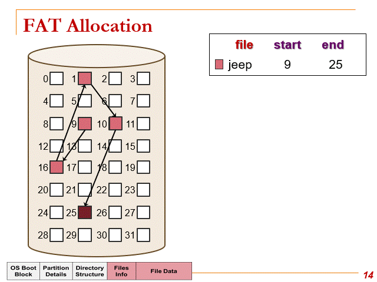<figcaption></figcaption></figure>

The random access problem is now alleviated, but the FAT must track all data clusters in the partition, so the table can become very large.



### Directory Organization

As discussed earlier, a directory is a **special type of file**. Like a regular file, the directory itself has an inode stored in the inode table, which contains metadata and pointers to its data blocks.

The key difference is that a **directory's data blocks** store a list of **directory entries** (files or other directories), each mapping a filename to its corresponding inode number, rather than ordinary file contents.


This aligns perfectly with what we've learned in the [previous section](files-and-directories.md#directory)! A directory is nothing but a collection of tuples, each of which contains a human-readable name and low-level name to which it maps.


For example, in vsfs, let's suppose each directory entry contains four fields:

* **`inum`:** Inode number associated with the entry.
* **`reclen`:** Total length of the directory record, including any unused or padding space.
* **`strlen`:** Length of the stored filename.
* **`name`:** Name of the file or directory.

For example, suppose directory `dir` has inode number 5 and contains three files: `foo`, `bar`, and `foobar_is_a_pretty_longname`, with inode numbers 12, 13, and 24, respectively. Its data blocks store these filename-to-inode mappings shown as follows:

<figure>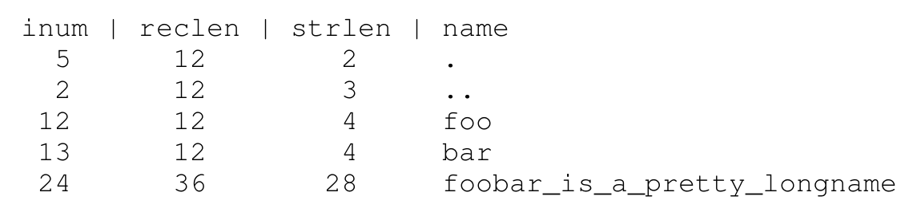<figcaption><p>Directory Data Block Illustration</p></figcaption></figure>


Every directory also contains two special entries: **`.`**, which refers to the directory itself, and **`..`**, which refers to its parent directory.


In the previous approach, directory entries are stored as a **linear list**, so finding a file by its human-readable name may require searching through the entire list. A **hash table** provides a faster alternative. It uses a **hash function** to convert the filename into an index, allowing the file system to locate the corresponding directory entry more efficiently. If multiple filenames produce the same index (a **collision**), techniques such as **chaining** are used to handle them.

### Free Space Management

A file system must track which inodes and data blocks are free, and which are not, so that when a new file or directory is allocated, it can find space for it. Thus **free space management** is important for all file systems! In this section, we will introduce two ways to do free space management:

1. Bitmap
2. Linnked List

#### Bitmap


In vsfs, as discussed above, we use [two bitmaps](file-system-implementation.md#allocation-tracking-methods) for this task!


For example, when creating a file, the file system must first **allocate an inode**. To do so, it searches the **inode bitmap** for a free inode, allocates it to the new file, and marks the corresponding bit as **allocated (1)**. The updated bitmap must eventually be written back to disk.


Similarly, when a file needs additional storage space, the file system searches the **data bitmap** for a free data block, allocates it, and updates the corresponding bit.


#### Linked List

In this approach, we can just use a **linked list** that points to the first free block, which then points to the next free block, and so forth.

## Access Paths

Now that we have some ideas of how files and directories are stored on disk, we should be able to follow the flow of operation during the activity of **reading** or **writing** a file.


For the following examples, let's assume that the file system has been mounted and thus that the [superblock](file-system-implementation.md#superblock) is already in memory. Everything else (e.g., inodes, directories) is still on the disk. When the file system needs an on-disk structure (e.g., an inode, bitmap, or directory data block), let's assume for now it will always perform a disk I/O (we will see later that this is not ideal and thus we have the idea of [caching](file-system-implementation.md#caching-and-buffering) coming up again!)


### Reading A File From Disk

Suppose we want to open a file `/foo/bar`, read its contents, and then close it. For simplicity, assume the file is **12 KB in size (3 blocks of 4 KB each)**, and we use one `read()` system call per block.

#### Open the File

```c
int fd = open("/foo/bar", O_RDONLY);
```

Before opening `bar`, the file system must first **locate its inode** to obtain its metadata, such as permissions, file size, and data block pointers.



#### Traverse the Directory Tree

Since we only have the pathname `/foo/bar`, the file system must traverse the directory tree to find the corresponding inode.

1. **Start at the root directory `/`:** In many UNIX file systems, the root directory has a known inode number (typically 2). The file system first loads this inode into memory using the inode number 2.
2. **Find `foo`:** Using data block pointers inside the root inode, the file system reads the root directory's data blocks (load the data blocks into the main memory), which contain nothing but a tuple of **directory entries (filename, inode number)**. It searches these entries for `foo` to obtain its inode number.
3. **Traverse into `foo`:** Using the inode number obtained, the file system loads `foo`'s inode and follows its data block pointers to read the directory entries within `foo`.
4. **Find `bar`:** The file system searches these entries for `bar`, obtains its inode number, and loads the corresponding inode into memory.

At this point, the file system has located **`bar`'s inode** and can check its permissions and other metadata.



#### Create the Open-File Entry

After successfully locating and checking the file, the OS creates an **open-file object** in the system-wide open-file table, containing information such as:

* **File offset:** Initially 0.
* **Access mode:** Read-only (`O_RDONLY`).
* **Inode reference:** Refers to `bar`'s in-memory inode.

The OS then allocates an entry in the process's per-process **open-file table**, pointing to this open-file object, and returns the corresponding **file descriptor (FD)**, which is the index to the entry in the per-process open-file table.


It's good to look at the image in the [previous chapter](files-and-directories.md#shared-file-table-entries)!




#### Read the File

Once the file is opened, we can use its file descriptor to read its contents.

```c
read(fd, buffer, 4096);
```

Since the file contains three 4 KB blocks, we assume that we issue **three `read()` system calls**, each requesting 4 KB. For the first `read()`:

1. The OS uses the **FD** to locate the corresponding open-file object, which references `bar`'s inode.
2. Using the inode's **data block pointers**, the file system locates the first data block and reads it into memory if it is not already cached. The requested data is then copied into the process's buffer.
3. After successfully reading 4 KB, the **file offset** in the open-file object is updated from 0 to 4096 bytes.
4. The file system may also update the inode's **last-accessed time (`atime`)**, potentially requiring a write to disk.

The next two `read()` calls follow the same process, reading the second and third blocks and advancing the offset to 8192 and 12288 bytes, respectively.

#### Close the File

Finally, we close the file using:

```c
close(fd);
```

The OS removes the corresponding entry from the process's **file descriptor table** and releases its reference to the open-file object.


If no other file descriptors reference that open-file object, the OS can release it and its associated inode reference.


#### Timeline

A depiction of this entire process is found in the following figure. In the figure, the open causes numerous reads to take place in order to finally locate the inode of the file. Afterwards, reading each block requires the file system to first consult the inode to get the data pointer, and then read the data block, and then update the inode's last-accessed-time field with a write.

<figure>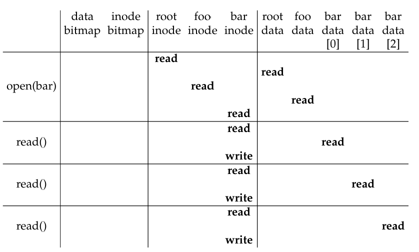<figcaption></figcaption></figure>

### Writing to Disk

Writing to a file follows a similar process to reading. First, the file must be opened (or created). The application then issues `write()` system calls to modify its contents, and finally closes the file.

#### Create the file

Recall that we can create a new file `/foo/bar` using the `open()` system call:

```c
int fd = open("/foo/bar", O_CREAT | O_WRONLY, 0644);
```

Assuming `bar` does not already exist, the file system first **traverses the directory tree** to locate its parent directory `/foo`. It then allocates a new inode and adds a directory entry mapping `bar` to its inode number.


According to exactly the [steps shown before](file-system-implementation.md#traverse-the-directory-tree), we need 4 disk I/Os to traverse the directory tree!


In addition to the I/Os required for pathname traversal, creating the file requires the following **6 disk I/Os** in our simplified vsfs model:

1. **Read the inode bitmap** to find a free inode.
2. **Write the inode bitmap** to mark the allocated inode as used.
3. **Write the parent directory's data block** to add an entry mapping `bar` to its inode number.
4. **Read the new inode's block** to prepare for initializing its metadata.
5. **Write the new inode's block** to store the initialized inode.
6. **Write the parent directory's inode** to update its metadata.


Note that we do not need to read the parent directory's inode or data block again, since both were already loaded into memory during pathname traversal.


Thus, creating `/foo/bar` requires **10 disk I/Os in total**: 4 for pathname traversal and 6 for file creation, assuming the parent directory has enough space for the new entry.


Note that this count assumes the directory already has enough space for the new entry. If a new directory data block must be allocated, additional I/Os are required.


#### Write to the file

Unlike reading, writing to a file may require **allocating a new data block**, unless we are simply overwriting an existing block. For example, suppose each `write()` call writes 4 KB of data into a newly allocated block. In our simplified vsfs model, each write requires **5 disk I/Os**:

1. **Read the file's inode** to obtain its existing metadata and data block pointers.
2. **Read the data bitmap** to find a free data block.
3. **Write the data bitmap** to mark the newly allocated block as used.
4. **Write the new data block** to store the actual file contents.
5. **Write the file's inode** to add the pointer to the newly allocated data block and update its metadata.

Thus, allocating and writing one new data block logically requires **5 disk I/Os**, compared with a read operation, which does not require allocating new blocks.

#### Close the file

Finally, we close the file using:

```c
close(fd);
```

As discussed in the reading example, the OS releases the file descriptor and updates the corresponding **in-memory open-file structures**.


However, unlike reading, writing may leave **modified file data and metadata** in memory that have not yet been written to disk. These changes must eventually be written back, but `close()` does not necessarily force them to disk immediately.


#### Timeline

Consider creating a new file `/foo/bar` and writing **12 KB of data** to it using three 4 KB `write()` calls. Its timeline is shown as follows:

<figure>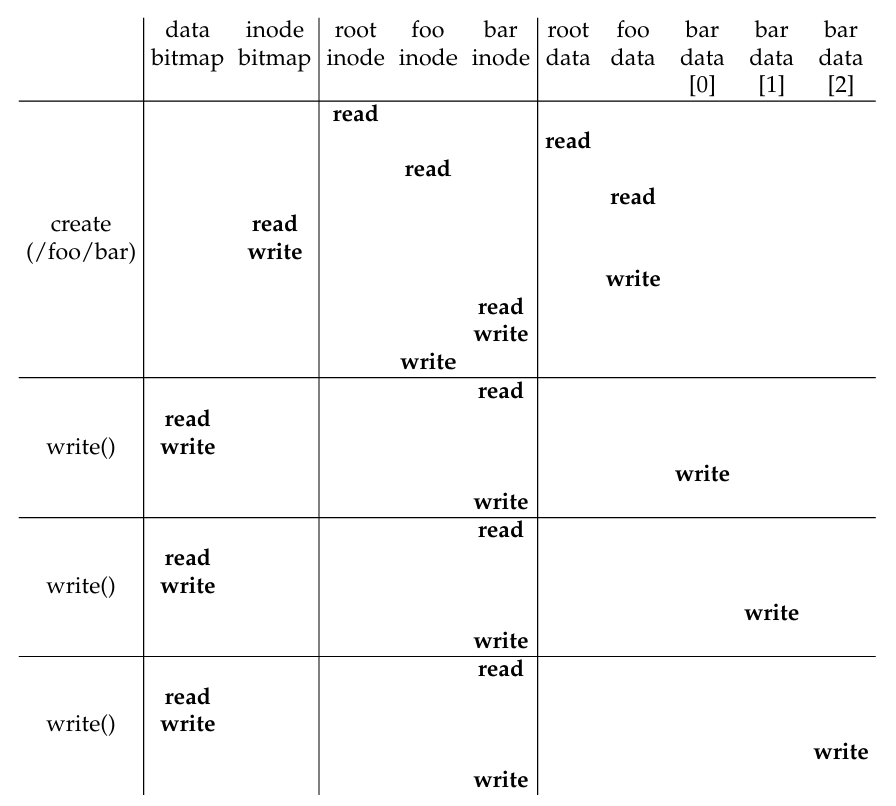<figcaption></figcaption></figure>

<details>

<summary>Caching and Buffering</summary>

As the examples above show, reading and writing files can be expensive, incurring many I/O to the (slow) disk. To remedy what would clearly be a huge performance problem, most file systems aggressively use the main memory (DRAM) to **cache** important blocks.

In this way, the first open may generate a lot of I/O traffic to read in directory inode and data, but subsequent file opens of that same file (or files in the same directory) will mostly hit in the cache and thus no I/O is needed.

> However, this idea of caching only applies to the **read disk I/O**s.

Unlike the read disk I/Os, the write I/Os have to go to disk in order to be persistent. In this case, we will use the technique called **(write) buffering**. This technique actually applies the idea of laziness (which we first encountered in NUS CS2030S):

> by temporarily keeping modified data in memory, the file system can combine multiple updates into fewer disk I/Os.

For example, if an inode is updated several times, the file system can write only its final state to disk instead of writing after every modification.


However, this introduces a trade-off: if the system crashes before the buffered data is written to disk, those updates may be lost.


</details>
