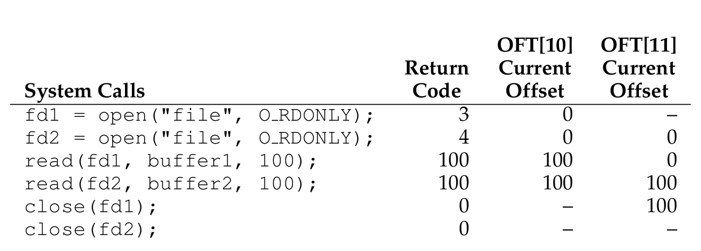
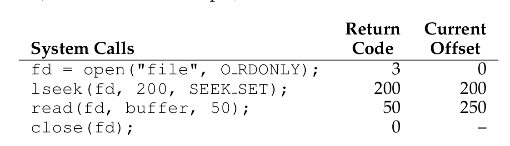
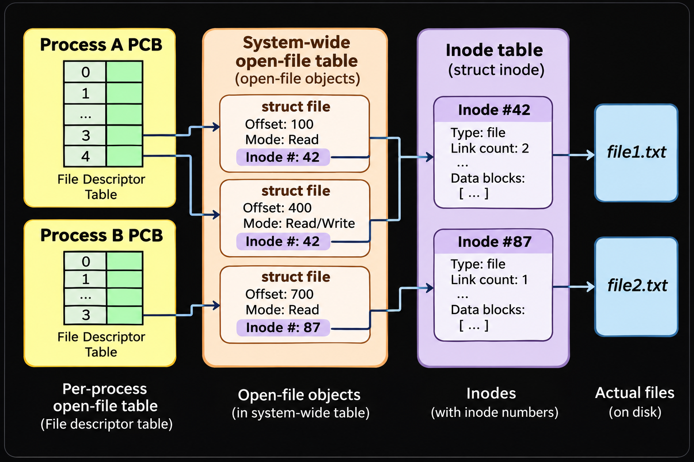
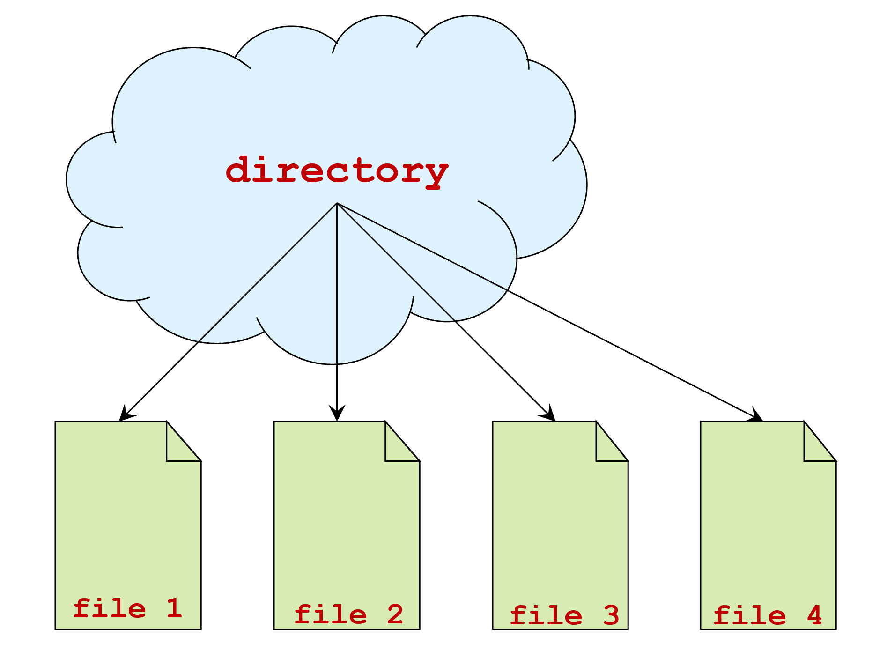
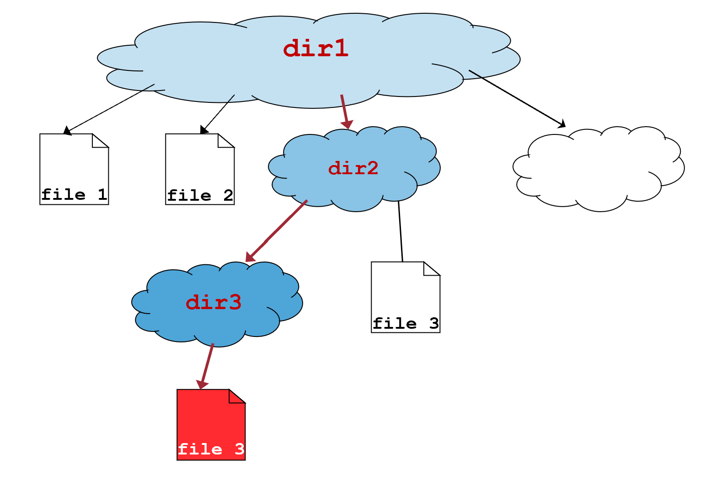
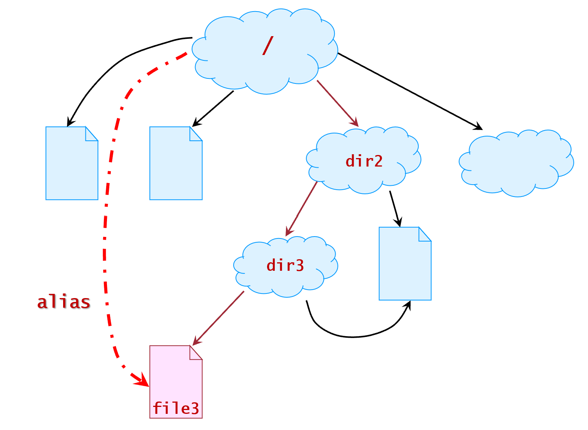
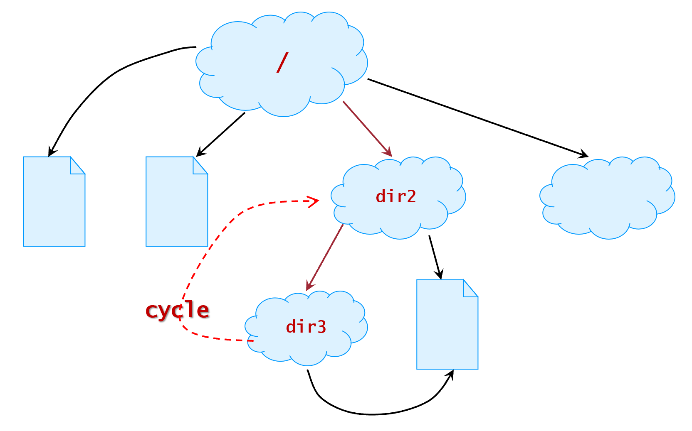

# Files and Directories

In this section, we will briefly introduce what is a file system and then talk about the two key abstractions developed over time in the virtualization of storage, **files** and **directories**.

## File Systems

A **file system** is a mechanism used by the OS to organize, store, and retrieve data on non-volatile storage devices, such as HDDs and SSDs. Examples of file systems include **NTFS** (commonly used by Windows), **ext4** (Linux), and **APFS** (macOS).


A physical disk (SSD or HDD) can be divided into **multiple partitions**, each of which can contain its own **file system**, such as ext4, NTFS, or APFS.


The motivation for having a file system is that **physical memory (RAM) is volatile.** Therefore, we need non-volatile storage to preserve data even after the OS or processes terminate. A good file system should satisfy three general criteria:

1. **Self-Contained:** All information needed to describe the organization of files and directories is stored on the storage device itself, allowing it to be recognized and accessed by another compatible system (_plug-and-play_).
2. **Persistent:** Stored data remains available beyond the lifetime of the OS and individual processes, including after shutdowns and restarts.
3. **Efficient:** The file system should manage free and used storage space effectively while minimizing the overhead required to maintain metadata (bookkeeping information).

Although both **memory management** and **file system management** are handled by the OS, they differ in several aspects:

| Aspect             | Memory Management                                                                 | File System Management                                                             |
| ------------------ | --------------------------------------------------------------------------------- | ---------------------------------------------------------------------------------- |
| Underlying Storage | RAM (volatile)                                                                    | Disk/SSD (non-volatile)                                                            |
| Access Speed       | Fast, relatively constant access time                                             | Slower, variable I/O time                                                          |
| Addressing         | Physical memory addresses                                                         | Disk sectors or logical blocks                                                     |
| Usage              | Provides memory space for running processes, accessed implicitly during execution | Provides persistent storage, typically accessed explicitly through file operations |
| Organization       | Paging/segmentation, managed by hardware and OS                                   | Different file systems, such as ext4, FAT32, and NTFS                              |


The **file system** is pure **software**!


Even though our computer runs a single OS, it can still access files stored on different disk partitions, each potentially using a different file system.

> How is this possible?

The key is that the OS can **combine multiple file systems into a single, unified directory tree** which we will call file-system tree. In UNIX, this is achieved through two operations: **creating** and **mounting** file systems.


The [#directory](files-and-directories.md#directory "mention") will be introduced soon!


#### **Make a File System**

To create a file system in UNIX, we need a **device** (e.g., a disk partition `/dev/sda1`) and a **file system type** (e.g., ext3, ext4, or NTFS). We can then use the `mkfs` command to initialize the desired file system on that partition. For example, to create an ext3 file system on `/dev/sda1`:

```bash
mkfs -t ext3 /dev/sda1
```

This initializes the partition with the necessary file-system structures, allowing it to store files and directories.

#### **Mount a File System**

However, creating a file system does not automatically make its contents accessible. We must first **mount** it into the existing directory tree using the `mount` command.

> Mounting essentially attaches a file system to an existing directory, called the **mount point**, allowing users to access its contents through that directory.

For example, suppose `/dev/sda1` contains an ext3 file system whose root directory has two subdirectories, `a` and `b`. To mount it at `/home/users`, we execute:

```bash
mount -t ext3 /dev/sda1 /home/users
```

After mounting, running `ls /home/users` will display `a` and `b`, as the contents of the mounted file system are now accessible through `/home/users`.


Note that any existing contents of `/home/users` are temporarily hidden while the new file system is mounted there.


The beauty of mounting here is that instead of having a number of separate file systems, mount **unifies all file systems into one tree**, making naming uniform and convenient.

## Files

A **file** is simply a linear array of bytes, each of which you can read or write. Each file also has some kind of **low-level name**, usually a number of some kind; often, the user is not aware of this name.


For historical reasons, the low-level name of a file is often referred to as its **inode number**. We'll be learning a lot more about inodes in the next chapter!


Each file consists of two main components:

1. **Data:** The actual information stored in the file, organized in a particular structure.
2. **Metadata (File Attributes):** Additional information describing the file, such as its name, size, type, and access permissions.

### File Metadata

**File metadata**, also known as **file attributes**, refers to additional information associated with a file that helps the OS identify, manage, and control access to it. Common file attributes include:

| Attribute              | Description                                                                                     |
| ---------------------- | ----------------------------------------------------------------------------------------------- |
| **Name**               | Human-readable name used to reference the file.                                                 |
| **Identifier**         | Unique ID used internally by the file system to identify the file.                              |
| **Type**               | Indicates the type of file, such as a text file, executable, or directory.                      |
| **Size**               | Current size of the file, typically measured in bytes.                                          |
| **Protection**         | Specifies the access permissions associated with the file.                                      |
| **Time, Date & Owner** | Records information such as creation time, last modification time, and file ownership.          |
| **Table of Contents**  | Information used by the file system to locate and access the file's data on the storage device. |

#### File Name

Each file has a **name** that allows users to identify and reference it. Different file systems have different naming rules, which typically specify:

1. **Length:** Maximum number of characters allowed in a filename.
2. **Case Sensitivity:** Whether uppercase and lowercase letters are treated as different (e.g., `File.txt` vs. `file.txt`).
3. **Special Characters:** Which symbols are allowed in filenames.
4. **File Extension:** Usually follows the format `Name.Extension` (e.g., `report.pdf`). Some systems use the extension to help identify the file type.


However, this naming convention `name.extension` is just a convention! There is no enforcement that the data contained in a file named `main.c` is indeed C source code!


#### File Type

An OS typically supports several **file types**, each associated with a set of operations and possibly specific programs for processing its contents. There are three common categories of files:

1. **Regular Files:** Store user information, such as documents, programs, and images.
2. **Directories:** Organize files and other directories within the file system.
3. **Special Files:** Represent devices or other system interfaces, such as character-oriented and block-oriented devices in Unix.

Regular files can be further classified into two major types:

* **ASCII (Text) Files:** Store information as readable text, such as `.txt` files and source code. Their contents can generally be displayed directly using a text editor.
* **Binary Files:** Store data in a specific binary format, such as executables, PDFs, images, and videos. They typically require appropriate programs to interpret their predefined internal structure. e.g., JVM to execte Java class file and PDF reader for pdf file, etc.

<details>

<summary><strong>How does the OS distinguish different file types?</strong></summary>

There are two common approaches:

1. **File Extension:** Uses the filename extension to indicate the file type, commonly used by Windows for file associations. For example, `.docx` indicates a Word document.
2. **Magic Number:** Uses a predefined sequence of bytes, usually stored at the beginning of a file, to identify its format. This approach is commonly used by Unix utilities.

Note that changing a file's extension does not actually change its internal format; it only changes how the file may be identified or opened.

</details>

#### File Protection

**File protection** controls which users are allowed to access a file and what operations they can perform. Common access types include:

1. **Read:** Retrieve information from a file.
2. **Write:** Modify or overwrite file contents.
3. **Execute:** Run a file as a program.
4. **Append:** Add new information to the end of a file.
5. **Delete:** Remove a file from the file system.
6. **List:** Retrieve file metadata or directory information.

The most common approach to file protection is to **restrict access based on user identity**. One general mechanism is the **Access Control List (ACL)**, which specifies the users or groups allowed to access a file and their corresponding permissions. ACLs are highly customizable, but maintaining detailed permissions for many users can introduce significant metadata overhead. To reduce this overhead, Unix provides a simpler permission scheme that divides users into three classes:

1. **Owner:** The user who owns the file, typically its creator.
2. **Group:** A set of users who share access permissions.
3. **Others (Universe):** All other users in the system.

For each class, Unix defines three basic permission bits: **Read (r)**, **Write (w)**, and **Execute (x)**. A hyphen (`-`) indicates that a permission is not granted. For example, running `ls -l` in Unix might produce:

```bash
-rwxr--r--  somefile
```

Here, the first `-` indicates a regular file, while the remaining nine characters represent the permissions:

* **Owner (`rwx`):** Read, write, and execute.
* **Group (`r--`):** Read only.
* **Others (`r--`):** Read only.

Unix also supports **extended ACLs**, which allow additional permissions to be assigned to specific named users or groups beyond the three basic classes.

#### Operations on File Metadata

Besides reading and writing file contents, the OS also provides operations to access and modify file metadata:

1. **Rename:** Change the filename.
2. **Change Attributes:** Modify metadata such as access permissions, timestamps, and ownership.
3. **Read Attributes:** Retrieve metadata such as file size, creation time, or access permissions.

These operations allow users and processes to manage files without necessarily modifying their actual data.

### File Data

**File data** refers to the actual information stored in a file. We will discuss how this data is organized (**file structure**) and how it can be retrieved (**access methods**).

#### File Structure

There are three common ways to organize data **within a file**:

1. **Array of Bytes:** The file is treated as a sequence of bytes, where each byte has a unique **offset** (distance from the beginning of the file), starting from 0. This provides a flexible structure without imposing any particular organization on the data.
2. **Fixed-Length Records:** The file is organized as an array of records, each having the same size. The file can grow or shrink as records are added or removed. Since all records have equal lengths, we can easily locate any record using its offset: $$\text{Offset of }N^{th}\text{ record}=(N-1)\times\text{Record Size}$$. Here, N starts from 1, and the offset is measured from the beginning of the file.
3. **Variable-Length Records:** The file is organized into records of different sizes. This provides greater flexibility but makes it harder to locate a particular record, since its offset cannot be calculated directly from its record number without additional information.

#### Access Methods

After organizing the file data, we need a way to access it. There are two common **file access methods**:

1. **Sequential Access:** Data is read in order, starting from the beginning of the file. We cannot directly skip to an arbitrary record, but we can rewind[^1] and read through the file again. A classic example is **magnetic tape storage**.
2. **Direct Access (Random Access):** Data can be accessed directly without reading all preceding records. This is particularly useful for files containing a large number of **fixed-length records**, since the offset of any record can be calculated directly. A special case of direct access is **byte-level random access**, where each byte is treated as a record of size 1. This allows us to jump directly to any byte offset within the file.

The key difference is that **sequential access** processes data in order, whereas **direct access** allows us to jump to a specific location without traversing the preceding data.

### File Operations

The OS provides **file operations through system calls**, allowing processes to access and modify files in a protected, concurrent, and efficient manner. Common file operations include:

1. **Create:** Create a new, initially empty file.
2. **Open:** Prepare a file for subsequent operations, such as reading and writing.
3. **Read:** Retrieve data from a file, usually starting from the current file position.
4. **Write:** Write data to a file, usually starting from the current file position.
5. **Reposition (Seek):** Move the current file position to a specified offset without actually reading or writing data.
6. **Truncate:** Remove data beyond a specified position, reducing the file's size.


In UNIX systems, each one of the operation above will have a corresponding **system call**, which we will introduce soon!


#### Creating Files

In UNIX systems, we can create a file by calling the `open()` system call with the following flags.

```c
int fd = open("foo", O_CREAT | O_WRONLY | O_TRUNC, S_IRUSR | S_IWUSR);
```


#### The `creat()` system call

An older way to create a file is to actually use the `creat()` system call (Yeah, without an 'e"!). However, we can think of `creat()` as `open()` with the following flags: `O_CREAT | O_WRONLY | O_TRUNC`. Because of this reason, the usage of `creat()` has somewhat fallen out of favor.


One important aspect of `open()` is that it returns a **file descriptor (FD)**, which is simply an integer used to identify an open file within a process. More specifically, a file descriptor serves as an **index into the per-process open-file table**, where each entry points to an open-file object (we will see soon in the example below).


We can also think of a file descriptor as a **capability-like** [**handle**](#user-content-fn-2)[^2], which allows the process to perform certain operations on the opened file, such as `read()` and `write()`, subject to the access permissions established when the file was opened. Thus, once a file is opened, the process can use its file descriptor to access the file without repeatedly specifying its pathname.


File descriptors are managed by the OS on a **per-process basis**. This means some kind of simple structure (e.g., an array) is kept in the `proc` structure on UNIX systems. Using NUS CG2271 terminologies, this structure is stored in the **OS context** of a process! Here is the relevant piece from the `xv6` kernel.


```c
struct proc {
    // ...
    struct file *ofile[NOFILE]; // Open files
    // ...
};
```


In this code, a simple array (with a maximum of `NOFILE` open files) tracks which files are opened on a per-process basis. Each entry of the array is actually just a pointer to a `struct file`, which will be used to track information about the file being read or written by this process; we will discuss this further below.


We will see below that this array is an example of the **per-process open-file table**.


Thus we can see clearly from this example that the **file descriptor (FD)** is simply an integer index into this array, allowing the process to reference the corresponding open file.


In UNIX, each process already have 3 files open,

1. standard input (which the process can read to receive input), `fd == 0`.
2. standard output (which the process can write to in order to dump information to the screen), `fd == 1`.
3. standard error (which the process can write error messages to), `fd == 2`.


#### Reading or Writing Files Sequentially

Suppose we have a file called `foo` containing `hello`, created using the command `echo hello > foo`. We can then run `cat foo` to display its contents on the screen. To understand what happens behind the scenes, we can use `strace` to trace the **system calls** made by the `cat` program, as shown in the following example.


```bash
open("foo", O_RDONLY|O_LARGEFILE)  = 3
read(3, "hello\n", 4096)           = 6
write(1, "hello\n", 6)             = 6
read(3, "", 4096)                  = 0
close(3)                           = 0
```


Let's walk through the sequence:

1. **`open()`:** The program opens `foo` by specifying its pathname and requesting read-only access (`O_RDONLY`). The system call returns a **file descriptor (FD)** of `3`, which serves as a handle to the opened file.
2. **`read()`:** The program calls `read()` with three arguments: the file descriptor (`3`), a pointer to a buffer where the data will be stored , and the maximum number of bytes to read (`4096`, or 4 KB). The system call returns `6`, indicating that six bytes (`hello\n`, including the newline character) were successfully read.
3. **`write()`:** The program writes the six bytes to **standard output (`fd = 1`)**, displaying `hello` on the screen.
4. **`read()`:** The program attempts to read another 4096 bytes. However, since the **end of the file (EOF)** has been reached, `read()` returns `0`, indicating that no more data is available.
5. **`close()`:** Finally, the program calls `close(3)` to close the opened file and release its file descriptor. The system call returns `0`, indicating success.

<details>

<summary>The second parameter of <code>read()</code> seems a bit counter-intuitive?</summary>

In an actual C program, we typically declare a **character array** to serve as the buffer and pass its address as the second argument to `read()`. For example:


```c
char buffer[4096];
ssize_t n = read(3, buffer, 4096);
```


Here, `buffer` provides the starting memory address where the OS will store the data read from the file. After the system call completes, the first `n` bytes of the buffer contain the data successfully read.

</details>

#### Reading or Writing Files Non-Sequentially

So far, we've discussed how to **read and write files sequentially**, meaning that we access the file from beginning to end. However, sometimes we may want to read from or write to a **specific offset** within a file instead.

<details>

<summary>The <code>lseek()</code> system call</summary>

To change the current file offset of an opened file, we can use the **`lseek()` system call**, which has the following format:


```c
off_t lseek(int fd, off_t offset, int whence);
```


Here:

1. **`fd`:** The file descriptor identifying the opened file.
2. **`offset`:** The displacement, in bytes, relative to the reference position.
3. **`whence`:** Specifies the reference position from which the offset is calculated: `SEEK_SET` (beginning of file), `SEEK_CUR` (current offset), or `SEEK_END` (end of file).

The system call returns the resulting file offset on success, or `-1` on failure.

</details>

This brings us to an important observation: **when a process opens a file, the OS must maintain information about that open-file instance**, including its current offset. In the `xv6` kernel, this information is stored in a `struct file`. A simplified definition is shown below:


```c
struct file {
    int ref;
    char readable;
    char writable;
    struct inode *ip;
    uint off;
};
```


These structures represent the currently opened file instances in the system. Collectively, they form what we call the **system-wide open-file table**.


#### System-wide Open-File Table vs. Per-Process Open-File Table

Recall that each process maintains a **per-process open-file table**, implemented as an array indexed by file descriptors. Each entry points to an open-file object in the system-wide open-file table. And each open-file object tracks information such as the **underlying file, current offset, and access permissions** (whether the file is readable or writable). Thus, open-file object (the table entry for the system-wide open-file table) is **per-open**, not per-file!


In `xv6`, the system-wide open-file table is also implemented as an array, protected by a lock, as shown below:


```c
struct {
    struct spinlock lock;
    struct file file[NFILE];
} ftable;
```


To better understand how these tables work, let's consider a process that **opens the same file twice** and performs a read operation using each file descriptor.

<figure><figcaption></figcaption></figure>

In this example, two file descriptors (`3` and `4`) are allocated. Although both refer to the **same underlying file**, they point to **different open-file objects** in the system-wide open-file table. Therefore, each open-file object maintains its **own independent file offset**. Reading through one file descriptor updates its corresponding offset without affecting the other.

<details>

<summary>How to update the file offset of an opened file?</summary>

There are two main ways to update the **current file offset** of an opened file:

1. **`read()` and `write()`:** These system calls automatically advance the file offset by the number of bytes successfully read or written, as we've seen in the previous example.
2. [**`lseek()`**](files-and-directories.md#the-lseek-system-call)**:** This system call allows a process to explicitly change the file offset, enabling **random access** to different parts of the file.

The following example illustrates how `lseek()` can be used to change the current offset of an opened file.

<figure><figcaption></figcaption></figure>

Here, the `lseek()` call first sets the current offset to 200. The subsequent `read()` then reads the next 50 bytes, and updates the current offset accordingly.

</details>

#### Shared File Table Entries

In many cases, the mapping of file descriptor to an entry in the open file table is a one-to-one mapping, meaning that the file will have a unique entry in the **system-wide open-file table**. Even if some other process reads the same file at the same time, each will have its own entry in the system-wide open-file table. An example is give below:

<figure><figcaption></figcaption></figure>

However, it is also possible for **two processes to share the same open-file entry**, such as when a file descriptor is inherited through `fork()`. In this case, both processes share the **same file offset**, meaning that reading, writing, or seeking in one process updates the offset seen by the other.

## Directory

A **directory** is a collection of tuples, each of which contains a human-readable name and low-level name to which it maps. Each entry refers either to another **directory** or to a **file**. Each directory also has a low-level name (inode number) itself.

A **directory tree** or **directory hierarchy** organizes all files and directories into a large tree, starting at the **root**. There are four common **directory structures**: Single-Level, Tree-Structured, Directed Acyclic Graph (DAG), and General Graph.


In UNIX systems, the file system provides a unified way to access files on disk, USB stick, CD-ROM, many other devices, and in fact many other things, all located under the **single directory tree**!


### Single-Level Directory

A **single-level directory** stores all files within one directory, without any subdirectories.

<figure><figcaption></figcaption></figure>

This structure is simple to implement, but it becomes difficult to organize files as their number increases. Moreover, all files must have **unique names** within the same directory, potentially causing naming conflicts.

### Tree-Structured Directory

A **tree-structured directory** allows directories to contain files and other directories (subdirectories), forming a hierarchical structure starting from a **root directory**.

<figure><figcaption></figcaption></figure>

Each file or subdirectory has exactly one parent directory, allowing files to be organized into different levels. There are two ways to specify the location of a file in a tree-structured directory:

1. **Absolute Pathname:** Specifies the complete path from the **root directory** to the file, regardless of the current location.
2. **Relative Pathname:** Specifies the path from the **Current Working Directory (CWD)** to the file. The CWD can be changed using commands such as `cd` in Unix.

For example, suppose the CWD is `/home/user` and we want to access `/home/user/docs/report.txt`:

* **Absolute Path:** `/home/user/docs/report.txt`
* **Relative Path:** `docs/report.txt`

### Directed Acyclic Graph (DAG) Directory

A **DAG directory structure** extends the tree structure by allowing **files or directories to be shared** across multiple locations. This means a file can appear under different pathnames while referring to the same underlying content, avoiding unnecessary duplication. Unlike a general graph, a DAG does not contain cycles.

<figure><figcaption></figcaption></figure>

In Unix, file sharing can be implemented using two types of links:

#### Hard Link

A **hard link** creates another directory entry (filename) that refers to the **same underlying file**, meaning that both filenames share the **same inode number**.


Recall from the [introduction](files-and-directories.md#files) that each file has a **human-readable filename** and a **low-level identifier called an inode number**.


For example, suppose Directory A contains a file named `F`, and Directory B wants to share it. We can create a hard link named `E` in Directory B, allowing both `E` and `F` to reference the same underlying file without creating another copy.

* **Advantage:** Low overhead, since only an additional directory entry is required, without duplicating the file's data.
* **Disadvantage:** File deletion requires careful reference management. Unix handles this using a **link count**, stored in the inode, which tracks how many directory entries (filenames) refer to the file. When the link count reaches `0` and no processes still have the file open, the file system can reclaim the inode and its associated data blocks. We will introduce the concept of an **inode** in more detail in the next section.

Hard links are generally restricted to regular files and cannot span different file systems. In Unix, we can create a hard link using:

```bash
ln source_file link_name
```

This command creates a hard link named `link_name` in the **current working directory (CWD)**, assuming `link_name` is a simple filename. Both `source_file` and `link_name` then refer to the **same inode** and therefore share the same file contents.

#### Symbolic Link (Soft Link)

A **symbolic link (soft link)** is a special type of file that stores the **pathname of another file or directory**, rather than directly referencing its inode. Thus, the size of a symbolic link generally depends on the length of the stored pathname: a longer pathname requires more space for the symbolic link file.


Recall that we've already encountered two types of files in a file system: **regular files** and **directories**. A symbolic link introduces a **third file type**!


For example, Directory B creates a symbolic link G containing the pathname of file F in Directory A. When G is accessed, the OS follows the stored pathname to locate F.

* **Advantage:** Easier deletion management. Deleting G does not affect F, while deleting F leaves G as a **dangling (broken) link**.
* **Disadvantage:** Higher overhead, since the symbolic link requires its own storage and an additional pathname lookup.

Unlike hard links, symbolic links can reference both files and directories, including targets on different file systems. The unix command for a symbolic link is as follows:

```bash
ln -s target_path link_name
```

### General Graph Directory

A **general graph directory structure** allows links between directories that may form **cycles**.

<figure><figcaption></figcaption></figure>

For example, Directory A contains Directory B, while B contains a link pointing back to A, creating a cycle. Although this structure provides greater flexibility, it introduces two major problems:

1. **Difficult Traversal:** Following directory links may cause infinite loops, requiring cycle detection or other safeguards.
2. **Difficult Deletion Management:** Cyclic references make it harder to determine when files or directories are no longer needed and can be safely removed.

Therefore, general graph directory structures are generally less desirable than DAG structures.


In Unix, **symbolic links to directories** can create cycles in the logical directory graph. However, the underlying directory hierarchy remains tree-structured, and file-system utilities must handle such links carefully to avoid infinite traversal.


[^1]: It simply means we can **go backward**.

[^2]: We can think of a handle as a **reference** or **identifier** that allows us to access and operate on something without knowing its internal details.
