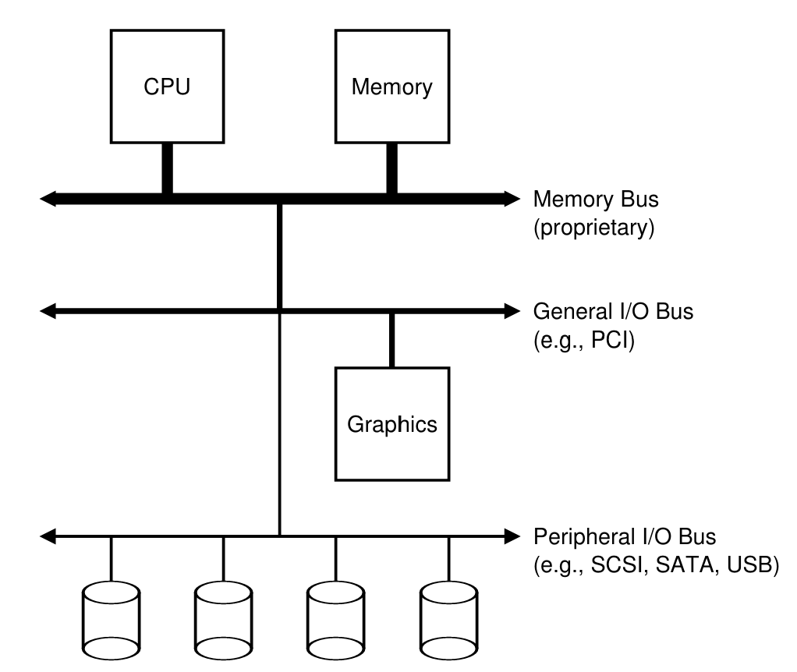
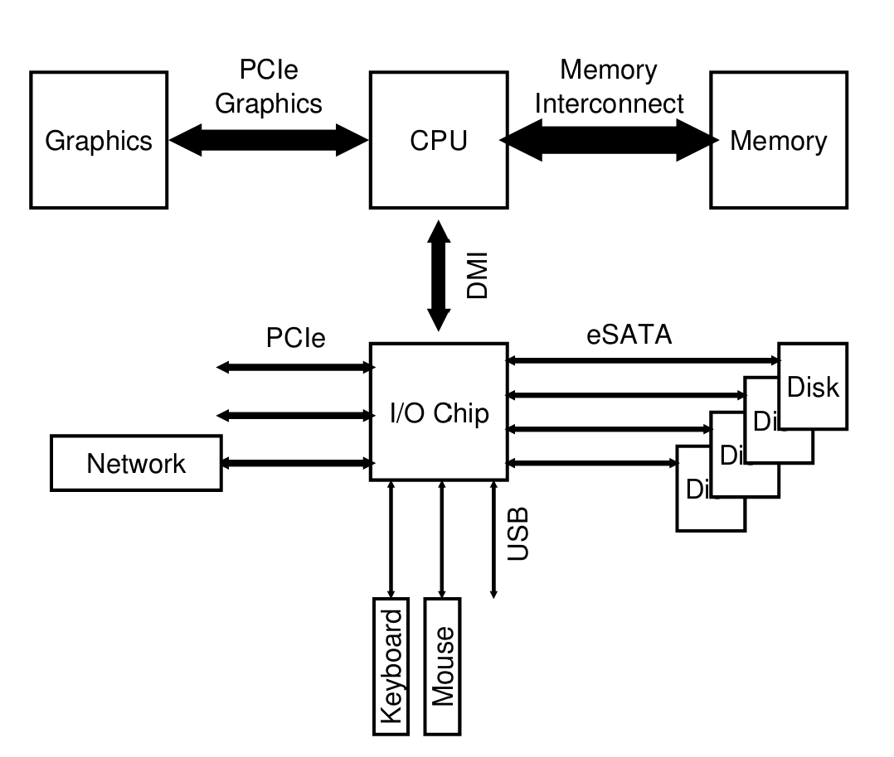
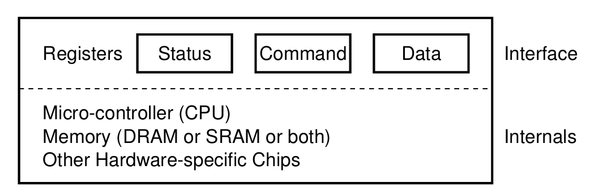

# I/O Devices

Before delving into the main content of this part of the book (on persistence), we first introduce the concept of input/output devices and show how the operating system/CPU might interact with such an entity.


**Attention:** This section provides valuable insights into why we learn **bare-metal programming in NUS CG2271**! By understanding how the CPU and operating system interact with I/O devices, we can better appreciate the hardware-level mechanisms behind our embedded systems and develop a more complete understanding of how computer systems work as a whole.


## System Architecture

Let's begin by looking at the **system-level architecture** of a typical computer, as shown in the following figure.

<figure><figcaption><p>Figure 36.1: Prototypical System Architecture</p></figcaption></figure>

The system consists of:

1. a **CPU** connected to the **main memory** through a **memory bus** (or interconnect).
2. High-performance I/O devices, such as graphics cards, are connected through a **general I/O bus**, typically PCI or one of its derivatives.
3. Further down, slower devices, such as disks, mice, and keyboards, are connected through **peripheral buses**, such as SCSI, SATA, or USB.

The overall idea is simple: **various devices are connected to the CPU through different buses**, allowing them to communicate and exchange data.


#### Bus vs. Interconnects

A **bus** is a shared communication pathway (group of parallel electrical lines or wires) where multiple hardware components use the same physical line to send and receive data. An **interconnect** (or point-to-point interconnect) is a dedicated, direct connection or switching fabric between two or more specific components that replaces wide shared buses to allow simultaneous, high-speed communication.


In modern computer systems, **specialized chipsets and high-speed point-to-point interconnects** are commonly used to connect devices to the CPU. The following figure illustrates the architecture of Intel's Z270 chipset.

<figure><figcaption><p>Figure 36.2: Modern System Architecture</p></figcaption></figure>

* **CPU connections:** The CPU connects directly to the main memory and high-performance graphics cards, while communicating with the I/O chipset through Intel's proprietary **Direct Media Interface (DMI)**.
* **I/O chipset connections:** Other devices are connected to the I/O chipset through various interconnects, such as PCIe, SATA, and USB.

### A Canonical Device

Now that we have explored the overall system architecture, let's take a closer look at a **canonical device** (a simplified, conceptual device) to understand how the CPU interacts with I/O devices. The architecture of a canonical device is shown in the following figure.

<figure><figcaption><p>Figure 36.3: A Canonical Device</p></figcaption></figure>

A canonical device consists of two main components:



#### Interface

The **interface** allows the CPU to communicate with and control the device. It typically consists of three registers:

1. **Status Register:** Indicates the current status of the device, such as whether it is busy or ready.
2. **Command Register:** Allows the CPU to issue commands to the device to perform specific operations.
3. **Data Register:** Allows the CPU to read data from or write data to the device.

By reading from and writing to these registers, the **CPU (executing OS which contains the device driver code) can control the device's behavior**.



#### Internal Structure

The **internal structure** contains the hardware responsible for implementing the device's functionality. Its design varies depending on the complexity of the device.

Simple devices may require only a few hardware circuits (like GPIO), while more complex devices may contain their own **processor, memory, and specialized hardware components** to perform their operations. For example, consider an SSD (a complex device):

1. **Host CPU**: Executes the OS device driver, which sends a read command to the SSD by writing to the registers (interface) presented by the SSD device.
2. **Device interface**: Receives the command and makes it available to the SSD controller (The value is already there, so this step is implicitly done).
3. **SSD controller**: Executes its firmware to **interpret the command**, locate the requested data, and manage the read operation.
4. **SSD hardware**: Performs the actual flash memory operations, and the controller coordinates returning the data to the host.

Thus, the internal structure of the device determines how the device implements the requested operations, potentially using its own **controller** and **firmware**.



### A Canonical Software Protocol

Unlike **hardware communication protocols**, such as I<sup>2</sup>C and UART, which define how data is transmitted and received **between devices**, we now focus on the **software-hardware interaction protocol**, which describes how the CPU communicates with and controls a device. For simplicity, we will refer to this as the **software protocol** in these notes.

The CPU interacts with a device through its [**interface**](i-o-devices.md#interface) (as we introduced before), specifically by executing instructions to read from or write to the device's registers. There are two main approaches to accessing these registers:



#### I/O Instruction

Some ISAs provide **special I/O instructions** that allow the CPU to communicate directly with device registers through a separate I/O address space.

For example, x86 provides the `in` and `out` instructions to read from and write to I/O ports. These instructions are typically **privileged**, meaning that they can normally only be executed by the OS in kernel mode. Therefore, a user process generally needs to request I/O operations through a **system call**, which transfers control to the kernel.


To connect **OS kernel mode** with the processor's **privilege modes**, we can think of kernel mode as the CPU operating at a higher privilege level, indicated by certain control bits in the processor's status registers. When the OS enters kernel mode, the CPU switches to this privileged mode, allowing it to execute privileged instructions and access protected hardware resources. For more details, refer to my [previous notes](virtualization/cpu-virtualization/limited-direct-execution.md#user-mode).




#### Memory-Mapped I/O

In this approach, **device registers are mapped into the CPU's memory address space**, allowing the CPU to access them using ordinary **load and store instructions**, just like accessing memory.

When the CPU accesses a memory-mapped device register, the hardware address-decoding and interconnect logic direct the request to the corresponding device instead of the main memory.



With these two mechanisms in mind, let's now look at how the CPU interacts with a device to request an operation. This interaction is exactly what we call a **canonical software protocol**, as illustrated below:

```
While (STATUS == BUSY)
    ; // wait until device is not busy
Write data to DATA register
Write command to COMMAND register
    (starts the device and executes the command)
While (STATUS == BUSY)
    ; // wait until device is done with your request
```

This protocol consists of four steps:

1. **Poll the device:** The CPU repeatedly reads the status register until the device is ready.
2. **Write data:** The CPU writes the required data to the data register.
3. **Issue a command:** The CPU writes to the command register, instructing the device to begin the operation.
4. **Wait for completion:** The CPU polls the status register again until the device finishes the operation.


All four steps involve accessing device registers through one of the two mechanisms introduced earlier: **I/O instructions** or **memory-mapped I/O (MMIO)**.


This seems familiar, doesn't it? We've been doing exactly this in our **EPP2 and CG2271 labs**! Now it's time to connect what we've learned and bring everything full circle! Generally, the code implementing these **software-hardware interaction protocols** can be found in two contexts:

1. **Bare-metal programming**, as we've practiced in EPP2 and CG2271.
2. **Device drivers**, which are typically part of a modern operating system.



#### Bare-Metal Programming

In EPP2 and CG2271 labs, we've practiced directly manipulating the registers of various peripherals, such as **UART, PWM, and ADC**, to configure their behavior and exchange data. This is exactly how we implement software-hardware interaction protocols in **bare-metal programming**.

In our CG2271 project, we also use an **RTOS**, which provides task scheduling and synchronization mechanisms. However, the RTOS does not necessarily manage all peripheral interactions for us. Instead, our tasks and interrupt handlers execute code that configures device registers and processes data from the peripherals.

Thus, the key idea is that **we write the hardware-interaction code ourselves**, rather than relying on a general-purpose OS to manage all device operations.



#### Device Driver

In modern operating systems, these hardware interactions are typically encapsulated in **device drivers**, which may be developed by hardware vendors or OS developers. Device drivers contain device-specific code, often written in C, to configure registers, issue commands, transfer data, and handle interrupts.

To support different devices without changing the rest of the OS, device drivers implement a **standardized interface** defined by the OS. For example, different storage device drivers may provide implementations of common operations such as reading and writing data, even though the underlying hardware interactions differ.

When an application invokes a **system call**, such as `open()` or `write()`, the OS processes the request and, when necessary, invokes the appropriate driver operations.

The important idea is that **the OS interacts with different devices through a common abstraction**, while each device driver handles the device-specific implementation. Therefore, replacing one device with another compatible device generally does not require changing the application's system calls or the OS's generic I/O code.


Interestingly, since modern computers support a wide variety of hardware devices, **device drivers can account for a significant portion of the OS codebase**, sometimes estimated at around **70%**! This observation is particularly relevant to [**monolithic kernels**](introduction-to-os.md#monolithic-kernel), such as Linux, where many device drivers run in kernel space.




## Data Transfer Models

In the canonical protocol discussed earlier, we've seen how the CPU interacts with a device to read or write data. In fact, this example uses **Programmed I/O (PIO)**, where the CPU directly controls data transfers through instructions and, in this particular example, uses **polling** to check the device's status.


We've already studied **polling, interrupts, and DMA** in detail in both [EPP2](https://app.gitbook.com/s/o4X8QvQZjJ2YsPgYhJDb/studio/studio-2-interrupts) and [CG3207](https://app.gitbook.com/s/jTJFBPtKk6NwweAooH53/lec/lec-08-io-and-exception-handling/lec-08a-embedded-i-o-systems#data-transfer-models)! Feel free to revisit those notes for a more comprehensive understanding of these mechanisms.


> TODO: It will be good to include the OSTEP explanation of Interrupt and DMA and use this as a reference notes instead using the one in EPP2 or CG3207!
