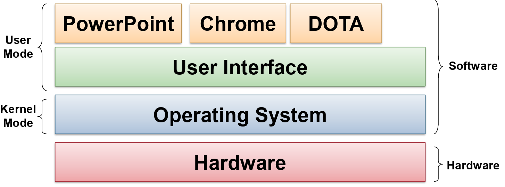
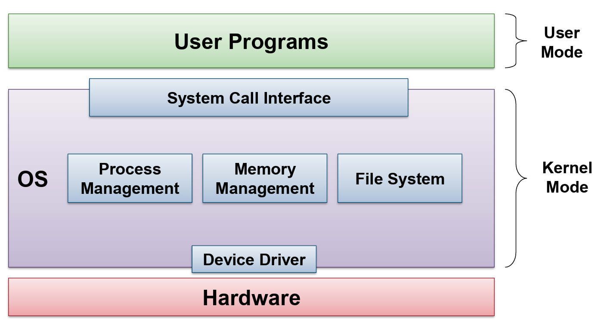
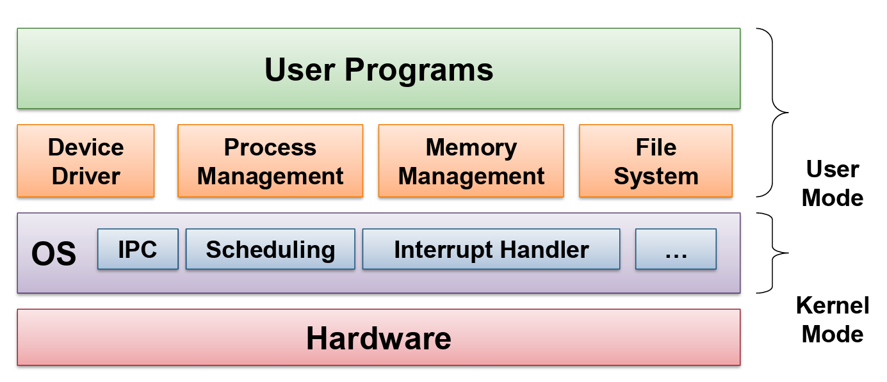
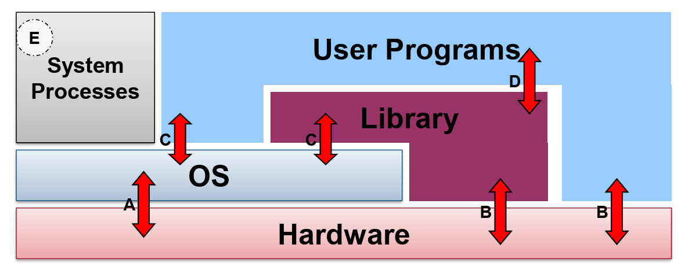
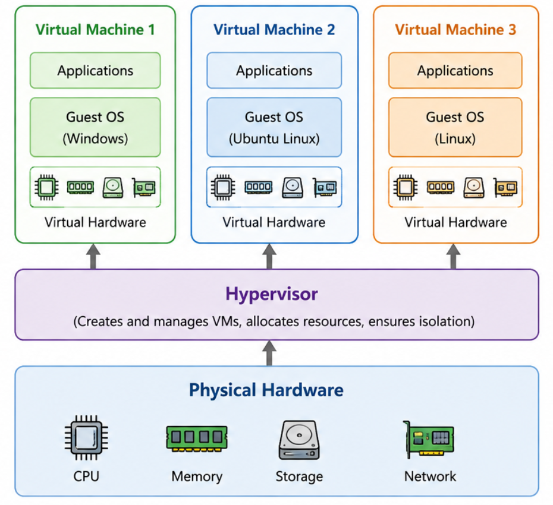
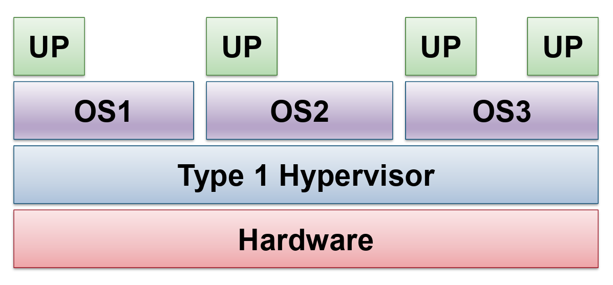
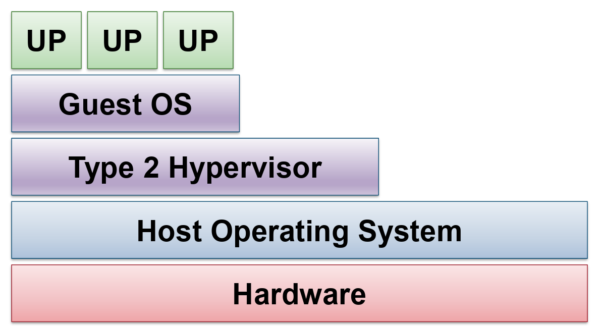

# Introduction to OS

As a student who have taken [NUS CG3207](https://app.gitbook.com/s/jTJFBPtKk6NwweAooH53/), we should have a good knowledge of what a computer program does when it runs. Basically, it does one very simple thing:

> it executes instructions.

But in this class, we will be learning that while a program runs, a lot of other wild things are going on with the primary goal of making the system **easy to use**.

There is a body of software, in fact, that is responsible for making it easy to run programs (even allowing you to seemingly run many at the same time), allowing programs to share memory, enabling programs to interact with devices, and other fun stuff like that. That body of software is called the **operating system (OS)**, as it is in charge of making sure the system operates correctly and efficiently in an easy-to-use manner.


The primary goal of OS is to make the system **easy to use**!


By looking through how OS makes the system easy to use, we can understand OS from three perspectives:

1. Virtual Machine
2. Standard Library
3. Resource Manager



#### Virtual Machine

The primary way the OS does this[^1] is through a general technique that we call **virtualization**. That is, the OS takes a **physical** resource (such as the processor, or memory, or a disk) and transforms it into a more general, powerful, and easy-to-use **virtual** form of itself. Thus, we sometimes refer to the operating system as a **virtual machine**.



#### Standard Library

Of course, in order to allow users to tell the OS what to do and thus make use of the features of the virtual machine (such as running a program, or allocating memory, or accessing a file), the OS also provides some interfaces (APIs) that we can call. A typical OS, in fact, exports a few hundred **system calls** that are available to applications. Because the OS provides these calls to run programs, access memory and devices, and other related actions, we also sometimes say that the OS provides a **standard library** to applications.


Attention here! The standard library here **is not equal to** the C library that we might usually refer to, which might include `printf()`, `fopen()`, etc. The standard library here is nothing but an ensemble of the system calls.




#### Resource Manager

Finally, because virtualization allows many programs to run (thus sharing the CPU), and many programs to concurrently access their own instructions and data (thus sharing memory), and many programs to access devices (thus sharing disks and so forth), the OS is sometimes known as a **resource manager**. Each of the CPU, memory, and disk is a **resource** of the system; it is thus the operating system's role to **manage** those resources, doing so efficiently or fairly or indeed with many other possible goals in mind.



In essence, OS is **nothing magical** as you might have thought, it is just a **program**, like many other programs running our your PC, but including the following key components:

1. Kernel (The most basic program in the OS)
2. System Processes, like file management, etc.

To understand the role of the OS a little bit better, let's take a look at some examples.

## Virtualization

The first main theme of this book is **virtualization**. We will start by reviewing the crux the problem of virtualization and then introduce two examples.

> how does the operating system virtualize resources?

_Why_ the OS does this is not the main question, as the answer should be obvious: it makes the system easier to use. Thus, we focus on the **how**: what mechanisms and policies are implemented by the OS to attain virtualization? How does the OS do so efficiently? What hardware support is needed?

### Virtualizing the CPU

Let's code our first program in this book!


```c
#include <stdio.h>
#include <stdlib.h>
#include <sys/time.h>
#include <assert.h>
#include "common.h"

int main(int argc, char *argv[])
{
    if (argc != 2)
    {
        fprintf(stderr, "usage: cpu<string>\n");
        exit(1);
    }
    char *str = argv[1];
    while (1)
    {
        Spin(1);
        printf("%s\n", str);
    }
    return 0;
}
```


If we run this program with `./cpu "A"`, we will see letter "A" being printed out every 1 second until the user press <kbd>Ctrl</kbd> + <kbd>C</kbd>.


```bash
prompt> gcc -o cpu cpu.c -Wall
prompt> ./cpu "A"
A
A
A
A
^C
prompt>
```


This is very normal! Now, let's do the same thing, but this time, let's run many different instances of this same program. The following code snippet shows the results of this slightly more complicate example.


```bash
prompt> ./cpu A & ./cpu B & ./cpu C & ./cpu D &
[1] 7353
[2] 7354
[3] 7355
[4] 7356
A
B
D
C
A
B
D
C
A
C
B
D
...
```



In this book, we assume that all the code is run on Linux and we are using Bash!


Well, now things are getting a little more interesting. Even though we have only one processor, somehow all four of these programs seem to be running at the same time! It turns out that the operating system, with some help from the hardware, is in charge of this **illusion**, i.e., the illusion that the system has a very large number of virtual CPUs. Turning a single CPU (or small set of them) into a seemingly infinite number of CPUs and thus allowing many programs to seemingly run at once is what we call **virtualizing the CPU**, the focus of the first major part of this book.

You might also notice that the ability to run multiple programs at once raises all sorts of new questions. For example, if two programs want to run at a particular time, which _should_ run? This question is answered by a **policy** of the OS; policies are used in many different places within an OS to answer these types of questions, and thus we will study them as we learn about the basic **mechanisms** that operating systems implement (such as the ability to run multiple programs at once). Hence the role of the OS as a **resource manager**.

### Virtualizing Memory

Now let's consider memory. The model of **physical memory** presented by modern machines is very simple. Memory is just an array of bytes; to **read** memory, one must specify an address to be able to access the data stored there; to **write** (or **update**) memory, one must also specify the data to be written to the given address.

Let’s take a look at the following program that allocates some memory by calling `malloc()`. The program does a couple of things. First, it allocates some memory (line 14). Then, it prints out the address of the memory (line 16), and then puts the number input by the user into the first slot of the newly allocated memory (line 17). Finally, it loops, delaying for a second and incrementing the value stored at the address held in p. With every print statement, it also prints out what is called the process identifier (the PID) of the running program. This PID is unique per running process.


```c
#include <unistd.h>
#include <stdio.h>
#include <stdlib.h>
#include "common.h"

int main(int argc, char *argv[])
{
    if (argc != 2)
    {
        fprintf(stderr, "usage: mem <value>\n");
        exit(1);
    }
    int *p;
    p = malloc(sizeof(int));
    assert(p != NULL);
    printf("(%d) addr pointed to by p: %p\n", (int)getpid(), p);
    *p = atoi(argv[1]); // assign value to addr stored in p
    while (1)
    {
        Spin(1);
        *p = *p + 1;
        printf("(%d) value of p: %d\n", getpid(), *p);
    }
    return 0;
}

```


The output of this program can be found here:


```bash
danie@DESKTOP-IAI9BIM:~$ ./mem 0
(412) addr pointed to by p: 0x564fbfcc52a0
(412) value of p: 1
(412) value of p: 2
(412) value of p: 3
(412) value of p: 4
(412) value of p: 5
(412) value of p: 6
(412) value of p: 7
```


Again, this first result is not too interesting. Now, we again run multiple instances of this same program to see what happens.


```bash
danie@DESKTOP-IAI9BIM:~$ ./mem 0 & ./mem 0
[1] 544
(544) addr pointed to by p: 0x5555555592a0
(545) addr pointed to by p: 0x5555555592a0
(544) value of p: 1
(545) value of p: 1
(544) value of p: 2
(545) value of p: 2
(545) value of p: 3
(544) value of p: 3
(544) value of p: 4
(545) value of p: 4
(544) value of p: 5
(545) value of p: 5
```


We see from the example that each running program has allocated memory at the same address (`0x5555555592a0`), and yet each seems to be updating the value at `0x5555555592a0` independently! It is as if each running program has its own **private memory**, instead of sharing the same physical memory with other running programs.


If you run the code on Linux and find out that the addresses assigned to `p` by the two processes are different, you need to run this command to turn off the ASLR (Address Space Layout Randomization) `sudo sh -c 'echo 0 > /proc/sys/kernel/randomize_va_space'` and after that, turn the ASLR back on by using this command `sudo sh -c 'echo 2 > /proc/sys/kernel/randomize_va_space'`.


Indeed, that is exactly what is happening here as the OS is **virtualizing memory**. Each process accesses its own private **virtual address space** (sometimes just called its **address space**), which the OS somehow maps onto the physical memory of the machine. A memory reference within one running program does not affect the address space of other processes (or the OS itself); as far as the running program is concerned, it has physical memory all to itself. The reality, however, is that physical memory is a shared resource, managed by the operating system. Exactly how all of this is accomplished is also the subject of the first part of this book, on the topic of **virtualization.**

## Concurrency

Another main theme of this book is **concurrency**. We use this conceptual term to refer to a host of problems that arise, and must be addressed, when working on many things at once (e.g., concurrently) in the same program. The problems of concurrency arose first within the OS itself; as we can see in the examples above on [virtualization](introduction-to-os.md#virtualizing-memory), the OS is juggling many things at once, first running one process, then another, and so forth. As it turns out, doing so leads to some deep and interesting problems.

Unfortunately, the problems of concurrency are no longer limited just to the OS itself. Indeed, modern **multi-threaded** programs exhibit the same problems. Let us demonstrate with an example of a **multi-threaded** program.


```c
#include <stdio.h>
#include <stdlib.h>
#include "common.h"
#include "common_threads.h"

volatile int counter = 0;
int loops;

void *worker(void *arg)
{
    int i;
    for (i = 0; i < loops; i++)
    {
        counter++;
    }
    return NULL;
}

int main(int argc, char *argv[])
{
    if (argc != 2)
    {
        fprintf(stderr, "usage: threads <loops>\n");
        exit(1);
    }
    loops = atoi(argv[1]);
    pthread_t p1, p2;
    printf("Initial value : %d\n", counter);
    Pthread_create(&p1, NULL, worker, NULL);
    Pthread_create(&p2, NULL, worker, NULL);
    Pthread_join(p1, NULL);
    Pthread_join(p2, NULL);
    printf("Final value   : %d\n", counter);
    return 0;
}

```


The main program creates two threads using `Pthread_create()`. We can think of a thread as a function running within the same memory space as other functions, with more than one of them active at a time. In this example, each thread starts running in a routine called `worker()`, in which it simply increments a counter in a loop for `loops` number of times.

If we set `loops=1000`, we will get the following output.


```bash
danie@DESKTOP-IAI9BIM:~$ ./threads 1000
Initial value : 0
Final value   : 2000
```


This is as we expected since, when the two threads are finished, the final value of the shared counter is 2000, as each thread incremented the counter 1000 times. However, if we set `loops` to a higher value and rerun the program, we might find the following outputs:


```bash
danie@DESKTOP-IAI9BIM:~$ ./threads 100000
Initial value : 0
Final value   : 113502
danie@DESKTOP-IAI9BIM:~$ ./threads 100000
Initial value : 0
Final value   : 107180
```


In this run, we set `loops=100000`, but we not only get a wrong value for both times, but also get a different value at the last run! So why is this happening?

As it turns out, the reason for these odd and unusual outcomes relate to how instructions are executed, which is one at a time. Unfortunately, a key part of the program above, where the shared counter is incremented, takes three instructions:

1. one to load the value of the counter from memory into a register,
2. one to increment it, and
3. one to store it back into memory.

Because these three instructions do not execute **atomically** (instead they are executed all at once), strange things can happen. It is this problem of **concurrency** that we will address in great detail in the second part of this book. And this also gives us the crux of problem of concurrency.

> When there are many concurrently executing threads within the same memory space, how can we build a correctly working program? What **primitives** are needed from the OS? What mechanisms should be provided by the hardware? How can we use them to solve the problems of concurrency?

## Persistance

The third major theme of the course is **persistence**. In system memory, data can be easily lost, as devices such as DRAM store values in a **volatile** manner; when power goes away or the system crashes, any data in memory is lost. Thus, we need hardware and software to be able to store data **persistently**; such storage is thus critical to any system as users care a great deal about their data.

The hardware comes in the form of some kind of **input/output** or **I/O** device; in modern systems, a hard drive is a common repository for long-lived information, although solid-state drives (SSDs) are making headway in this arena as well.

The software in the operating system that usually manages the disk is called the **file system**; it is thus responsible for storing any files the user creates in a reliable and efficient manner on the disks of the system.


The "disk" in the paragraph above strictly refers to the **hard drive** or **SSD** or the storage that is non-volatile.


Unlike the abstractions provided by the OS for the CPU and memory, the OS does not create a private, virtualized disk for each application. Rather, it is assumed that oftentimes, users will want to **share** information that is in files which are in disk(s).

To understand this better, let's look at some code. The following code snippet presents code to create a file (`/tmp/file`) that contains the string "hello world".


```c
#include <stdio.h>
#include <unistd.h>
#include <assert.h>
#include <fcntl.h>
#include <sys/stat.h>
#include <sys/types.h>
#include <string.h>

int main(int argc, char *argv[])
{
    int fd = open("/tmp/file", O_WRONLY | O_CREAT | O_TRUNC, S_IRUSR | S_IWUSR);
    assert(fd >= 0);
    char buffer[20];
    sprintf(buffer, "hello world\n");
    int rc = write(fd, buffer, strlen(buffer));
    assert(rc == (strlen(buffer)));
    fsync(fd);
    close(fd);
    return 0;
}
```


To accomplish this task, the program makes three calls into the operating system.

1. The first, a call to `open()`, opens the file and creates it;
2. the second, `write()`, writes some data to the file;
3. the third, `close()`, simply closes the file thus indicating the program won't be writing any more data to it.&#x20;

These **system calls** are routed to the part of the operating system called the **file system**, which then handles the requests and returns some kind of error code to the user.


Attention here, `open`, `write` and `close` are **direct system calls** here! If we are using some C library calls, it might be `fopen`, `fprintf` and `fclose`. These library calls are built upon those system calls!


You might be wondering what the OS does in order to actually write to disk. Long story short, this is very complicated and involves a lot of low-level stuff. However, fortunately, the OS provides a standard and simple way to access devices through its **system calls**. Thus, the OS is sometimes seen as a [**standard library**](introduction-to-os.md#standard-library)!

We'll be talking about all of this quite a bit more in the third part of this book on **persistence**, where we'll discuss devices and I/O in general, and then disks, RAIDs, and file systems in great detail! Lastly, let's look at the crux of the problem of persistence!

> The **file system** is the part of the OS in charge of managing persistent data. What techniques are needed to do so correctly? What mechanisms and policies are required to do so with high performance? How is **reliability** achieved, in the face of failures in hardware and software?

## Design Goals

So now we have some idea of what an OS actually does:

* it takes physical resources, such as a CPU, memory, or disk, and **virtualizes** them.
* It handles tough and tricky issues related to **concurrency**.
* And it stores files **persistently**, thus making them safe over the long-term.

Given that we want to build such a system, we want to have some goals in mind to help focus our design and implementation and make trade-offs as necessary; finding the right set of trade-offs is a key to building systems.



#### Abstraction

One of the most basic goals is to build up some **abstractions** in order to make the system convenient and easy to use. Abstractions are fundamental to everything we do in computer science. For example, if we want to create a file, with the help of OS, it doesn't matter we want to create a file on the SSD/HDD/Thumbdrive, the **system call** to create a file (`open`) is always the same.

So, one of the motivations for OS is to **abstract away the hardware differences**!


We've seen the importance of abstraction in the field of [digital](https://app.gitbook.com/s/jTJFBPtKk6NwweAooH53/textbook/from-zero-to-one#abstraction)/[analog](https://app.gitbook.com/s/FkaT0aUkbzwIwL8qtYDI/razavi/introduction-to-analog-design#levels-of-abstraction) design!




#### Performance

One goal in designing and implementing an operating system is to provide high **performance**; another way to say this is our goal is to **minimize the overheads** of the OS.



#### Protection

Another goal will be to provide **protection** between applications, as well as between the OS and applications. Because we wish to allow many programs to run at the same time, we want to make sure that the malicious or accidental bad behavior of one does not harm others; we certainly don’t want an application to be able to harm the OS itself (as that would affect all programs running on the system). Protection is at the heart of one of the main principles underlying an operating system, which is that of **isolation**; isolating processes from one another is the key to protection and thus underlies much of what an OS must do.



#### Reliability

The operating system must also run non-stop; when it fails, all applications running on the system fail as well. Because of this dependence, operating systems often strive to provide a high degree of **reliability**.



#### Other Goals

Other goals make sense:

* **energy-efficiency** is important in our increasingly green world;
* **security** (an extension of protection, really) against malicious applications is critical, especially in these highly-networked times;
* **mobility** is increasingly important as OSes are run on smaller and smaller devices.




After the "design goals" section in OSTEP, there is a section on the history of OS, which is very worth reading to get a glimpse of how some great ideas come up, such as **system calls**!


## OS Structure


This part is not from OSTEP but from Lec 01 of NUS CG2271!


The high level view of OS is shown as follows:

<figure><figcaption></figcaption></figure>


The User Interface is mostly **shell** and note that the GUI of Windows/macOS/Linux that we usually see is also a type of **shell**.


In CG2271, we've introduced two main types of OS structures:

1. Monolithic Kernel
2. Microkernel



#### Monolithic Kernel

The monolithic kernel OS structure can be shown as follows:

<figure><figcaption></figcaption></figure>

The advantage is that since almost everything is in kernel mode, this structure has very **good performance**. However, its disadvantage is also very obvious, which is that it is not very safe as all the programs like process management, memory management and file system, have access to the hardware, which is very dangerous.



#### Microkernel Components

As comparison, the microkernel OS structure is shown as follows:

<figure><figcaption></figcaption></figure>

Whereras in this OS structure, all the higher level services are separate out, making the programs running in kernel mode very small and clean. However, the disadvantage is **low performance** as we need to frequently switch modes between user modes and kernel modes.



### Generic OS Components

The generic OS componenets can be shown as follows:

<figure><figcaption></figcaption></figure>

1. A: OS executign **machine instructions**
2. B: Normal machine instructions executed by program or library code
3. C: calling OS using **system call interface**, like `open`, `write`
4. D: User program calls C library code, like `fopen()`, `fprintf()`
5. E: System processes which are also parts of OS

### OS Booting Sequence

As I might have already had some experience during my intern at [JaguarMicro](https://app.gitbook.com/o/MnEKr5A4lYXtOfhoXGj5/s/KWXnx1UevXlXTuyEfewj/), and according to Prof. Colin, the OS booting sequence from a perspective of a CPU engineer is as follows:

1. **Power-On**: When power is applied, the CPU resets and begins executing from a predefined address which points to firmware (UEFI) stored in the motherboard's **SPI flash/ROM**.
2. **UEFI Firmware Initialization**: The CPU executes the **UEFI firmware**, which initializes essential hardware needed for booting.
   * One of the most important steps is [DDR memory initialization/training](https://app.gitbook.com/s/KWXnx1UevXlXTuyEfewj/ddr-memory/ddr4-initialization-training-and-calibration), which configures the memory controller so the system can reliably use RAM.
   * UEFI also initializes important hardware interfaces such as storage and PCIe devices.
3. **Boot Device and Bootloader**: UEFI determines which device to boot from according to the configured boot order.
   * For a typical UEFI system, it accesses the **EFI System Partition (ESP)** on the storage device.
   * It loads a **bootloader** such as GRUB or Windows Boot Manager from storage into **DDR memory (RAM)**.
   * The CPU then begins executing the bootloader.
4. **Operating System Kernel Loading**: The bootloader locates the **OS kernel** on the storage device.
   * It loads the kernel and any required boot files into DDR memory.
   * The bootloader then transfers control to the kernel by jumping to the kernel's entry point.
5.  **OS Initialization**: The kernel initializes the rest of the computer hardware and operating-system components. It starts device drivers, storage/filesystem support, and other essential OS services.


<details>

<summary>Normal programs use OS, what does OS use LOL?</summary>

The answer is simple: **bare metal**.

</details>

## Virtual Machine


This is an FYI part from NUS CG2271!


Normally, an **operating system (OS) assumes it has total control over the hardware**. It expects to directly manage the CPU, memory, disk, and other hardware resources. This creates two practical problems:

* **Running multiple operating systems:** What if we want several OSes to run on the **same physical machine at the same time**? They cannot all independently have total control of the same hardware.
* **Debugging and monitoring an OS:** Because an OS directly controls the hardware, it can be difficult to observe its internal behavior or safely test potentially destructive implementations. A bug in the OS could crash or corrupt the whole physical system. (This is related to the sandbox that some readers might know)

**Virtual machines solve these problems by adding a virtualization layer between the physical hardware and the operating system.**

### **Basic Concepts**

#### **What is a Virtual Machine?**

A **Virtual Machine (VM)** is a **software emulation/virtualization of a computer's hardware**. Instead of giving an operating system direct access to the real hardware, virtualization presents the OS with the **illusion of having its own complete machine**, including:

> **Virtual CPU + Virtual Memory + Virtual Disk + Other Virtual Devices**

From the guest OS's point of view, these resources look like normal hardware. Therefore, a **normal operating system can run on top of the virtual machine without needing to own the actual physical hardware**.

#### Hypervisor

The software layer responsible for providing and managing these virtual machines is called a **Hypervisor**, also known as a **Virtual Machine Monitor (VMM)**. The hypervisor **virtualizes and manages the underlying hardware resources**, deciding how the physical CPU, memory, storage, etc. are shared among the VMs.

<details>

<summary>Hypervisor, Virtual Machine and Guest OS</summary>

To get a clearer understanding of the relationship between hypervisor, virtual machine and the guest OS, we say that:

* **Hypervisor:** Software that **creates and manages VMs** and allocates physical hardware resources to them.
* **Virtual Machine (VM):** A **virtual computer** provided by the hypervisor.
* **Guest OS:** The operating system **running inside a VM**.

<figure><figcaption></figcaption></figure>

</details>

### Hypervisor Types

There are **two major classes of hypervisor implementations**, depending on where the hypervisor sits relative to the hardware and host operating system.

#### Type 1 Hypervisor

Type 1 Hypervisor runs **directly on the hardware** and there is **no host OS** underneath.

<figure><figcaption></figcaption></figure>

For example, Microsoft's Hyper-V is a type 1 hypervisor.

#### Type 2 Hypervisor

Type 2 hypervisor runs **on top of a host OS** and usually appears as an application/software on the host.

<figure><figcaption></figcaption></figure>

Examples for this type of hypervisors are: WSL 2, Sandbox and Apple Parallels.

[^1]: OS is in charge of making sure the system operates correctly and efficiently in an easy-to-use manner.
