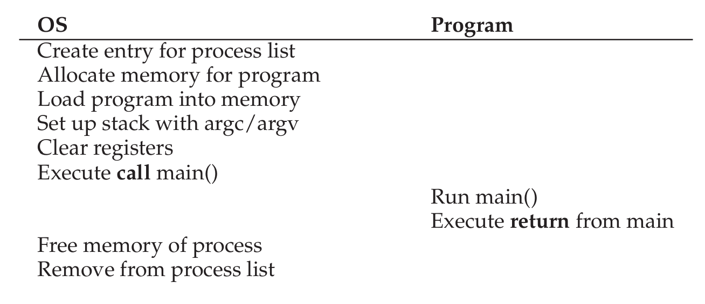
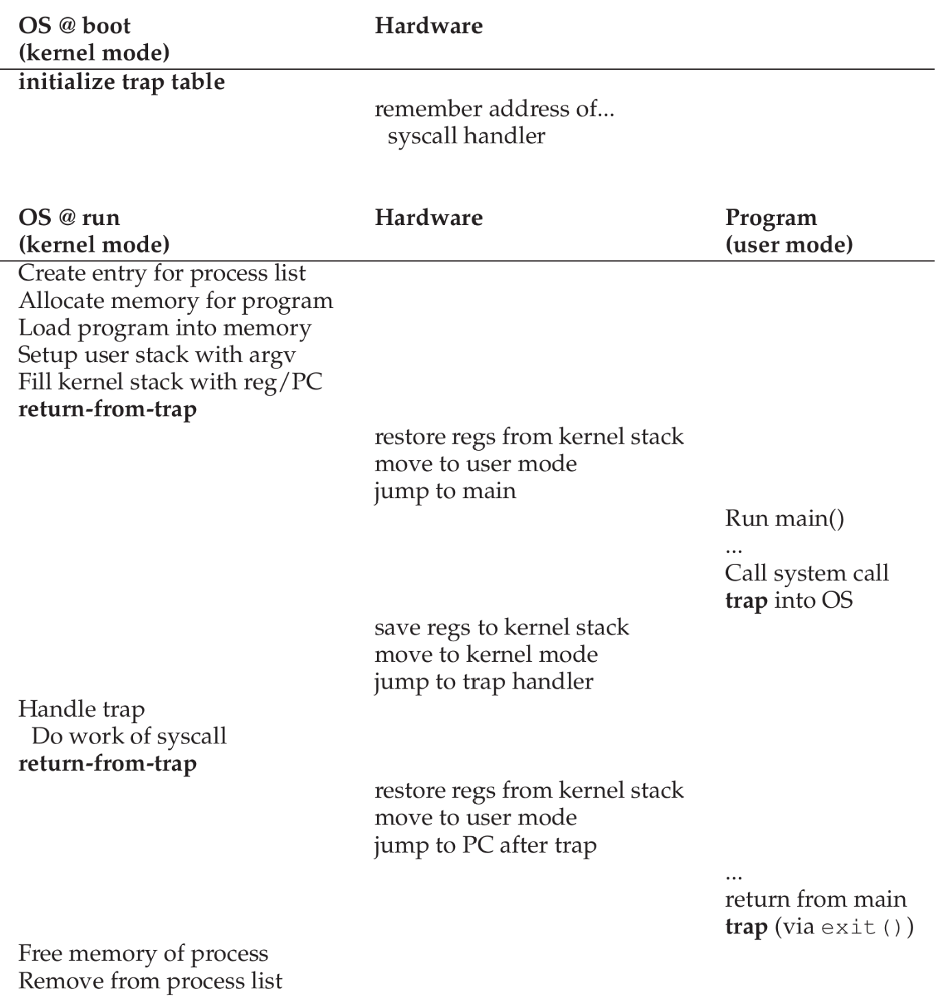
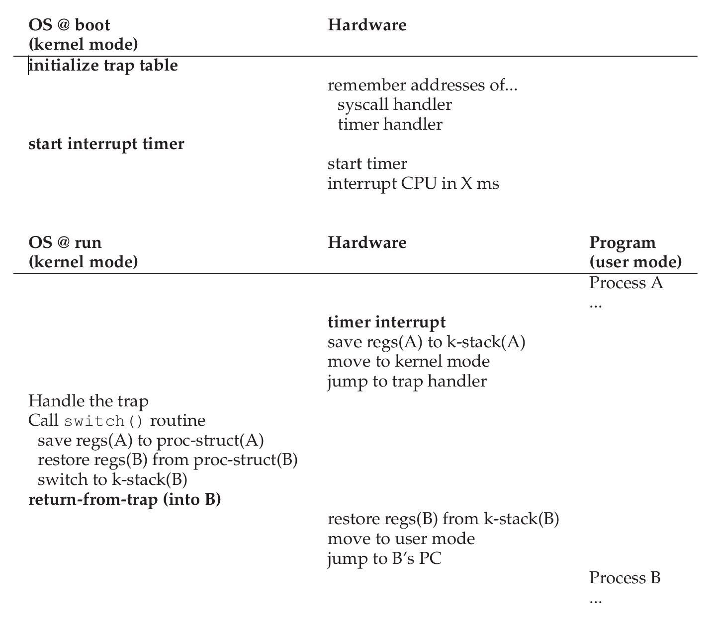

# Limited Direct Execution

In order to virtualize the CPU, the operating system needs to somehow share the physical CPU among many jobs running seemingly at the same time. The basic idea is simple:

> run one process for a little while, then run another one, and so forth.

By [time sharing](the-process.md#use-time-sharing-and-space-sharing) the CPU in this manner, virtualization is achieved.

There are a few challenges, however, in building such virtualization machinery.

1. The first is **performance**: how can we implement virtualization without adding excessive overhead to the system?
2. The second is **control**: how can we run processes efficiently while retaining control over the CPU? Control is particularly important to the OS, as it is in charge of resources; without control, a process could simply run forever and take over the machine, or access information that it should not be allowed to access.

Obtaining high performance while maintaining control is thus one of the central challenges in building an operating system.

The Crux of the Problem: How to efficiently virtualize the CPU with control?

The OS must virtualize the CPU in an efficient manner while retaining control over the system. To do so, both hardware and operating-system support will be required. The OS will often use a judicious bit of hardware support in order to accomplish its work effectively.

## Basic Technique: Limited Direct Execution

To make a program run as fast as one might expect, not surprisingly OS developers came up with a technique, which we call **limited direct execution**. The "direct execution" part of the idea is simple:

> just run the program directly on the CPU.

Thus, when the OS wishes to start a program running, it creates a process entry for it in a process list, allocates some memory for it, loads the program code into memory (from disk), locates its entry point (i.e., the `main()` routine or something similar), jumps to it, and starts running the user's code. Figure 6.1 shows this basic direct execution protocol (without any limits, yet), using a normal call and return to jump to the program's `main()` and later to get back into the kernel.

<figure><figcaption>
Figure 6.1: Direct Execution Protocol (Without Limits)
</figcaption></figure>

Sounds simple, no? But this approach gives rise to a few problems in our quest to virtualize the CPU.

1. The first is simple: if we just run a program, how can the OS make sure the program doesn't do anything that we don't want it to do, while still running it efficiently?
2. The second: when we are running a process, how does the operating system stop it from running and switch to another process, thus implementing the [time sharing](the-process.md#use-time-sharing-and-space-sharing) we require to virtualize the CPU?


These two bullet points form the backbone of this section: **operating modes** from the CPU's perspective and **context switching**.


In answering these questions below, we'll get a much better sense of what is needed to virtualize the CPU. In developing these techniques, we'll also see where the "limited" part of the name arises from; without limits on running programs, the OS wouldn't be in control of anything and thus would be "just a library" — a very sad state of affairs for an aspiring operating system!

## Problem #1: Restricted Operations

Direct execution has the obvious advantage of being fast; the program runs natively on the hardware CPU and thus executes as quickly as one would expect. But running on the CPU introduces a problem:

> what if the process wishes to perform some kind of restricted operation, such as issuing an I/O request to a disk, or gaining access to more system resources such as CPU or memory?

The Crux of the Problem: How to perform restricted operations?

A process must be able to perform I/O and some other restricted operations, but without giving the process complete control over the system. How can the OS and hardware work together to do so?

One approach would simply be to let any process do whatever it wants in terms of I/O and other related operations. However, doing so would prevent the construction of many kinds of systems that are desirable. For example, if we wish to build a file system that checks permissions before granting access to a file, we can't simply let any user process issue I/Os to the disk; if we did, a process could simply read or write the entire disk and thus all protections would be lost.

### User Mode

Thus, the approach we take is to introduce a new processor mode, known as **user mode**; code that runs in user mode is restricted in what it can do. For example, when running in user mode, a process can't issue I/O requests; doing so would result in the processor raising an exception; the OS would then likely kill the process.


In [NUS CG3207](https://app.gitbook.com/s/jTJFBPtKk6NwweAooH53/lec/lec-08-io-and-exception-handling/lec-08b-exceptions#execution-modes-and-privilege-levels), we have seen that the RISC-V processor provides **three modes** (machine mode, kernal mode and user mode) plus an experimental mode (hypervisor mode). **User Mode (Unprivileged Mode):** Supports ordinary instructions such as `ADD`, `MUL`, and `JUMP`, but does not permit the execution of privileged instructions.


### Kernal Mode

In contrast to user mode is **kernel mode**, which the operating system (or kernel) runs in. In this mode, code that runs can do what it likes, including privileged operations such as issuing I/O requests and executing all types of restricted instructions.


**Kernel Mode (Privileged Mode):** Supports all instructions available in user mode, as well as additional **privileged instructions** for operations such as hardware control and memory management.


### System Call

We are still left with a challenge, however:

> what should a user process do when it wishes to perform some kind of privileged operation, such as reading from disk?

To enable this, virtually all modern hardware provides the ability for user programs to perform a **system call**. Pioneered on ancient machines such as the Atlas, system calls allow the kernel to carefully expose certain key pieces of functionality to user programs, such as

* accessing the file system,
* creating and destroying processes,
* communicating with other processes, and
* allocating more memory.

Most operating systems provide a few hundred calls (see the POSIX standard for details); early Unix systems exposed a more concise subset of around twenty calls.


In [NUS CG3207](https://app.gitbook.com/s/jTJFBPtKk6NwweAooH53/lec/lec-08-io-and-exception-handling/lec-08b-exceptions#execution-modes-and-privilege-levels), we learned that when a processor wants to switch from user mode to supervisor mode, it executes a special instruction called `ecall`. In RISC-V, this **environment call** instruction is the hardware mechanism used to implement OS system calls. In the implementation of system calls, there are also other types of normal instructions!


### Trap

To execute a system call, a program must execute a special **trap** instruction (this is nothing but the `ecall` in RISC-V). This instruction simultaneously jumps into the kernel and raises the privilege level to kernel mode; once in the kernel, the system can now perform whatever privileged operations are needed (if allowed), and thus do the required work for the calling process. When finished, the OS calls a special return-from-trap instruction, which, as you might expect, returns into the calling user program while simultaneously reducing the privilege level back to user mode.

The Dual Meaning of "Traps" (OS vs. Architecture)

In [NUS CG3207](https://app.gitbook.com/s/jTJFBPtKk6NwweAooH53/lec/lec-08-io-and-exception-handling/lec-08b-exceptions#two-types-of-exceptions), we learned about traps as a hardware concept. However, Operating Systems courses often use the term slightly differently. The discrepancy comes down to **Intent vs. Hardware Mechanism**.

1. **The OS Context (The Intentional Tool)**
   * **Meaning**: In OS design, a "trap" is typically discussed as the deliberate software mechanism used to implement System Calls.
   * **Focus**: It is about _intent_. A user program intentionally pauses itself and raises its privilege level to ask the kernel for a service (like reading a file).
   * **RISC-V Implementation**: This is executed specifically using the `ecall` instruction.
2. **The DDCA / Architecture Context (The Broad Mechanism)**
   * **Meaning**: To the CPU hardware, a "Trap" (or synchronous exception) is an umbrella term for _any_ **software** internal event that forces the processor to stop, raise privileges, and jump to the OS exception handler.
   * **Focus**: It is about the _hardware's reaction_, regardless of whether the software did it on purpose.
   * **Scope**: It includes both intentional events (System calls via `ecall`) and unintentional errors (Page Faults, Divide-by-Zero, Illegal Instructions).

#### Kernal Stack

The hardware needs to be a bit careful when executing a trap, in that it must make sure to save enough of the caller's registers in order to be able to return correctly when the OS issues the return-from-trap instruction. On x86, for example, the processor will push the program counter, flags, and a few other registers onto a per-process **kernel stack**; the return-from-trap will pop these values off the stack and resume execution of the user-mode program. Other hardware systems use different conventions, but the [basic concepts](#user-content-fn-1)[^1] are similar across platforms.


The **kernel stack** is used only when a user program enters the kernel, such as through a **system call** or **trap**. For normal function calls within a user program, the [**user stack**](the-process.md#user-stack) is used instead.


#### Trap Table

There is one important detail left out of this discussion:

> how does the trap know which code to run inside the OS?

Clearly, the calling process can't specify an address to jump to (as we  would when making a procedure call); doing so would allow programs to jump anywhere into the kernel which clearly is a **very bad idea**. Thus the kernel must carefully control what code executes upon a trap.

The kernel does so by setting up a **trap table** at boot time. When the machine boots up, it does so in privileged (kernel) mode, and thus is free to configure machine hardware as need be. One of the first things the OS thus does is to tell the hardware what code to run when certain exceptional events occur.


Sometimes, the trap table is called **interrupt vector table** in some ISAs.


For example, what code should run when a hard disk interrupt takes place, when a keyboard interrupt occurs, or when a program makes a system call? The OS informs the hardware of the locations of these trap handlers, usually with some kind of _special instruction_. Once the hardware is informed, it remembers the location of these handlers until the machine is next rebooted, and thus the hardware knows what to do (i.e., what code to jump to) when system calls and other exceptional events take place.


The trap table is configured by the OS during boot and contains the entry addresses of handlers for events such as **hardware interrupts**, **exceptions**, and **system calls**. When a trap occurs, the CPU uses this information to transfer control to the appropriate handler in kernel mode.


Booting Up and Setting up the Trap Table

It is easy to confuse the "Operating System" on your hard drive with the "Operating System" running in memory. Here is how they differ and how the [boot process](../../introduction-to-os.md#os-booting-sequence) bridges the gap to set up the CPU hardware:


This also combines the knowledge that I learned during my intern at [JaguarMicro](https://app.gitbook.com/s/KWXnx1UevXlXTuyEfewj/), where I learn the boot sequence of their DPU!




#### The OS on Disk vs. The Kernel in RAM

* **On Disk (The Full OS Package)**: This is the massive 20GB+ installation (Windows/Ubuntu) containing the GUI, desktop environment, thousands of drivers, and pre-installed apps.
* **In RAM (The Kernel)**: The CPU can only execute instructions that are physically in RAM. Therefore, only the core of the OS — the **Kernel** (often just 10-30MB) — is loaded into memory to manage processes, memory, and traps.


We can understand the **kernal** as nothing but a program which can and must be run!




#### The Boot Sequence

Because RAM is completely wiped when the power is turned off, the computer must load the kernel from the **disk** before it can run any OS code.

* **BIOS/UEFI (Firmware)**: A hardcoded program on the motherboard wakes up the system, initializes hardware, and finds the hard drive.
* **Bootloader (e.g., GRUB)**: A tiny program loaded by the BIOS. Its only job is to find the Kernel file on the disk, copy it into RAM, and point the CPU to the Kernel's first line of code.



#### Setting the Trap Table

* When the Kernel first begins running in RAM, the CPU is in Maximum Privilege Mode (e.g., M-mode in RISC-V or Ring 0 in x86).
* Because the Kernel is loaded dynamically, it calculates the current RAM addresses of its trap handler functions.
* It executes highly privileged hardware instructions (like `csrw stvec` on RISC-V or `lidt` on x86) to physically wire the CPU to those trap handler addresses.
* Once the Trap Table is locked in, the Kernel drops the CPU down to unprivileged User Mode (U-mode) and launches the rest of the system. If a user program tries to change the trap table later, the hardware will block it with an Illegal Instruction trap!


The setup for the trap table is **dynamic** because the exact location of the kernel code in RAM can change depending on the boot process.




### Timeline

The **timeline** (with time increasing downward, in Figure 6.2) summarizes the protocol. We assume each process has a kernel stack where registers (including general purpose registers and the program counter) are saved to and restored from (by the hardware) when transitioning into and out of the kernel.

<figure><figcaption>
Figure 6.2: Limited Direct Execution Protocol
</figcaption></figure>

There are two phases in the LDE protocol.

1. In the first (at boot time), the kernel initializes the trap table, and the CPU remembers its location for subsequent use. The kernel does so via a [privileged instruction](limited-direct-execution.md#setting-the-trap-table) (all privileged instructions are highlighted in bold).
2. In the second (when running a process), the kernel sets up a few things (e.g., allocating a node on the process list, allocating memory) before using a return-from-trap instruction to start the execution of the process; this switches the CPU to **user mode** and begins running the process. When the process wishes to issue a system call, it traps back into the OS, which handles it and once again returns control via a return-from-trap to the process. The process then completes its work, and returns from `main()`; this usually will return into some stub code which will properly exit the program (say, by calling the `exit()` system call, which traps into the OS). At this point, the OS cleans up and we are done.

## Problem #2: Switching Between Processes

The next problem with direct execution is achieving a switch between processes. Switching between processes should be simple, right? The OS should just decide to stop one process and start another. What’s the big deal? But it actually is a little bit tricky: specifically, if a process is running on the CPU, this by definition means the OS is **not** running. If the OS is not running, how can it do anything at all? (hint: it can't) While this sounds almost philosophical, it is a real problem:

> there is clearly no way for the OS to take an action if it is not running on the CPU.

Thus we arrive at the crux of the problem.

The Crux of the Problem: How to regain control of the CPU?

How can the operating system **regain control** of the CPU so that it can switch between processes?

### A Cooperative Approach

One approach that some systems have taken in the past is known as the **cooperative** approach. In this style, the OS **trusts** the processes of the system to behave reasonably. Processes that run for too long are assumed to periodically give up the CPU so that the OS can decide to run some other task. There are two ways for a process to give up the CPU to the OS:

1. Via [System Call](limited-direct-execution.md#system-call)
2. Via Trap


Note that the term "trap" used in the second approach is similar to how it is used in DDCA mentioned [above](limited-direct-execution.md#the-dual-meaning-of-traps-os-vs.-architecture). However, in this context, the book's author uses it only to refer to **illegal events** done by the process, such as division by zero.




#### System Call

Most processes, as it turns out, transfer control of the CPU to the OS quite frequently by making **system calls**, for example, to open a file and subsequently read it, or to send a message to another machine, or to create a new process. Systems like this often include an explicit `yield` system call, which does nothing except to transfer control to the OS so it can run other processes.



#### Trap

Applications also transfer control to the OS when they do something illegal. For example, if an application divides by zero, or tries to access memory that it shouldn't be able to access, it will generate a **trap** to the OS. The OS will then have control of the CPU again (and likely terminate the offending process).



Thus, in a cooperative scheduling system, the OS regains control of the CPU by **waiting for a system call** or an **illegal operation** of some kind to take place. You might also be thinking: isn't this passive approach less than ideal? What happens, for example, if a process (whether malicious, or just full of bugs) ends up in an infinite loop, and never makes a system call? What can the OS do then?

### A Non-Cooperative Approach

Without some additional help from the hardware, it turns out the OS can't do much at all when a process refuses to make system calls (or mistakes) and thus return control to the OS. In fact, in the cooperative approach, our only recourse when a process gets stuck in an infinite loop is to resort to the age-old solution to all problems in computer systems: **reboot the machine**. Thus, we again arrive at a subproblem of our general quest to gain control of the CPU.

The Crux of the Problem: How to gain control without cooperation?

How can the OS gain control of the CPU even if processes are not being cooperative? What can the OS do to ensure a rogue process does not take over the machine?

The answer turns out to be simple and was discovered by a number of people building computer systems many years ago: a **timer interrupt**. A timer device can be programmed to raise an interrupt every so many milliseconds; when the interrupt is raised, the currently running process is halted, and a pre-configured **interrupt handler** in the OS runs. At this point, the OS has regained control of the CPU, and thus can do what it pleases: stop the current process, and start a different one.

As we discussed before with system calls, the OS must inform the hardware of which code to run when the timer interrupt occurs; thus, at boot time, the OS does exactly that. Second, also during the boot sequence, the OS must start the timer, which is of course a privileged operation. Once the timer has begun, the OS can thus feel safe in that control will eventually be returned to it, and thus the OS is free to run user programs. The timer can also be turned off (also a privileged operation), something we will discuss later when we understand concurrency in more detail.

Note that the hardware has some responsibility when an interrupt occurs, in particular to save enough of the state of the program that was running when the interrupt occurred such that a subsequent return-from-trap instruction will be able to resume the running program correctly. This set of actions is quite similar to the behavior of the hardware during an explicit system-call trap into the kernel, with various registers thus getting saved (e.g., onto a [kernel stack](limited-direct-execution.md#kernal-stack)) and thus easily restored by the return-from-trap instruction.


#### Interrupts vs. Exceptions

In NUS CG2271, we treat **exceptions** as errors caused by executing a machine-level instruction, such as arithmetic or memory errors. Since exceptions are triggered directly by the instruction being executed, they are **synchronous**.

In contrast, **interrupts** are triggered by external events, such as a timer signal or a keyboard input. They are therefore **asynchronous**.


### Context Switch

Now that the OS has regained control, whether cooperatively via a system call, or more forcefully via a timer interrupt, a decision has to be made:

> whether to continue running the currently-running process, or switch to a different one.

This decision is made by a part of the operating system known as the **scheduler**; we will discuss scheduling policies in great detail in the next few chapters.

If the decision is made to switch, the OS then executes a low-level piece of code which we refer to as a **context switch**. A context switch is conceptually simple:

> all the OS has to do is save a few register values for the currently-executing process (onto its kernel stack, for example) and restore a few for the soon-to-be-executing process (from its kernel stack).

By doing so, the OS thus ensures that when the return-from-trap instruction is finally executed, instead of returning to the process that was running, the system resumes execution of another process.


As we mentioned [above](limited-direct-execution.md#problem-2-switching-between-processes), the OS cannot simply pause a running process. A Trap/System Call **must** occur first to force the hardware to hand control back to the OS kernel!


To save the context of the currently-running process, the OS will execute some low-level assembly code to save the general purpose registers, PC, as well as the kernel stack pointer of the currently-running process, and then restore said registers, PC, and switch to the kernel stack for the soon-to-be-executing process. By switching stacks, the kernel enters the call to the switch code in the context of one process (the one that was interrupted) and returns in the context of another (the soon-to-be-executing one). When the OS then finally executes a return-from-trap instruction, the soon-to-be-executing process becomes the currently-running process. And thus the context switch is complete.


Don't worry if you find the above paragraph a bit hard to understand, we will use a timeline as follows to explain everythin more clearer.


#### Timeline

A timeline of the entire process is shown in Figure 6.3.

<figure><figcaption>
Figure 6.3: Limited Direct Execution Protocol (Timer Interrupt)
</figcaption></figure>

In this example, Process A is running and then is interrupted by the timer interrupt. The hardware saves its registers (onto its kernel stack) and enters the kernel (switching to kernel mode). In the timer interrupt handler, the OS decides to switch from running Process A to Process B. At that point, it calls the `switch()` routine, which carefully saves current register values (into the process structure of A), restores the registers of Process B (from its process structure entry), and then switches contexts, specifically by changing the stack pointer to use B's kernel stack (and not A's). Finally, the OS returns-from-trap, which restores B's registers and starts running it.

Note that there are **two** types of register saves/restores that happen during this protocol.

1. The first is when the timer interrupt occurs; in this case, the [**user registers**](#user-content-fn-2)[^2] of the running process are implicitly saved by the **hardware**, using the kernel stack of that process.
2. The second is when the OS decides to switch from A to B; in this case, the [**kernel registers**](#user-content-fn-3)[^3] are explicitly saved by the software (i.e., the OS), but this time into memory in the process structure of the process. This action moves the system from running as if it just trapped into the kernel from A to as if it just trapped into the kernel from B.


The process structure is nothing but the [process control block](the-process.md#more-on-the-process-list) we've seen earlier!


## Summary

The big picture is that each process has its **own memory space** containing its text, data, heap, and user stack, and normally the process runs directly on the CPU in **user mode**. Ordinary instructions and function calls execute without OS involvement. When the process needs a privileged operation or encounters an exceptional event, control transfers through a **trap/system call** into the kernel, where the OS runs in **kernel mode** and uses the process's kernel stack to handle the event.

This mechanism also lets the OS virtualize the CPU across multiple processes. A **timer interrupt** can force the running process back into the kernel, where the scheduler decides whether to resume it or perform a **context switch** to another process. Thus, Limited Direct Execution is essentially:

> let processes run directly and efficiently, but use hardware-supported traps, interrupts, and privilege levels to ensure the OS can always regain control.

[^1]: It's nothing but the **caller's state** must be saved! More specifically, the caller's specific registers must be saved onto a special stack.

[^2]: Specifically, the Program Counter, `x1`-`x31` that the running process was using to do its math.

[^3]: Specifically, the OS's **Stack Pointer** and any registers the OS itself was using while executing the trap handler.
