# Scheduling

As we've already seen in the previous notes,

> to implement the **virtualization** well, the OS will need both some low-level machinery as well as some high-level intelligence.

We've already seen the low-level machinery, which is [context switch](limited-direct-execution.md#problem-2-switching-between-processes), so now in this part, we will talk about the high-level intelligence which is a series of **scheduling policies** that an OS scheduler employs.

## Basic Concepts

Before getting into the range of possible policies, let's first look at some assumptions we've made for now as well as some basic concepts.


#### Schedulers vs. Scheduling Algorithms

**Scheduler** is part of the OS that makes scheduling decision while **scheduling algorithm** is the algorithm used by the scheduler.


### Workload Assumptions

We will make the following assumptions about the processes, sometimes called **jobs**, that are running in the system:

1. Each job runs for the same amount of time.
2. All jobs arrive at the same time.
3. Once started, each job runs to completion.
4. All jobs only use the CPU (i.e., they perform no I/O)
5. The run-time of each job is known.

These assumptions will be relaxed in sequence when we introduce the scheduling policies/algorithms.


In the real-world, the run-time of each job is unknown, so the OS scheduler will just schedule based on the priority as well as using the time quantum to switch between processes.


### Scheduling Metrics

To compare different scheduling policies/algorithms, we also need a metric called **scheduling metric**. Usually, this metric can be classified into two categories:

1. Performance Metrics
2. Fairness Metrics

#### Performance Metrics

We will cover the following performance metrics in this section:

1. Turnaround Time
2. Response Time



#### Turnaround Time

For now, to simplify our life, let's just use a single metric called **turnaround time**. The turnaround time $$T_{\text{turnaround}}$$ of a job is defined as follows:

$$
T_{\text{turnaround}} = T_{\text{completion}} - T_{\text{arrival}}
$$

As from above, we've already assumed that all jobs arrive at the same time, for now, $$T_{\text{arrival}}=0$$, hence, $$T_{\text{turnaround}} = T_{\text{completion}}$$.



#### Response Time

We define response time as the time from when the job arrives in a system to the first time it is scheduled. More formally:

$$
T_{\text{response}}=T_{\text{firstrun}}-T_{\text{arrival}}
$$



#### Fairness Metric

This is another important metric and sometimes we can use the Jain's Fairness Index.

### Processing Environments

There are three types of processing environments and different process environments usually require a different scheduling policy/algorithm.



#### Batch Processing

There is no user, no interaction required and no need to be responsive.



#### Interactive

There is an active user interacting with the system so that the system should be responsive, consistent in response time.



#### Real-Time Processing

There is a hard deadline for the process to meet and the processes are usually **periodic**.


This is the focus of NUS CG2271 as the module's name suggests!




## Scheduling Policies

We will introduce several scheduling policies/algorithms here! And we will do so in a step-by-step manner by slowly relaxing the [assumptions](scheduling.md#workload-assumptions) we made earlier so that we are closer to a scheduling policy used by the real-world actual OS! The way we introduce the scheduling policies/algorithms will be based on the **types** of [#processing-environments](scheduling.md#processing-environments "mention") we've introduced above:

1. For **batch computing systems**, we use the most improved version of [#fifo](scheduling.md#fifo "mention").
2. For **interactive systems**, we use [#round-robin](scheduling.md#round-robin "mention"), [#priority-scheduling](scheduling.md#priority-scheduling "mention") and Multi-Level Feedback Queue (an FYI thing but it is actually the industry standard)
3. For **real-time systems**, we will introduce 3 different scheduling algorithms:
   1. Fixed Priority Scheduling
   2. Rate Monotonic Scheduling (RMS)
   3. Earliest Deadline First Scheduling (EDF)

### Batch Computing Systems

In batch computing systems, there is no direct user interaction. Therefore, an important figure of merit is [#turnaround-time](scheduling.md#turnaround-time "mention"), which we aim to minimize.

#### FIFO

The first scheduling policy starts from **First In, First Out (FIFO)** or sometimes of **First Come, First Served (FCFS)**. Imagine there are three jobs arriving in our system, each takes 10 seconds to complete and they are scheduled as follows,

<figure>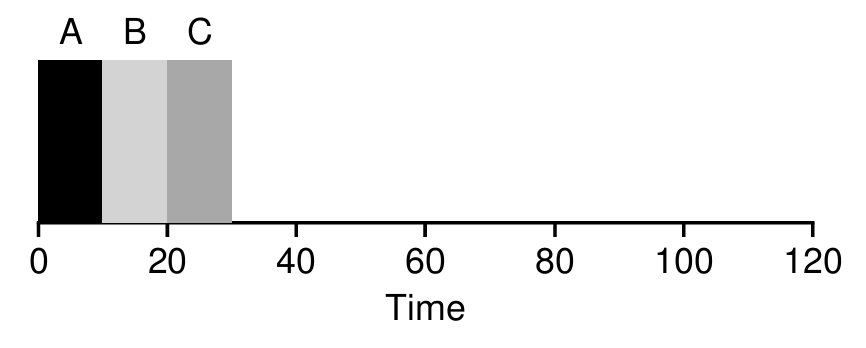<figcaption></figcaption></figure>

The turnaround time can be easily calculated as

$$
T_{\text{turnaround}}=\frac{10+20+30}{3}=20
$$

Now's let's relax our assumption 1,

> Now, each job can run **different** amounts of time.

What kind of workload can we construct to make FIFO perform poorly? Below is an example:

<figure>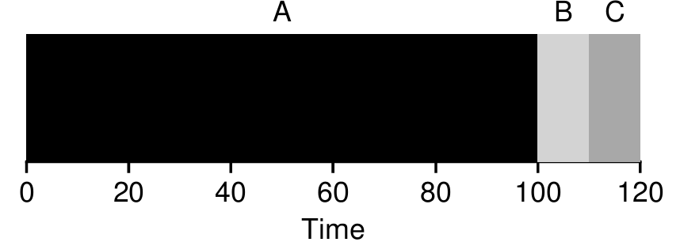<figcaption></figcaption></figure>

This time, the turnaround is $$T_{\text{turnaround}}=\frac{100+110+120}{3}=110$$. And there a jargon for this effect!

> This is called **convoy effect**, where a number of relatively-short potential consumers of a resource get queued behind a heavyweight resource consumer.

To solve this problem, let's introduce our second scheduling policy — shortest job first (SJF)!

#### SJF

As its name suggested, SJF will run the **shortest job first**, then the next shortest, and so on.

<figure>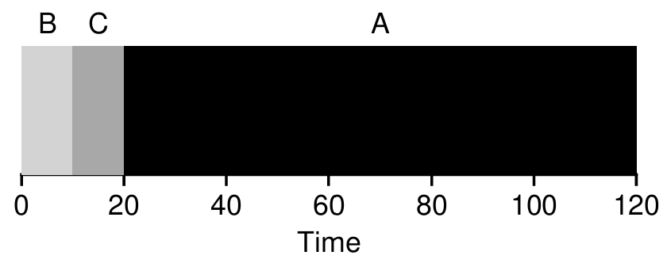<figcaption></figcaption></figure>

In this example, our turnaround time will become

$$
T_{\text{turnaround}}=\frac{10+20+120}{3}=50
$$

However, what if now we relax our assumption 2, and now assume that jobs can arrive at any time instead of all at once. What problems does it lead to?

<figure>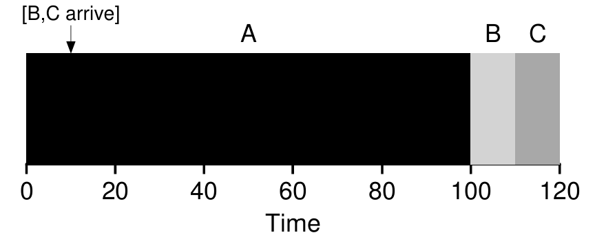<figcaption></figcaption></figure>

As shown in the example above, now our turnaround time will become

$$
T_{\text{turnaround}}=\frac{100+(110-10)+(120-10)}{3}\approx103.333
$$

How can we improve our scheduling policy then? Indeed, there is a solution called **shortest time-to-completion** (STCF)!

#### STCF

To address the concern right above, we need to relax assumption 3

> Now, the jobs don't necessarily need to run to completion

This will use our low-level machinery — [context switch](limited-direct-execution.md#problem-2-switching-between-processes)! So, let's say when B,C arrives earlier when A is still running, the scheduler can **preempt** job A and decide to run another job by performing a **context switch**, and perhaps continuing A later.


#### Preemptive vs. Non-preemptive Scheduler

The SJF mentioned above is actually a **non-preemptive scheduler** as it assumes that all jobs must run to completion before considering whether to run a new job. However, virtually all modern schedulers nowadays are **preemptive**, and quite willing to stop one process from running in order to run another. This usually happens when an interrupt occurs or when a process exceeds its assigned time quantum. The latter is key to understanding how multiple processes created by [`fork()`](process-api.md#the-fork-system-call) can appear to run concurrently.


This gives rise to our new scheduling policy/algorithm here, which is adding preemption to SJF and thus is called **Shortest Time-to-Completion First (STCF)** or **Preemptive Shortest Job First (PSJF)**! Any time a job enters the system, the STCF scheduler determines which of the remaining jobs (including the new job) has the least time left, and schedules that one.

<figure>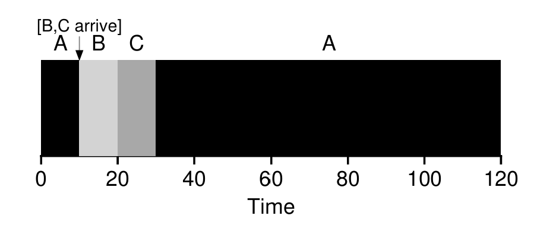<figcaption></figcaption></figure>

So now, from the example above, we've seen a much improved turnaround time

$$
T_{\text{turnaround}}=\frac{(120-10)+(20-10)+(30-10)}{3}=50
$$

So, if we knew job lengths, and that jobs only used the CPU, and our only metric is **turnaround time** , STCF would be a great policy!

### Interactive Systems

In interactive systems, we generally care more about [#response-time](scheduling.md#response-time "mention"). However, a **multi-level feedback queue (MLFQ)** allows us to improve response time while also taking [#turnaround-time](scheduling.md#turnaround-time "mention") into consideration!


The real industry-standard scheduling algorithms for interactive systems, which also includes the Windows, macOS and linux that most of us use nowadays, is actually the **multi-level feedback queue**. However, this will be put in the next section as it is not a focus for NUS CG2271.


#### Round Robin

This scheduling policy/algorithm emerges because we want to solve the problem that our STCF might not have great **response time**! The basic idea of round robin is simple:

> Instead of running jobs to completion, RR runs a job for a **time slice** (sometimes called a **scheduling quantum**) and then switches to the next job in the run queue.

It repeatedly does so until the jobs are finished. For this reason, RR is sometimes called **time-slicing**.


#### Time Slice/Time Quantum

Note that the length of a [**time slice**](#user-content-fn-1)[^1] must be a multiple of the [timer-interrupt period](#user-content-fn-2)[^2]; thus if the timer interrupts every 10 milliseconds, the time slice could be 10, 20, or any multiple of 10 ms.


For example, assume three jobs A, B, and C arrive at the same time in the system, and that they each wish to run for 5 seconds. An SJF scheduler runs each job to completion before running another, giving us a response time of $$\frac{0+5+10}{3}=5$$.

<figure>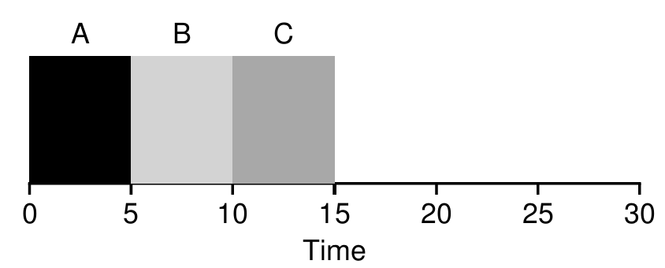<figcaption>
SJF Again (Bad for Response Time)
</figcaption></figure>

In contrast, RR with a time-slice of 1 second would cycle through the jobs quickly, giving us a response time of $$\frac{0+1+2}{3}=1$$.

<figure>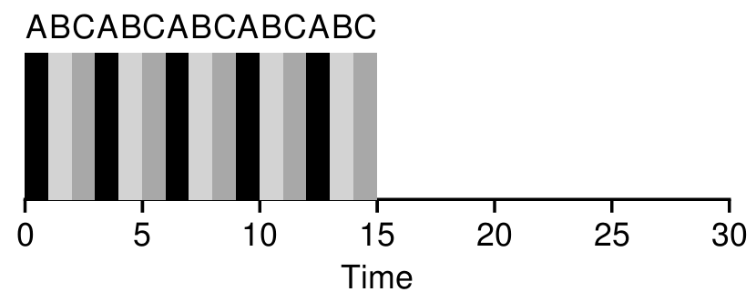<figcaption>
Round Robin (Good for Response Time)
</figcaption></figure>

However, there exists the following trade-offs with the RR scheduling policy/algorithm:

1. Trade-offs between **time slice** and **context switch**: It seems tha making the time slice shorter will be better. However, if the time slice is too short, then the cost of **context switching** will dominate overall performance!&#x20;
2. Trade-offs between **response time** and **turnaround time**: From the example above, we might notice that even though we've achieved a better response time, but the **turnaround time** suffers (it is $$\frac{13+14+15}{3}=14$$ now!)

So, if our only interested metric is **turnaround time**, then STCF is the way to go. But if our interested metric is **response time**, RR is the way to go!

#### Incoporating I/O

Now let's relax our assumption 4,

> So, we assume some jobs will perform I/O.

Before that, let's first see what happens to the process/job's state when it performs an I/O operation. When the current process initiates an I/O request, it will become **blocked** waiting for the I/O completion as it won't be using the CPU during the I/O. When the I/O completes, an interrupt will usually be raised so that the OS may move the process from **blocked** back to **ready** state.

For example, let's assume we have two jobs, A and B, which each needs 50ms of CPU time. However, A runs for 10ms and then issues an I/O request which each takes 10ms to complete, whereras B simply uses the CPU for 50ms and performs no I/O. Assume now we want to use a STCF scheduler, so the timings might look like as follows:

<figure>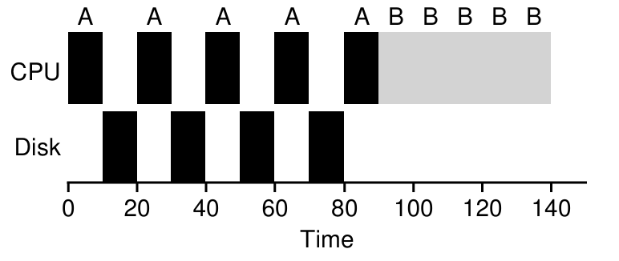<figcaption></figcaption></figure>

This is a poor use of resource example as the main problem here is that A is broken up to 5 10-ms sub-jobs but we are still treating them as 1 big job! To solve this, a common approach is just to treat each 10 ms sub-job of A as an indepedent job and use a **RR** scheduler to fill in the gap between each sub-job of A.

<figure>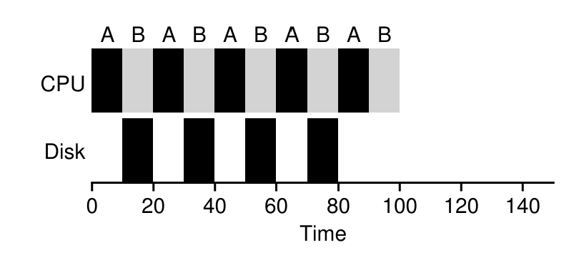<figcaption></figcaption></figure>

This gives us the idea of **overlap**, which solves the problem of poor resource utilization when incorporating I/O into processes.


However, we still haven't relaxed our assumption 5 yet! We will relax it in the next section named Multi-level Feedback Queue!


#### Priority Scheduling

In real-world scenarios, processes often have different **priorities**. It is therefore intuitive to assign a **priority value** to each task and select the task with the highest priority first. An example of priority scheduling is illustrated below:

<figure>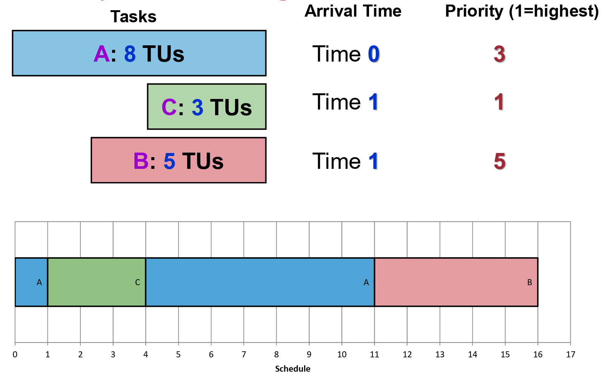<figcaption></figcaption></figure>

However, priority scheduling may have an obvious shortcome, which is the low priority processes can **starve**, meaning that they need to wait for very long to be run.


In priority scheduling, when the higher priority task is ready again, it will preempt the lower task immediately. Thus, it is not recommended to use the idea of **ready queue** when doing priority-based scheduling (I got this wrong during AY26/27 Sem 1 Midterm, which is quite sad).


### Real-Time Systems


As this is under the notes for NUS CG2271 RTOS, this section will be our focus.


In real-time systems, [processes](the-process.md) are often referred to as **tasks**, and many of them execute periodically. For example:

* A GPS module may produce a reading 10 times per second, so its ISR is triggered approximately every $$0.1\,\text{s}$$.
* Serial communication operating at $$9600\,\text{bps}$$ may trigger a UART ISR roughly every $$1\,\text{ms}$$, depending on the frame format.

Therefore, a task typically runs only for a **limited amount of time** to process an event, reading, or calculation, and then waits until the next event occurs.


The sentence above is the key design strategy for our NUS CG2271 Project!


Therefore, a task $$i$$ in a real-time system can be characterized by two parameters:

* **Period** $$P_i$$: the interval between successive activations of the task.
* **Execution time** $$C_i$$: the amount of time the task takes to execute before becoming blocked while waiting for the next event.

Periodic Tasks vs. Event-Driven Tasks

The **period and execution time model** mainly applies to **periodic tasks**. However, in our CG2271 project, we mostly use **event-driven tasks**, which execute in response to specific events rather than at fixed intervals.

When an event occurs (e.g., a button press), it triggers an **ISR**, which gives a semaphore to the corresponding task. If the task is blocked while waiting for this semaphore, the RTOS will automatically wake it up and move it to the **Ready** state. Once selected by the scheduler, the task starts running.


The task does not need to continuously poll for the semaphore. Instead, it can block on the semaphore, allowing other ready tasks to use the CPU. This is the whole purpose we are using [**semaphores**](../../concurrency/semaphores.md#semaphores)! Also, becoming Ready does not necessarily mean running immediately, as this depends on the task priorities and the RTOS scheduler.


For convenience, execution time is often expressed in **CPU cycles** rather than seconds:

$$
\text{CPU cycles}=\frac{\text{execution time}}{\text{time per cycle}}
$$


When the exact execution time is unknown, we use the **worst-case execution time (WCET)**. In most of the modern RTOS, there is **no time quantum**!


Now we will introduce the three scheduling policies/algorithms used in real-time systems.

#### Fixed Priority Scheduling

This scheduling policy is similar to [priority scheduling](scheduling.md#priority-scheduling) in interactive systems. Each task is assigned a priority, and the scheduler always selects the highest-priority task that is ready to run. If a higher-priority task becomes ready, it **pre-empts** the lower-priority task currently running.


In real-time systems, we typically assume that all tasks are ready at time $$t_0$$ and are activated periodically thereafter. We also assume that the scheduler is **pre-emptive** in all cases.


Let's use an example to understand how it works better. Suppose we have the following set of 3 tasks with the periods and running times shown in CPU cycles.

| Task | Pi | Ci | Priority |
| ---- | -- | -- | -------- |
| T1   | 6  | 1  | 0        |
| T2   | 4  | 2  | 2        |
| T3   | 5  | 1  | 1        |


In this table, assume that lower priority number = higher priority


Now, we can schedule the these 3 tasks as follows:

<figure>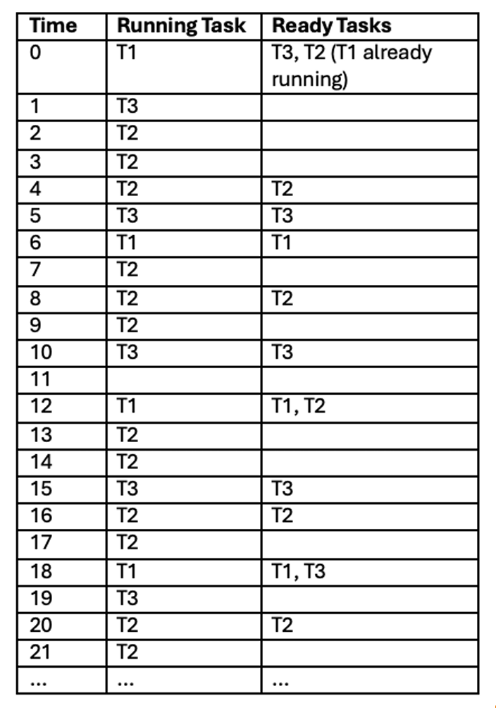<figcaption></figcaption></figure>

From the table, we can see that each task is triggered at **multiples of its period** $$P_i$$. A task being **ready at a given time** means that it becomes ready at the **beginning** of that time unit. For example, T2 is ready at time 4. If no other task needs to run, T2 can begin execution at time 4 and run for **one** time unit before it is pre-empted by the task T3 at time 5.

Deadlines

In real-time scheduling, **deadlines are critical**. A task must generally finish before its next deadline; otherwise, its output may become outdated or be lost. For example, in the example above, the first T2 task has a deadline at time 4, so it must finish **before time 4 (not including time 4)**.

<figure>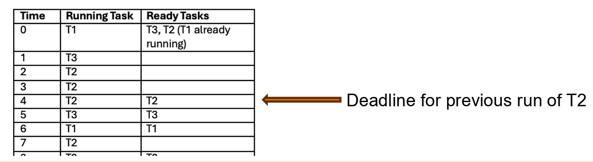<figcaption></figcaption></figure>

If a task cannot finish before its deadline, we say that the task has **missed its deadline**. For example, the first T2 misses its deadline under the following scheduling conditions.

<figure>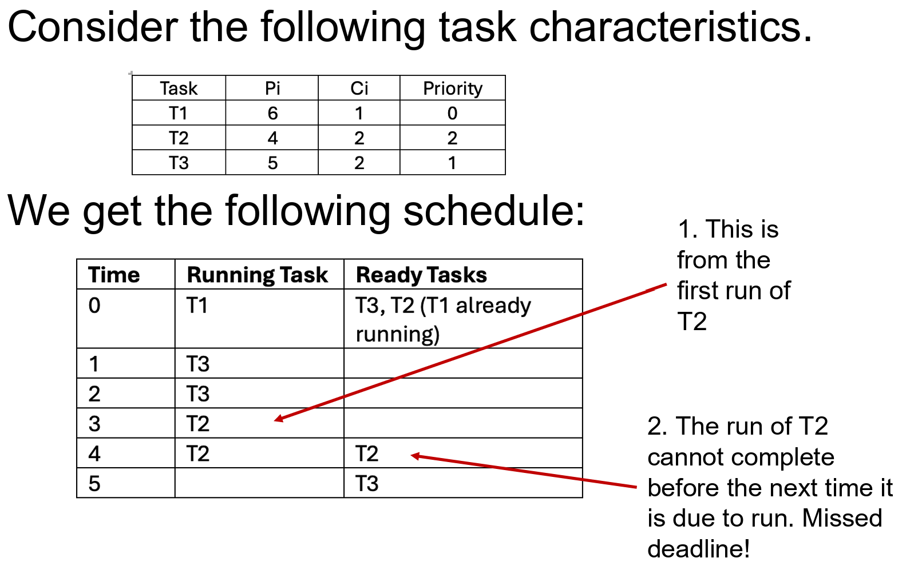<figcaption></figcaption></figure>

If we can schedule a set of tasks such that **all tasks meet their deadlines**, we say that the tasks are **schedulable**. The crux of our problem is thus:

> **How do we determine the optimal priority assignment for these tasks?**

To answer this, we will introduce **Rate Monotonic Scheduling (RMS)**, our second scheduling algorithm commonly used in RTOS.

#### Rate Monotonic Scheduling

In **Rate Monotonic Scheduling (RMS)**, tasks are prioritized based on their **period**:

> a **shorter period means higher priority**.

This is because tasks with shorter periods must run more frequently and are therefore more likely to miss their deadlines.


RMS provides the **optimal fixed-priority assignment**, meaning that if a set of tasks cannot be scheduled under RMS, then no other fixed-priority scheduling algorithm can schedule them successfully.


We will use two examples to get a glimpse of the RMS scheduling algorithm



#### Successful RMS scheduling

We consider the schedule for the following set of tasks:

| Task |  Pi |  Ci |
| ---- | :-: | :-: |
| T1   |  6  |  2  |
| T2   |  8  |  2  |
| T3   |  4  |  1  |

The following scheduling using RMS is **schedulable**.

<figure>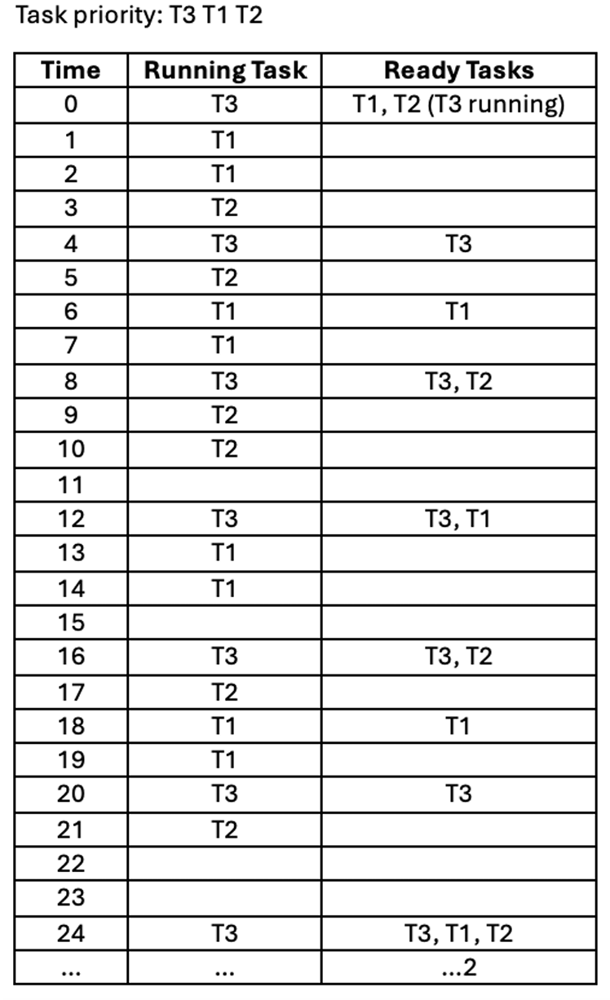<figcaption></figcaption></figure>



#### Unsuccessful RMS Scheduling

Although RMS provides the **optimal fixed-priority assignment**, this does not mean that every task set is schedulable, even when the CPU is not fully utilized.


We will see the definition and criteria for deciding whether a CPU is overloaded [soon](scheduling.md#cpu-utilization)!


Consider the case that T2 now takes 3 cycles instead of 2:

| Task |  Pi |  Ci |
| ---- | :-: | :-: |
| T1   |  6  |  2  |
| T2   |  8  |  3  |
| T3   |  4  |  1  |

In this case, **RMS cannot produce a schedule in which all tasks meet their deadlines**. In other words, the task set is **not schedulable under RMS**.

<figure>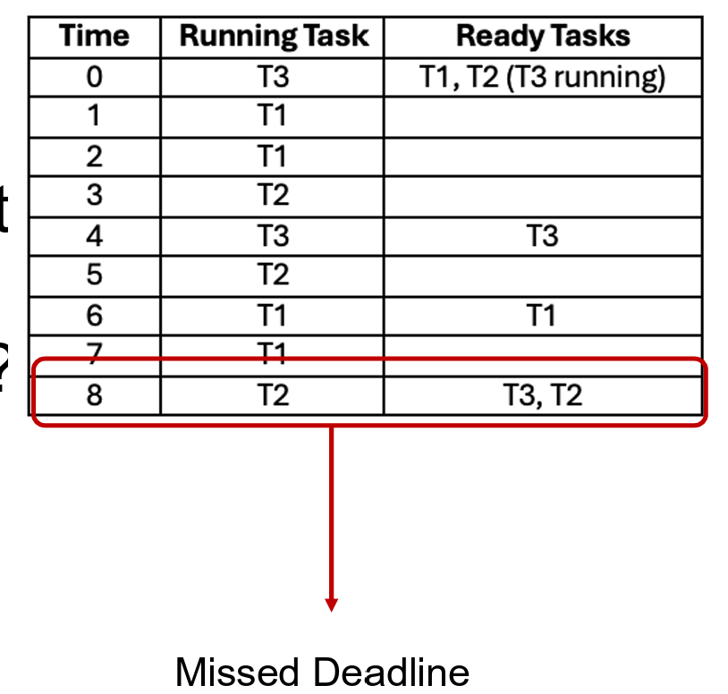<figcaption></figcaption></figure>



So, how do we test the **schedulability** of a set of tasks scheduled using RMS? We will introduce three methods:

1. Unrolling (Brute-Force)
2. Utilization Bound Test
3. Critical Instance Analysis



#### Unrolling

This is the most straightforward way to test **schedulability**: simply unroll the schedule until it repeats. The schedule repeats every **hyper-period**, defined as the **least common multiple (LCM)** of all task periods. For the example [above](scheduling.md#unsuccessful-rms-scheduling):

$$
\text{Hyper-period}=\operatorname{LCM}(4,6,8)=24
$$

Therefore, we only need to check the first 24 time units. However, if the LCM is very large, this brute-force approach can require **significant computation**.



#### Utilization Bound Test

Before that, let's first introduce what is CPU utilization.

CPU Utilization

**CPU utilization** is the percentage of time the CPU is busy. For a set of periodic tasks, it is given by

U=\sum_i\frac{C_i}{P_i}

where $$C_i$$ is the execution time and $$P_i$$ is the period of task ii. For the two RMS examples above:

1. **Example 1:** $$\frac{2}{6}+\frac{2}{8}+\frac{1}{4}=0.75$$
2. **Example 2:** $$\frac{2}{6}+\frac{3}{8}+\frac{1}{4}\approx0.958$$

In **NUS CG2271**, the priority is to ensure that **all deadlines are met**. In contrast, **NUS CS2106** focuses more on **maximizing CPU utilization**.


For any set of tasks running on a single CPU, we must have $$U\leq1$$ since the CPU cannot be busy for more than 100% of the time. Hence, when discussing RMS above, we assume that the CPU is **not overloaded**.


After calculating the CPU utilization of the task set, we can use the **Liu–Layland bound** to test schedulability under RMS:

> A set of $$n$$ periodic tasks is guaranteed to be schedulable under RMS if
>
> 
U \leq n\left(2^{1/n}-1\right)

For $$n=3$$:

$$
U\leq3\left(2^{1/3}-1\right)\approx0.78
$$

If $$U$$ is **below this bound**, the task set is guaranteed to be schedulable, so no further testing is needed. However, if $$U$$ **exceeds the bound**, the task set may still be schedulable, and further testing is required. For example, in [RMS Example 1](scheduling.md#successful-rms-scheduling), $$U=0.83>0.78$$, yet the task set is still schedulable.


Therefore, the Liu–Layland bound is a **sufficient but not necessary condition** for schedulability.




#### Critical Instance Analysis

The **Critical Instance Analysis** tests schedulability systematically by computing the worst-case response time of each task.

1. **Sort the tasks by period**: If the tasks are not already sorted, arrange them in increasing order of period. Thus, T1 has the shortest period, T2 the second shortest, and so on.
2.  **For each task Ti, recursively compute** $$S_{i,0},S_{i,1},\ldots$$

    1. $$S_{i,0} = \sum_{j=1}^{i} C_j$$: This represents the initial workload when all higher-priority tasks and $$T_i$$ are released simultaneously.
    2. $$S_{i,x+1} = C_i + \sum_{j=1}^{i-1} \left\lceil \frac{S_{i,x}}{P_j} \right\rceil C_j$$: The summation accounts for the **preemptions** caused by higher-priority tasks.

    Continue until $$S_{i,x+1}=S_{i,x}$$ and call this final value $$S_{i,F}$$.&#x20;
3. **Check the deadline**: $$S_{i,F}\leq D_i$$. If this condition holds for **every task** Ti, then the entire task set is **schedulable under RMS** and no task will miss its deadline.


#### The Essence of Critical Instance Analysis

Because this fixed-point value $$S_{i,F}$$ represents the task's **worst-case response time** under **maximum interference**, comparing it against $$D_i$$ definitively proves whether the task is schedulable under all possible release patterns.


For example, let's try the critical instance analysis on our [#successful-rms-scheduling](scheduling.md#successful-rms-scheduling "mention") first.

| Task |  Pi |  Ci |
| ---- | :-: | :-: |
| T1   |  6  |  2  |
| T2   |  8  |  2  |
| T3   |  4  |  1  |

1. **Sort the tasks by period**: We have the priority order $$\{T_3,T_1,T_2\}$$
2. **Check T3:** $$S_{3,0}=C_3=1$$, $$S_{3,1}=1\leq4$$. Therefore, T3 is schedulable.
3. **Check T1:** $$S_{1,0}=C_3+C_1=1+2=3$$, $$S_{1,1} =2+\left\lceil\frac{3}{4}\right\rceil\times1 =3\leq6$$. Therefore, T1 is schedulable.
4. **Check T2:** $$S_{2,0}=C_3+C_1+C_2=1+2+2=5$$, $$S_{2,1} =2+\left\lceil\frac{5}{4}\right\rceil\times1 +\left\lceil\frac{5}{6}\right\rceil\times2 =2+2+2=6$$, $$S_{2,2} =2+\left\lceil\frac{6}{4}\right\rceil\times1 +\left\lceil\frac{6}{6}\right\rceil\times2 =6$$. Since $$S_{2,2}=S_{2,1}$$, the iteration has converged. Thus, $$S_{2,F}=6\leq8$$. Therefore, T2 is schedulable.

Hence, **all three tasks are schedulable under RMS**. However, what if we try with [#unsuccessful-rms-scheduling](scheduling.md#unsuccessful-rms-scheduling "mention"), this time we only need to work on T2 as T1 and T3 are the same:

* $$S_{2,0}=C_3+C_1+C_2=1+2+3=6$$, $$S_{2,1} =3+\left\lceil\frac{6}{4}\right\rceil\times1 +\left\lceil\frac{6}{6}\right\rceil\times2 =3+2+2=7$$, $$S_{2,2} =3+\left\lceil\frac{7}{4}\right\rceil\times1 +\left\lceil\frac{7}{6}\right\rceil\times2 =3+2+4=9>8$$

Since $$S_{2,2}>D_2=8$$, **T2 is not schedulable**. Therefore, the entire task set is **not schedulable under RMS**.


A useful shortcut for **Critical Instance Analysis** is to start with the **lowest-priority task**. If this task fails the schedulability test, we can immediately conclude that the **entire task set is not schedulable**, so there is no need to check the higher-priority tasks. However, if the lowest-priority tasks meets the deadline, we should continue checking other tasks to make sure all the tasks are schedulable! (The second point is really important as I got marks deducted cuz of this in AY26/27 Sem 1 midterm)




#### Earliest Deadline First

RMS uses a **fixed-priority** scheme, so a task can still be preempted by higher-priority tasks even when its deadline is approaching.

> What if we instead **increase a task's priority as its deadline approaches**?

This idea leads to **Earliest Deadline First (EDF)** scheduling, the last RTOS scheduling algorithm we will cover. Let's consider the [#unsuccessful-rms-scheduling](scheduling.md#unsuccessful-rms-scheduling "mention"), but schedule it using EDF instead.

<figure>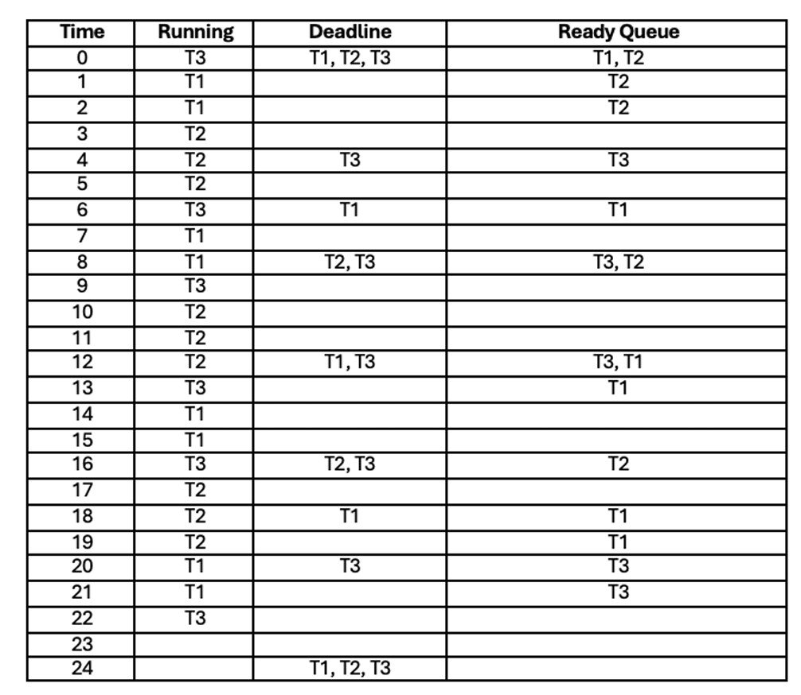<figcaption></figcaption></figure>

At time 4, T2 continues running because both T2 and T3 have the same next deadline at time 8. The scheduler therefore lets T2 continue to **avoid the unnecessary context-switching overhead**.


However, in **RTOS**, **fixed-priority scheduling** is commonly used, including the first two scheduling algorithms discussed above.


[^1]: In NUS CG2271, this is called **time quantum**.

[^2]: In NUS CG2271, this is called **Interval of Timer Interrupt (ITI).**
