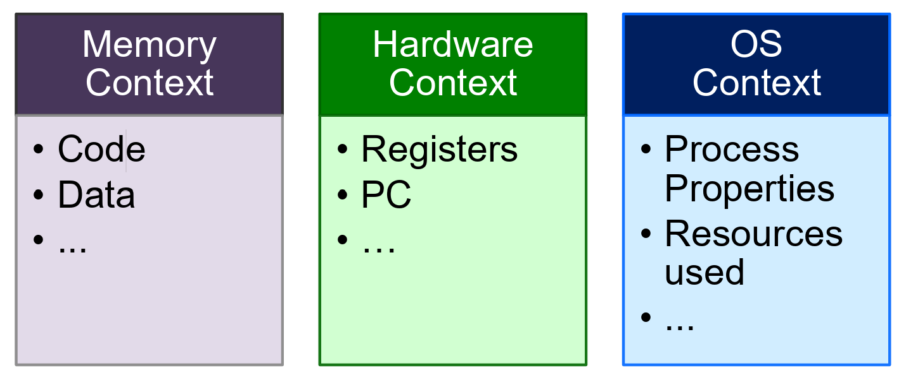
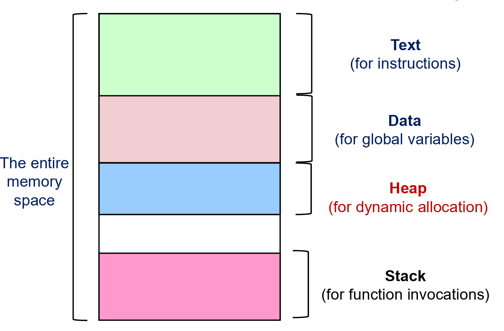
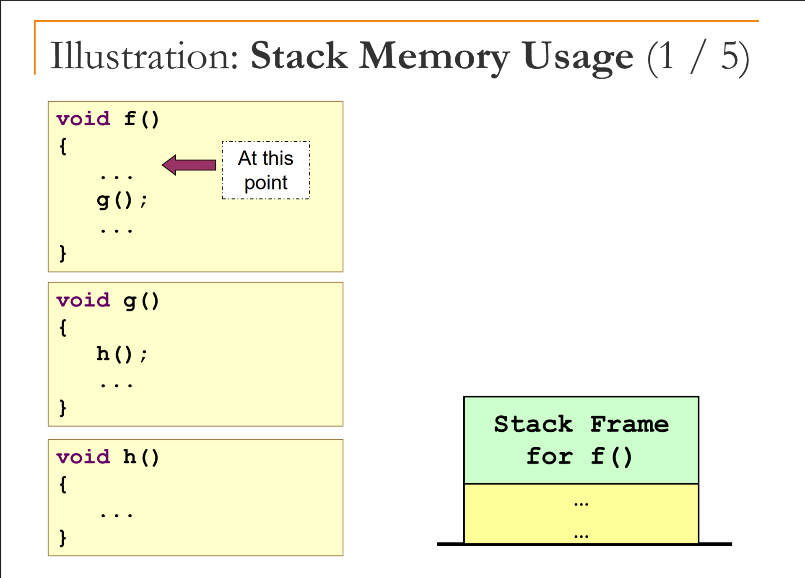
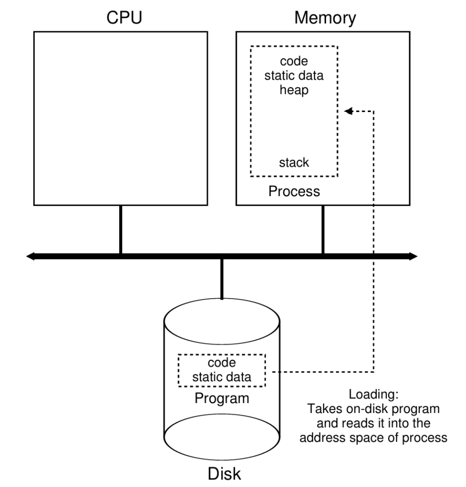
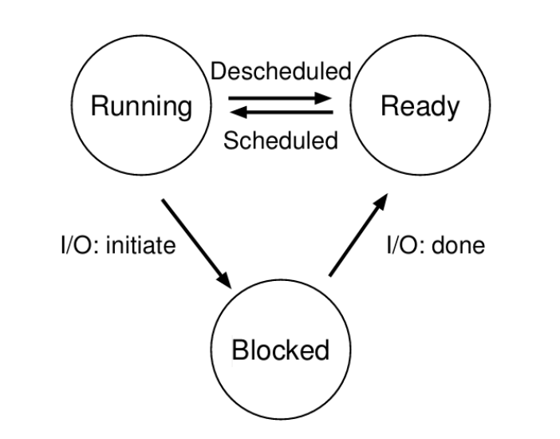
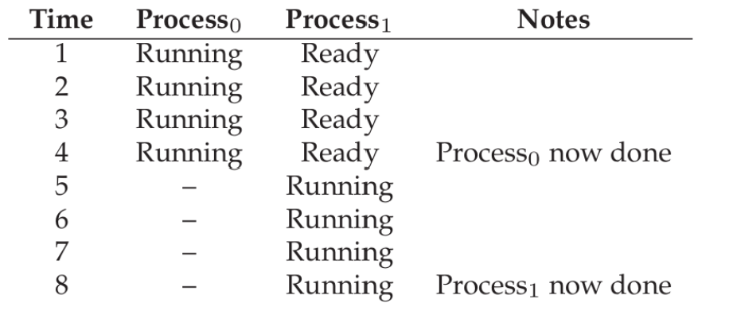
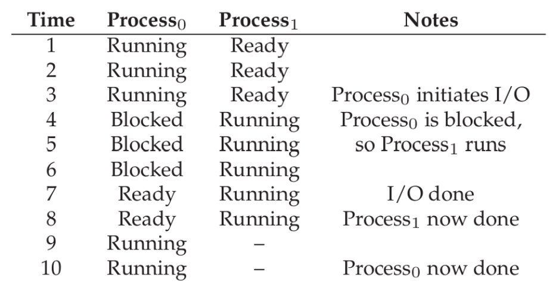
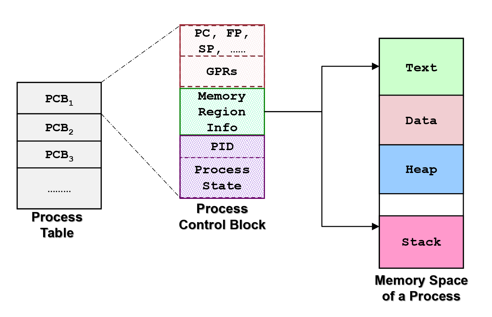

# The Process

In this chapter, we will discuss one of the most fundamental abstractions that the OS provides to users: the **process**. The definition of a **process**, informally, is quite simple:

> it is a **running program**.


A **program** is nothing but a bunch of instructions (and maybe some static data) sitting on the **disk**.


It turns out that one often wants to run more than one program at once. In fact, a typical system may be seemingly running tens or even hundreds of processes at the same time. Doing so makes the system **easy to use**, as one never need be concerned with whether a CPU is available; one simply runs programs. Hence our challenge:

<details>

<summary>The Crux of the Problem: How to provide the illusion of many CPUs?</summary>

Although there are only a few physical CPUs available, how can the OS provide the illusion of a nearly-endless supply of said CPUs?

</details>

The OS creates this illusion by **virtualizing** the CPU. By running one process, then stopping it and running another, and so forth, the OS can promote the illusion that many virtual CPUs exist when in fact there is only one physical CPU (or a few). This basic technique, known as **time sharing** of the CPU, allows users to run as many concurrent processes as they would like; the potential cost is performance, as each will run more slowly if the CPU(s) must be shared.

<details>

<summary>Use Time Sharing (and Space Sharing)</summary>

**Time sharing** is one of the most basic techniques used by an OS to share a resource. By allowing the resource to be used for a little while by one entity, and then a little while by another, and so forth, the resource in question (e.g., the CPU, or a network link) can be shared by many. The natural counterpart of time sharing is **space sharing**, where a resource is divided (in space) among those who wish to use it. For example, disk space is naturally a space-shared resource, as once a block is assigned to a file, it is not likely to be assigned to another file until the user deletes it.

</details>

To implement virtualization of the CPU, and to implement it well, the OS will need both some low-level machinery as well as some high-level intelligence.


Pay attention to the keywords, "**mechanism**" and "**policy**" here!&#x20;




#### Low-Level Machinery

We call the low-level machinery **mechanisms**;

> **mechanisms** are **low-level methods** or **protocols** that implement a needed piece of functionality.

For example, we'll learn later how to implement a **context switch**, which gives the OS the ability to stop running one program and start running another on a given CPU; this **time-sharing** mechanism is employed by all modern OSes.



#### High-Level Intelligence

On top of these mechanisms resides some of the intelligence in the OS, in the form of **policies**.

> **Policies** are algorithms for making some kind of decision within the OS.

For example, given a number of possible programs to run on a CPU, which program should the OS run? A **scheduling policy** in the OS will make this decision, likely using the following things:

* historical information (e.g., which program has run more over the last minute?),
* workload knowledge (e.g., what types of programs are run), and
* performance metrics (e.g., is the system optimizing for interactive performance, or throughput?)



<details>

<summary>Separate Policy and Mechanism</summary>

In many operating systems, a common design paradigm is to separate high-level [policies](the-process.md#high-level-intelligence) from their low-level [mechanisms](the-process.md#low-level-machinery).

* We can think of the **mechanism** as providing the answer to a _how_ question about a system; for example, _how_ does an operating system perform a context switch?
* The **policy** provides the answer to a _which_ question; for example, _which_ process should the operating system run right now?

Separating the two allows one easily to change policies without having to rethink the mechanism and is thus a form of **modularity**, a general software design principle.

</details>

## The Abstraction: A Process

The abstraction provided by the OS of a running program is something we will call a **process**. At any instant in time, we can summarize a process by looking at what **constitutes** a process, we thus have to understand its **machine state**:

> what a program can **read** or **update** when it is running. At any given time, what parts of the machine are important to the execution of this program?

The **machine state** of a process contains the following three components:

1. Memory
2. Registers
3. I/O information: In NUS CG2271, we replace this with the OS context which include process properties and resources used (including the I/O infromation)

<figure><figcaption><p>NUS CG2271 Process Abstraction</p></figcaption></figure>

### Memory

One obvious component of machine state that comprises a process is its **memory**. Instructions lie in memory; the data that the running program reads and writes sits in memory as well. Thus the memory that the process can address (called its **address space**) is part of the process. Below is a simplified view of a process's address space:

<figure><figcaption></figcaption></figure>

In most conventional process address-space layouts, the **stack grows downward toward lower memory addresses** (bottom to top in the figure above), while the **heap grows upward toward higher memory addresses** (top to bottom in the figure above). Thus, the heap and stack conceptually grow toward each other as more memory is needed.


Remember that each process will have its own **address space**!


#### User Stack

From the discussion [above](the-process.md#timeline), we can see that there is another important type of stack: the **user stack**. This region of memory is used to store information associated with function calls. Each function invocation is represented by a **stack frame**, which typically contains:

1. **Arguments and parameters** passed to the function;
2. **Storage for local variables**;
3. **Other information** needed to manage the function call, which we will discuss later.


The **user stack** belongs to both the caller and callee.


Therefore, when a process is executing normally — in other words, when it has not entered the kernel through a system call or trap — it uses the **user stack and heap within its own address space** as needed. An animation of how stack frames work together with function call is shown below:

<figure><figcaption></figcaption></figure>


Can got to the [limited-direct-execution.md](limited-direct-execution.md "mention") to know more about what a system call and a trap is!


#### Heap


Can refer to the [#heap-setup](the-process.md#heap-setup "mention") below for more information about the heap and we will see heap again when we introduce the memory management topic!


### Registers

Also part of the process's machine state are **registers**; many instructions explicitly read or update registers and thus clearly they are important to the execution of the process. Note that there are some particularly special registers that form part of this machine state. For example,

1. the **program counter (PC)** (sometimes called the instruction pointer or IP) tells us which instruction of the program is currently being executed;
2. similarly, a **stack pointer** and associated **frame pointer** are used to manage the stack for function parameters, local variables, and return addresses.

#### Stack Pointer

The **stack pointer (SP)** we are discussing here refers to the [**user stack**](the-process.md#user-stack) **pointer**. It points to the current **top** of the user stack for a given process. When a normal function call is made, the compiler generates code that adjusts the stack pointer to allocate enough space for the function's **stack frame**, including space for local variables, saved registers, and other information required by the function. The stack pointer is then positioned at the **top** of this newly created stack frame.

#### Frame Pointer

The motivation for a **frame pointer** is that the stack pointer can change as the [callee (usually)](https://app.gitbook.com/s/U2H1IohCa1n4UnV3qHk8/tut/tut-01-more-on-mips-assembly#id-4.-full-calling-convention) pushes registers or allocates space for local variables. Although the compiler knows these changes in advance, accessing stack data relative to a moving stack pointer can be inconvenient.

A **frame pointer** provides a stable reference point, typically pointing to the **bottom (start) of the current stack frame**. This makes it easier to access parameters and local variables because their offsets from fp remain fixed.


Not all ISAs use or provide a frame pointer so it is not a **compulsory** feature!


#### Calling Convention

The **calling convention** is a set of rules defined by the **ABI** of the ISA being used that specifies how the caller and callee interact when calling a function, including which registers they use and which registers or variables they must save.


Can go the [this NUS CG2271 tutorial question](https://app.gitbook.com/s/U2H1IohCa1n4UnV3qHk8/tut/tut-01-more-on-mips-assembly#id-4.-full-calling-convention) to have a glimpse of how the calling convention works in real life!


### I/O Information

Finally, programs often access persistent storage devices too. Such **I/O information** might include a list of the files that the process currently has open.

<details>

<summary> Process Creation: A Little More Detail</summary>

One mystery that we should unmask a bit is how programs are transformed into processes. Specifically, how does the OS get a program up and running? How does process creation actually work


#### Program vs. Process

For now, we can think of a **program** as a **static file** containing instructions and data, while a **process** is a **running instance of a program**. A process also includes its execution context, such as **memory, register values, and I/O information**.


The first thing that the OS must do to run a program is to **load** its code and any static data (e.g., initialized variables) into memory, into the address space of the process. Programs initially reside on **disk** (or, in some modern systems, **flash-based SSDs**) in some kind of **executable format**; thus, the process of loading a program and static data into memory requires the OS to read those bytes from disk and place them in memory somewhere (as shown in Figure 4.1).

<figure><figcaption><p>Figure 4.1: Loading from Program to Process</p></figcaption></figure>

Once the code and static data are loaded into memory, there are a few other things the OS needs to do before running the process:

1. Stack Setup
2. Heap Setup
3. I/O Setup



#### **Stack Setup**

The first thing is that some **memory** must be allocated for the program's **run-time stack** (or just **stack**). As we should have likely already learned from [NUS CS1010](https://app.gitbook.com/s/KipySCGxC8NC1UpA24DS/lec-tut-lab-exes/lecture/lec-06-call-stacks-arrays#call-stack), C programs use the stack for local variables, function parameters, and return addresses; the OS allocates this memory and gives it to the process. The OS will also likely initialize the stack with arguments; specifically, it will fill in the parameters to the `main()` function, i.e., `argc` and the `argv` array.



#### Heap Setup

The OS may also allocate some memory for the program's **heap**. In C programs, the heap is used for explicitly requested dynamically-allocated data; programs request such space by calling `malloc()` and free it explicitly by calling `free()`. The heap is needed for data structures such as linked lists, hash tables, trees, and other interesting data structures. The heap will be small at first; as the program runs, and requests more memory via the `malloc()` library API, the OS may get involved and allocate more memory to the process to help satisfy such calls.


This is a good reason that a process's **address space** will slowly grow bigger!




#### I/O Setup

The OS will also do some other initialization tasks, particularly as related to input/output (I/O). For example, in UNIX systems, each process by default has three open **file descriptors**, for standard input, output, and error; these descriptors let programs easily read input from the terminal as well as print output to the screen without needing to know anything about the physical hardware it is running on. We'll learn more about I/O, file descriptors, and the like in the third part of the book on persistence.



By loading the code and static data into memory, by creating and initializing a stack, and by doing other work as related to I/O setup, the OS has now (finally) set the stage for program execution. It thus has one last task:

> to start the program running at the entry point, namely `main()`.

By jumping to the `main()` routine (through a specialized mechanism that we will discuss next chapter), the OS transfers control of the **CPU** to the newly-created process, and thus the program begins its execution.


A quick summary here, **OS** creates a process by

1. first loading the program code from **disk** to **memory**
2. then doing some setup stuff, like stack, heap and I/O setup.

After the creation, the **OS** will hand the control of **CPU** to the process to let the program begin its execution.


</details>

## Process States

Now that we have some idea of what a process is (though we will continue to refine this notion), and (roughly) [how it is created](the-process.md#process-creation-a-little-more-detail), let us talk about the different **states** a process can be in at a given time. In a simplified view, a process can be in one of three states:

* **Running**: In the running state, a process is running on a processor. This means it is executing instructions.
* **Ready**: In the ready state, a process is ready to run but for some reason the OS has chosen not to run it at this given moment.
* **Blocked**: In the blocked state, a process has performed some kind of operation that makes it not ready to run until some other event takes place.
  * For example, when a process initiates an I/O request to a disk, it becomes blocked and thus some other process can use the processor.

If we were to map these states to a graph, we would arrive at the diagram in Figure 4.2.

<figure><figcaption><p>Figure 4.2: Process: State Transitions</p></figcaption></figure>

As we can see in the diagram, a process can be moved between the ready and running states at the discretion of the OS.

* Being moved from ready to running means the process has been **scheduled**;
* being moved from running to ready means the process has been **descheduled**.

Once a process has become **blocked** (e.g., by initiating an I/O operation), the OS will keep it as such until some event occurs (e.g., I/O completion); at that point, the process moves to the ready state again (and potentially immediately to running again, if the OS decides so).

<details>

<summary>An example of process state transition</summary>

Let's look at an example of how two processes might transition through some of these states. First, imagine two processes running, each of which only uses the CPU (they do no I/O). In this case, a trace of the state of each process might look like this (Figure 4.3).

<figure><figcaption><p>Figure 4.3: Tracing Process State: CPU Only</p></figcaption></figure>

In this next example, the first process issues an I/O after running for some time. At that point, the process is blocked, giving the other process a chance to run. Figure 4.4 shows a trace of this scenario.

<figure><figcaption><p>Figure 4.4: Tracing Process State: CPU and I/O</p></figcaption></figure>

More specifically, Process<sub>0</sub> initiates an I/O and becomes blocked waiting for it to complete.


Processes become **blocked**, for example, when reading from a disk or waiting for a packet from a network


The OS recognizes Process<sub>0</sub> is not using the CPU and starts running Process<sub>1</sub>. While Process<sub>1</sub> is running, the I/O completes, moving Process<sub>0</sub> back to ready. Finally, Process<sub>1</sub> finishes, and Process<sub>0</sub> runs and then is done.


Note that there are many decisions the OS must make, even in this simple example.

1. First, the system had to decide to run Process<sub>1</sub> while Process<sub>0</sub> issued an I/O; doing so improves resource utilization by keeping the CPU busy.
2. Second, the system decided not to switch back to Process<sub>0</sub> when its I/O completed; it is not clear if this is a good decision or not. What do you think?

These types of decisions are made by the OS **scheduler**, a topic we will discuss a few chapters in the future.


</details>

## Process Table & Process Control Block

### Process Control Block

The **Process Control Block (PCB)** stores the complete **execution context** of a process, including the [three contexts](the-process.md#the-abstraction-a-process) we discussed earlier: **memory, OS, and hardware context**.

<details>

<summary>Example of a PCB in the <code>xv6</code> kernel</summary>

The following code snippet shows what type of information an OS needs to track about each process in the xv6 kernel. Similar process structures exist in "real" operating systems such as Linux, Mac OS X, or Windows; look them up and see how much more complex they are.


```c
// the registers xv6 will save and restore
// to stop and subsequently restart a process
struct context {
    int eip;
    int esp;
    int ebx;
    int ecx;
    int edx;
    int esi;
    int edi;
    int ebp;
};

// the different states a process can be in
enum proc_state { UNUSED, EMBRYO, SLEEPING,
                  RUNNABLE, RUNNING, ZOMBIE };

// the information xv6 tracks about each process
// including its register context and state
struct proc {
    char *mem;                  // Start of process memory
    uint sz;                    // Size of process memory
    char *kstack;               // Bottom of kernel stack
                                // for this process

    enum proc_state state;      // Process state
    int pid;                    // Process ID
    struct proc *parent;        // Parent process
    void *chan;                 // If non-zero, sleeping on chan
    int killed;                 // If non-zero, have been killed
    struct file *ofile[NOFILE]; // Open files
    struct inode *cwd;          // Current directory
    struct context context;     // Switch here to run process
    struct trapframe *tf;       // Trap frame for the
                                // current interrupt
};
```


When the OS performs the `switch()` routine which saves the current kernel-mode registers (the CPU state of the kernel executing the switch, including callee-saved registers, the kernel PC, and the kernel SP), these registers will be directly saved into the `context` structure located inside the PCB.

</details>

### Process Table

The **Process Table** can be thought of as a data structure maintained by the kernel that contains an entry for every process. Each entry is a PCB, which is why a PCB is also referred to as a **process table entry (PTE)**. The figure below illustrates the relationship between the **process table**, **process control blocks**, and a process's **address space**.

<figure><figcaption></figcaption></figure>

When the OS performs a **context switch** to another process, the current register values are saved in the register-related fields (the top field) of the PCB belonging to the old process.


Notice that both the **Process Table** and **PCBs** reside in **kernel space**, while a process's actual memory space resides in **user space**. The PCB does not store the entire memory space itself; instead, it stores information about the process's memory regions, which can be thought of as the pointer to the actual memory.


## Summary

We have introduced the most basic abstraction of the OS: the **process**. It is quite simply viewed as a running program. With this conceptual view in mind, we will now move on to the nitty-gritty:

* the low-level mechanisms needed to implement processes, which is **context-switch** and
* the higher-level policies required to **schedule** them in an intelligent way.

By combining mechanisms and policies, we will build up our understanding of how an operating system virtualizes the CPU.
