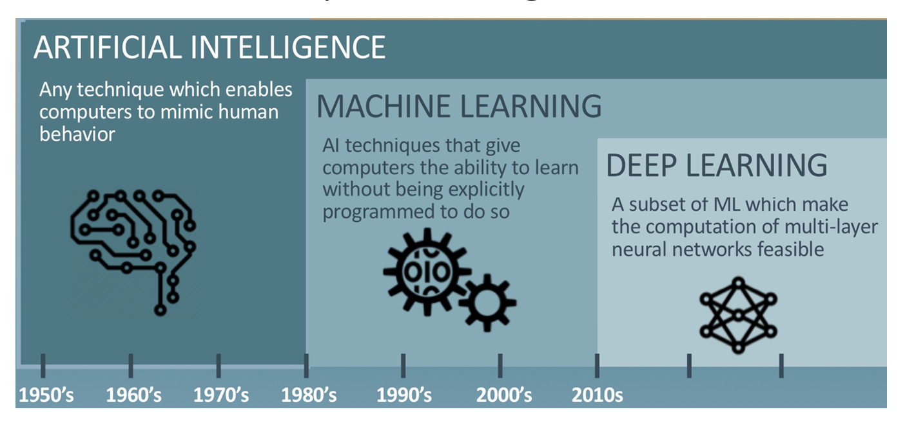
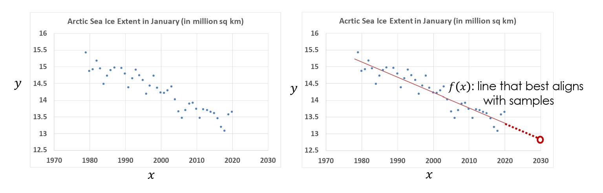
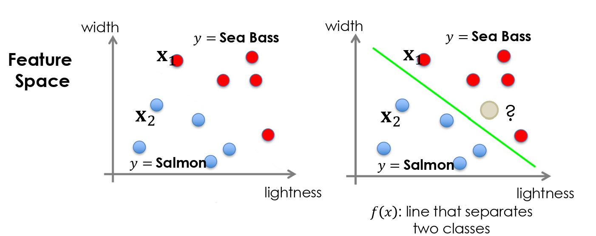
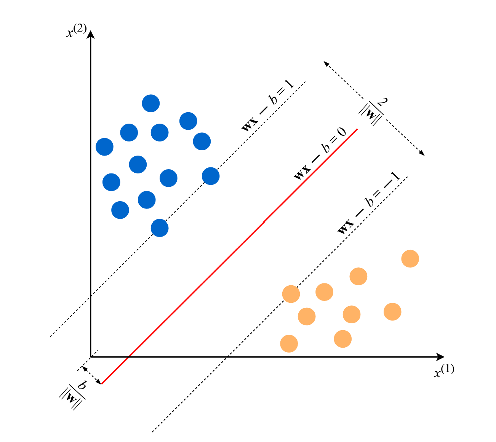
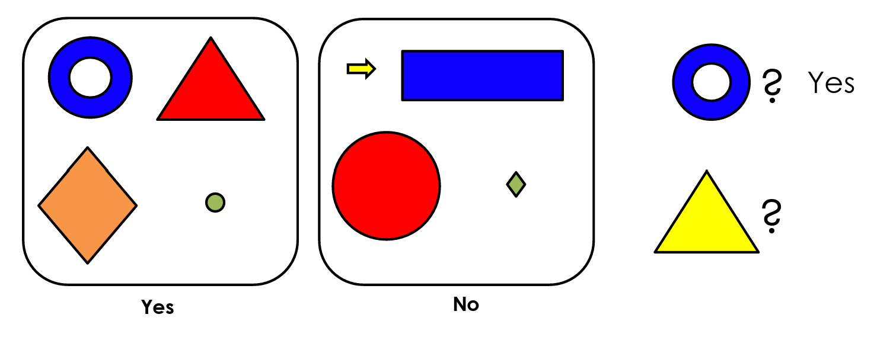
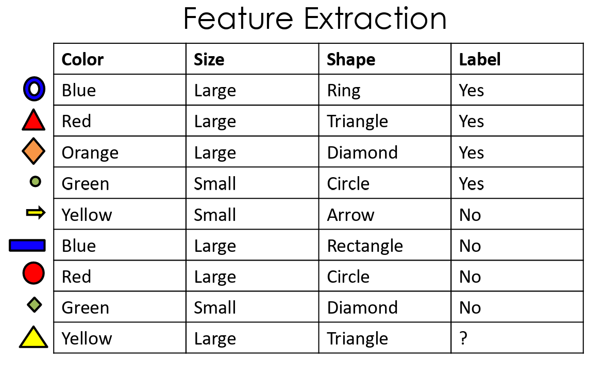
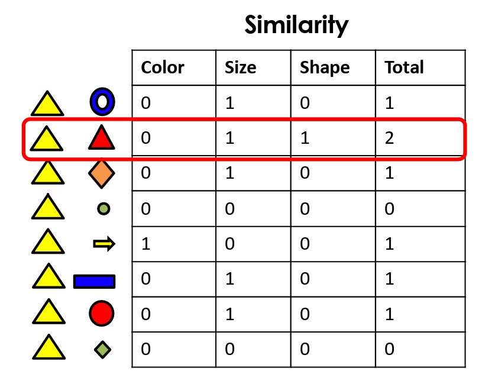

# Lec 01 - Introduction

## What is Machine Learning

**Machine learning** is a subfield of computer science that is concerned with building algorithms which, to be useful, rely on a collection of examples of some phenomenon. These examples can come from nature, be handcrafted by humans or generated by another algorithm.

Machine learning can also be defined as the process of solving a practical problem by

1. gathering a dataset, and
2. algorithmically building a **statistical model** based on that dataset.

That **statistical model** is assumed to be used somehow to solve the practical problem.


To save keystrokes, I use the terms "learning" and "machine learning" interchangeably.


[Herbet Simon](https://en.wikipedia.org/wiki/Herbert_A._Simon) once said,

> Learning is any process by which a system improves **performance** from **experience**.


Smart readers like you might come up with a question, "Does it mean more experience will give better performance?" For now, let's just assume the answer is yes in this module. However, according to Prof. Wang, this is not true in nowaday's machine learning and deep learning field.


Building on this defintion based on **performance** and **experience**, Tom Mitchell gives the following definition for learning:

> A computer program is said to learn
>
> * from **experience** $$E$$
> * with respect to some class of **tasks** $$T$$ and **performance measure** $$P$$
>
> if its performance at tasks in $$T$$, as measured by $$P$$, improves with experience $$E$$.

In this framework, the performance measure $$P$$ serves as the metric to evaluate how successfully the model executes its objective a.k.a., completing the task $$T$$. Therefore, when approaching any machine learning problem, the very first step must always be to clearly define the specific **task** $$T$$.

Let's see some examples on how to find $$T$$, $$P$$ and $$E$$ in some given applications of machine learning:



#### Digit Recognition

$$T$$: Digit Recognition, $$P$$: Classification Accuracy, $$E$$: Labelled Images



#### Email Categorization

$$T$$: Email Categorization, $$P$$: Classification Accuracy, $$E$$: Email Data, Some Labelled



#### Playing Go Game

$$T$$: Playing Go Game, $$P$$: Chances of Winnin&#x67;**,** $$E$$: Records of Past Games



#### Identifying COVID-19 Clusters

$$T$$: Identifying Covid-19 Clusters, $$P$$: Small Internal Distances, Larger External Distances, $$E$$: Records of Patients

<figure><figcaption></figcaption></figure>


In this application, we use the performance measure $$P$$ to evaluate the overall **quality** of the discovered clusters. A well-formed cluster is indicated by high intra-cluster cohesion (small internal distances) and high inter-cluster separation (large external distances). In other words, we want to find small and tense clusters!




AI, Machine Learning and Deep Learning

In EE2211, there is a very clear graph indicating the relationship between AI, machine learning and deep learning!

<figure><figcaption></figcaption></figure>


Pay attention to the small words defining the each concept!


One example of AI but not ML is **deductive reasoning**. For example, NUS is in Singapore, Singapore is in Asia -> NUS is in Asia. Deductive reasoning is not ML because in deductive reasoning, there is no [**learning**](../#course-spirit)!

> What about Generative AI (GenAI)? Where does it belong to?

GenAI is actually called generative deep learning and it is s subfield of deep learning.

## Types of Learning

Learning can be **supervised**, **semi-supervised**, **unsupervised** and **reinforcement**.

### Supervised Learning

In supervised learning, we will first introduce some very important terminologies first, including

1. Dataset
2. Feature Vector
3. Label and Class
4. Model

And then we will introduce two types of supervised learning:

1. Classification
2. Regression

#### Dataset

In supervised learning, the **dataset** is the collection/set of **labeled examples** $$\{(x_i,y_i)\}^N_{i=1}$$.

#### Feature Vector

In the dataset mentioned above, each element[^1] $$x_i$$ among $$N$$ is called a **feature vector**. A feature vector is a vector in which each dimension $$j=1,\dots,D$$ contains a value that describes the example somehow. That value is called a **feature** and is denoted as $$x^{(j)}$$. For instance, if each example/element $$x$$ in our collection represents a preson, then the first feature, $$x^{(1)}$$, could contain height in cm, the second feature, $$x^{(2)}$$, could contain weight in kg, $$x^{(3)}$$ could contain gender, and so on.


For all examples in the dataset, the feature at position $$j$$ in the feature vector always contains the **same** kind of information. It means that if $$x_i^{(2)}$$ contains weight in kg in some example $$x_i$$, then $$x_k^{(2)}$$ will also contain weight in kg in every example $$x_k$$, $$k = 1,\ldots,N$$.


#### Label and Class

The label $$y_i$$ can be either an element belonging to a **finite** set of **classes** $$\{1,2,\dots,C\}$$, or a real number, or a more complex structure, like a vector, a matrix, a tree, or a graph. Unless otherwise stated, in this book $$y_i$$ is either one of a finite set of classes or a real number.


We can see a **class** as a category to which an example belongs. For instance, if our examples are email messages and our problem is spam detection, then we have two classes $$\{\text{spam}, \text{no spam}\}$$.


#### Model

The goal of a **supervised learning algorithm** is to use the dataset to produce a **model** that takes a feature vector $$x$$ as input and outputs **information that allows deducing the label** for this feature vector. For instance, the model created using the dataset of people could take as input a feature vector describing a person and output a probability that the person has cancer.


The sentence above is perhaps the most important take away from this section about supervised learning.


***

In supervised learning, we actually have the following two categories:

* Regression
* Classification

The input for a supervised learning model can be a [feature vector](lec-01-introduction.md#feature-vector) of any dimension other than 0!


The digit identifaction and email classifier examples we mentioned [above](lec-01-introduction.md#what-is-machine-learning) are examples of **supervised learning**.


#### Regression

Regression is that if we are given $$(x_1,y_1),(x_2,y_2),\dots,(x_N,y_N)$$, we need to learn a **model**/function to predict **real-valued** $$y$$ given $$x$$.

<figure><figcaption></figcaption></figure>


According to Prof. Vicent Tan, regression is just like classification except that $$y_i, i\in\{1,\dots,N\}$$ are no longer restricted to belong to a **finite set**. Rather, it can take on **uncountably many values**. In the case of regression, we typically do not say that $$y_i$$ is the [label](lec-01-introduction.md#label-and-class). Rather we use the term **target variable** or **outcome variable** or **dependent variable** to refer to the $$y_i$$'s.


#### Classification

In classification, suppose that we are still given the data $$(x_1,y_1),(x_2,y_2),\dots,(x_N,y_N)$$, now we need to learn a **model**/function to predict **categorical** $$y$$ given $$x$$.


Pay attention here that the $$x$$ feature vector in the data pair contains **2 features**: width and lightness!


<figure><figcaption></figcaption></figure>


#### Binary vs. Multi-class Classification

If there are only two classes that $$y$$ can belong to, then this is a **binary classification**. Otherwise, if there are mroe than two classes that $$y$$ can belong to, then this is a **multi-class classification**!


### Unsupervised Learning

In **unsupervised learning**, the dataset is a collection of _**unlabeled**_ examples $$\{x_i\}_{i=1}^{N}$$. Again, $$x$$ is a feature vector, and the goal of an unsupervised learning algorithm is to create a model that takes a feature vector $$x$$ as input and either transforms it into another vector or into a value that can be used to solve a practical problem.


The paragraph above is perhaps the most important take away for this section about unsupervised learning!


There are three examples of unsupervised learning:

1. Clustering
2. Dimensionality Reduction
3. Outlier Detection



#### Clustering

In **clustering**, the model returns the id of the cluster for each feature vector in the dataset.


Note that while a clustering algorithm knows that there are 2 clusters, it does not and cannot assign semantic meanings to the **clusters** it discovers! In other words, in unsupervised learning, the output has **no label**!!!




#### Dimensionality Reduction

In **dimensionality reduction**, the output of the model is a feature vector that has **fewer features** than the input $$x$$. This is useful to reduce the redundant or useless information from the dataset.


This is not examinable in NUS EE2211, but is a good FYI thing to know.




#### Outlier Detection

In **outlier detection**, the output is a real number that indicates how $$x$$ is different from a "typical" example in the dataset.




The COVID-19 example we mentioned [above](lec-01-introduction.md#what-is-machine-learning) is an example of **unsupervised learning**.


When to use supervised learning or unsupervised learning?


This is one of the most important things that we should know from this tutorial!


Bascially, to determine whether we should use supervised learning or unsupervised learning in a scenario, we always start by looking at the **output (target) we want the model to learn**.

* Do we want/need/have a known target/label for the training data?
  * **No -> Unsupervised Learning**
    * The model looks for patterns or structures in the data without predefined labels.
      * Examples: clustering customers, grouping similar documents.
  * **Yes -> Supervised Learning**
    * The model learns the relationship between the input features and the known target.

For **supervised learning**, look at the type of target:

* **Categorical / discrete target -> Classification**
  * Predicts a **class or category**.
* **Numerical / continuous target -> Regression**
  * Predicts a **numeric value**.

### Semi-Supervised Learning

In **semi-supervised learning**, the dataset contains both labeled and unlabeled examples. Usually, the quantity of unlabeled examples is much higher than the number of labeled examples. The goal of a semi-supervised learning algorithm is the same as the goal of the [supervised learning algorithm](lec-01-introduction.md#supervised-learning). The hope here is that using many unlabeled examples can help the learning algorithm to find (we might say "produce" or "compute") a better model.

It could look counter-intuitive that learning could benefit from adding more unlabeled examples. It seems like we add more uncertainty to the problem. However, when we add unlabeled examples, we add more information about our problem:

> a larger sample reflects better the probability distribution the data we labeled came from.

Theoretically, a learning algorithm should be able to leverage this additional information.

### Reinforcement Learning

**Reinforcement learning** is a subfield of machine learning where the machine "lives" in an environment and is capable of perceiving the _state_ of that environment as a vector of features. The machine can execute _actions_ in every state. Different actions bring different _rewards_ and could also move the machine to another state of the environment. The goal of a reinforcement learning algorithm is to learn a _policy_. A policy is a function $$f$$ (similar to the model in supervised learning) that takes the feature vector of a state as input and outputs an optimal action to execute in that state. The action is optimal if it maximizes the _expected average reward_.

Reinforcement learning solves a particular kind of problems where decision making is **sequential**, and the goal is long-term, such as game playing, robotics, resource management, or logistics.


In this book, we put emphasis on one-shot decision making where input examples are independent of one another and the predictions made in the past. We will leave reinforcement learning out of the scope of this book.



The **go game** example we mentioned [above](lec-01-introduction.md#what-is-machine-learning) is an example of **reinforcement learning**.


## How Supervised Learning Works

In this section, we will briefly explain how [supervised learning](lec-01-introduction.md#supervised-learning) works so that you have the picture of the whole process before we go into detail.


We decided to use supervised learning as an example because it's the type of machine learning most frequently used in practice.


The supervised learning process starts with gathering the data. The data for supervised learning is a collection of pairs (input, output).

* **Input** could be anything, for example, email messages, pictures, or sensor measurements.
* **Outputs** are usually real numbers, or labels (e.g. "spam", "not\_spam", "cat", "dog", "mouse", etc). In some cases, outputs are vectors (e.g., four coordinates of the rectangle around a person on the picture), sequences (e.g. \["adjective", "adjective", "noun"] for the input "big beautiful car"), or have some other structure.


This sentence above is very good and aligns with what we have already seen in our [EE4218 final project](https://app.gitbook.com/s/BcpQMbfvKRcTJoaXhJD0/neural-network/introduction)!


### The Problem

Let's say the problem that we want to solve using supervised learning is _spam detection_. We gather the data, for example, 10,000 email messages, each with a label either "spam" or "not\_spam' (we could add those labels manually or pay someone to do that for us).


The following steps to get a glimpse of **supervised learning** are very important and should be the take-away from this course.


### Forming the Dataset

> This step is also known as **feature extraction**.

Now, we have to convert each email message into a [feature vector](lec-01-introduction.md#supervised-learning). The data analyst decides, based on their experience, how to convert a real-world entity, such as an email message, into a feature vector. One common way to convert a text into a feature vector, called **bag of words**, is to take a dictionary of English words (let's say it contains 20,000 alphabetically sorted words) and stipulate that in our feature vector:

* the first feature is equal to 1 if the email message contains the word "a"; otherwise, this feature is 0;
* the second feature is equal to 1 if the email message contains the word "aaron"; otherwise, this feature equals 0;
* ...
* the feature at position 20,000 is equal to 1 if the email message contains the word "zulu"; otherwise, this feature is equal to 0.

We repeat the above procedure for every email message in our collection, which gives us 10,000 feature vectors (each vector having the dimensionality of 20,000) and a label ("spam"/"not\_spam").

Now we have a machine-readable input data, but the output labels are still in the form of human-readable text. Some learning algorithms require transforming labels into numbers. For example, some algorithms require numbers like 0 (to represent the label "not\_spam") and 1 (to represent the label "spam"). The algorithm we use to illustrate supervised learning is called **Support Vector Machine (SVM)**. This algorithm requires that the positive label (in our case it’s "spam") has the numeric value of +1 (one), and the negative label ("not\_spam") has the value of −1 (minus one).

### Training

At this point, we have a **dataset** and a **learning algorithm**, so we are ready to apply the learning algorithm to the dataset to get the **model**. This process is what we refer to as **training**.


#### Learning Algorithms

SVM is a ML learning algorithm for **classification** while its regression counterpart is called SMR (Support Vector Regression). In EE2211, our main focus is on the **regression** machine learning algorithm, which includes linear regression, polynomial regression and ridge regression.


SVM sees every feature vector as a point in a high-dimensional space (in our case, space is 20,000-dimensional). The algorithm puts all feature vectors on an imaginary 20,000-dimensional plot and draws an imaginary [19,999-dimensional line](#user-content-fn-2)[^2] (a hyperplane) that separates examples with positive labels from examples with negative labels. In machine learning, the boundary separating the examples of different classes is called the **decision boundary**.


For now, we might find out that the essence of training is to find the decision boundary. Later we will find out that training is to find the **optimal** decision boundary.


The equation of the hyperplane is given by two parameters, a real-valued vector $$w$$ of the same dimensionality as our input feature vector $$x$$, and a real number $$b$$ like this:

$$
w x - b = 0
$$

where the expression $$w x$$ means $$w^{(1)}x^{(1)} + w^{(2)}x^{(2)} + \ldots + w^{(D)}x^{(D)}$$, and $$D$$ is the number of dimensions of the feature vector $$x$$.


If we still remember our basic linear algebra, we might find out that in our case, vector $$w$$ is $$1\times20000$$ and vector $$x$$ is $$20000\times1$$ so that their dot product is exactly a real number.


Now, the predicted label for some input feature vector $$x$$ is given like this:

$$
y = \text{sign}(w x + b)
$$

where $$\text{sign}$$ is a mathematical operator that takes any value as input and returns +1 if the input is a positive number or −1 if the input is a negative number.

The goal of the learning algorithm — SVM in this case — is to leverage the dataset and find the **optimal values** $$\hat{w}$$ and $$\hat{b}$$ for parameters $$w$$ and $$b$$. Once the learning algorithm identifies these optimal values, the model $$f(x)$$ is then defined as:&#x20;

$$
f(x) = \text{sign}(\hat{w}x + \hat{b})
$$

Therefore, to predict whether an email message is spam or not spam using an SVM model, we have to

1. take a text of the message,
2. convert it into a feature vector,
3. then multiply this vector by $$\hat{w}$$, add $$\hat{b}$$ and take the sign of the result.

This will give us the prediction (+1 means "spam", −1 means "not\_spam").

Now, how does the machine find $$\hat{w}$$ and $$\hat{b}$$? It solves an **optimization problem**. Machines are good at optimizing functions under constraints. So what are the constraints we want to satisfy here? First of all, we want the model to predict the labels of our 10,000 examples correctly. Remember that each example $$i = 1, \ldots, 10000$$ is given by a pair $$(x_i, y_i)$$, where $$x_i$$ is the feature vector of example $$i$$ and $$y_i$$ is its label that takes values either −1 or +1. So the constraints are naturally:

* $$w x_i + b \ge 1$$ if $$y_i = +1$$, and
* $$w x_i + b \le -1$$ if $$y_i = -1$$


To understand the two equations above, we might start from the if clause, then look at the left clause.


We would also prefer that the hyperplane separates positive examples from negative ones with the **largest** margin. The margin is the distance between the closest examples of two classes, as defined by the decision boundary. A large margin contributes to better generalization, that is, how well the model will classify new examples in the future. To achieve that, we need to minimize the Euclidean norm of $$w$$, denoted by $$|w|$$ and given by $$\sqrt{\sum_{j=1}^{D} (w^{(j)})^2}$$. So, the optimization problem that we want the machine to solve looks like this:

Minimize |w| subject to y_i (w x_i + b) \ge 1 for i = 1, \ldots, N.


The expression $$y_i (w x_i + b) \ge 1$$ is just a compact way to write the above two constraints.&#x20;


The solution of this optimization problem, given by $$\hat{w}$$ and $$\hat{b}$$, is called the **statistical model**, or, simply, the **model**. The process of building the model is called **training**.

Why finding the largest margin is equal to minimizing |w|?

Let's lower down our problem to two-dimensional feature vectors. For two-dimensional feature vectors, the problem and the solution can be visualized as shown in fig. 1. The blue and orange circles represent, respectively, positive and negative examples, and the line given by $$w x + b = 0$$ is the decision boundary.

<figure><figcaption>
Figure 1.1: An example of an SVM model for two-dimensional feature vectors
</figcaption></figure>

Geometrically, the equations $$w x + b = 1$$ and $$w x + b = -1$$ define two parallel hyperplanes, as we see in fig. 1. The distance between these hyperplanes is given by $$\frac{2}{|w|}$$, so the **smaller** the norm $$|w|$$, the larger the distance between these two hyperplanes.


Here, we suppose the readers already know how to [calculate the distance between two parallel lines](https://en.wikipedia.org/wiki/Distance_between_two_parallel_lines).


That's how Support Vector Machines work. This particular version of the algorithm builds the so-called _linear_ model. It’s called linear because the decision boundary is a straight line (or a plane, or a hyperplane). SVM can also incorporate **kernels** that can make the decision boundary arbitrarily non-linear. In some cases, it could be impossible to perfectly separate the two groups of points because of noise in the data, errors of labeling, or **outliers** (examples very different from a "typical" example in the dataset). Another version of SVM can also incorporate a penalty hyperparameter[^3] for misclassification of training examples of specific classes.

### Summary

At this point, we  should retain the following:

> any **classification** learning algorithm that builds a model implicitly or explicitly creates a **decision boundary**.

The decision boundary can be straight, or curved, or it can have a complex form, or it can be a superposition of some geometrical figures. The form of the decision boundary determines the accuracy of the model (that is the ratio of examples whose labels are predicted correctly). The form of the decision boundary, the way it is algorithmically or mathematically computed based on the training data, differentiates one learning algorithm from another.


The paragraph above is perhaps the most important take-away from this example!


In practice, there are two other essential differentiators of learning algorithms to consider:

1. speed of model building and
2. prediction processing time.

In many practical cases, we would prefer a learning algorithm that builds a less accurate model fast. Additionally, we might prefer a less accurate model that is much quicker at making predictions.

Another Example of Supervised Learning (classification): Nearst Neighbor Classifier

The problem here is that we want to recognize new incoming shapes based on the following already labelled dataset.

<figure><figcaption></figcaption></figure>

By looking using our eyes, we might find out that the blue circle is obsivously a "Yes", but how about the yellow triangle? How does the computer recognize this object? To solve this problem, the **nearest neighbot classifier** solves it using the following steps.



#### Feature Extraction

> This step is similar to the [#forming-the-dataset](lec-01-introduction.md#forming-the-dataset "mention") section mentioned above.

To a computer, an image is just pixels. To make sense of the shapes, we have to extract specific "features" or attributes that define them.


This step is analogous to the step of forming **feature vectors**.


<figure><figcaption></figcaption></figure>

The table above organizes all of this extracted information into a clean data table. Now, instead of looking at pictures, the computer can look at structured data. Our mystery yellow triangle is at the bottom, waiting for its label.


If we come up with some other features and continue the following steps, we might get a different result!




#### Similarity Evaluation

To figure out where the yellow triangle belongs, the computer compares it to _every single shape_ in the table to see which one is the most similar. The Similarity below gives a score of 1 if a feature matches the yellow triangle, and 0 if it doesn't.

<figure><figcaption></figcaption></figure>

For example, when compared to the Red Triangle, it gets a 0 for Color (Yellow vs. Red), but a 1 for Size (Large vs. Large) and a 1 for Shape (Triangle vs. Triangle). Adding those up, the Red Triangle gets a Total Similarity Score of 2. This is the highest score on the board.



#### Making the Decision

Finally, we apply the **Nearest Neighbor Classifier** rule.

1. **Find the nearest neighbor**: The shape with the highest similarity score (the Red Triangle) is considered the "nearest neighbor" to our mystery shape.
2. **Assign the label**: Because the Red Triangle's label is "Yes", the algorithm decides that our mystery Yellow Triangle must also be a "Yes".




The nearest neighbor classifier is **not** an example of [#feature-extraction](lec-01-introduction.md#feature-extraction "mention") because feature extraction is independent of nearest neighbor classifer and it can be in other systems!


## Why the Model Works on New Data

Why is a machine-learned model capable of predicting correctly the labels of new, previously unseen examples? To understand that, look at the plot in fig. 1. If two classes are separable from one another by a decision boundary, then, obviously, examples that belong to each class are located in two different subspaces which the decision boundary creates.

If the examples used for training were selected randomly, independently of one another, and following the same procedure, then, statistically, it is more likely that the new negative example will be located on the plot somewhere not too far from other negative examples. The same concerns the new positive example: it will likely come from the surroundings of other positive examples. In such a case, our decision boundary will still, with high probability, separate well new positive and negative examples from one another. For other, less likely situations, our model will make errors, but because such situations are less likely, the number of errors will likely be smaller than the number of correct predictions.

Intuitively, the larger the set of training examples is, the more unlikely that the new examples will be dissimilar to (and lie on the plot far from) the examples used for training.


To **minimize** the probability of making errors on new examples, the SVM algorithm, by looking for the **largest** margin, explicitly tries to draw the decision boundary in such a way that it lies as far as possible from examples of both classes.


Inductive vs. Deductive Reasoning

Still remember the deductive reasoning example we mentioned [above](lec-01-introduction.md#ai-machine-learning-and-deep-learning)? The main task of machine learning is to make **inference**. However, there are two types of inference

* Inductive Reasoning
* Deductive Reasoning



#### Inductive Reasoning

Inductive Reasoning derives **probabilistic**, general rules from specific, incomplete observations (Bottom-up logic, probability and statistics).


In EE2211, all the machine learning and deep learning models that we will see are considered as **inductive reasoning/learning**!




#### Deductive Reasoning

Deductive Reasoning derives **deterministic**, guaranteed conclusions from known, established premises (Top-down logic, rule-based reasoning).



## Reference

1. NUS EE2211 Lecture 1 Notes.
2. NUS goated prof. Vincent Tan's Notes on EE2211 Chapter 1.
3. NUS EE2211 Tutorial conducted by Mr. Christopher.

[^1]: This element can also be understood as **example**, which is in the collection/set that we just mentioned.

[^2]: The reason here is that, image on a 2-d plane, if we want to draw a line to separate two cluster of points, that line is 1-d. Same thing applies here when we are dealing with high dimensionality.

[^3]: &#x20;A hyperparameter is a property of a learning algorithm, usually (but not always) having a numerical value. That value influences the way the algorithm works. Those values aren't learned by the algorithm itself from data. They have to be set by te data analyst before running the algorithm.
