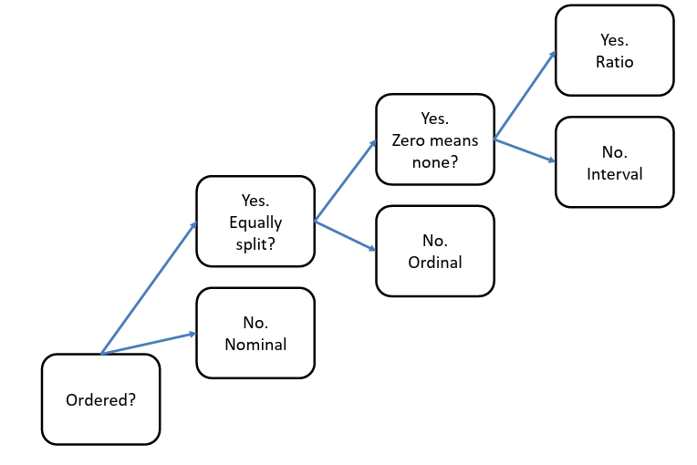
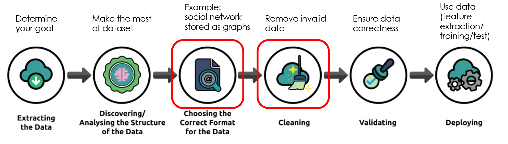
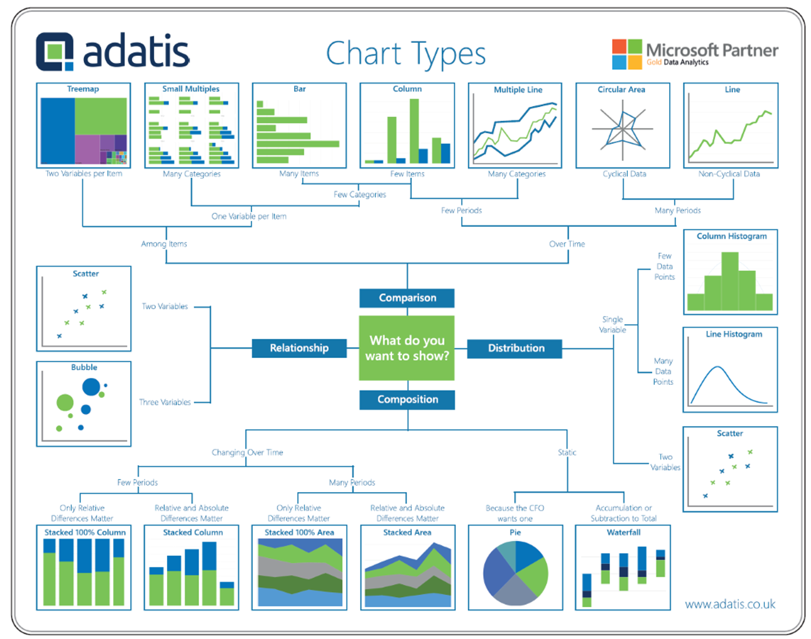
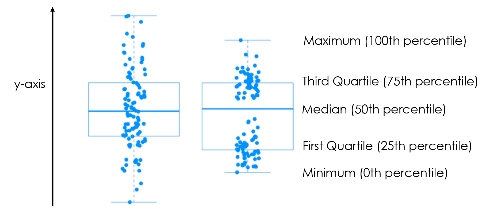
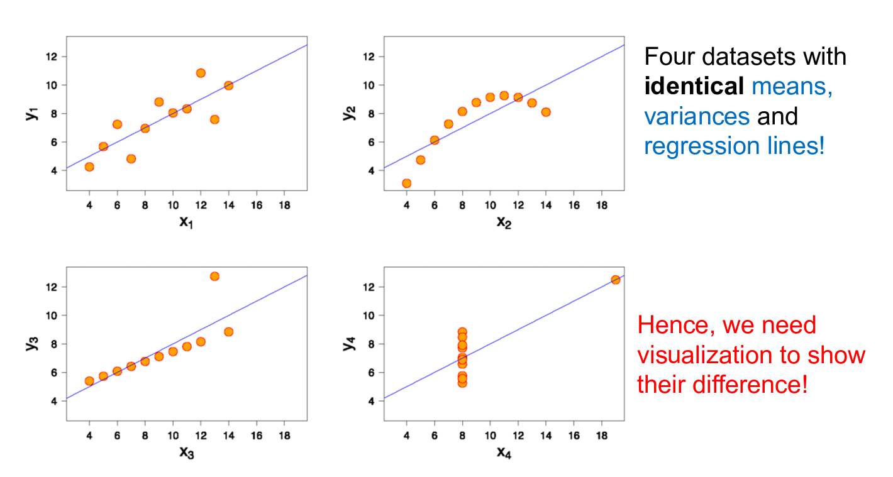

# Lec 02 - Data Engineering

## Types of Data

In this section, we are supposed to correctly identify the **type** of data!

### NOIR

This first categorization is based on the levels/scales of measurement. NOIR stands for:

> Nominal -> Ordinal -> Interval -> Ratio.

We can think of them as **increasing** levels of information:

1. **Nominal:** named categories
2. **Ordinal:** named + ordered
3. **Interval:** named + ordered + equal intervals
4. **Ratio:** all of the above + a true zero

#### Nominal

Data are simply **categories or labels**. There is **no natural order** between them. For example

* gender,
* occupation,
* blood type,
* nationality
* favorite restaurants: Mcdonald's, Burger King, Subway, KFC, ...
* ...

We can ask **how often** (frequency distribution, mode) each category occurs, but numerical calculations such as averages are not meaningful.

#### Ordinal

Data have categories with a **meaningful order or ranking**, but the distance between ranks is unknown or unequal. For example,

* the exam difficulty: 1 = Very Easy, 2 = Easy, 3 = About Right, 4 = Difficult, 5 = Very Difficult
* the size of packaged eggs in supermarkets: small, medium, large, extra large, ...
* the military rank: general, major, captain

For the exam difficulty example, we know that 4 represents more difficult than 3, but we cannot say the difference between 3 and 4 is exactly the same as between 4 and 5.


For the ordinal data, we **cannot do addition or substraction**!!! And for the **odd** number ordinal data, we can also calculate the **median** as the only requirement for being able to calculate the median is that we can **sort the data**.


#### Interval

Data are **ordered** and have **equal, meaningful intervals** between values. However, zero is **arbitrary rather than a true absence** of the quantity. For examples:

* Temperature in degree ceslius
* Calendar years
* SAT scores measured from \[400, 1600]

For example, the difference between 10°C and 20°C is the same size as the difference between 20°C and 30°C. But **20°C is not "twice as hot" as 10°C**, because 0°C does not mean "no temperature."


So with interval data, **differences are meaningful, ratios are not**.


#### Ratio

Ratio data have everything [interval data](lec-02-data-engineering.md#interval) have, plus a **true/natural zero**. A zero means the quantity is genuinely absent. For example:

* weight,
* height,
* distance,
* duration
* Temperature in Kelvin

Because there is a true zero, **ratios are meaningful**. For example, **20 kg is twice 10 kg**.

#### Summary

So far, we have seen four types of data, and the following graph shows a quick way to identify NOIR.

<figure><figcaption></figcaption></figure>

Mean, Median and Mode

* **Mean** = arithmetic average
* **Median** = middle value after arranging the data
* **Mode** = most frequently occurring value

As the measurement level increases, more statistical operations become meaningful:

| Level    | Mode / Frequency | Median | Mean / SD | + / − | Ratios |
| -------- | ---------------: | -----: | --------: | ----: | -----: |
| Nominal  |                ✓ |      ✗ |         ✗ |     ✗ |      ✗ |
| Ordinal  |                ✓ |      ✓ |         ✗ |     ✗ |      ✗ |
| Interval |                ✓ |      ✓ |         ✓ |     ✓ |      ✗ |
| Ratio    |                ✓ |      ✓ |         ✓ |     ✓ |      ✓ |

### Numerical/Categorical

Besides NOIR, a variable can generally be classified as either **categorical** or **numerical**.

#### Categorical

Categorical data describe **groups, labels, or qualities** rather than quantities. They are usually divided into two groups:

* [**Nominal**](lec-02-data-engineering.md#nominal)
* [**Ordinal**](lec-02-data-engineering.md#ordinal)


Both of these two types emphasizes the **discrete nature** of categorical data, which is **countable**!




#### Nominal Data

Similar to the definition of the nomial data that we've seen from the lecture above, the nominal data represent **discrete** units and are used to represent variables that have no natural quantitative value. They are nothing but "labels".

Usually, to deal with categorical variables within a machine learning framework (which is more amenable to numerical data), we may use [one-hot encoding](lec-02-data-engineering.md#binary-coding-one-hot-encoding).



#### Ordinal Data

These data represent **discrete** and **ordered** units. It is therefore nearly the same as nominal data, except that its ordering matters.



So for categorical data, to differentiate between nominal and ordinal data, the key question is:

> Are the values just labels, or do they have an order?

#### Numerical

Numerical data represent **quantities** and are expressed as numbers. They can be divided in two different ways.

* Discrete vs. Continuous
* Interval vs. Ratio



#### Discrete vs Continuous

**Discrete data** is data that are distinct and separate and can only take on certain values (usually **finitely many values**). This type of data can be **counted**. For example,

* number of heads in 100 coin flips
* outcomes of a digital thermometer

To ascertain whether you're dealing with discrete data, you can ask yourself the following questions:

> "Can you count it?" and "Can it be divided up in to smaller and smaller parts?".

If the first answer is "yes" and the second is "no", you know you're dealing with **discrete numerical data**.


#### Binary Data

If the discrete data only takes on the two values (e.g., in $${0,1}$$), then it is called binary data.


**Continuous data** are data that can't be counted but they can be **measured**. For example,

* **Raw Temperature**: no matter how accurate your thermometer, the reading quantized and so what you get is only an approximation (to a certain number of significant digits/decimal points) to the true temperature.


However, a temperature of 27.00°C rounded to 2 decimal places is considered **discrete**, because there are only a **countable number of possible outcomes** after rounding.


* **Height**: you can't nail down the height of a person to infinite precision (because your measurements will be "off by a bit")


If the outcome variable is continuous, it makes sense to build a [regression model](/broken/spaces/YkFGdrZ5zOuB9ejN6sof/pages/2s2nRiYLUFA1Le8B4p88#supervised-learning).




#### **Interval vs Ratio**

As we've seen [above](lec-02-data-engineering.md#interval), numerical data can also be classified according to their **measurement scale**:

* **Interval**: equal intervals, but **no true zero**
  * Example: temperature in °C
* **Ratio**: equal intervals and a **true zero**
  * Examples: weight, height, duration


This is the same **Interval and Ratio** idea from [NOIR](lec-02-data-engineering.md#noir).




### Missing Data

Lastly, we also have such data with a missing value, in this case, it's common to use "NA" to fill in the blank instead of doing nothing.

## Data Wrangling and Cleaning

### Data Wrangling

**Data wrangling** is the process of turning **raw, messy data** into a cleaner and more useful form so it can be analysed or used in a model.


It is a **general process**, and the exact steps depend on the type of data and the final goal.


#### Typical Data Wrangling Process

The typical data wrangling process can be shown as follows:

<figure><figcaption></figcaption></figure>


Attention here that different textbooks will use different data wrangling processes!


Let's use the example of constructing a face detector:

1. **Extract the data**: Collect the raw data from the relevant source.
   1. _Example:_ Gather a large set of human face images for building a face detector.
2. **Understand the data**: Inspect the dataset to understand its structure, categories, and possible issues.
   1. _Example:_ Examine the face images and organize them into relevant groups, such as men and women.
3. **Choose the correct format**: Convert the data into a consistent format that can be processed easily.
   1. _Example:_ Convert all images into the same file format, such as `.png`.
4. **Clean the data**: Remove invalid, noisy, duplicated, or irrelevant samples.
   1. _Example:_ Remove poor-quality or unrelated images that should not be used for training.
5. **Validate the data**: Check that the cleaned data are correct and complete.
   1. _Example:_ Make sure every face image has the correct label and that no required labels are missing.
6. **Use the data**: The prepared dataset can now be used for analysis or model development.
   1. _Example:_ Use the cleaned face images for **feature extraction** and to **train/test the face detector**.

#### Formatting Data

Formatting is an important part of data wrangling because raw data may not be in a form that a statistical or machine-learning model can use directly. Here, we will discuss two types of data formatting:

1. Binary Coding
2. Normalization



#### Binary coding / One-hot encoding

Categorical values are converted into **binary vectors made of 0s and 1s**. For example, if colour can be:

* Red -> `[1, 0, 0]`
* Yellow -> `[0, 1, 0]`
* Green -> `[0, 0, 1]`

Each position represents one category. This is especially common in **classification and machine-learning tasks**, because models generally work with numerical inputs rather than category names.


This is similar to the one-hot encoding that we've already seen in the [FSM design](https://app.gitbook.com/s/jTJFBPtKk6NwweAooH53/textbook/sequential-logic-design/finite-state-machines#state-encodings)! And in my DDCA notes, we explicitly differentiate between binary encoding and one-hot encoding. But in EE2211, we just treat **one-hot encoding** to be the **same thing** as **binary encoding**! This binary coding/one-hot encoding technique is usually applied on the **output labels** but can also be applied to the **input features**.




#### Normalization

Normalization adjusts numerical variables so that their scales are more comparable. This is useful when variables have very **different ranges**. For example:

* Age: 18 - 80
* Income: $1,000 - $100,000

Without scaling, the much larger income values may **dominate some calculations**. Given a [feature vector](lec-01-introduction.md#feature-vector), features with larger magnitudes can contribute disproportionately to operations such as distance calculations or parameter updates, causing the model to treat them as more important than features with smaller magnitudes. To mitigate this issue and place the features on comparable scales, we apply normalization. And here, we will introduce two scaling techniques:

1. **Min-max scaling**: Rescales values to a fixed range, commonly **0 to 1**:

$$
x' = \frac{x - x_{\min}}{x_{\max} - x_{\min}}
$$

So we have minimum value -> **0,** maximum value -> **1** and other values fall between them.

2. **Z-score standardization**: Transforms a value according to how far it is from the mean:

$$
z = \frac{x - \mu}{\sigma}
$$

where: $$\mu$$ = mean and $$\sigma$$ = standard deviation. After standardization, values are expressed in terms of **standard deviations from the mean**.


**Normalization** is usually applied to the **all** **input features**, rather than the labelled outputs. However, the outputs may also be normalized if their values are highly skewed or vary significantly in scale.




### Data Cleaning

**Data cleaning** is the process of finding and fixing, replacing, or removing **incorrect, corrupted, noisy, or missing data**. The goal is to make the dataset more **accurate, consistent, and usable** before analysis or model training. Among data cleaning, there are two main problems:

* **outliers**
* **missing values**

#### Handling Outliers

An **outlier** is a value that is unusually far from the rest of the data. One way to handle outliers is **clipping**:

* Set a maximum or minimum allowed value.
* Any value beyond that limit is replaced by the boundary value.

For example, if values above **4.0** are considered too extreme, they can all be clipped to **4.0**. This prevents a few extreme values from having too much influence on the analysis or model.

#### Handling Missing Features

A dataset may contain missing values, such as a missing height, GPA, or year of birth. There are three main approaches to handle it:

1. Remove samples with missing values
2. Use an algorithm that can handle missing values
3. Imputation



#### Remove samples with missing values

Delete rows that contain missing features. This is reasonable when:

* the dataset is **large enough**
* only a small proportion of data is missing

The downside is that useful information is lost.



#### Use an algorithm that can handle missing values

Some learning algorithms can work with missing data directly. For example:

* **Random forest** can sometimes handle missing information depending on the implementation and preprocessing setup.

This avoids having to remove or manually replace every missing value.



#### Imputation

**Imputation** means replacing missing values with suitable substitute values. And there are two ways of imputation introduced here:

1. **Mean imputation**: Replace a missing numerical value with the **average value of that feature**:

$$
\hat{x}^{(j)} = \frac{1}{N} \sum_{i=1}^{N} x_{i}^{(j)}
$$

For example, if the known heights are 1.70, 1.75, and 1.80 m, the missing height could be replaced by their average.

2.  **Highlight the missing value**: Instead of estimating the missing value, assign a **special value outside the normal range**. Fxample:

    * Normal feature range: \[0,1]
    * Missing value: set to **−1**

    The unusual value tells the learning algorithm: "**This feature was missing."** The model can then learn how to treat these cases.



## Data Integrity and Visualization

### Data Integrity

**Data integrity** means keeping data **accurate, consistent, and valid** throughout its use. It is important whenever a system stores, processes, or retrieves data. And a simple way to think about it is that:

> Data should follow the rules we expect.

For example:

* A **numeric** field should not accept letters.
* A **binary** field should only allow two valid inputs.
* A fixed-format value, such as a card number, should follow the expected structure and validity checks.

So data integrity is about **preventing invalid data from entering the system**, not just fixing it later.

### Data Visualization

**Data visualization** means representing data **graphically** so that patterns, trends, comparisons, and unusual values are easier to see. The main thing to know in this section is **which types of charts are most suitable for showing different aspects of data**.

<figure><figcaption></figcaption></figure>

For example, a **boxplot** summarizes the distribution using statistics such as the median and quartiles, but it does **not show the detailed shape of the data distribution**. For example:

<figure><figcaption></figcaption></figure>

Why Visualization is necessary?

Two datasets can have the same:

* mean
* variance
* regression line

but still have **very different patterns**. This is why visualization is important as it can reveal things that numerical summaries may hide, such as:

* curves or nonlinear relationships
* clusters
* outliers
* unusual distributions
* different overall patterns

<figure><figcaption></figcaption></figure>

## Reference

1. NUS EE2211 Lecture 2 Notes by Prof. Vincent Tan.
