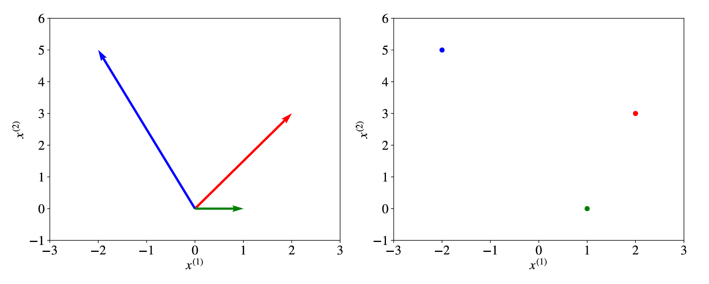
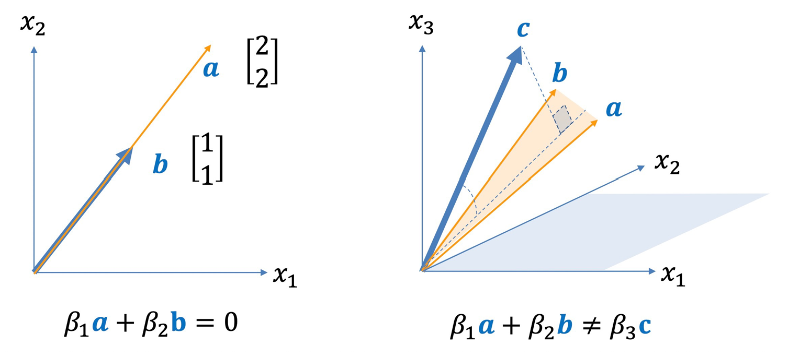
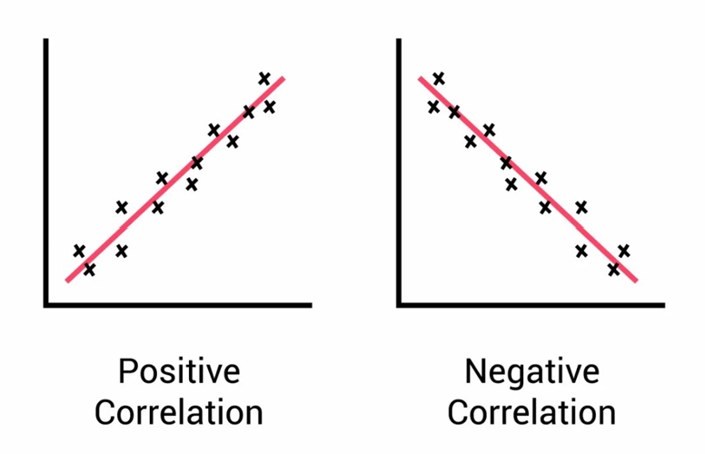
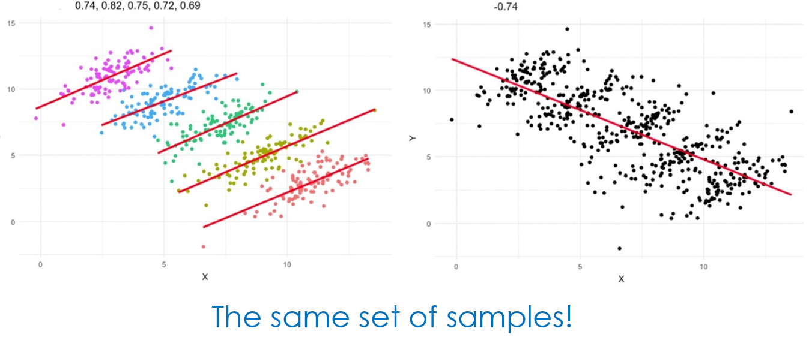
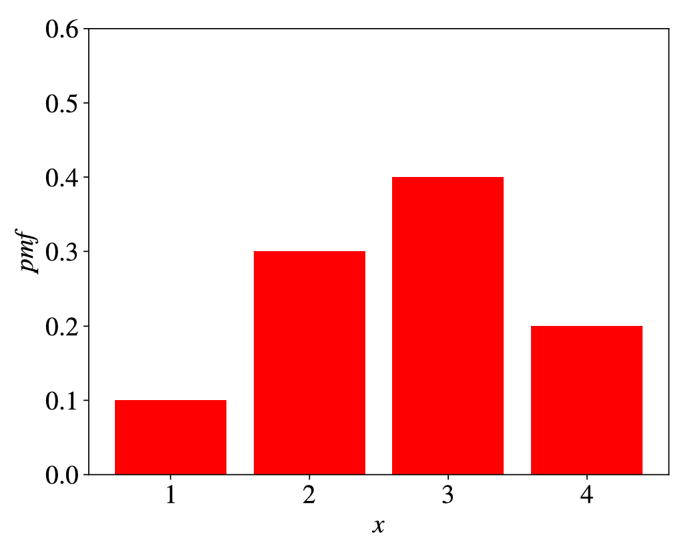
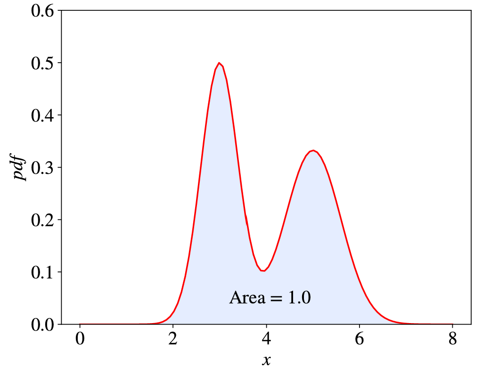
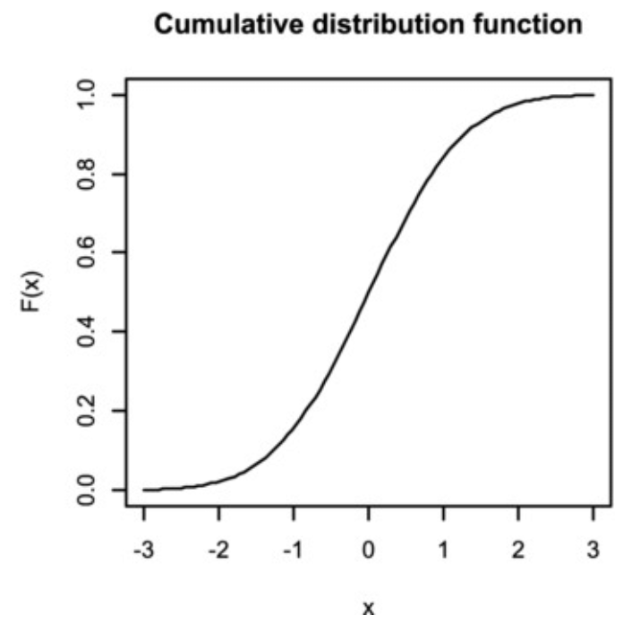

# Lec 03 - Introduction to Linear Algebra, Probability and Statistics

In this lecture, we will have a **brief overview of three fundamental topics**:

1. Linear Algebra
2. Probability
3. Statistics

Among these, **Linear Algebra** will be covered in greater depth in the upcoming lectures. For **Probability** and **Statistics**, we only need to develop a basic understanding of the key concepts introduced here.

## Linear Algebra

In this section, the main goal is to **refresh our understanding of the basic notations and concepts in Linear Algebra**. In NUS EE2211, we will not be tested on the underlying mathematics directly, so we are not required to master the derivations. However, it is still recommended to understand **what is happening behind the scenes**.

### Notations

#### Scalar

A **scalar** is a simple numerical value, like 15 or -3.25. **Variables** or **constants** that take scalar values are denoted by an _italic_ letter, like $$x$$ or $$a$$.


In **NUS EE2211**, we will be explicitly told whether a variable is a **scalar, vector, or matrix**. Therefore, we do not need to memorize the notation or letter conventions used to represent each type of variable.


#### Vector

A **vector** is an **ordered** list of scalar values, called attributes. We denote a vector as a **bold** character, for example, $$\mathbf{x}$$ or $$\mathbf{w}$$.


Here, **"ordered"** means that we cannot arbitrarily change the positions of elements in a vector, as doing so may produce a **different vector**. As we will see later, [**matrices**](lec-03-introduction-to-linear-algebra-probability-and-statistics.md#matrix) **are also ordered** in the same way.


Vectors can be visualized as **arrows** that point to some directions as well as **points** in a multi-dimensional space. Illustrations of three two-dimensional vectors, $$\mathbf{a} = [2,3]$$, $$\mathbf{b} = [-2,5]$$, and $$\mathbf{c} = [1,0]$$ is given in Figure 2.1.

<figure><figcaption>
Figure 2.1: Three vectors visualized as directions and as points
</figcaption></figure>

We denote an attribute of a vector as an italic value with an index, like this: $$w^{(j)}$$ or $$x^{(j)}$$. The index $$j$$ denotes a specific dimension of the vector, the position of an attribute in the list. For instance, in the vector $$\mathbf{a}$$ shown in red in Figure 2.1., $$a^{(1)} = 2$$ and $$a^{(2)} = 3$$.

The notation $$x^{(j)}$$ should not be confused with the power operator, like this $$x^2$$ (squared) or $$x^3$$ (cubed). If we want to apply a power operator, say square, to an indexed attribute of a vector, we write like this: $$(x^{(j)})^2$$.


A variable can have two or more indices, like this: $$x_i^{(j)}$$ (In the previous [note](lec-01-introduction.md#feature-vector), we've seen that this can represent a feature in a feature vector). In neural networks, we denote as $$x^{(j)}$$ or like this $$x_{i,j}^{(k)}$$. For example, in $$x_{l,u}^{(j)}$$, the input feature $$j$$ of unit $$u$$ in layer $$l$$.


#### Matrix

A **matrix** is a rectangular array of numbers arranged in rows and columns. Below is an example of a matrix with two rows and three columns, a.k.a, a 2x3 matrix.

$$
\mathbf{W}=\begin{bmatrix}
2 & 4 & -3 \\
21 & -6 & -1
\end{bmatrix}
$$


As we saw in the previous [notes](lec-01-introduction.md#feature-vector), in **machine learning**, each **row** of a matrix typically represents a [**sample/element/example**](lec-01-introduction.md#dataset), while each **column** represents a **feature**.


Matrices are denoted with **bold CAPITAL** letters, such as $$\mathbf{A}$$ or $$\mathbf{W}$$.


For elements in matrix $$\mathbf{X}$$, we shall use the indexing $$x_{1,1}$$ where the **first** and **second** indices indicate the **row** and **column** position.


#### Capital Sigma Notation

The summation over a collection $$X = {x_1,x_2,\ldots,x_{n-1},x_n}$$ or over the attributes of a vector $$\mathbf{x} = [x^{(1)},x^{(2)},\ldots,x^{(m-1)},x^{(m)}]$$ is denoted like this:

$$
\sum_{i=1}^{n} x_i \stackrel{\text{def}}{=} x_1 + x_2 + \ldots + x_{n-1} + x_n
$$

or else:

$$
\sum_{j=1}^{m} x^{(j)} \stackrel{\text{def}}{=} x^{(1)} + x^{(2)} + \ldots + x^{(m-1)} + x^{(m)}
$$

The notation $$\stackrel{\text{def}}{=}$$ means "is defined as".

#### Capital Pi Notation

A notation analogous to capital sigma is the **capital pi notation**. It denotes a product of elements in a collection or attributes of a vector:

$$
\prod_{i=1}^{n} x_i \stackrel{\text{def}}{=} x_1 \cdot x_2 \cdot \ldots \cdot x_{n-1} \cdot x_n
$$

where $$a \cdot b$$ means $$a$$ multiplied by $$b$$. Where possible, we omit $$\cdot$$ to simplify the notation, so $$ab$$ also means $$a$$ multiplied by $$b$$.

### Systems of Linear Equations


These concepts will be discussed in greater detail in future lectures of **NUS EE2211**.&#x20;


For now, we will focus on two key topics:

1. [Linear dependence and independence](lec-03-introduction-to-linear-algebra-probability-and-statistics.md#linear-dependence-and-independence)
2. [Rank](lec-03-introduction-to-linear-algebra-probability-and-statistics.md#rank)

#### Linear Dependence and Independence

A collection of vectors $$\mathbf{x}_1,\ldots,\mathbf{x}_m$$ is **linearly dependent** if we can find coefficients $$\beta_1,\ldots,\beta_m$$, **not all zero**, such that

$$
\beta_1\mathbf{x}_1+\cdots+\beta_m\mathbf{x}_m=\mathbf{0}
$$


In other words, at least **one** vector can be written as a linear combination of the **others**.


A collection of vectors is **linearly independent** if the only way to obtain the zero vector is by setting all coefficients to zero:

$$
\beta_1\mathbf{x}_1+\cdots+\beta_m\mathbf{x}_m=\mathbf{0} \quad\Longrightarrow\quad \beta_1=\cdots=\beta_m=0
$$

The geometry of dependency and independency can be shown as follows:

<figure><figcaption>
LHS is linear dependency; RHS is linear independency
</figcaption></figure>


#### Invertibility

For a **square** matrix $$\mathbf{X}$$, if all of its rows (equivalently, all of its columns) are **linearly independent**, then $$\mathbf{X}$$ is **invertible**.


#### Rank

The **rank** of a matrix $$\mathbf{X}$$ is the **maximum number of linearly independent rows** or **columns** of $$\mathbf{X}$$.


This definition of rank implicitly uses a fundamental theorem in linear algebra, which is for **any** $$m\times n$$ matrix, its **row rank** = **column rank**.



In NUS EE2211, we are only required to know how to find the rank of a matrix via Python! And according to my tutor Mr. Christopher, there will exist at least one question about rank in the exams!


## Statistics

In this section, we are going to focus specifically on the Causality, Correlation and Simpson's Paradox.


In NUS EE2211, this is just an FYI part as this is related to a very complex field in AI, which is called **interpretability**, or **mechanistic interpretability**. I happen to have a [close friend](https://yuzhang527.github.io/) working on this field, so feel free to reach out to him LOL.


### Casuality

**Causality** refers to whether $$A$$ contributes to or causes a change in $$B$$. If $$A$$ affects $$B$$, we say that they have a **causal relationship**.

However, researchers can rarely be completely certain that there are no other factors influencing this relationship. Therefore, we often say that $$A$$ is **partly responsible** for the effect observed in $$B$$.


Casuality is a **statistical relationship**, not a deterministic relationship! Casuality **always implies** correlation!


### Correlation

In statistics, **correlation** refers to any statistical relationship between two random variables, whether **causal or not**. Correlation is useful because it can reveal a **predictive relationship** between variables that may be exploited in practice.


However, remember that **correlation does not necessarily imply causation**.


Below is an illustration of **positive vs. negative correlation**.

<figure><figcaption></figcaption></figure>

To measure the **strength and direction of the linear correlation** between two variables, we use the **Pearson correlation coefficient**, denoted by $$r$$:

$$
r = \frac{\sum_{i=1}^n (x_i - \bar{x})(y_i - \bar{y})}{\sqrt{\sum_{i=1}^n (x_i - \bar{x})^2} \sqrt{\sum_{i=1}^n (y_i - \bar{y})^2}} = \frac{s_{xy}}{s_x s_y}
$$

where $$\bar{x}$$ and $$\bar{y}$$ are the means of $$X$$ and $$X$$, respectively. The Pearson correlation coefficient always satisfies

$$
-1\le r\le1
$$

where $$r>0$$ indicates a **positive correlation**, $$r<0$$ a **negative correlation**, and $$r\approx0$$ indicates **little or no linear correlation**.

### Simpson's Paradox


We've first touched this in [NUS GEA1000](../../../../Y1S2/GEA1000/GEA1000-Notes)! Nostalgic!


**Simpson's Paradox** is a phenomenon[^1] in probability and statistics where a trend appears in several separate groups of data but **disappears or reverses when the groups are combined**.

<figure><figcaption></figcaption></figure>

## Probability

In this part, we are going to focus on the random variables and Bayes' Rule!

### Random Variable

A **random variable**, usually written as an italic capital letter, like $$X$$, is a variable whose possible values are **numerical** outcomes[^2] of a random phenomenon. Examples of random phenomena with a numerical outcome include

1. a toss of a coin (0 for heads and 1 for tails),
2. a roll of a dice, or
3. the height of the first stranger we meet outside.
4. ...


#### Sample Space

All unique outcomes form a **sample space**.


There are two types of random variables: **discrete** and **continuous**.


The probability of an outcome can be exactly 0.


#### Discrete Random Variables

A **discrete random variable** takes on only a **countable** number of distinct values such as red, yellow, blue, or 1, 2, 3, ....


Discrete does not mean finite! It means the possible values are countable, even if there are infinitely many of them.




#### Probability Distribution

The **probability distribution** of a discrete random variable is described by a list of probabilities associated with each of its possible values. This list of probabilities is called a **probability mass function** (pmf). For example: $$\Pr(X = \text{red}) = 0.3$$, $$\Pr(X = \text{yellow}) = 0.45$$, $$\Pr(X = \text{blue}) = 0.25$$. Each probability in a probability mass function is a value greater than or equal to 0. The sum of probabilities equals 1 (Figure 2.3a).

<figure><figcaption>
Figure 2.3(a): A probability mass function
</figcaption></figure>



#### Expectation

Let a discrete random variable $$X$$ have $$k$$ possible values $$x_i,i=1,\ldots,k$$_._ The expectation of $$X$$, denoted as $$E[X]$$, is given by,

$$
\begin{align*}
\mathbb{E}[X] &\overset{\text{def}}{=} \sum_{i=1}^{k} \left[ x_i \cdot \Pr(X = x_i) \right] \tag{2.1} \\
&= x_1 \cdot \Pr(X = x_1) + x_2 \cdot \Pr(X = x_2) + \cdots + x_k \cdot \Pr(X = x_k)
\end{align*}
$$

where $$\Pr(X = x_i)$$ is the probability that $$X$$ has the value $$x_i$$ according to the pmf.


The expectation of a random variable is also called the **mean**, **average**, or **expected value** and is frequently denoted with the letter $$\mu$$. The expectation is one of the most important **statistics** of a random variable. **This also applies to** [#continuous-random-variables](lec-03-introduction-to-linear-algebra-probability-and-statistics.md#continuous-random-variables "mention")!




#### Standard Deviation and Variance

Another important statistic is the **standard deviation**, defined as,

$$
\sigma \stackrel{\text{def}}{=} \sqrt{E[(X-\mu)^2]}
$$

**Variance**, denoted as $$\sigma^2$$ or $$\text{var}(X)$$, is defined as,

$$
\sigma^2 = E[(X-\mu)^2]
$$


These two definitions apply to [#continuous-random-variables](lec-03-introduction-to-linear-algebra-probability-and-statistics.md#continuous-random-variables "mention") as well!


For a discrete random variable, the standard deviation is given by:

$$
\sigma = \sqrt{\Pr(X = x_1)(x_1-\mu)^2 + \Pr(X = x_2)(x_2-\mu)^2 + \cdots + \Pr(X = x_k)(x_k-\mu)^2}
$$

where $$\mu = E[X]$$.


Usually, there is a simpler way to calculate the variance, which is to use this formula: $$\sigma^2 = \mathbb{E}[X^2] - (\mathbb{E}[X])^2$$. It applies to both discrete and continuous random variables!




#### Continuous Random Variables

A **continuous random variable** (CRV) takes an infinite number of possible values in some interval. Examples include height, weight, and time.



#### Probability Distribution

Because the number of values of a continuous random variable $$X$$ is infinite, the probability $$\Pr(X = c)$$ for any $$c$$ is 0. Therefore, instead of the list of probabilities, the probability distribution of a CRV (a continuous probability distribution) is described by a **probability density function** (pdf). The pdf is a function whose codomain is nonnegative and the area under the curve is equal to 1 (Figure 2.3b).

<figure><figcaption>
Figure 2.3(b): A probability density function
</figcaption></figure>


Attention that the y-axis in PDF doesn't mean **probability**! Instead, the area under the curve represents the probability.


Usually, we are expected to know how to perform **simple integration of a PDF** to find the probability that a continuous random variable $$X$$ falls within a given range:

$$
P(a \le X \le b)=\int_a^b f_X(x)\,dx
$$


Notice that in EE2211, we usually ignore the constant $$C$$ term!




#### Cumulative Density Function

In the **EE2211 tutorials**, we also introduce another useful concept called the **Cumulative Distribution Function (CDF)**. The CDF is derived from the **PDF** and represents the probability that a random variable $$X$$ is less than or equal to a given value:

$$
F_X(x)=P(X\le x)
$$

Thus, the $$y$$-axis represents the **cumulative probability**, which is always **non-decreasing** as $$x$$ increases.

<figure><figcaption></figcaption></figure>



#### Expectation

The expectation of a continuous random variable $$X$$ is given by

$$
E[X] \stackrel{\text{def}}{=} \int_{\mathbb{R}} x f_X(x)\,dx, \tag{2.2}
$$

where $$f_X$$ is the pdf of the variable $$X$$ and $$\int_{\mathbb{R}}$$ is the integral of function $$x f_X$$. **Integral** is an equivalent of the summation over all values of the function when the function has a continuous domain. It equals the area under the curve of the function. The property of the pdf that the area under its curve is 1 mathematically means that $$\int_{\mathbb{R}} f_X(x)dx = 1$$.


Most of the time we don't know $$f_X$$, but we can observe some values of $$X$$. In machine learning, we call these values **examples**, and the collection of these examples is called a **sample** or a **dataset**.




#### Standard Deviation and Variance

We can just plug the integral in Eq. 2.2 into the [defintion](lec-03-introduction-to-linear-algebra-probability-and-statistics.md#standard-deviation-and-variance) of standard deviation and variance above. So, the standard deviation will be:

$$
\sigma = \sqrt{\int_{\mathbb{R}} (x - \mu)^2 f_X(x)dx}
$$

And the variance is simply:

$$
\sigma^2 = \mathbb{E}[(X - \mu)^2] = \int_{\mathbb{R}} (x - \mu)^2 f_X(x)dx
$$



### Bayes' Rule

The conditional probability $$\Pr(X = x \mid Y = y)$$ is the probability of the random variable $$X$$ to have a specific value $$x$$ given that another random variable $$Y$$ has a specific value of $$y$$. The **Bayes' Rule** (also known as the **Bayes' Theorem**) stipulates that:

$$
\Pr(X = x \mid Y = y) = \frac{\Pr(Y = y \mid X = x)\Pr(X = x)}{\Pr(Y = y)}
$$


In **NUS EE2211**, we only need to know that **Bayes' Rule** exists and how to **apply the formula by substituting the given values**. We do not need to know the derivation of the formula.


In high school, we've also learned that&#x20;

$$
P(A|B) = \frac{P(A \cap B)}{P(B)}
$$

Besides Bayes' Rule, we can also calculate **conditional probability** $$P(A\mid B)$$, which simply means the probability that event $$A$$ occurs, **given that event** $$B$$ **has already occurred**, directly using the **definition of conditional probability**:

$$
P(A\mid B)=\frac{P(A\cap B)}{P(B)}
$$

Here, $$P(A\cap B)$$ represents the **joint probability** that both events $$A$$ and $$B$$ occur, while $$P(B)$$ represents the probability of the given condition.

[^1]: Here, "phenomenon" simply means that there is **nothing mathematically wrong** with the data or calculations.

[^2]: Outcomes are **mutually exclusive**, meaning that in any single trial of a random experiment, **only one outcome can occur**.
