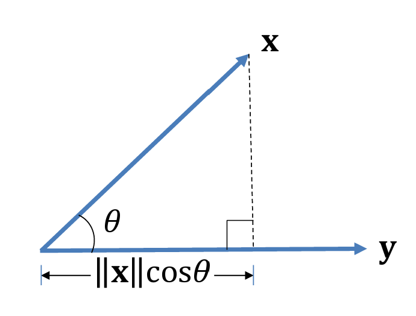
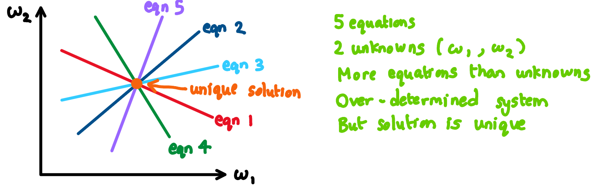
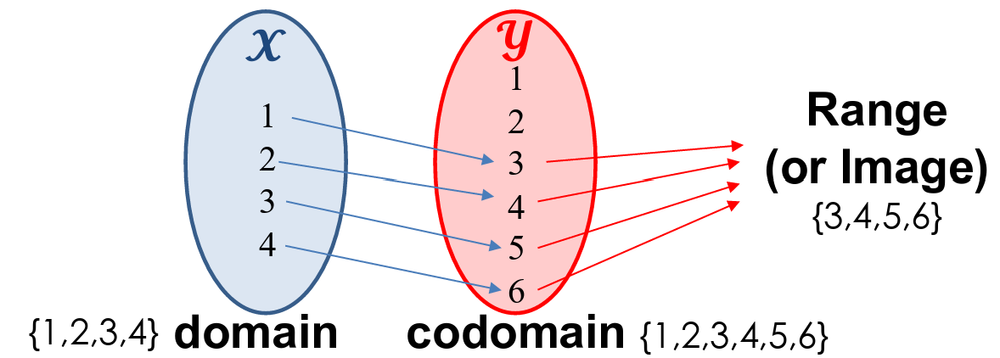
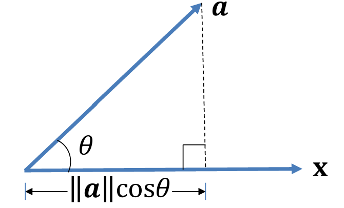

# Lec 04 - Systems of Linear Equations

From this lecture onward, we will dive into the more **mathematical side of machine learning**, starting with **Linear Algebra**. In this lecture, we will cover three main topics:

1. Operations on Vectors and Matrices
2. Systems of Linear Equations
3. Sets and Functions

Again, as an intro mod to ML, we are not required to grasp all the derivation behind, but it is highly recommended to do so!

## Operations on Vectors and Matrices

**Vectors and matrices** are two of the most fundamental building blocks of **Linear Algebra**. In this section, we will refresh the basic concepts and the relavant derivations associated with them.

### Operations on Vectors

There are several important operations on vectors that we should know to understand the topic of machine learning well. Most of them are covered in your high school mathematics course!

1. [#sum-of-two-vectors](lec-04-systems-of-linear-equations.md#sum-of-two-vectors "mention")
2. [#difference-of-two-vectors](lec-04-systems-of-linear-equations.md#difference-of-two-vectors "mention")
3. [#vector-multiplied-by-a-scalar](lec-04-systems-of-linear-equations.md#vector-multiplied-by-a-scalar "mention")
4. [#matrix-or-vector-transpose](lec-04-systems-of-linear-equations.md#matrix-or-vector-transpose "mention")
5. [#dot-product](lec-04-systems-of-linear-equations.md#dot-product "mention")
6. [#matrix-and-vector-multiplication](lec-04-systems-of-linear-equations.md#matrix-and-vector-multiplication "mention")

#### Sum of two vectors

The sum of two vectors $$\mathbf{x} + \mathbf{z}$$ is defined as the vector $$[x^{(1)} + z^{(1)}, x^{(2)} + z^{(2)}, \ldots, x^{(m)} + z^{(m)}]$$.&#x20;

#### Difference of two vectors

The difference of two vectors $$\mathbf{x} - \mathbf{z}$$ is defined as $$[x^{(1)} - z^{(1)}, x^{(2)} - z^{(2)}, \ldots, x^{(m)} - z^{(m)}]$$.

#### Vector multiplied by a scalar

A vector multiplied by a scalar is a vector. For example, $$\mathbf{x}c \stackrel{\text{def}}{=} [cx^{(1)}, cx^{(2)}, \ldots, cx^{(m)}]$$.

#### Matrix or Vector Transpose

The **transpose** of a vector or matrix is obtained by **swapping its rows and columns**. In other words, transpose simply turns **rows into columns** and **columns into rows**.

* For a vector:

$$
\mathbf{x}= \begin{bmatrix} x_1\\ x_2 \end{bmatrix} \quad\Longrightarrow\quad \mathbf{x}^T= \begin{bmatrix} x_1 & x_2 \end{bmatrix}
$$

* For a matrix:

$$
\mathbf{X}= \begin{bmatrix} x_{1,1} & x_{1,2} & x_{1,3}\\ x_{2,1} & x_{2,2} & x_{2,3}\\ x_{3,1} & x_{3,2} & x_{3,3} \end{bmatrix} \quad\Longrightarrow\quad \mathbf{X}^T= \begin{bmatrix} x_{1,1} & x_{2,1} & x_{3,1}\\ x_{1,2} & x_{2,2} & x_{3,2}\\ x_{1,3} & x_{2,3} & x_{3,3} \end{bmatrix}
$$

#### Dot Product

The **dot product**, also called the **inner product**, combines two vectors to produce a **scalar**. For two vectors:

$$
\mathbf{x}= \begin{bmatrix} x_1\\x_2 \end{bmatrix}, \quad \mathbf{y}= \begin{bmatrix} y_1\\y_2 \end{bmatrix}
$$


The two vectors must be of the same dimensionality. Otherwise, the dot-product is undefined.


the dot product is:

$$
\mathbf{x}\cdot\mathbf{y} =\mathbf{x}^T\mathbf{y} =x_1y_1+x_2y_2
$$

Geometrically,

$$
\mathbf{x}\cdot\mathbf{y} =\|\mathbf{x}\|\,\|\mathbf{y}\|\cos\theta
$$

where $$\theta$$ is the angle between the two vectors.

<figure><figcaption></figcaption></figure>

For example,

$$
\mathbf{a}= \begin{bmatrix} 2 \\3 \end{bmatrix}, \quad \mathbf{c}= \begin{bmatrix} 1\\0 \end{bmatrix}
$$

Their dot product is:

$$
\mathbf{a}\cdot\mathbf{c}=2(1)+3(0)=2
$$

#### Matrix and Vector multiplication

The multiplication of a matrix $$\mathbf{W}$$ by a vector $$\mathbf{x}$$ results in another vector. Let our matrix be,

$$
\mathbf{W} = \begin{bmatrix}
w^{(1,1)} & w^{(1,2)} & w^{(1,3)} \\
w^{(2,1)} & w^{(2,2)} & w^{(2,3)}
\end{bmatrix}
$$

When vectors participate in operations on matrices, a vector is by default represented as a matrix with **one column**. When the vector is on the right of the matrix, it remains a column vector. We can only multiply a matrix by vector if the vector has the same number of rows as the number of columns in the matrix. Let our vector be $$\mathbf{x} \stackrel{\text{def}}{=} [x^{(1)}, x^{(2)}, x^{(3)}]$$. Then $$\mathbf{W}\mathbf{x}$$ is a two-dimensional vector defined as,

$$
\begin{align*}
\mathbf{W}\mathbf{x} &= \begin{bmatrix}
w^{(1,1)} & w^{(1,2)} & w^{(1,3)} \\
w^{(2,1)} & w^{(2,2)} & w^{(2,3)}
\end{bmatrix}
\begin{bmatrix}
x^{(1)} \\
x^{(2)} \\
x^{(3)}
\end{bmatrix} \\[6pt]
&\overset{\text{def}}{=}
\begin{bmatrix}
w^{(1,1)}x^{(1)} + w^{(1,2)}x^{(2)} + w^{(1,3)}x^{(3)} \\
w^{(2,1)}x^{(1)} + w^{(2,2)}x^{(2)} + w^{(2,3)}x^{(3)}
\end{bmatrix} \\[6pt]
&= \begin{bmatrix}
\mathbf{w}^{(1)}\mathbf{x} \\
\mathbf{w}^{(2)}\mathbf{x}
\end{bmatrix}
\end{align*}
$$


If our matrix had, say, five rows, the result of the product would be a five-dimensional vector.


When the vector is on the left side of the matrix in the multiplication, then it has to be **transposed** before we multiply it by the matrix. The transpose of the vector $$\mathbf{x}$$, denoted as $$\mathbf{x}^{\top}$$, makes a row vector out of a column vector. Let's say,

$$
\mathbf{x} = \begin{bmatrix} x^{(1)} \\ x^{(2)} \end{bmatrix}, \text{ then } \mathbf{x}^\top \overset{\text{def}}{=} \begin{bmatrix} x^{(1)} & x^{(2)} \end{bmatrix}.
$$

The multiplication of the vector $$\mathbf{x}$$ by the matrix $$\mathbf{W}$$ is given by $$\mathbf{x}^{\top}\mathbf{W}$$,

$$
\begin{align*}
\mathbf{x}^\top \mathbf{W} &= \begin{bmatrix} x^{(1)} & x^{(2)} \end{bmatrix}
\begin{bmatrix}
w^{(1,1)} & w^{(1,2)} & w^{(1,3)} \\
w^{(2,1)} & w^{(2,2)} & w^{(2,3)}
\end{bmatrix} \\[6pt]
&\overset{\text{def}}{=} \begin{bmatrix} w^{(1,1)}x^{(1)} + w^{(2,1)}x^{(2)}, \, w^{(1,2)}x^{(1)} + w^{(2,2)}x^{(2)}, \, w^{(1,3)}x^{(1)} + w^{(2,3)}x^{(2)} \end{bmatrix}
\end{align*}
$$

As you can see, we can only multiply a vector by a matrix if the vector has the **same number of dimensions** as the number of rows in the matrix.

### Operations on Matrix

In this part, we will cover:

1. [#matrix-matrix-product](lec-04-systems-of-linear-equations.md#matrix-matrix-product "mention")
2. [#matrix-inverse](lec-04-systems-of-linear-equations.md#matrix-inverse "mention")
3. [#matrix-inverse-computation](lec-04-systems-of-linear-equations.md#matrix-inverse-computation "mention")
4. [#adjugate-computation](lec-04-systems-of-linear-equations.md#adjugate-computation "mention")
5. [#determinant-computation](lec-04-systems-of-linear-equations.md#determinant-computation "mention")

#### Matrix-Matrix Product

Matrix multiplication extends the idea of the **dot product** to matrices. For $$\mathbf{X}\in\mathbb{R}^{m\times d},\mathbf{W}\in\mathbb{R}^{d\times h}$$, the product $$\mathbf{XW}$$ is an $$m\times h$$ matrix. Each element is obtained by taking the **dot product between a row of** $$\mathbf{X}$$ **and a column of** $$\mathbf{W}$$:

$$
(\mathbf{XW})_{j,k} = \sum_{i=1}^{d}x_{j,i}w_{i,k}
$$

For matrix multiplication to be valid, the **inner dimensions must match**:

$$
(m\times d)(d\times h)=m\times h
$$

#### Matrix Inverse

For a square matrix $$\mathbf{A}$$, if there exists another square matrix $$\mathbf{B}$$ which has the same dimension as $$\mathbf{A}$$ and satisfies that:

$$
\mathbf{A}\mathbf{B} = \mathbf{B}\mathbf{A} = \mathbf{I}
$$

where $$\mathbf{I}$$ is the **identity matrix**. We say matrix $$\mathbf{A}$$ is invertible and matrix $$\mathbf{B}$$ is the inverse of matrix $$\mathbf{A}$$.


A matrix has an inverse only if it is **invertible (nonsingular)**.


#### Matrix Inverse Computation

For an invertible square matrix $$\mathbf{A}$$, its inverse can be computed as:

$$
\mathbf{A}^{-1} = \frac{1}{\det(\mathbf{A})}\operatorname{adj}(\mathbf{A})
$$

where:

* $$\det(\mathbf{A})$$ is the **determinant** of $$\mathbf{A}$$.
* $$\operatorname{adj}(\mathbf{A})$$ is the **adjugate (adjoint)** of $$\mathbf{A}$$.


$$\mathbf{A}^{-1}$$ exists only when $$\det(\mathbf{A})\neq 0$$. This is because the denominator cannot be 0!


#### Adjugate Computation

For a square matrix $$\mathbf{A}$$, the **adjugate** and **determinant** are closely related and are useful for computing the matrix inverse.



#### Minor

The **minor** $$M_{ij}$$ of an element $$a_{ij}$$ is the determinant obtained by **deleting the** $$i$$**-th row and** $$j$$**-th column**. For example, for

$$
\mathbf A= \begin{bmatrix} a_{11}&a_{12}&a_{13}\\ a_{21}&a_{22}&a_{23}\\ a_{31}&a_{32}&a_{33} \end{bmatrix}
$$

the minor of $$a_{12}$$ is

$$
M_{12}= \begin{vmatrix} a_{21}&a_{23}\\ a_{31}&a_{33} \end{vmatrix} =a_{21}a_{33}-a_{23}a_{31}
$$



#### Cofactor

The **cofactor** is the minor multiplied by a sign factor:

$$
C_{ij}=(-1)^{i+j}M_{ij}
$$

The signs follow the pattern

$$
\begin{bmatrix} +&-&+\\ -&+&-\\ +&-&+ \end{bmatrix}
$$



#### Adjucate

The **adjugate** of $$\mathbf A$$ is the **transpose of its cofactor matrix**:

$$
\operatorname{adj}(\mathbf A)=\mathbf C^T
$$

For a $$3\times3$$ matrix, first calculate all nine cofactors, form the cofactor matrix $$\mathbf C$$, and then **transpose it** to obtain $$\operatorname{adj}(\mathbf A)$$.



#### Determinant Computation

The **determinant** of a square matrix can be calculated by expanding along any row or column:

$$
\det(\mathbf A) = \sum_j a_{ij}C_{ij} = \sum_j a_{ij}(-1)^{i+j}M_{ij}
$$

For a $$3\times3$$ matrix, expanding along the first row gives:

$$
\det(\mathbf A) = a_{11}M_{11}-a_{12}M_{12}+a_{13}M_{13}
$$

## Systems of Linear Equations

A **system of linear equations** consists of $$m$$ linear equations with $$d$$ unknowns $$w_1,\ldots,w_d$$.


The number of linear equations $$m$$ can be understood as the number of **samples** while the number of $$d$$ unknowns can be understood as the number of **features** in one sample!


These equations can be written compactly as:

$$
\mathbf{X}\mathbf{w}=\mathbf{y}
$$

where $$\mathbf{X}\in\mathbb{R}^{m\times d}, \mathbf{w}\in\mathbb{R}^{d}, \mathbf{y}\in\mathbb{R}^{m}$$. Careful readers may notice that solving the equation above is essentially a **compact mathematical representation of the** [**supervised learning process**](lec-01-introduction.md#how-supervised-learning-works) introduced earlier. Each element of the output vector $$\mathbf{y}$$ represents the **desired output for one input sample** in $$\mathbf{X}$$. The goal is to find the model parameters $$\mathbf{w}$$ such that each input sample is mapped to its corresponding desired output. Therefore, this equation captures one of the **fundamental ideas behind both machine learning and deep learning**.


Here, $$\mathbf{X}$$ and $$\mathbf{y}$$ are **given**, while $$\mathbf{w}$$ contains the **unknown parameters** we want to find.


By comparing the **number of equations** $$m$$ with the **number of unknowns** $$d$$, we can classify the system into three cases:


This means that, given a condition, we should **always write out the equations first** and then determine the **number of unknowns**. We should not simply look at the shape of matrix $$\mathbf{X}$$ and assume what type of system it represents.


| Type                 | Condition | Meaning                               |
| -------------------- | --------- | ------------------------------------- |
| **Even-determined**  | $$m=d$$   | Same number of equations and unknowns |
| **Over-determined**  | $$m>d$$   | More equations than unknowns          |
| **Under-determined** | $$m<d$$   | Fewer equations than unknowns         |

Once we determine the **type of system**, we can calculate $$\operatorname{rank}(\mathbf X)$$ and $$\operatorname{rank}([\mathbf X\mid\mathbf y])$$ to determine **which type of solution exists**. We then use the appropriate inverse — **left inverse, right inverse, or ordinary inverse —** to find the solution.

A tricky exception

Given $$\mathbf w^T\mathbf X=\mathbf y^T$$, where

\mathbf X= \begin{bmatrix} 1 &#x26; 2\\ 2 &#x26; 4 \\ 1 &#x26; -1\end{bmatrix}, \mathbf y= \begin{bmatrix} 0\\ 1 \end{bmatrix}

What kind of system is this: **even-determined, over-determined, or under-determined**?

***

**Sol.** This question is slightly tricky because it is written as $$\mathbf w^T\mathbf X=\mathbf y^T$$, instead of the standard form $$\mathbf X\mathbf w=\mathbf y$$. Thus, we first **transpose both sides**:

(\mathbf w^T\mathbf X)^T=(\mathbf y^T)^T

Using $$(\mathbf{AB})^T=\mathbf B^T\mathbf A^T$$, we get

\mathbf X^T\mathbf w=\mathbf y

Therefore, the **matrix of interest is** $$\mathbf X^T$$. Since $$\mathbf X$$ is $$3\times2$$, $$\mathbf X^T$$ is $$2\times3$$, meaning there are **2 equations and 3 unknowns**. Hence, this is an **under-determined system**.

In the following sections, we will examine these three cases individually and see how the **number of equations and unknowns affects the possible solutions**. Ultimately, our goal is to solve the system and determine the model parameters, or **weights**, $$\mathbf{w}$$.

### Even-Determined System

An **even-determined system** has the same number of **equations** and **unknowns**: $$m=d$$ Therefore, the data matrix $$\mathbf{X}$$ is a **square matrix**:

$$
\mathbf{X}\mathbf{w}=\mathbf{y}, \qquad \mathbf{X}\in\mathbb{R}^{d\times d}
$$

For an **even-determined system**, the solution can be classified into **three** cases based on the **rank of the augmented matrix** formed by $$[\mathbf{X}\mid\mathbf{y}]$$:

1. **Unique solution:** $$\operatorname{rank}(\mathbf{X})=\operatorname{rank}([\mathbf{X}\mid\mathbf{y}])=d$$
2. **No solution:** $$\operatorname{rank}(\mathbf{X})<\operatorname{rank}([\mathbf{X}\mid\mathbf{y}])$$
3. **Infinitely many solutions:** $$\operatorname{rank}(\mathbf{X})=\operatorname{rank}([\mathbf{X}\mid\mathbf{y}])<d$$

In an even-determined system, we usually care about the **first case**.


#### Augmented Matrix

The **augmented matrix** $$[\mathbf{X}\mid\mathbf{y}]$$ is simply formed by appending the output vector $$\mathbf{y}$$ as an additional column to the matrix $$\mathbf{X}$$. Therefore, $$\operatorname{rank}([\mathbf{X}\mid\mathbf{y}])\geq\operatorname{rank}(\mathbf{X})$$ always holds!


#### Unique Solution

When $$\operatorname{rank}(\mathbf{X})=\operatorname{rank}([\mathbf{X}\mid\mathbf{y}])=d$$, the matrix $$\mathbf{X}$$ has **full rank**. For an even-determined system, $$\mathbf{X}$$ is therefore **invertible**, and the system has **exactly one unique solution**:

$$
\hat{\mathbf{w}}=\mathbf{X}^{-1}\mathbf{y}
$$

where $$\hat{\mathbf{w}}$$ denotes the specific solution for $$\mathbf{w}$$.

#### No Solution

In this case, $$\operatorname{rank}(\mathbf{X})<\operatorname{rank}([\mathbf{X}\mid\mathbf{y}])$$, hence $$\mathbf{X}$$ is **not invertible**. The system is **inconsistent** and there is no solution. For example, two **parallel, non-overlapping lines**.

#### Infinitely Solution

In this case, $$\operatorname{rank}(\mathbf{X})=\operatorname{rank}([\mathbf{X}\mid\mathbf{y}])<d$$, which is the number of unknowns. The equations are **dependent**, giving infinitely many solutions. For example, two equations represent the **same overlapping line**.

### **Over-Determined System**

An **over-determined system** has more equations than unknowns: $$m>d$$&#x20;

$$
\mathbf{X}\mathbf{w}=\mathbf{y}, \mathbf{X}\in\mathbb{R}^{m\times d}
$$

For an **over-determined system**, we also have **three possible cases** based on the ranks of $$\mathbf X$$ and the augmented matrix $$[\mathbf X\mid\mathbf y]$$:

1. **Unique solution:** $$\operatorname{rank}(\mathbf{X})=\operatorname{rank}([\mathbf{X}\mid\mathbf{y}])=d$$
2. **No solution:** $$\operatorname{rank}(\mathbf{X})<\operatorname{rank}([\mathbf{X}\mid\mathbf{y}])$$
3. **Infinitely many solutions:** $$\operatorname{rank}(\mathbf{X})=\operatorname{rank}([\mathbf{X}\mid\mathbf{y}])<d$$

In an **over-dertermined system**, we usually focus on the **second case**, where we usually use the **left inverse** to find the approximate solution.

#### Unique Solution

In an over-determined system, unique solution is possible and one eample is shown below:

<figure><figcaption></figcaption></figure>

#### No Solution

In this case, even though there is **no exact solution**, we can still find an **approximate solution** $$\hat{\mathbf w}$$ that makes $$\mathbf X\mathbf w$$ as close as possible to $$\mathbf y$$. This can be done using the **left inverse** of $$\mathbf X$$, denoted by $$X^\dagger$$. If $$\mathbf X^\mathrm{T}\mathbf X$$ is invertible, then

$$
\mathbf X^\dagger=(\mathbf X^\mathrm{T}\mathbf X)^{-1}\mathbf X^\mathrm{T}
$$


If $$\mathbf X^T\mathbf X$$ is **not invertible**, then it means there are many "best approximate" solutions, rather than just one unique one!


and the approximate solution is

$$
\hat{\mathbf w}=\mathbf X^\dagger\mathbf y
$$

which gives the **least-squares solution**.


#### Full Circle Moment Here

In the supervised learning example we introduced [earlier](lec-01-introduction.md#how-supervised-learning-works), we learned that the **regression line is obtained using least squares**. This is because real-world machine learning problems are usually **over-determined systems**, where there are more equations than unknowns. Therefore, an exact solution may not exist, so we find an **approximate solution** for the weights that **minimizes the total squared distance between the predicted values and the sample points**.


#### Infinite Solutions

In this case, $$\operatorname{rank}(\mathbf{X})=\operatorname{rank}([\mathbf{X}\mid\mathbf{y}])<d$$. There are **infinite number of solutions** in the system. For example, two overlapped lines.

### Under-Determined System

An **under-determined system** has fewer equations than unknowns: $$m<d$$:

$$
\mathbf X\mathbf w=\mathbf y, \mathbf X\in\mathbb{R}^{m\times d}
$$

Similarly, there are **three possible cases** based on the ranks of $$\mathbf X$$ and the augmented matrix $$[\mathbf X\mid\mathbf y]$$:

1. **Unique solution:** $$\operatorname{rank}(\mathbf X)=\operatorname{rank}([\mathbf X\mid\mathbf y])=d$$.
2. **No solution:** $$\operatorname{rank}(\mathbf X)<\operatorname{rank}([\mathbf X\mid\mathbf y])$$
3. **Infinitely many solutions:** $$\operatorname{rank}(\mathbf X)=\operatorname{rank}([\mathbf X\mid\mathbf y])<d$$

Here, usually we care more about the third case!

#### Unique Solution


This case is impossible because $$m<d$$.


#### No Solution

In this case, $$\operatorname{rank}(\mathbf X)<\operatorname{rank}([\mathbf X\mid\mathbf y])$$, so **neither a left inverse nor a right inverse exists**. For example, in 3D, the equations may represent **two parallel planes that never intersect**, resulting in **no solution**.

#### Infinite Solutions

In this case, $$\operatorname{rank}(\mathbf X)=\operatorname{rank}([\mathbf X\mid\mathbf y])<d$$. Thus, the system has **infinitely many solutions**. Since the system is under-determined, we can use the **right inverse** $$\mathbf X^\dagger$$ to obtain one **particular (constrained) solution**. The right inverse satisfies

$$
\mathbf X\mathbf X^\dagger=\mathbf I_m
$$

If the right inverse exists, the constrained solution is

$$
\mathbf w=\mathbf X^\dagger\mathbf y
$$

where

$$
\mathbf X^\dagger=\mathbf X^T(\mathbf X\mathbf X^T)^{-1}
$$

This gives **one constrained solution** among the infinitely many possible solutions.


The reason we use the **left inverse** for an over-determined system but the **right inverse** for an under-determined system is that we want to invert the **smaller square matrix**:

* **Over-determined (**$$m>d$$**):** use the left inverse because $$\mathbf X^T\mathbf X$$ is $$d\times d$$, which is smaller than $$\mathbf X\mathbf X^T$$ ($$m\times m$$).
* **Under-determined (**$$m<d$$**):** use the right inverse because $$\mathbf X\mathbf X^T$$ is $$m\times m$$, which is smaller than $$\mathbf X^T\mathbf X$$ ($$d\times d$$).


## Sets and Functions

In this part, we will mainly introduce sets and functions.

### Sets

A **set** is an unordered collection of unique elements. We denote a set as a calligraphic capital character, for example, $$\mathcal{S}$$.

* A set of numbers can be **finite** (include a fixed amount of values). In this case, it is denoted using accolades, for example, $$\{1,3,18,23,235\}$$ or $$\{x_1,x_2,x_3,x_4,\ldots,x_n\}$$.
* A set can be **infinite** and include all values in some interval. If a set includes all values between $$a$$ and $$b$$, including $$a$$ and $$b$$, it is denoted using brackets as $$[a,b]$$. If the set doesn't include the values $$a$$ and $$b$$, such a set is denoted using parentheses like this: $$(a,b)$$. For example, the set $$[0,1]$$ includes such values as 0, 0.0001, 0.25, 0.784, 0.9995, and 1.0.

When an element $$x$$ belongs to a set $$\mathcal{S}$$, we write $$x \in \mathcal{S}$$.


A special set denoted $$\mathbb{R}$$ includes all numbers from minus infinity to plus infinity.


#### Intersection

We can obtain a new set $$\mathcal{S}_3$$ as an **intersection** of two sets $$\mathcal{S}_1$$ and $$\mathcal{S}_2$$. In this case, we write $$\mathcal{S}_3 \leftarrow \mathcal{S}_1 \cap \mathcal{S}_2$$. For example, $$\{1,3,5,8\} \cap \{1,8,4\}$$ gives the new set $$\{1,8\}$$.

#### Union

We can obtain a new set $$\mathcal{S}_3$$ as a **union** of two sets $$\mathcal{S}_1$$ and $$\mathcal{S}_2$$. In this case, we write $$\mathcal{S}_3 \leftarrow \mathcal{S}_1 \cup \mathcal{S}_2$$. For example, $$\{1,3,5,8\} \cup \{1,8,4\}$$ gives the new set $$\{1,3,4,5,8\}$$.

#### Operations on Sets

A derived set creation operator looks like this: $$\mathcal{S}' \leftarrow \{x^2 \mid x \in \mathcal{S}, x > 3\}$$. This notation means that we create a new set $$\mathcal{S}'$$ by putting into it $$x$$ squared such that $$x$$ is in $$\mathcal{S}$$, and $$x$$ is greater than 3.


The cardinality operator $$|\mathcal{S}|$$ returns the number of elements in set $$\mathcal{S}$$.


### Functions

A **function** is a rule that maps **each input** $$x$$ from a **domain** $$\mathcal X$$ to **exactly one output** $$y$$ in a **codomain** $$\mathcal Y$$:

$$
y=f(x)
$$

* **Domain:** the set of possible inputs.
* **Codomain:** the set in which the outputs are defined.
* **Range (Image):** the set of outputs that are actually produced.
* $$x$$ is the **input/argument**, while $$y$$ is the **output/value**.


Notice that the **range can be smaller than the codomain**.


<figure><figcaption></figcaption></figure>


Also, the function's **variables** are the quantities it depends on. For example, $$f(x)$$ depends on $$x$$, while $$f(x,\mathbf w)$$ depends on both $$x$$ and $$\mathbf w$$.


#### Scalar and Vector Functions

A function can take either a **scalar or vector as its input** and return either a **scalar or vector as its output**.



#### Scalar Function

A **scalar function** returns a scalar: $$y=f(\mathbf{x})$$. For example,

$$
f(\mathbf{x})=x_1+x_2+2x_3
$$



#### Vector Function

A **vector function** returns a vector: $$\mathbf{y}=f(\mathbf{x})$$. For example,

$$
\begin{bmatrix} y_1\\ y_2 \end{bmatrix} = \begin{bmatrix} -x_1\\ x_2 \end{bmatrix}
$$



#### **Function Mapping Notation**

The notation

$$
f:\mathbb{R}^d\rightarrow\mathbb{R}
$$

means that the function $$f$$ takes a $$d$$**-dimensional real vector** as input and returns a **single real number** as output. In other words,

$$
\mathbf{x}\in\mathbb{R}^d \Longrightarrow f(\mathbf{x})\in\mathbb{R}
$$

where $$\mathbf{x}= \begin{bmatrix} x_1&x_2&\cdots&x_d \end{bmatrix}^T$$. For example, $$f:\mathbb{R}^4\rightarrow\mathbb{R},f(\mathbf{x})=x_1+x_2-x_4^2$$ takes a **4-dimensional vector** as input and produces **one scalar** as output.

#### Inner Product Function

Suppose $$\mathbf a$$ is a fixed $$d$$-dimensional vector. We can define a **scalar-valued function**:

$$
f(\mathbf x)=\mathbf a^T\mathbf x =a_1x_1+a_2x_2+\cdots+a_dx_d
$$

This function takes a vector $$\mathbf x$$ as input and returns a **single scalar**. The inner product can also be viewed as a **weighted sum** of the elements of $$\mathbf x$$, where the elements of $$\mathbf a$$ act as the **weights**. Geometrically,

$$
f(\mathbf x)=\|\mathbf a\|\,\|\mathbf x\|\cos\theta
$$

where $$\theta$$ is the angle between $$\mathbf a$$ and $$\mathbf x$$.

<figure><figcaption></figcaption></figure>

#### Linear Functions

A function $$f:\mathbb{R}^d\rightarrow\mathbb{R}$$ is **linear** if it satisfies two properties:

1. Homogeneity
2. Additivity



#### Homogeneity

Scaling the input by $$\alpha$$ scales the output by the same factor.

$$
f(\alpha\mathbf{x})=\alpha f(\mathbf{x})
$$



#### Additivity

Adding the inputs is equivalent to adding their outputs.

$$
f(\mathbf{x}+\mathbf{y})=f(\mathbf{x})+f(\mathbf{y})
$$



Together, these properties give the **superposition property**:

$$
f(\alpha\mathbf{x}+\beta\mathbf{y}) = \alpha f(\mathbf{x})+\beta f(\mathbf{y})
$$

More generally,

$$
f\left(\sum_{i=1}^{k}\alpha_i\mathbf{x}_i\right) = \sum_{i=1}^{k}\alpha_i f(\mathbf{x}_i)
$$

#### **Affine Functions**

An **affine function** is a **linear function plus a constant offset**:

$$
f(\mathbf{x})=\mathbf{a}^T\mathbf{x}+b
$$

where:

* $$\mathbf{a}$$ is a $$d$$-dimensional vector of **coefficients/weights**.
* $$b$$ is a scalar **offset (or bias)**.

The key difference is that a linear function has **no constant term**, while an affine function can have one. For example,

$$
f(\mathbf{x})=2.3-2x_1+1.3x_2-x_3
$$

is affine, with $$b=2.3\text{, }\mathbf{a}^T=[-2,\ 1.3,\ -1]$$


An affine function is **not a linear** function!

