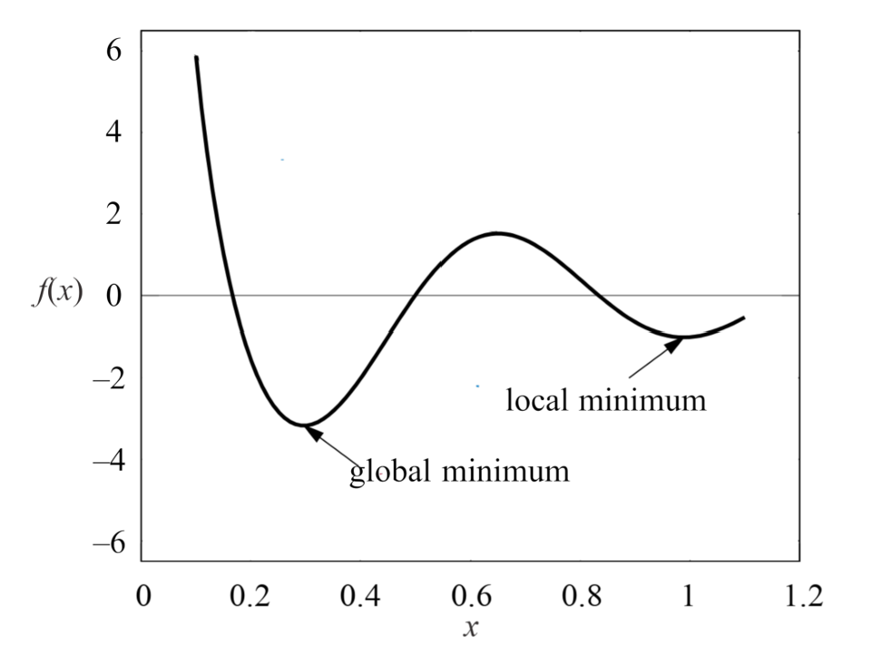
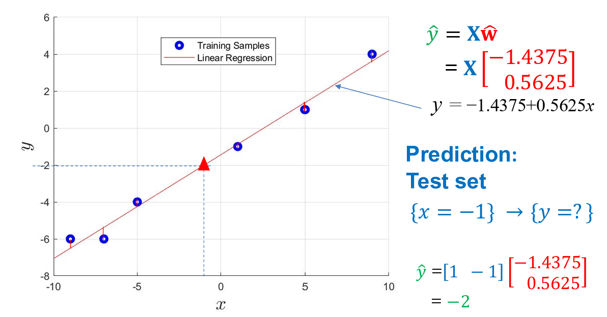

# Lec 05 - Linear Regression

In this lecture, we will learn how to perform **linear regression** on a given dataset and connect it to the [**systems of linear equations**](lec-04-systems-of-linear-equations.md) introduced in the previous lecture.

## Derivative and Gradient

### Functions

A **function** is a relation that associates each element $$x$$ of a set $$\mathcal{X}$$, the **domain** of the function, to a single element $$y$$ of another set $$\mathcal{Y}$$, the **codomain** of the function. A function usually has a name. If the function is called $$f$$, this relation is denoted $$y = f(x)$$ (read $$f$$ of $$x$$), the element $$x$$ is the argument or input of the function, and $$y$$ is the value of the function or the output. The symbol that is used for representing the input is the variable of the function (we often say that $$f$$ is a function of the variable $$x$$).

We say that $$f(x)$$ has a **local minimum** at $$x = c$$ if $$f(x) \ge f(c)$$ for every $$x$$ in some open interval around $$x = c$$. An **interval** is a set of real numbers with the property that any number that lies between two numbers in the set is also included in the set. An **open interval** does not include its endpoints and is denoted using parentheses. For example, $$(0,1)$$ means "all numbers greater than 0 and less than 1". The minimal value among all the local minima is called the **global minimum**. See illustration in Figure 2.2.

<figure><figcaption>
Figure 2.2: A local and a global minima of a function
</figcaption></figure>


#### Scalar Function vs. Vector Function

The function introduced above is a **scalar function**: it may take either a scalar or a vector as input, but its output is always a scalar. In contrast, a **vector function**, written as $$\mathbf{y}=f(\mathbf{x})$$, returns a **vector** $$\mathbf{y}$$. Its input can also be either a scalar or a vector.


#### Max and Arg Max

Given a set of values $$\mathcal{A} = {a_1,a_2,\ldots,a_n}$$,

* **Max**: the operator $$\max_{a \in \mathcal{A}} f(a)$$ returns the highest value $$f(a)$$ for all elements in the set $$\mathcal{A}$$.
* **Arg Max**: On the other hand, the operator $$\arg\max_{a \in \mathcal{A}} f(a)$$ returns the element of the set $$\mathcal{A}$$ that maximizes $$f(a)$$.

Sometimes, when the set is implicit or infinite, we can write $$\max_a f(a)$$ or $$\arg\max_a f(a)$$.


Operators $$\min$$ and $$\arg\min$$ operate in a similar manner.


#### Assignment Operator

The expression $$a \leftarrow f(x)$$ means that the variable $$a$$ gets the new value: the result of $$f(x)$$. We say that the variable $$a$$ gets assigned a new value. Similarly, $$\mathbf{a} \leftarrow [a_1,a_2]$$ means that the vector variable $$\mathbf{a}$$ gets the two-dimensional vector value $$[a_1,a_2]$$.

### Derivative

A **derivative** $$f'$$ of a function $$f$$ is a **function** or a **value** that describes how **fast** $$f$$ grows (or decreases).

* If the derivative is a constant **value**, like 5 or −3, then the function grows (or decreases) constantly at any point $$x$$ of its domain.
* If the derivative $$f'$$ is a **function**, then the function $$f$$ can grow at a different pace in different regions of its domain.
* If the derivative $$f'$$ is **positive at some point** $$x$$, then the function $$f$$ grows at this point.
* If the derivative of $$f$$ is **negative at some** $$x$$, then the function decreases at this point.


The derivative of zero at $$x$$ means that the function's slope at $$x$$ is horizontal.


The process of finding a derivative is called **differentiation**. The method to differentiate basic functions and complex functions are different:



#### Basic Functions

Derivatives for basic functions are known.

For example, if $$f(x) = x^2$$, then $$f'(x) = 2x$$; if $$f(x) = 2x$$, then $$f'(x) = 2$$; if $$f(x) = 2$$, then $$f'(x) = 0$$ (the derivative of any function $$f(x) = c$$, where $$c$$ is a constant value, is zero).&#x20;



#### Non-Basic Functions

If the function we want to differentiate is not basic, we can find its derivative using the **chain rule**.

> For instance, if $$F(x) = f(g(x))$$, where $$f$$ and $$g$$ are some functions, then $$F'(x) = f'(g(x))g'(x)$$.

For example, if $$F(x) = (5x + 1)^2$$, then $$g(x) = 5x + 1$$ and $$f(g(x)) = (g(x))^2$$. By applying the chain rule, we find $$F'(x) = 2(5x+1)g'(x) = 2(5x+1)5 = 50x+10$$.



### Gradient

**Gradient** is the generalization of derivative for functions that take **several inputs** (or one input in the form of a vector or some other complex structure). A gradient of a function is a **vector** of **partial derivatives**.

> We can look at finding a **partial derivative** of a function as the process of finding the derivative by focusing on one of the function's inputs and by considering all other inputs as constant values.

For example, if our function is defined as $$f([x^{(1)},x^{(2)}]) = ax^{(1)} + bx^{(2)} + c$$, then the partial derivative of function $$f$$ with respect to $$x^{(1)}$$, denoted as $$\frac{\partial f}{\partial x^{(1)}}$$, is given by,

$$
\frac{\partial f}{\partial x^{(1)}} = a + 0 + 0 = a
$$

where $$a$$ is the derivative of the function $$ax^{(1)}$$; the two zeroes are respectively derivatives of $$bx^{(2)}$$ and $$c$$, because $$x^{(2)}$$ is considered constant when we compute the derivative with respect to $$x^{(1)}$$, and the derivative of any constant is zero. Similarly, the partial derivative of function $$f$$ with respect to $$x^{(2)}$$, $$\frac{\partial f}{\partial x^{(2)}}$$, is given by,

$$
\frac{\partial f}{\partial x^{(2)}} = 0 + b + 0 = b
$$

The gradient of function $$f$$, denoted as $$\nabla f$$, is given by the vector $$\left[\frac{\partial f}{\partial x^{(1)}}, \frac{\partial f}{\partial x^{(2)}}\right]$$.


The chain rule works with partial derivatives too, as we will illustrate in the later chapters.


Now, we will look at two cases of differentiating a function with respect to a **vector input** $$\mathbf{x}$$:



#### Scalar Function with a vector input

Suppose $$f(\mathbf{x})$$ is a scalar function and

$$
\mathbf{x} = \begin{bmatrix} x_1\\ \vdots\\ x_d \end{bmatrix} \in \mathbb{R}^{d}
$$

Differentiating $$f(\mathbf{x})$$ with respect to $$\mathbf{x}$$ gives a $$d\times1$$ vector:

$$
\frac{df(\mathbf{x})}{d\mathbf{x}} = \begin{bmatrix} \dfrac{\partial f}{\partial x_1}\\ \vdots\\ \dfrac{\partial f}{\partial x_d} \end{bmatrix}
$$

This vector is called the **gradient** of $$f(\mathbf{x})$$, denoted by $$\nabla_{\mathbf{x}}f$$. For example, if

$$
f(\mathbf{x})=ax_1+bx_2
$$

then

$$
\nabla_{\mathbf{x}}f = \begin{bmatrix} a\\ b \end{bmatrix}
$$



#### **Vector function with a vector input**

Suppose

$$
\mathbf{f}(\mathbf{x}) = \begin{bmatrix} f_1(\mathbf{x})\\ \vdots\\ f_h(\mathbf{x}) \end{bmatrix} \in\mathbb{R}^{h}
$$

and $$\mathbf{x}\in\mathbb{R}^{d}$$. Differentiating $$\mathbf{f}(\mathbf{x})$$ with respect to $$\mathbf{x}$$ gives an $$h\times d$$ matrix:

$$
\frac{d\mathbf{f}(\mathbf{x})}{d\mathbf{x}} = \begin{bmatrix} \dfrac{\partial f_1}{\partial x_1} & \cdots & \dfrac{\partial f_1}{\partial x_d}\\ \vdots & \ddots & \vdots\\ \dfrac{\partial f_h}{\partial x_1} & \cdots & \dfrac{\partial f_h}{\partial x_d} \end{bmatrix}
$$

This matrix is called the **Jacobian** of $$\mathbf{f}(\mathbf{x})$$.


A scalar function differentiated with respect to a vector gives a **gradient vector**, while a vector function differentiated with respect to a vector gives a **Jacobian matrix**.




#### Common Vector–Matrix Differentiation Formula

Let $$\mathbf{x}$$ be the variable vector, while $$\mathbf{A}$$, $$\mathbf{b}$$, and $$\mathbf{y}$$ are constant with respect to $$\mathbf{x}$$.



$$\displaystyle \frac{d(\mathbf{A}\mathbf{x})}{d\mathbf{x}}=\mathbf{A}$$

For a simple $$2\times2$$ example,

$$
\mathbf{A}= \begin{bmatrix} a_{11}&a_{12}\\ a_{21}&a_{22} \end{bmatrix},\mathbf{x}= \begin{bmatrix} x_1\\x_2 \end{bmatrix}
$$


We will use this settings throughout these 4 rules!


Then

$$
\mathbf{A}\mathbf{x} = \begin{bmatrix} a_{11}x_1+a_{12}x_2\\ a_{21}x_1+a_{22}x_2 \end{bmatrix}
$$

Taking the partial derivative of each output with respect to each input gives

$$
\frac{d(\mathbf{A}\mathbf{x})}{d\mathbf{x}} = \begin{bmatrix} a_{11}&a_{12}\\ a_{21}&a_{22} \end{bmatrix} =\mathbf{A}
$$


This is an example of a [vector function with a vector input](lec-05-linear-regression.md#vector-function-with-a-vector-input), and its derivative is a **Jacobian matrix**.




$$\frac{d(\mathbf{b}^T\mathbf{x})}{d\mathbf{x}}=\mathbf{b}$$

Suppose

$$
\mathbf{b}= \begin{bmatrix}b_1\\b_2\end{bmatrix}
$$

Then

$$
\mathbf{b}^T\mathbf{x}=b_1x_1+b_2x_2
$$

Therefore,

$$
\frac{d(\mathbf{b}^T\mathbf{x})}{d\mathbf{x}} = \begin{bmatrix} b_1\\b_2 \end{bmatrix} =\mathbf{b}.
$$

In other words, the gradient of a linear function is simply its **coefficient vector**.



$$\frac{d(\mathbf{y}^T\mathbf{A}\mathbf{x})}{d\mathbf{x}}=\mathbf{A}^T\mathbf{y}$$

We can rewrite

$$
\mathbf{y}^T\mathbf{A}\mathbf{x} = (\mathbf{A}^T\mathbf{y})^T\mathbf{x}
$$

Since $$\mathbf{A}^T\mathbf{y}$$ is constant with respect to $$\mathbf{x}$$, using the previous rule gives

$$
\frac{d(\mathbf{y}^T\mathbf{A}\mathbf{x})}{d\mathbf{x}} = \mathbf{A}^T\mathbf{y}
$$



$$\frac{d(\mathbf{x}^T\mathbf{A}\mathbf{x})}{d\mathbf{x}}=(\mathbf{A}+\mathbf{A}^T)\mathbf{x}$$

For the $$2\times2$$ case,

$$
\mathbf{x}^T\mathbf{A}\mathbf{x} = a_{11}x_1^2 +(a_{12}+a_{21})x_1x_2 +a_{22}x_2^2
$$

Taking the gradient gives

$$
\begin{bmatrix} 2a_{11}x_1+(a_{12}+a_{21})x_2\\ (a_{12}+a_{21})x_1+2a_{22}x_2 \end{bmatrix}
$$

which is exactly

$$
(\mathbf{A}+\mathbf{A}^T)\mathbf{x}
$$

If $$\mathbf{A}$$ is **symmetric**, $$\mathbf{A}=\mathbf{A}^T$$, so this simplifies to

$$
\frac{d(\mathbf{x}^T\mathbf{A}\mathbf{x})}{d\mathbf{x}} =2\mathbf{A}\mathbf{x}
$$



## Linear Regression

In this part, we will talk about two types of linear regression:

1. Linear Regression with Single Output
2. Linear Regression with Multiple Outputs


In NUS EE2211, when discussing linear regression, we generally use the matrix form $$\mathbf{X}\mathbf{w}=\mathbf{y}$$ for a single-output problem, or $$\mathbf{X}\mathbf{W}=\mathbf{Y}$$ for multiple outputs.


An Intuitive Property of Linear Regression

There are two main factors that can make the regression line **move closer to a particular sample**:

1. **A larger feature value**: the sample has a greater influence on the fitted model.
2. **More identical samples**: repeated samples give that data point greater weight in the overall dataset.


To understand the second point intuitively, imagine the identical points to be many points clustered around the same location. Since the regression line tries to fit **all the data points**, this cluster has a greater influence on the fitted line, pulling it closer to that region.


### Linear Regression with Single Output

**Linear regression** is a supervised learning method used to predict a **continuous numerical value**. Given a feature vector $$\mathbf{x}$$, we build a model that predicts the corresponding target $$y$$ as a linear combination of its features. For a single example,

$$
f_{\mathbf{w},b}(\mathbf{x}) = \mathbf{x}^T\mathbf{w}+b
$$

where:

* $$\mathbf{x}\in\mathbb{R}^{d}$$ is the **feature vector** containing $$d$$ features;
* $$\mathbf{w}\in\mathbb{R}^{d}$$ contains the **weights** of the features;
* $$b\in\mathbb{R}$$ is the **bias/intercept**;
* $$f_{\mathbf{w},b}(\mathbf{x})$$ is the model's predicted value.

The **weights** determine how **strongly** each feature affects the prediction, while the **bias** allows the fitted line, plane, or hyperplane to **shift** away from the origin.

#### **Training Dataset**

Suppose we have $$m$$ labeled training examples $$\{(\mathbf{x}_i,y_i)\}_{i=1}^{m}$$, where $$\mathbf{x}_i\in\mathbb{R}^{d}, y_i\in\mathbb{R}$$. Each $$\mathbf{x}_i$$ contains the **features** of one training example, while $$y_i$$ is its known target value. The goal of **training** is to use these known examples to find suitable values of $$\mathbf{w}$$ and $$b$$.


If the target $$y$$ is **continuous**, it is a regression problem. If the target represents **discrete classes**, it is a classification problem.


#### **Incorporating the Bias into the Weight Vector**


In NUS EE2211, we generally **include the bias term by adding a constant feature of** $$1$$ **at the beginning of each input vector**, unless the question explicitly states that the bias does not need to be considered.


To simplify the notation, we can include the bias $$b$$ directly inside the weight vector by adding a constant feature $$1$$:

$$
\mathbf{x}_i = \begin{bmatrix} 1\\ x_{i,1}\\ \vdots\\ x_{i,d} \end{bmatrix}, \mathbf{w} = \begin{bmatrix} b\\ w_1\\ \vdots\\ w_d \end{bmatrix}
$$


#### Reasons for setting initial bias to 1

In standard machine learning, we usually represent the bias term using a **constant feature of** $$1$$. This allows the bias parameter to retain its original meaning as the **constant offset** of the model. Using a value other than $$1$$ would simply scale the parameter representing the bias.


The model can then be written simply as

$$
f_{\mathbf w}(\mathbf{x}_i)=\mathbf{x}_i^T\mathbf w
$$

So from this point onward, we do not need to write $$+b$$ separately.


If we **do not include the bias term**, the fitted line, plane, or hyperplane is forced to pass through the **origin**. This restriction can significantly reduce the model's ability to fit the data and may lead to poorer predictions.


#### **Measuring the Prediction Error**

For each training example, the model makes the prediction

$$
\hat y_i=f_{\mathbf w}(\mathbf{x}_i)
$$

We need some way to measure how far this prediction is from the actual target $$y_i$$. In linear regression, we commonly use the **squared error loss**:

$$
\left(f_{\mathbf w}(\mathbf{x}_i)-y_i\right)^2
$$

A perfect prediction gives a loss of $$0$$, while a larger prediction error produces a larger loss. To evaluate the model over the **entire training set**, we sum the losses:

$$
J(\mathbf w) = \sum_{i=1}^{m} \left(f_{\mathbf w}(\mathbf{x}_i)-y_i\right)^2
$$

This is our **cost/objective function**, called SSE (Sum Squared Errors). Sometimes it is written with a factor $$\frac{1}{m}$$ to give the average loss (called MSE — Mean Squared Errors). This constant does not change which $$\mathbf w$$ minimizes the function, so it can be omitted when solving for the optimum.

#### **Writing All Training Examples as a Linear System**

Instead of handling each example separately, **stack all** $$m$$ training examples into a matrix:

$$
\mathbf X = \begin{bmatrix} \mathbf{x}_1^T\\ \mathbf{x}_2^T\\ \vdots\\ \mathbf{x}_m^T \end{bmatrix}, \mathbf y = \begin{bmatrix} y_1\\ y_2\\ \vdots\\ y_m \end{bmatrix}
$$

The predictions for **all training examples at once** are therefore

$$
\hat{\mathbf y}=\mathbf X\mathbf w
$$

Hence the error vector is

$$
\mathbf e = \hat{\mathbf y}-\mathbf y = \mathbf X\mathbf w-\mathbf y
$$


Below is the key connection to the **systems of linear equations** from the previous lecture.


If $$\mathbf X\mathbf w=\mathbf y$$, then every training example is fitted perfectly. In general, however, an exact solution may not exist, so linear regression looks for the $$\mathbf w$$ that makes $$\mathbf X\mathbf w$$ **as close as possible** to $$\mathbf y$$.


If our system of equations is **under-determined or exactly determined**, we may be able to find an exact solution. For an under-determined system with infinitely many solutions, we choose the solution **closest to the origin** (the minimum-norm or constrained solution). But usually, in real life, we will deal with over-determined systems.


#### **Least-Squares Regression**

Because the cost is the sum of squared errors,

$$
J(\mathbf w) = \sum_{i=1}^{m} \left(f_{\mathbf w}(\mathbf{x}_i)-y_i\right)^2
$$

we can write it compactly as

$$
J(\mathbf w) = (\mathbf X\mathbf w-\mathbf y)^T (\mathbf X\mathbf w-\mathbf y)
$$

This is why the method is called **least-squares regression**: we want to find

$$
\hat{\mathbf w} = \arg\min_{\mathbf w}J(\mathbf w)
$$

Expanding the cost function,

$$
\begin{aligned} J(\mathbf w) &=(\mathbf X\mathbf w-\mathbf y)^T (\mathbf X\mathbf w-\mathbf y)\\ &=\mathbf w^T\mathbf X^T\mathbf X\mathbf w -2\mathbf y^T\mathbf X\mathbf w +\mathbf y^T\mathbf y \end{aligned}
$$

#### **Finding the Optimal Weights**

To minimize $$J(\mathbf w)$$, differentiate it with respect to $$\mathbf w$$ and set the gradient equal to zero:

$$
\nabla_{\mathbf w}J(\mathbf w)=0
$$

Using the vector differentiation rules introduced earlier,

$$
2\mathbf X^T\mathbf X\mathbf w - 2\mathbf X^T\mathbf y =0
$$

Therefore,

$$
\mathbf X^T\mathbf X\mathbf w = \mathbf X^T\mathbf y
$$

This is called the **normal equation**.


Notice the connection to our previous lecture: training linear regression has now been converted back into solving a **system of linear equations**!


If $$\mathbf X^T\mathbf X$$ is invertible, the optimal weights are

$$
\hat{\mathbf w} = (\mathbf X^T\mathbf X)^{-1}\mathbf X^T\mathbf y
$$

which is exactly the **left-inverse / least-squares solution** we encountered for over-determined systems.


Note that if the **left inverse does not exist**, the solution above cannot be used directly. In the next lecture, we will see how **ridge regression** can be used to handle this situation.


#### **Training vs. Prediction**

There are therefore two distinct stages:

* **Training:** use the known training data $$\mathbf X$$ and $$\mathbf y$$ to learn

$$
\hat{\mathbf w} = (\mathbf X^T\mathbf X)^{-1}\mathbf X^T\mathbf y
$$

* **Prediction:** once $$\hat{\mathbf w}$$ has been learned, use it to predict the target of unseen data:

$$
\hat{\mathbf y}_{\text{new}} = \mathbf X_{\text{new}}\hat{\mathbf w}
$$


#### Observed Range

Since our model is trained using data within the **observed range**, we should be cautious when using it to predict values outside this range, as we do not know whether the underlying relationship remains linear beyond the observed data. In NUS EE2211, we just take the convention that we can never predict the value outside the observed range.


#### Examples of Linear Regression

The following examples illustrate the complete linear regression process: construct $$\mathbf X$$ and $$\mathbf y$$ from the training data, find the least-squares solution $$\hat{\mathbf w}$$, and use the learned model to predict unseen data. Consider the training set

$$
\{(-9,-6),(-7,-6),(-5,-4),(1,-1),(5,1),(9,4)\}
$$

Since the model includes a bias term, we add a constant feature $$1$$ to every example:

$$
\mathbf X= \begin{bmatrix} 1&-9\\ 1&-7\\ 1&-5\\ 1&1\\ 1&5\\ 1&9 \end{bmatrix}, \mathbf w= \begin{bmatrix} w_0\\w_1 \end{bmatrix}, \mathbf y= \begin{bmatrix} -6\\-6\\-4\\-1\\1\\4 \end{bmatrix}
$$


In NUS EE2211, we should remember that

* **Prediction/regression**: Include the bias column by default.
* **Given systems of linear equations** (In [Lec 04](lec-04-systems-of-linear-equations.md)): Follow the equations exactly; don't introduce an additional bias column.


This is an over-determined system and by using the method we've introduced in the last lecture, there is **no exact solution** to $$\mathbf X\mathbf w=\mathbf y$$, meaning that no single straight line passes through all the training points. Therefore, we find the least-squares solution:

$$
\hat{\mathbf w} = (\mathbf X^T\mathbf X)^{-1}\mathbf X^T\mathbf y = \begin{bmatrix} -1.4375\\ 0.5625 \end{bmatrix}
$$

Hence, the learned regression model is

$$
\hat y=-1.4375+0.5625x
$$

For a new example $$x=-1$$,

$$
\hat y = \begin{bmatrix}1&-1\end{bmatrix} \begin{bmatrix} -1.4375\\0.5625 \end{bmatrix} =-2
$$

So the model predicts $$\hat y=-2$$.

<figure><figcaption></figcaption></figure>

### Linear Regression with Multiple Outputs

So far, each input example $$\mathbf{x}_i$$ has been mapped to a **single scalar output** $$y_i$$. Linear regression can also predict **multiple outputs simultaneously**. For example,

$$
\mathbf{x}_i \longrightarrow \begin{bmatrix} y_{i,1}\\ y_{i,2}\\ \vdots\\ y_{i,h} \end{bmatrix}
$$

The main idea remains the same:

$$
\text{Single output: weight vector }\mathbf w \longrightarrow \text{Multiple outputs: weight matrix }\mathbf W
$$

#### From a Scalar Function to a Vector Function

For single-output regression, one sample is modeled by

$$
f_{\mathbf w}(\mathbf{x}) = \mathbf{x}^T\mathbf w
$$

which returns a **scalar**. If we want $$h$$ outputs, we instead use

$$
\mathbf f_{\mathbf W}(\mathbf{x}) = \mathbf{x}^T\mathbf W
$$

where

$$
\mathbf W = \begin{bmatrix} |&|&&|\\ \mathbf w_1&\mathbf w_2&\cdots&\mathbf w_h\\ |&|&&| \end{bmatrix}
$$

Each column $$\mathbf w_k$$ contains the weights used to predict the $$k$$-th output. Therefore,

$$
\mathbf{x}^T\mathbf W = \begin{bmatrix} \mathbf{x}^T\mathbf w_1& \mathbf{x}^T\mathbf w_2& \cdots& \mathbf{x}^T\mathbf w_h \end{bmatrix}
$$

So we are essentially learning **one linear regression model for each output**, while writing all of them compactly in one matrix.

#### Matrix Form for the Training Set

For $$m$$ training samples, stack the feature vectors as before:

$$
\mathbf X = \begin{bmatrix} \mathbf{x}_1^T\\ \mathbf{x}_2^T\\ \vdots\\ \mathbf{x}_m^T \end{bmatrix}
$$

Because every sample now has $$h$$ target values, the target is no longer a vector. It becomes a matrix:

$$
\mathbf Y = \begin{bmatrix} y_{1,1}&\cdots&y_{1,h}\\ \vdots&\ddots&\vdots\\ y_{m,1}&\cdots&y_{m,h} \end{bmatrix}
$$

Including the bias term in $$\mathbf X$$, the dimensions are

$$
\mathbf X\in\mathbb R^{m\times(d+1)}, \mathbf W\in\mathbb R^{(d+1)\times h}, \mathbf Y\in\mathbb R^{m\times h}
$$

Thus, predictions for the entire training set are

$$
\hat{\mathbf Y}=\mathbf X\mathbf W
$$


Notice that **rows correspond to samples**, while **columns correspond to outputs**.


#### Error and Cost Function

The error matrix is

$$
\mathbf E = \hat{\mathbf Y}-\mathbf Y = \mathbf X\mathbf W-\mathbf Y
$$

Each column $$\mathbf e_k$$ of $$\mathbf E$$ contains the errors associated with output $$k$$:

$$
\mathbf E= \begin{bmatrix} \mathbf e_1&\mathbf e_2&\cdots&\mathbf e_h \end{bmatrix}
$$

We want to minimize the squared errors over **all samples and all outputs**. The cost function can be written compactly as

$$
J(\mathbf W) = \operatorname{trace}(\mathbf E^T\mathbf E)
$$

or equivalently,

$$
J(\mathbf W) = \operatorname{trace} \left[ (\mathbf X\mathbf W-\mathbf Y)^T (\mathbf X\mathbf W-\mathbf Y) \right]
$$

Why the trace? Since

$$
\mathbf E^T\mathbf E = \begin{bmatrix} \mathbf e_1^T\mathbf e_1&\cdots\\ \vdots&\ddots \end{bmatrix}
$$

taking the trace keeps the diagonal terms:

$$
\operatorname{trace}(\mathbf E^T\mathbf E) = \sum_{k=1}^{h}\mathbf e_k^T\mathbf e_k
$$

Each $$\mathbf e_k^T\mathbf e_k$$ is the **sum of squared errors for one output**, so the trace simply adds the squared errors of all outputs together.


In single-output regression, we minimize the squared length of an **error vector**. In multiple-output regression, we minimize the squared errors contained in an **error matrix**.


#### Learning the Weight Matrix

The optimization gives the same least-squares form as before. If $$\mathbf X^T\mathbf X$$ is invertible,

$$
\hat{\mathbf W} = (\mathbf X^T\mathbf X)^{-1} \mathbf X^T\mathbf Y
$$

Compare this with single-output regression:

$$
\hat{\mathbf w} = (\mathbf X^T\mathbf X)^{-1}\mathbf X^T\mathbf y
$$

The formula is essentially identical:

$$
\mathbf y\rightarrow\mathbf Y, \mathbf w\rightarrow\mathbf W
$$

This also shows that every column of $$\hat{\mathbf W}$$ is simply the least-squares solution for the corresponding output:

$$
\hat{\mathbf W} = \begin{bmatrix} \hat{\mathbf w}_1& \hat{\mathbf w}_2& \cdots& \hat{\mathbf w}_h \end{bmatrix}
$$

#### Prediction

Once $$\hat{\mathbf W}$$ has been learned, prediction works exactly as before:

$$
\hat{\mathbf Y}_{\text{new}} = \mathbf X_{\text{new}}\hat{\mathbf W}
$$

If $$\mathbf X_{\text{new}}$$ contains $$n$$ new samples, then

$$
\mathbf X_{\text{new}}\in\mathbb R^{n\times(d+1)}
$$

and

$$
\hat{\mathbf Y}_{\text{new}}\in\mathbb R^{n\times h}
$$

Therefore, **each row gives the** $$h$$ **predicted outputs for one new sample**.

#### Example

Using the training set from the lecture,

$$
\mathbf X= \begin{bmatrix} 1&1&1\\ 1&-1&1\\ 1&1&3\\ 1&1&0 \end{bmatrix}, \mathbf Y= \begin{bmatrix} 1&0\\ 0&1\\ 2&-1\\ -1&3 \end{bmatrix}
$$

There is no exact solution to

$$
\mathbf X\mathbf W=\mathbf Y
$$

so we find the least-squares approximation:

$$
\hat{\mathbf W} = (\mathbf X^T\mathbf X)^{-1}\mathbf X^T\mathbf Y = \begin{bmatrix} -0.75&2.25\\ 0.1786&0.0357\\ 0.9286&-1.2143 \end{bmatrix}
$$

Notice what the two columns mean:

$$
\hat{\mathbf W} = \begin{bmatrix} \vert&\vert\\ \hat{\mathbf w}_1&\hat{\mathbf w}_2\\ \vert&\vert \end{bmatrix}
$$

The first column predicts $$y_1$$, while the second predicts $$y_2$$. For two new samples,

$$
\mathbf X_{\text{new}} = \begin{bmatrix} 1&6&8\\ 1&0&-1 \end{bmatrix}
$$

we obtain

$$
\hat{\mathbf Y} = \mathbf X_{\text{new}}\hat{\mathbf W} = \begin{bmatrix} 7.75&-7.25\\ -1.6786&3.4643 \end{bmatrix}
$$

Therefore:

* first new sample $$\rightarrow (7.75,-7.25)$$;
* second new sample $$\rightarrow (-1.6786,3.4643)$$.

#### Single vs. Multiple Outputs

The summary for this section is:

|            | Single Output                                       | Multiple Outputs                                    |
| ---------- | --------------------------------------------------- | --------------------------------------------------- |
| Target     | $$\mathbf y$$                                       | $$\mathbf Y$$                                       |
| Parameters | $$\mathbf w$$                                       | $$\mathbf W$$                                       |
| Model      | $$\mathbf X\mathbf w$$                              | $$\mathbf X\mathbf W$$                              |
| Error      | $$\mathbf X\mathbf w-\mathbf y$$                    | $$\mathbf X\mathbf W-\mathbf Y$$                    |
| Training   | $$(\mathbf X^T\mathbf X)^{-1}\mathbf X^T\mathbf y$$ | $$(\mathbf X^T\mathbf X)^{-1}\mathbf X^T\mathbf Y$$ |
| Prediction | $$\mathbf X_{\rm new}\hat{\mathbf w}$$              | $$\mathbf X_{\rm new}\hat{\mathbf W}$$              |

When do we add the bias terms?

According to Prof. Helen, when the question askes for a prediction system, we shall add the bias automatically. Otherwise, if the question gives a specific system of equations like $$\mathbf{Xw}=\mathbf{y}$$, then we don't need to add a bias term.

