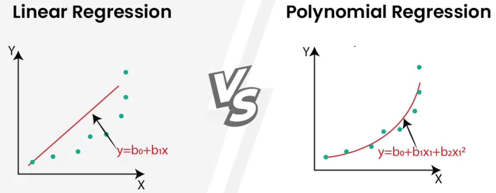

# Lec 06 - Polynomial, Ridge Regression and Classification

In this lecture, we will strengthen our understanding of **regression**. We will first introduce **polynomial regression**, then use **ridge regression** to address cases where the left or right inverse does not exist. Finally, we will explore how **regression can also be used for classification**.

## Polynomial Regression

The idea behind **polynomial regression** is similar to linear regression. For a dataset with one feature $$x$$ and one output $$y$$, linear regression fits the data with a **straight line**, as shown in the left-hand-side (LHS) figure below.

<figure><figcaption></figcaption></figure>

As we can see, a straight line may not always provide the **best fit** to the data. To capture more complex relationships, we can instead use **polynomial regression**. For example, the right-hand-side (RHS) figure shows a **second-order polynomial regression** fitted to the same dataset.

### Recap on Linear Regression

And remember that, for **linear regression**, the training process can be formulated as solving the $$w$$ in the following equation:

$$
\mathbf{X}\mathbf{w} = \mathbf{y}
$$

Using the linear algebra knowledge from **Lecture 4**, we can solve this system in three cases:

1. **Even-determined system:** $$\mathbf{w} = \mathbf{X}^{-1}\mathbf{y}$$
2. **Overdetermined system:** $$\mathbf{w} = (\mathbf{X}^T\mathbf{X})^{-1}\mathbf{X}^T\mathbf{y}$$
3. **Underdetermined system:** $$\mathbf{w} = \mathbf{X}^T(\mathbf{X}\mathbf{X}^T)^{-1}\mathbf{y}$$

Here, the **design matrix** $$X$$consists of a bias column followed by the feature columns. For $$m$$ training samples and $$n$$ features,

$$
\mathbf{X}=
\begin{bmatrix}
1 & x_{11} & x_{12} & \cdots & x_{1n}\\
1 & x_{21} & x_{22} & \cdots & x_{2n}\\
\vdots & \vdots & \vdots & \ddots & \vdots\\
1 & x_{m1} & x_{m2} & \cdots & x_{mn}
\end{bmatrix}
\in \mathbb{R}^{m\times(n+1)}
$$

The weight vector contains one weight for the bias and one for each feature:

$$
\mathbf{w}=
\begin{bmatrix}
w_0\\
w_1\\
\vdots\\
w_n
\end{bmatrix}
\in \mathbb{R}^{(n+1)\times1}
$$

while the output vector contains the target value for each of the $$m$$ training samples:

$$
\mathbf{y}=
\begin{bmatrix}
y_1\\
y_2\\
\vdots\\
y_m
\end{bmatrix}
\in \mathbb{R}^{m\times1}
$$

### Training

For **polynomial regression**, the main idea remains the same as linear regression. The key difference is that we replace the design matrix $$X$$ with a **polynomial design matrix** $$P$$, which contains different powers and combinations of the original features. For example, suppose we have **one feature** $$x$$, **3 training samples**, and want to perform **second-order polynomial regression**. Then,

$$
\mathbf{P}=
\begin{bmatrix}
1 & x_1 & x_1^2\\
1 & x_2 & x_2^2\\
1 & x_3 & x_3^2
\end{bmatrix}
$$

And the weight vector becomes

$$
\mathbf{w}=
\begin{bmatrix}
w_0\\
w_1\\
w_2
\end{bmatrix}
$$

The output vector remains unchanged:

$$
\mathbf{y}=
\begin{bmatrix}
y_1\\
y_2\\
y_3
\end{bmatrix}
$$

Therefore, the **training** part of the polynomial regression is essentially solving

$$
\mathbf{P}\mathbf{w} = \mathbf{y}
$$

Just like linear regression, we can divide the solution into the same three cases:

1. **Even-determined — normal inverse**: $$\mathbf{w} = \mathbf{P}^{-1}\mathbf{y}$$
2. **Overdetermined — primal form**: $$\mathbf{w} = (\mathbf{P}^T\mathbf{P})^{-1}\mathbf{P}^T\mathbf{y}$$
3. **Underdetermined — dual form**: $$\mathbf{w} = \mathbf{P}^T(\mathbf{P}\mathbf{P}^T)^{-1}\mathbf{y}$$


We can find out that the linear regression is a special case of polynomial regression!


### Prediction

The **prediction step** is straightforward. For a new input, we first construct **one row of the polynomial design matrix** $$P$$, including 1 for the bias term. We then multiply this row by the learned weight vector $$w$$ to obtain the predicted output $$\hat{y}$$. For example, for second-order polynomial regression:

$$
\hat{\mathbf{y}}
=
\begin{bmatrix}
1 & x & x^2
\end{bmatrix}
\begin{bmatrix}
w_0\\
w_1\\
w_2
\end{bmatrix}
=
w_0+w_1x+w_2x^2
$$

## Ridge Regression

From the training process above, it may seem that we can solve any regression problem using the normal, primal, or dual form. However, there is still one important issue:

> **what if the matrix we need to invert is singular?**

In this case, we can use **ridge regression**. The idea is to **add a small regularization term** $$\lambda \mathbf{I}$$ before taking the inverse, where $$\lambda>0$$ and $$\mathbf{I}$$ is the identity matrix. This makes the matrix invertible while only slightly modifying the original problem. For example, suppose the matrix we want to invert is

$$
\mathbf{A}=
\begin{bmatrix}
1 & 2 & 3\\
2 & 4 & 6\\
3 & 6 & 9
\end{bmatrix}
$$

Since it is obviously singular, after adding $$\lambda \mathbf{I}$$ where $$\lambda=1$$, we obtain

$$
\mathbf{A}+0.1\mathbf{I}=
\begin{bmatrix}
1.1 & 2 & 3\\
2 & 4.1 & 6\\
3 & 6 & 9.1
\end{bmatrix}
$$

So now, for polynomial regression, ridge regression modifies the solutions as follows:

* **Over-determined — primal form:** $$\mathbf{w} = (\mathbf{P}^T\mathbf{P} + \lambda\mathbf{I})^{-1}\mathbf{P}^T\mathbf{y}$$
* **Under-determined — dual form:** $$\mathbf{w} = \mathbf{P}^T(\mathbf{P}\mathbf{P}^T + \lambda\mathbf{I})^{-1}\mathbf{y}$$

The same idea also applies to **linear regression** by replacing $$\mathbf{P}$$ with $$\mathbf{X}$$.


We usually do not need to treat the even-determined case separately. It can be grouped with either the overdetermined or underdetermined formulation. In our notes, we will group it with the **over-determined (primal) case**.


There are **three main reasons** for using the $$\lambda$$ regularization term:

1. **Make a singular matrix invertible**: As shown above, adding $$\lambda \mathbf{I}$$ can make a singular matrix non-singular, allowing us to compute its inverse.
2. **Make different forms of the solution more consistent**: Without regularization, only one of the inverses exists depending on the system: the left-inverse applies exclusively to over-determined systems, while the right-inverse applies exclusively to under-determined systems. With $$\lambda I$$, even if we use the **"wrong" form**, the resulting weight vector can still be very close to the solution obtained using the appropriate form. Therefore, the choice of left or right inverse becomes less important.
3. This will be introduced in the **next lecture**. (More penalty for complex models?)


**Ridge regression uses L2 regularization**, which adds a penalty proportional to the **sum of squared weights**, $$\sum_{i=1}^{d}w_i^2$$, to the original loss function. This encourages smaller weight magnitudes and helps prevent [overfitting](lec-07-overfitting-bias-and-variance-trade-off.md#more-on-regularization). However, L2 regularization does **not guarantee** a reduction in other quantities, such as the sum of sixth powers, $$\sum_{i=1}^{d}w_i^6$$.


## Classification

Usually, after studying regression, we can extend the same idea to **classification**. Classification can be divided into two main types:

1. **Binary classification:** two classes.
2. **Multi-class classification:** more than two classes.

The general procedure is as follows.



#### Rewrite the output vector $$\mathbf{y}$$

First, we need to represent the class labels in a numerical form.

* For **binary classification**, we can use $$-1$$ and $$+1$$ and this is called **signnum discrimination**. For example,

$$
\mathbf{y}= \begin{bmatrix} +1\\ -1\\ +1\\ -1 \end{bmatrix}
$$

* For **multi-class classification**, we use **one-hot encoding**. For example, suppose there are three classes: Class 1, Class 2, and Class 3. We can represent them as

$$
\text{Class 1}\rightarrow \begin{bmatrix} 1&0&0 \end{bmatrix}, \qquad \text{Class 2}\rightarrow \begin{bmatrix} 0&1&0 \end{bmatrix}, \qquad \text{Class 3}\rightarrow \begin{bmatrix} 0&0&1 \end{bmatrix}.
$$

Therefore, with four training samples, $$y$$ becomes a **matrix** instead of a vector:

$$
\mathbf{y}= \begin{bmatrix} 1&0&0\\ 0&1&0\\ 0&0&1\\ 1&0&0 \end{bmatrix}
$$



#### Use the same regression method to solve for $$\mathbf{w}$$

Once $$\mathbf{y}$$ has been rewritten, we can use the **same regression method** to calculate $$\mathbf{w}$$. For example, using polynomial regression with design matrix $$\mathbf{P}$$,

$$
\mathbf{P}\mathbf{w}=\mathbf{y}
$$

* For **binary classification**, $$\mathbf{y}$$ is a vector, so $$\mathbf{w}$$ is also a vector.
* For **multi-class classification**, $$\mathbf{Y}$$ becomes a matrix, so $$\mathbf{W}$$ also becomes a **matrix.** For example,

$$
\mathbf{W}= \begin{bmatrix} w_{11}&w_{12}&w_{13}\\ w_{21}&w_{22}&w_{23}\\ \vdots&\vdots&\vdots\\ w_{k1}&w_{k2}&w_{k3} \end{bmatrix}
$$


This is similar to [**linear regression with multiple outputs**](lec-05-linear-regression.md#linear-regression-with-multiple-outputs). Polynomial regression can also have multiple outputs in exactly the same way.




#### Predict the class for a test sample

After obtaining $$w$$, we use the normal prediction process:

$$
\hat{y}=\mathbf{P}\mathbf{w}
$$

For **binary classification** using $$-1$$ and $$+1$$, we can use the sign of the prediction:

$$
\hat{y}= \operatorname{sign}(\mathbf{P}\mathbf{w)}
$$

A positive value gives $$+1$$, while a negative value gives $$-1$$.


If we instead use 0 and 1 as the labels, we can use a threshold such as 0.5:

$$
\hat{y}= \begin{cases} 1,& \hat{y}\geq0.5\\ 0,& \hat{y}<0.5 \end{cases}
$$


For **multi-class classification**, each row of $$\hat{y}$$ contains a value for each class. We simply choose the class with the **highest value**. For example,

$$
\hat{y}_i= \begin{bmatrix} 0.2&0.7&0.1 \end{bmatrix}
$$

would be classified as **Class 2**, since $$0.7$$ is the largest value.


In **multi-class classification**, we choose the class with the **highest predicted value**, NOT the highest absolute value.




So, the key idea is that: we can perform classification using the same regression framework. The main difference is how we **encode** $$y$$ and how we **convert the predicted values back into class labels**.
