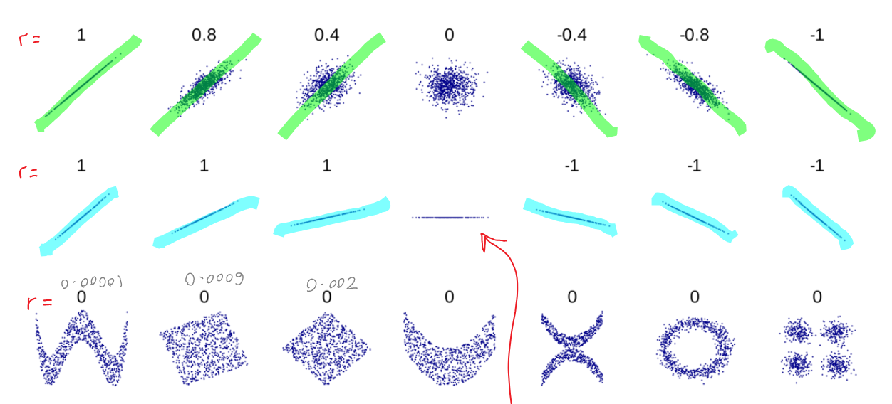
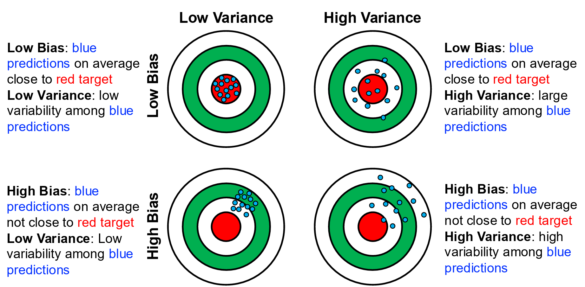

# Lec 07 - Overfitting, Bias & Variance Trade-off

## Overfitting, Underfitting & Model Complexity

### Model Complexity

By "complex", we mean that if the regression visually looks like a 2-order, than any model which has order greater than 2 will be considered as complex.


This visual inspection may not be feasible when we have more than 1 features, but the idea is around there


If we are dealing with only 1 feature, then according to Mr. Christopher (my tutor), a shortcut to inspect the **ideal order** of the model is to count the turning points of the 2-d regression line. The ideal order is then

$$
\text{ideal order}=\text{no. of turning points}+1
$$

### Overfitting

Overfitting occurs when model predicts the **training data** well, but predicts the **new data (from test set)** poorly. The reasons for overfitting are:

1. Model is too complex,
2. Too many features but number of training samples are too small. (This can happen in both linear and polynomial regression)

To solve the problem, we can use:

1. Simpler models (e.g., lower order polynomial)
2. Regularization (This is the [third purpose](lec-06-polynomial-ridge-regression-and-classification.md#ridge-regression) of having $$\lambda$$! Full circle moment here!)


One simple way to understand **overfitting** is that, instead of learning the underlying patterns in the training dataset, the model starts to **memorize the training data**, including its noise and irrelevant details. As a result, the model performs well on the training dataset but poorly on unseen testing data, since it fails to **generalize** to new samples.


### Underfitting

While underfitting simply means that the model predicts badly on both the train and test set. The reasons for this to happen are:

1. The model is too simple for the data
2. The features are not informative enough, meaning that features don't have a strong relationship with the output.

Thus, to solve the problem of underfitting, the solutions will thus be:

1. Try more complex model,
2. Try to develop informative features (we will see soon/below)

## Feature Selection & More on Regularization

### Feature Selection

Features are really important in a machine learning model. In particular, we want to keep the **informative features** while discarding the **useless or redundant features** so that our model will not suffer from:

1. **Overfitting** because we have too many features, especially irrelevant or noisy ones.
2. **Underfitting** because we discard too many informative features and the model becomes too simple.


Usually, a low training accuracy (around 50%) and a low testing accuracy (around 50% also) will indicate an **underfitting model**!


Thus, we want to know how to select informative features! However, before doing the feature selection, we should know that the procedure for feature selection is that:

1. Do feature selection in **training set**. (Never do on test set as this will inflate the performance!)
2. Fit model using the selected features in the training set
3. Evaluate trained model using test set.

There might exist multiple methods to do feature selection, but in this section, we will particularly introduce one method of feature selection, called **Pearson's Correlation Coefficient**.

#### Pearson's Correlation Coefficient

This Pearson's Correlation Coefficient measures the **linear relationship** between two variables (usually one is the feature and the other is the output). For example,&#x20;

<figure><figcaption>
Visualization of Pearson's Coefficient
</figcaption></figure>

The Pearson's Correlation Coefficient $$r$$ is calculated using the following formula:

$$
r = \frac{\displaystyle\sum_{i=1}^{n}(x_i-\bar{x})(y_i-\bar{y})} {\displaystyle\sqrt{\sum_{i=1}^{n}(x_i-\bar{x})^2} \sqrt{\sum_{i=1}^{n}(y_i-\bar{y})^2}}
$$

where:

* $$x_i,y_i$$ are the $$i$$-th sample ($$x$$ is one feature and $$y$$ is the output)
* $$\bar{x}$$ is the mean of $$x$$
* $$\bar{y}$$ is the mean of $$y$$
* $$n$$ is the number of samples

And

$$
-1 \le r \le 1
$$

where $$r\approx1$$ means **strong positive linear correlation**, $$r\approx-1$$ means **strong negative linear correlation**, and $$r\approx0$$ means **little or no linear correlation**. **When comparing the strength of linear correlations using the Pearson correlation coefficient** $$r$$**, we look at its absolute value** $$|r|$$.


In EE2211, in the sake of exams, we can just use Python Code or Excel to calculate the Pearson's Correlation Coefficient of a feature w.r.t the output variable.


### More on Regularization

In the preivous lecture, we've learned the idea of regularization in [**ridge regression**](lec-06-polynomial-ridge-regression-and-classification.md#ridge-regression). From that part of notes, we should at least know that, one of the motivation for the regularization term $$\lambda$$ is that it can **prevent the singularity** of the $$\mathrm{P}^T\mathrm{P}$$. In this section, we should know that $$\lambda$$ also helps us **reduce overfitting** for complex models!


We don't need to know how to prove this, but we should note that $$\lambda$$ generally has a more noticeable effect on complex models that are prone to overfitting. However, we cannot always rely on tuning $$\lambda$$ to improve model performance. We should also choose an appropriate model complexity, such as finding the ideal order for polynomial regression.


## Bias vs. Variance Trade-off

In short, **bias** measures how far the model's predicted results are from the actual results, while **variance** measures how much the model's predicted results vary when the training data changes (the sparseness between various predicted results). This can be shown clearly in the following figure:

<figure><figcaption></figcaption></figure>

The table below summarizes the general trends of the bias and variance relationship between different ML models.

* Increasing model complexity generally **decreases bias but increases variance**, while
* increasing regularization generally **increases bias but decreases variance**.
* Random forests primarily **reduce variance** by averaging predictions from multiple decision trees, while keeping bias approximately unchanged.


In AY26/27 Sem 1 finals, we are asked to calcualte the bias2 and variance of a give bunch of data. So, be prepared for this kind of question!


| Model or Situation                                        | Bias^2                  | Variance  |
| --------------------------------------------------------- | ----------------------- | --------- |
| Linear regression (underfitting nonlinear data)           | High                    | Low       |
| Low-degree polynomial regression                          | High                    | Low       |
| High-degree polynomial regression                         | Low                     | High      |
| Ridge regression: Increasing regularization ($$\lambda$$) | Increases               | Decreases |
| Ridge regression: Decreasing regularization ($$\lambda$$) | Decreases               | Increases |
| Shallow decision tree                                     | High                    | Low       |
| Deep decision tree                                        | Low                     | High      |
| Random forest vs. a single deep decision tree             | Approximately unchanged | Decreases |
