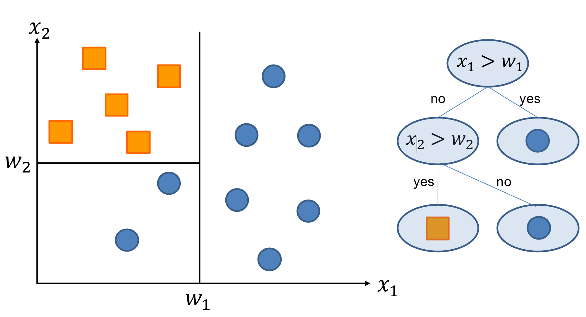
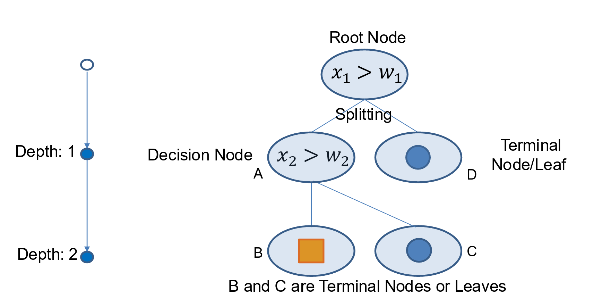
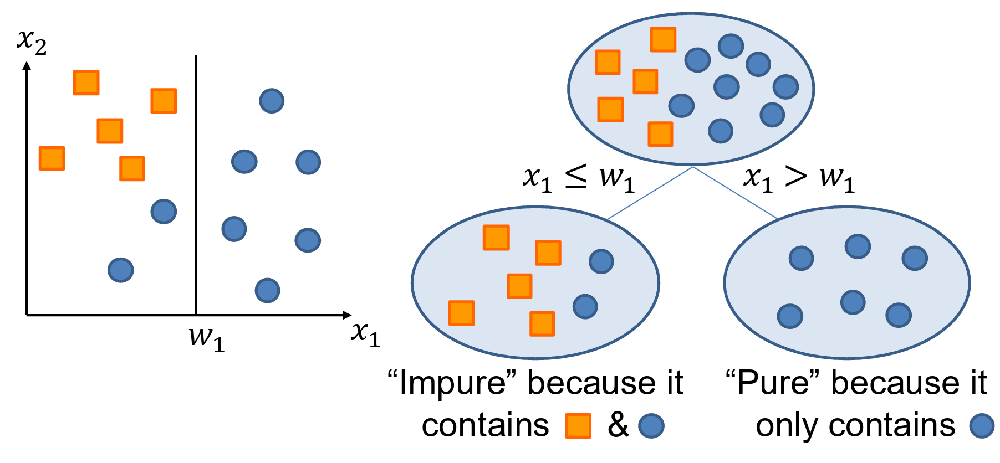
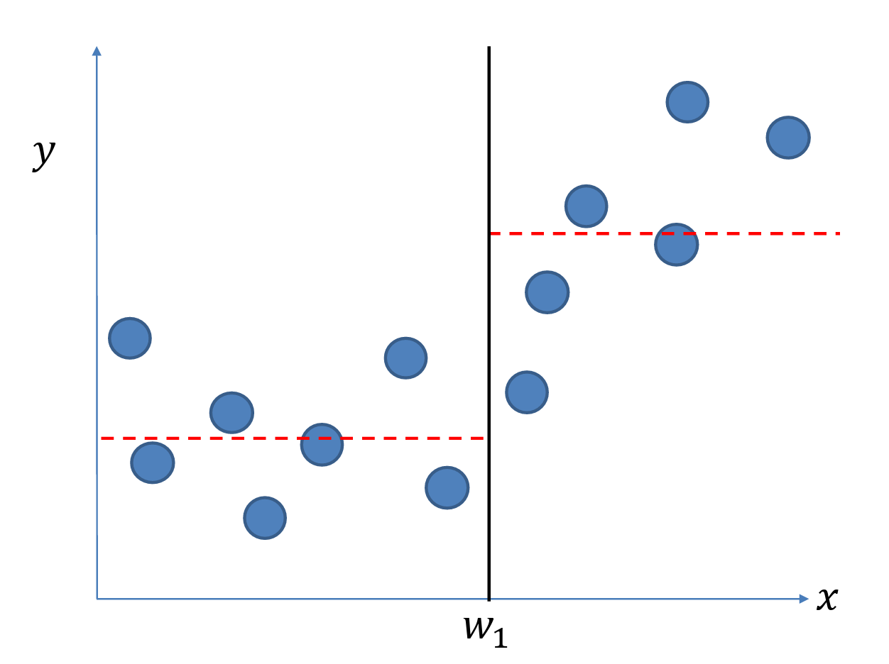

# Lec 09 - Decision Tree

In previous lectures, we explored various machine [learning models](lec-08-gradient-descent.md#learning-model), including [linear regression](lec-05-linear-regression.md) and [polynomial regression](lec-06-polynomial-ridge-regression-and-classification.md), where the optimal weights can be obtained by solving linear equations, as well as more complex models, such as exponential models, where the weights can be optimized using [gradient descent](lec-08-gradient-descent.md). In this lecture, we will introduce another widely used machine learning model: the **decision tree**, which makes predictions by repeatedly splitting the data based on feature values. We will cover three main topics:

1. Classification Decision Trees
2. Regression Decision Trees
3. Random Forests

For classification and regression decision trees, we will mainly focus on their intuitive working principles, including how they make predictions, as well as the metrics used to evaluate their performance. We will then explore how random forests combine multiple decision trees to improve prediction performance and robustness.


In EE2211, we will focus on binary decision trees, where each split divides the data into exactly two child nodes.


## Classification Decision Tree

A **classification decision tree** works by repeatedly splitting the feature space into smaller regions based on feature values. Within each region, the **most frequently occurring class label** among the training samples is selected as the predicted class. Therefore, any new sample that falls into that region will be assigned the same class label. An example involving a dataset with **two features and two possible class labels** is shown below.

<figure><figcaption>
An example of two features and two possible class labels
</figcaption></figure>

In the figure above, the vertical and horizontal lines represent **decision boundaries**. As we will see later, each decision boundary corresponds to a decision node in the tree.


By Mr. Christopher, we will be tested to use our brain to find the minimum number of decision boundaries to classify perfectly. In this kind of question, there is no shortcut but to use your brain power LOL!


A classification decision tree consists of root nodes, decision (internal) nodes, and leaf (terminal) nodes. Each decision/internal node splits the data based on a feature condition, while the final predicted class is determined at a leaf node. These terminologies are illustrated in the figure below.

<figure><figcaption></figcaption></figure>


Note that a classification decision tree can handle **more than two class labels**, even though each split in a binary decision tree produces exactly two child nodes.


Now that we understand how a classification decision tree makes predictions, the next question is:

> How do we determine where to place the decision boundaries?

Before answering this, let's first introduce some performance metrics that help us evaluate how well a classification decision tree performs. In particular, we will focus on a concept called **node impurity**, which measures how mixed the class labels are within a node. This can be illustrated as follows:

<figure><figcaption>
Figure 9.1. Impurity Example
</figcaption></figure>

Ideally, we want each node to be as pure as possible. A node is perfectly pure when all training samples within it belong to the same class. In this case, assigning that class label to the node gives 100% classification accuracy for its training samples.


Notice that, as the name suggests, node impurity is a property of an individual node, rather than the entire decision tree.


To quantify node impurity, let:

* $$p_i$$ denote the fraction (or estimated probability) of training samples in node $$m$$ belonging to class $$i$$.
* $$Q_m$$ denote the impurity of node $$m$$.

There are three commonly used node impurity measures:

1. Gini Impurity
2. Entropy
3. Misclassification Rate

These measures help us evaluate how well a potential split separates samples of different classes, allowing us to determine suitable decision boundaries.


In EE2211, our focus is to know how to calculate the 3 performance metrics for each node in the classification decision tree.


### Gini


All the 3 performance metrics introduced will use the Figure 9.1 as an example.


Gini impurity measures **how mixed** the different classes are within a node. It is defined as:

$$
Q_m=1-\sum_{i=1}^{K}p_i^2
$$

where $$K$$ is the number of classes and $$p_i$$ as defined above. For example, for a binary classification problem:

$$
Q_m=1-p_1^2-p_2^2
$$

For example, in Figure 9.1:

* Node A: $$Q_A=1-(8/13)^2-(5/13)^2=0.4734$$
* Node B: $$Q_B=1-(2/7)^2-(5/7)^2=0.4082$$
* Node C: $$Q_C=1-1^2-0^2=0$$

### Entropy

Entropy measures the **uncertainty** in the class labels within a node. It is defined as:

$$
Q_m=-\sum_{i=1}^{K}p_i\log_2p_i
$$

For a binary classification problem:

$$
Q_m=-p_1\log_2p_1-p_2\log_2p_2
$$

Using the same example in Figure 9.1:

* Node A: $$Q_A=0.9612$$
* Node B: $$Q_B=0.8631$$
* Node C: $$Q_C=0$$

### Misclassification Rate

Misclassification rate measures the fraction of samples that would be incorrectly classified if all samples in a node were assigned the majority class label. It is defined as:

$$
Q_m=1-\max_i(p_i)
$$

Using the same example in Figure 9.1.:

* Node A: $$Q_A=1-8/13=5/13\approx0.3846$$
* Node B: $$Q_B=1-5/7=2/7\approx0.2857$$
* Node C: $$Q_C=1-1=0$$

#### Overall Impurity at Each Depth

Since **each depth** may contain multiple nodes, we calculate the weighted average impurity, where each node is weighted by its fraction of the total training samples.

$$
Q_{\text{overall}}=\sum_{m\in\mathcal N}\frac{N_m}{N}Q_m
$$

where:

* $$N_m$$: Number of training samples in node $$m$$.
* $$N$$: Total number of training samples.
* $$\mathcal N$$: Set of nodes at the **depth** being evaluated.

For the example in Figure 9.1., the root node A contains 13 samples and is split into nodes B (7 samples) and C (6 samples).

| Impurity measure       | Root (depth 0) | After split (depth 1) |
| ---------------------- | -------------- | --------------------- |
| Gini impurity          | 0.4734         | 0.2198                |
| Entropy                | 0.9612         | 0.4648                |
| Misclassification rate | 0.3846         | 0.1538                |

For instance, the overall Gini impurity at depth 1 is:

$$
Q_{\text{overall}}=\frac{7}{13}(0.4082)+\frac{6}{13}(0)=0.2198
$$

It is obvious that all three measures decrease after the split, indicating that the resulting nodes are, on average, purer than the root node.


All three node impurity measures (Gini impurity, entropy, and misclassification rate) are zero simultaneously if and only if the node is **perfectly pure**. Otherwise, all three are strictly positive. As mentioned by Mr. Christopher, the weighted average impurity cannot increase after splitting a node. In other words, splitting a node either reduces or maintains its impurity.



When calculating the overall impurity after a split, we must also include any **terminal nodes** that stopped splitting at earlier depths. Since their samples remain unchanged, their impurity contributions remain constant and thus **cancel out when calculating the impurity reduction**. However, they must still be included when calculating the **overall impurity** itself.


### Learning

Now, we can return to our earlier question:

> How do we determine where to place the decision boundaries?

In a classification decision tree, the process of determining the decision boundaries is part of **learning (training)**. This is typically done using a greedy, exhaustive search, where we evaluate all candidate splits at each node and select the one that minimizes the weighted average impurity of the resulting child nodes. In other words, we aim to find the split that produces the **greatest reduction** in impurity, using one of the three measures introduced earlier: Gini impurity, entropy, or misclassification rate.


Also, the learning process is greedy because we select the **best split** at each node independently, rather than searching for the globally optimal decision tree.


What exactly is the split?

In Figure 9.1, we use a **normal decision tree** to classify the training samples. At each node, the decision tree examines **all available features** and searches for the best splitting condition (e.g., which feature to use and what threshold to set) that produces the **largest reduction in weighted impurity**.

For example, suppose our dataset has two features. At the root node, the decision tree considers both features and their possible splitting thresholds. It may find that splitting based on **Feature 1 >** $$w_1$$ produces the largest impurity reduction. The samples are then divided into two child nodes according to whether they satisfy this condition. This process is repeated recursively until a stopping criterion is met.


Later, we will learn about [**Random Forests**](lec-09-decision-tree.md#random-forests), where instead of examining all features at each split, we randomly select a **subset of features** and find the best split using only those selected features.


#### Disadvantages of Classification Decision Trees

Although classification decision trees are intuitive and easy to interpret, they have two main disadvantages:

1. **Overfitting**: Decision trees can become overly complex, fitting the training data too closely and resulting in poor generalization to unseen data.
2. **Instability**: Small changes in the training data may lead to significantly different tree structures and predictions.

To **reduce overfitting**, we can apply one or more of the following techniques:

1. **Limit the maximum tree depth**: Prevent the tree from growing too deep and becoming overly complex.
2. **Set a minimum number of samples required for splitting**: For example, if a node contains fewer than 10 samples, we do not split it further.
3. **Set a minimum impurity reduction**: Only perform a split if it reduces the weighted impurity by at least a specified threshold (e.g., 1%).
4. **Randomly select a subset of features**: Instead of considering all features when finding the best split, randomly select a subset (e.g., $$\sqrt{d}$$ features out of $$d$$ total features).

These techniques help control tree complexity and improve generalization, reducing the risk of overfitting.


The **complexity of a decision tree** can be measured by the **number of nodes** it contains. Generally, the more nodes a tree has, the more complex it is, increasing the risk of overfitting.


## Regression Decision Tree

Similar to a classification decision tree, a **regression decision tree** repeatedly splits the feature space into different regions based on feature values. However, instead of predicting a class label, it predicts a **continuous numerical value**, which is typically the **mean of the target values of all training samples** within that region.

For example, consider a dataset with one feature and a continuous target variable, as illustrated below. The **vertical lines represent the decision boundaries**, which divide the feature space into different regions, while the **horizontal lines represent the mean target value** within each region. Therefore, any new sample that falls into a particular region will be assigned the corresponding mean value as its prediction.

<figure><figcaption></figcaption></figure>

To evaluate how well a regression decision tree predicts the target values, we use two common performance metrics to measure the difference between the actual target values and the predicted values within each **region/node**.

1. Mean Squared Error (MSE)

$$
\text{MSE}=\frac{1}{N}\sum_{i=1}^{N}(y_i-\hat y_i)^2
$$

2\. Mean Absolute Error (MAE)

$$
\text{MAE}=\frac{1}{N}\sum_{i=1}^{N}|y_i-\hat y_i|
$$

where:

* $$N$$: Total number of samples in that node.
* $$y_i$$: Actual target value of sample $$i$$ in that node.
* $$\hat y_i$$: Predicted target value of sample $$i$$ in that node.

### Learning

Similar to a classification decision tree, a **regression decision tree** also uses a **greedy, exhaustive search** to determine the decision boundaries. At each node, we evaluate all candidate splits and select the one that produces the **greatest reduction** in weighted average MSE.


This process is repeated recursively to construct the tree, with each split aiming to minimize the prediction error **locally** rather than finding the globally optimal tree.


## Random Forests

As discussed earlier, both classification and regression decision trees are **unstable**, meaning that small changes in the training data can result in significantly different trees and predictions. In other words, decision trees generally have **low bias** but **high variance**, especially when grown deeply. To reduce this variance, instead of relying on a **single** decision tree, we can:

1. Generate $$M$$ different training datasets by randomly perturbing[^1] the original training set.
2. Train one decision tree on each dataset, obtaining $$M$$ different trees.
3. Combine the predictions of all $$M$$ trees to obtain a more stable final prediction.

The predictions are combined differently depending on the task:

* **Regression**: Take the average of the predictions from all trees.
* **Classification**: Take the most frequently predicted class (majority voting).

For example, given $$M=100$$ regression trees, where $$f_i(x)$$ is the prediction of the $$i$$-th tree:

$$
\hat y(x)=\frac{1}{100}\sum_{i=1}^{100}f_i(x)
$$

For classification, the final prediction is the class that appears most frequently among $$g_1(x),g_2(x),\ldots,g_{100}(x)$$, where $$g_i(x)$$ is the class predicted by the $$i$$-th tree.

### Bootstrapping

> But how do we generate different training datasets from the original dataset?

One common technique is **bootstrapping**, which involves randomly sampling the original training data with replacement to create a new dataset. For example, suppose the original training set contains three samples:

$$
D=\{(x_1,y_1),(x_2,y_2),(x_3,y_3)\}
$$

A possible bootstrapped dataset is:

$$
D'=\{(x_2,y_2),(x_2,y_2),(x_1,y_1)\}
$$

Notice that:

* The bootstrapped dataset has the **same number of samples** as the original dataset.
* Some samples may appear **multiple times** because sampling is performed with replacement.
* Some original samples may not appear at all in the bootstrapped dataset.

By repeating this process, we can generate multiple different training datasets and train a separate decision tree on each.


In AY26/27 Sem 1 final, we are asked to calculate the probability of one original sample not appeared in one bootstrapped dataset. So, be prepared for this kind of question!


### Learning

A **random forest** is an ensemble of decision trees trained using bootstrapped datasets, typically with additional randomness introduced during feature selection. The learning process is as follows:

1. **Bootstrap the training data**: Randomly sample $$N$$ training samples with replacement from the original dataset.
2. **Train a decision tree**: Use the bootstrapped dataset to construct a tree.
3. **Repeat**: Perform the above steps $$M$$ times to obtain $$M$$ different decision trees.
4. **Combine predictions**: Average the predictions for regression or use majority voting for classification.

To further increase randomness, instead of considering all $$d$$ features when splitting a node, we can randomly select a subset of features (e.g., approximately $$\sqrt d$$ features) and find the best split among them. This helps reduce the correlation between individual trees, making their combined predictions more effective at reducing variance.

[^1]: Basically it means generating more datasets from the original dataset.
