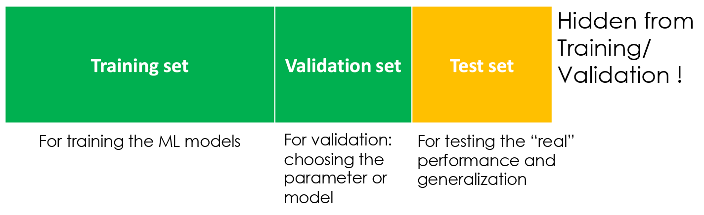
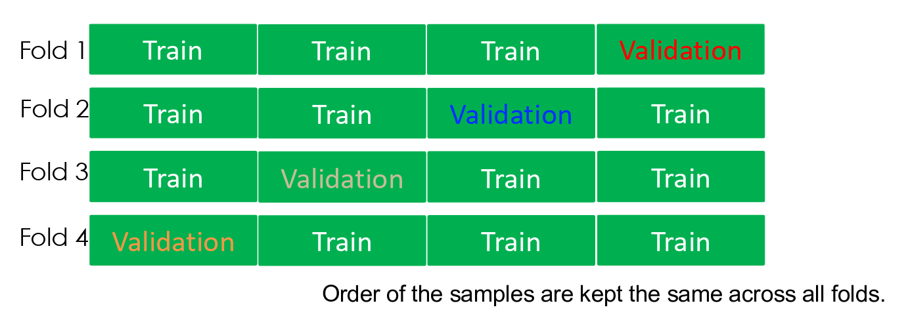
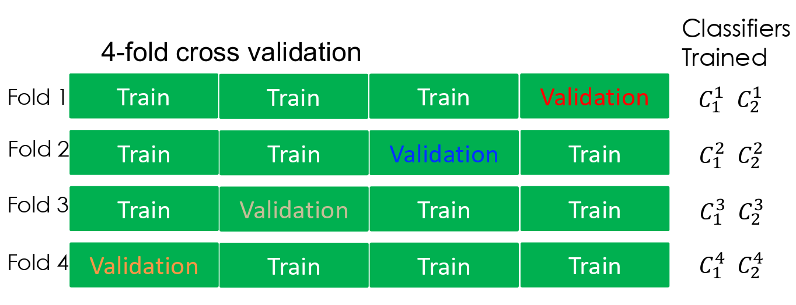
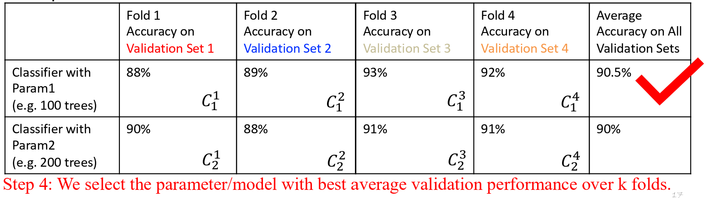
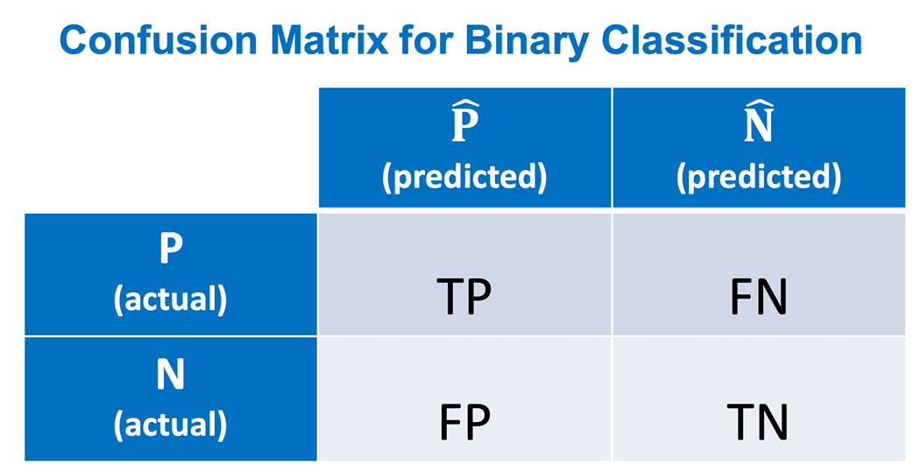
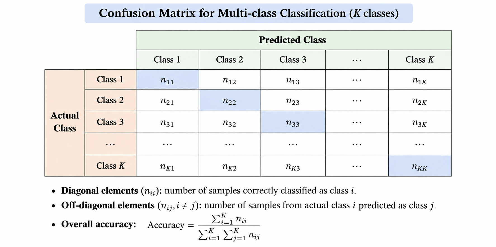
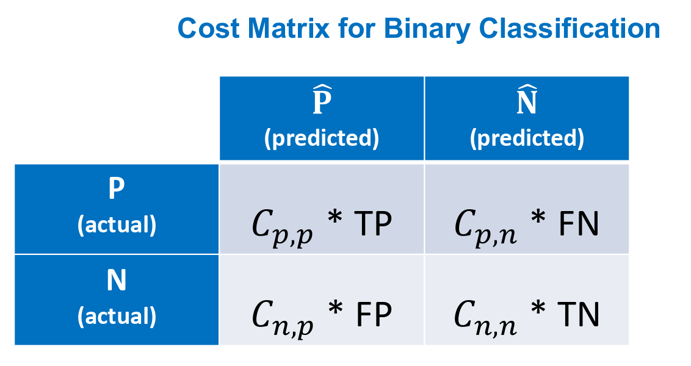

# Lec 10 - Performance Issues

In this lecture, we will introduce two important techniques for evaluating and improving model performance:

1. **K-fold Cross-Validation:** Helps us compare different models and select the one that generalizes best to unseen data.
2. **Evaluation Metrics:** Helps us evaluate the performance of a machine learning model.

## K-fold Cross-Validation

Before introducing **K-fold cross-validation**, we first need to understand how a dataset is typically divided in real-world machine learning applications. Usually, the dataset is split into three parts:

1. **Training Set:** Used to train the model by learning patterns from the data.
2. **Validation Set** (Pseudo Test Set)**:** Used to evaluate and compare models, helping us select the best model and tune its hyperparameters.
3. **Test Set:** Used only at the end to evaluate how well the final model **generalizes** to unseen data.

During model development, we can use both the **training and validation sets**, while the **test set is kept separate and unseen** to ensure an unbiased final evaluation. This partitioning is illustrated in the following figure.

<figure><figcaption></figcaption></figure>

**We should never use the test set to choose or tune our model**, because doing so introduces **data leakage from the test set into the model selection process**.


There is no connection between training accuracy and validation accuracy! A high training accuracy won't lead to a high validation accuracy!


In **K-fold cross-validation**,

1. we first set aside the **test set**, which remains untouched until the final evaluation. We then combine the original training and validation data and divide them into **K equal-sized, non-overlapping partitions**, called _folds_.
2. Next, we perform **K rounds of training**. In each round, we use **one fold as the validation set** and the remaining **K − 1 folds as the training set**. The dataset partitioning remains unchanged, but a different fold is selected for validation in each round.
3. As a result, **every fold serves as the validation set exactly once**, allowing us to evaluate the model on different portions of the dataset.

For example, suppose we want to compare two random forest models with different hyperparameters using **4-fold cross-validation**. The dataset partitioning for each round is illustrated in the following figure.

<figure><figcaption></figcaption></figure>

In each round, we train both candidate models and evaluate their performance on the corresponding validation fold. Since we have **2 candidate models and 4 folds**, we perform a total of $$2\times4=8$$ **training runs**, obtaining 8 validation accuracy scores, as shown below.

<figure><figcaption></figcaption></figure>

Finally, we calculate the **average validation accuracy** across the 4 folds for each candidate model and select the one with the higher average accuracy. After selecting the best candidate model based on its **average validation accuracy**, we have two options:

1. **Retrain the selected model** using the entire combined training and validation dataset.
2. **Use the trained model with the highest validation accuracy** among the K folds of the selected candidate model.

Finally, we evaluate the chosen model on the **untouched test set** to measure its performance on unseen data.

<figure><figcaption></figcaption></figure>


When selecting the best model or hyperparameter, we should prioritize **validation performance!** If multiple models achieve the **same validation performance**, we may use additional criteria to break the tie, such as model complexity, computational cost, or training performance.


## Evaluation Metrics

In previous lectures, we have learned several machine learning models, including

1. linear regression, polynomial regression, and
2. decision trees.

However, in real-world applications, how do we evaluate whether a trained model performs well? To answer this question, we use **evaluation metrics**, which measure how well a model makes predictions on unseen data.

For **regression models**, we can use metrics such as **Mean Squared Error (MSE)** and **Mean Absolute Error (MAE)** to measure the difference between predicted and actual values. Generally, a lower MSE or MAE on the test set indicates better prediction performance.

> But how do we evaluate a **classification model**, where the output is a category rather than a continuous value?

To answer this, we will first introduce the **confusion matrix**, followed by two evaluation metrics that help us assess classification performance beyond simply looking at accuracy.

### Confusion Matrix

For **binary classification**, a **confusion matrix** summarizes the model's predictions using four possible outcomes:

1. **True Positive (TP):** Predicted positive, and actually positive.
2. **True Negative (TN):** Predicted negative, and actually negative.
3. **False Positive (FP):** Predicted positive, but actually negative.
4. **False Negative (FN):** Predicted negative, but actually positive.


**Important:** Before constructing a confusion matrix, we must first define which class is considered **positive** and which is considered **negative**, based on our classification objective.


These four outcomes form a **2 x 2 confusion matrix**, as shown in the following figure.

<figure><figcaption></figcaption></figure>

The **classification accuracy** measures the proportion of correctly classified samples (TP and TN) out of all samples:

$$
\text{Accuracy}=\frac{TP+TN}{TP+TN+FP+FN}
$$


In NUS EE2211, we should know how to **construct and fill in a confusion matrix given a problem description**!


When constructing a **confusion matrix**, it is important to first define which class is **positive** and which is **negative**. In real-world applications, the positive class is often the **minority** class or the class we are particularly interested in detecting.

For example, in **COVID-19 detection**, infected patients are typically treated as the positive class, while uninfected patients are treated as the negative class. Since infected patients may represent only a small portion of the dataset, we are particularly interested in how well the classifier identifies these positive cases.

However, for an **imbalanced dataset**, a classifier can achieve high overall accuracy simply by predicting the majority class most of the time, even if it fails to identify many positive cases. Thus for imbalanced datasets, **overall classification accuracy alone is not sufficient** to determine whether a classifier performs well. We need additional evaluation metrics to measure how effectively the model identifies the positive class. To evaluate whether a classifier performs well on an imbalanced dataset, we usually use the following two metrics:

1. Cost-sensitive matrix
2. Precision and Recall Rate (derived from the confusion matrix)

Confusion matrix for multiple-class classification

<figure><figcaption></figcaption></figure>

### Cost-Sensitive Matrix

A **cost matrix (or cost-sensitive matrix)** is similar to a confusion matrix, except that we assign a **cost value** to each possible classification outcome. This allows us to account for the fact that different types of classification errors may have different consequences, as illustrated in the following figure.

<figure><figcaption></figcaption></figure>

The **total classification cost** is calculated by multiplying the number of samples in each cell of the confusion matrix by its corresponding cost value, then summing all the results. For binary classification:

$$
\text{Total Cost}=C_{TP}\cdot TP+C_{TN}\cdot TN+C_{FP}\cdot FP+C_{FN}\cdot FN
$$

where $$C_{TP}, C_{TN}, C_{FP}, C_{FN}$$ represent the costs assigned to the four classification outcomes.


Generally, **a higher total cost indicates worse classifier performance** on the same dataset.


The cost values are assigned based on the **real-world consequences of each outcome**. For example, in a self-driving car's pedestrian detection system, we define **positive** as a pedestrian being present and **negative** as no pedestrian being present.

* **False Negative (FN):** A pedestrian is present, but the model fails to detect them, causing the car to continue moving.
* **False Positive (FP):** No pedestrian is present, but the model incorrectly detects one, causing the car to stop unnecessarily.

Since failing to detect a pedestrian is much more dangerous than stopping unnecessarily, we should assign $$C_{FN} > C_{FP}$$.


Unlike overall accuracy, a cost matrix allows us to penalize more serious classification errors more heavily, making it particularly useful when different mistakes have different consequences.


### Precision and Recall Rate

Besides using a **cost matrix**, we can also evaluate a classifier directly from the original **confusion matrix** using two important metrics: **Precision** and **Recall**.

1. **Precision:** Measures how many of the samples predicted as positive are actually positive.

$$
\text{Precision}=\frac{TP}{TP+FP}
$$

2. **Recall:** Measures how many of the actual positive samples are correctly identified by the classifier.

$$
\text{Recall}=\frac{TP}{TP+FN}
$$

The key difference is that **precision focuses on the correctness of positive predictions**, while **recall focuses on how many actual positive cases the model successfully detects**.


Both the **cost matrix** and **precision/recall metrics** are particularly useful when dealing with **imbalanced datasets**, where overall accuracy may be misleading. For **balanced datasets**, overall accuracy is generally more informative, since both classes contribute equally to the dataset.


Besides Recall and Precision rate, we can also evaluate a binary classifier using the following two error rates:

1. **False Positive Rate (FPR):** The proportion of actual negative samples that are incorrectly predicted as positive.

$$
\text{FPR}=\frac{FP}{FP+TN}
$$

2. **False Negative Rate (FNR):** The proportion of actual positive samples that are incorrectly predicted as negative.

$$
\text{FNR}=\frac{FN}{FN+TP}
$$


Both rates range from 0 to 1 (0% to 100%). A lower FPR or FNR indicates fewer corresponding classification errors. Since they use different denominators, **their sum can exceed 100%!**

