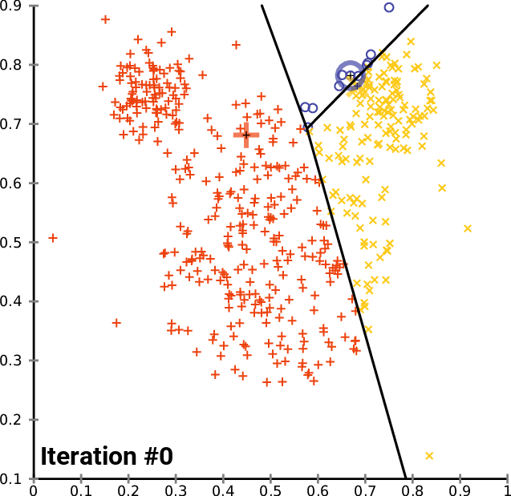
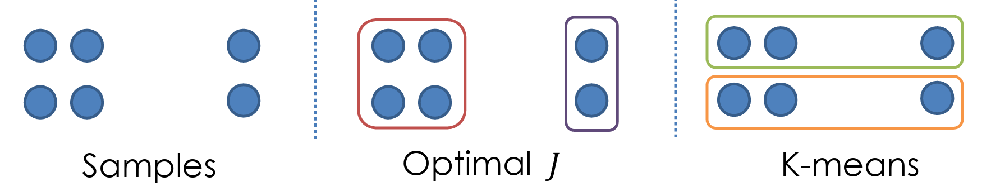
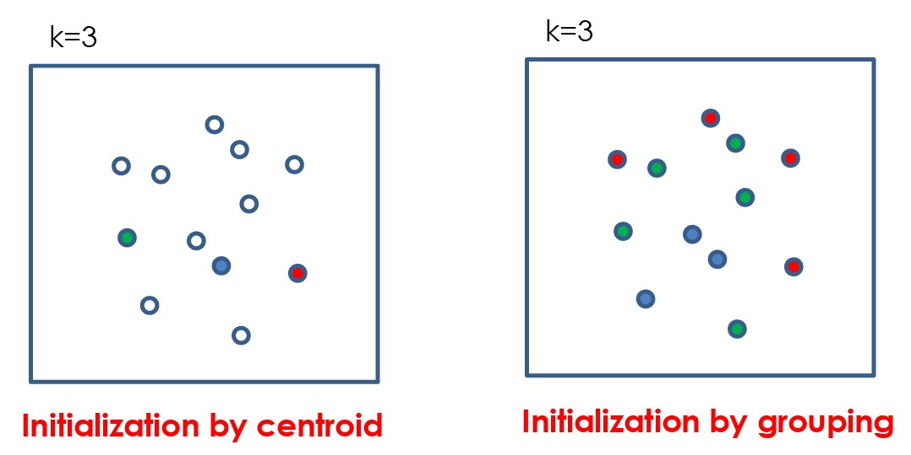

# Lec 11 - K-means Clustering

In this lecture, we will introduce **unsupervised learning**. Recall from [Lecture 1](lec-01-introduction.md#unsupervised-learning) that, unlike supervised learning, unsupervised learning deals with **unlabelled data**, meaning that we do not have the correct output labels for our training samples.


Without labels, we lack a direct reference (ground truth) against which to evaluate the quality of our model.


There are several approaches to unsupervised learning:

1. **Clustering:** Groups similar data samples into clusters, such that samples within the same cluster are more similar to each other than to those in other clusters.
2. **Density Estimation:** Estimates the underlying probability distribution of the data.
3. **Component Analysis:** Identifies important underlying components or patterns in the data, often for dimensionality reduction.
4. **Unsupervised Neural Networks (Autoencoders):** Learn useful representations of data by reconstructing their inputs without requiring labels.

In this lecture, we will focus on **clustering**, specifically two methods: **K-means clustering** and **fuzzy clustering**.


As emphasized by Prof. Xinchao, we only need to know  that clustering is one of several approaches to unsupervised learning. We will not study the other approaches in detail in this course.


## K-Means Clustering

The procedure of **K-means clustering** is straightforward:

1. **Initialization:** Choose $$K$$, the number of clusters, and initialize $$K$$ centroids (feature vectors) in the feature space. (The centroids can be any point in the feature space!)
2. **Assignment:** Compute the distance between each sample $$\mathbf{x}$$ and every centroid $$\mathbf{c}$$, typically using **Euclidean distance**. Assign each sample to its nearest centroid, effectively giving it a cluster ID, which is the ID for the centroid.
3. **Centroid Update:** For each cluster, calculate the **mean feature vector** of all samples assigned to it. This mean becomes the new location of the centroid.
4. **Iteration:** Repeat the assignment and centroid update steps until **convergence**, meaning that the cluster assignments no longer change (equivalently, the centroids no longer move, assuming non-empty clusters and consistent tie-breaking).
5. **Final Result:** Each sample is assigned a cluster ID, dividing the dataset into $$K$$ clusters.


The initial locations of the centroids can affect the final clustering result, since K-means may converge to different local optima depending on its initialization.


Below is an animation of how K-means clustering works:

<figure><figcaption></figcaption></figure>

### The Maths

In this part, we will introduce the math-heavy part for K-means clustering.

#### Optimization Objective of K-means Clustering

Similar to the supervised learning models introduced earlier, K-means clustering also has an **objective (loss) function** that we aim to minimize. Here, the objective is to minimize the **within-cluster sum of squared distances**, defined as:

$$
J=\sum_{i=1}^{m}\sum_{k=1}^{K}w_{ik}|\mathbf{x}_i-\mathbf{c}_k|^2
$$

where:

* $$m$$: Total number of training samples.
* $$K$$: Number of clusters.
* $$\mathbf{x}_i$$: Feature vector of sample $$i$$.
* $$\mathbf{c}_k$$: Centroid of cluster $$k$$.
* $$w_{ik}$$: **Cluster assignment indicator**, defined as:

$$
w_{ik} = \begin{cases} 1, & \text{if sample } i \text{ belongs to cluster } k \\ 0, & \text{otherwise} \end{cases}
$$

Since each sample belongs to exactly one cluster, only one $$w_{ik}$$ is equal to 1 for each sample $$i$$. Thus, $$J$$ simply measures the **total squared Euclidean distance between all samples and their assigned centroids**.

#### Minimizing the Objective Function

Recall that K-means clustering repeatedly performs two steps: **assignment** and **centroid update**. Mathematically, these steps minimize $$J$$ by alternately optimizing $$w_{ik}$$ and $$\mathbf{c}_k$$.



#### Assignment Step (**Fix** $$\mathbf{c}_k$$_**,**_**&#x20;Update** $$w_{ik}$$**)**

With the centroids fixed, we assign each sample to its **nearest centroid**, i.e.,

$$
k^*=\arg\min_{k}|\mathbf{x}_i-\mathbf{c}_k|^2
$$

We then set $$w_{ik^*}=1$$ and all other $$w_{ik}=0$$ for that sample.


This minimizes the contribution of each sample to $$J$$, since we always choose the centroid with the smallest squared distance.


Recall that the **Euclidean distance** between two $$D$$-dimensional feature vectors is:

$$
|\mathbf{x}-\mathbf{c}|=\sqrt{\sum_{d=1}^{D}(x_d-c_d)^2}
$$

For example, if $$\mathbf{x}=(1,2)$$ and $$\mathbf{c}=(4,6)$$, their Euclidean distance is $$\sqrt{(1-4)^2+(2-6)^2}=5$$, and the **squared Euclidean distance** used in $$J$$ is $$5^2=25$$.



#### Centroid Update Step (Fix $$w_{ik}$$, Update $$\mathbf{c}_k$$)

With the cluster assignments fixed, we find the optimal location of each centroid by **differentiating** $$J$$ **with respect to** $$\mathbf{c}_k$$ and setting the derivative to zero:

$$
\frac{\partial J}{\partial \mathbf{c}k}
=-2\sum_{i=1}^{m}w_{ik}(\mathbf{x}_i-\mathbf{c}_k)=0
$$

Rearranging gives:

$$
\mathbf{c}_k=\frac{\sum_{i=1}^{m}w_{ik}\mathbf{x}_i}{\sum_{i=1}^{m}w_{ik}}
$$

Since $$w_{ik}=1$$ only for samples belonging to cluster $$k$$, this simply means that the **optimal centroid is the mean feature vector of all samples assigned to that cluster** (assuming the cluster is non-empty).



#### Convergence of K-means

By repeatedly performing these two steps, the objective function $$J$$ is **guaranteed to never increase**:

* **Assignment step:** Each sample is assigned to its nearest centroid, so its squared distance cannot increase.
* **Centroid update step:** Each centroid is moved to the mean of its assigned samples, which minimizes the sum of squared distances within that cluster.

Therefore, $$J$$ either **decreases or remains unchanged** after each step until convergence. However, K-means is **not guaranteed** to find a global minimum, if finds only **local minimum**.

<figure><figcaption></figcaption></figure>

To reduce the probability of our model getting stuck at the local minimum, we might use multiple random initializations or better initialization methods (which will be introduced [soon](lec-11-k-means-clustering.md#two-initialization-methods))!


Finding the optimal $$J$$ (global minimum) is **NP-hard**!


### Two Initialization Methods

In the K-means algorithm introduced above, we initialize the centroids using the **Forgy method**, which randomly selects $$K$$ data samples as the initial centroids. Another initialization method is **Random Partition**, which works slightly differently:

1. Randomly assign each training sample to one of the $$K$$ clusters.
2. Compute the **mean feature vector** of the samples in each cluster and use it as the initial centroid.

After initialization, both methods proceed with the same K-means algorithm, repeatedly performing the assignment and centroid update steps until convergence.

<figure><figcaption>
Foggy (Left) vs. Random Partitioning (Right)
</figcaption></figure>

## Fuzzy Clustering

In the K-means clustering introduced above, each data point belongs to **exactly one cluster**. This is known as **hard clustering**. However, another approach called **soft clustering**, such as **fuzzy clustering**, allows each data point to belong to multiple clusters with different **degrees of membership**.

For example, instead of assigning an apple exclusively to the green cluster (green = 1, red = 0), fuzzy clustering might assign it a membership degree of 0.3 for green and 0.5 for red.

These membership values range from **0 to 1** and represent degrees of belonging rather than probabilities. In general fuzzy clustering, they do not necessarily sum to 1, although some algorithms, such as **Fuzzy C-means**, require the memberships across all clusters to sum to 1.


According to Prof. Xinchao, we only need to know that fuzzy clustering is another clustering approach that allows partial membership in multiple clusters. We do not need to study its algorithm in detail.

