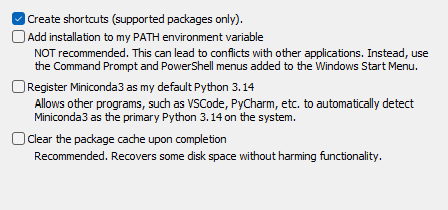

# Python Environment Setup

## Introduction

In EE2211 or your future Python projects, according to my Python tutori Feng Sicheng, it's highly recommended to use miniconda!

### Conda

Conda is an open-source **package** and **environment manager**. It installs software packages and manages isolated environments on your machine, preventing dependency conflicts between projects.

Without a tool like conda, managing software dependencies becomes complex. Different projects often require different versions of Python and incompatible libraries. Conda solves this by creating **isolated environments** where each project gets exactly what it needs. We can maintain one environment with Python 3.10 for a legacy project and another with Python 3.14 for new development — then switch between them seamlessly.

### Package

Packages are complete, ready-to-use pieces of software that extend the capabilities of a programming environment. They make it possible to reuse code written by others, so we don't have to build everything ourselves or worry about manually installing dependencies. Packages contain all the files, metadata, and instructions needed to install and run that software in our environment.


[Conda](python-environment-setup.md#conda) can install and manage these packages within [environments](python-environment-setup.md#environment) on our machine. Conda takes care of downloading the correct versions for our platform, resolving dependencies, and ensuring everything works together smoothly.


#### Package Types

There are many kinds of software packages, but within the conda ecosystem the most common types we'll work with are **conda packages** and **Python packages**.



#### Conda Packages

Conda packages are built specifically for the conda package manager. They can include software written in multiple programming languages, such as Python, R, or C/C++.


Conda packages differ from typical Python packages because they can include compiled code and non-Python components.




#### Python Packages

Python packages are distributed primarily through the Python Package Index (PyPI) and installed using pip, Python’s native package installer. Pip packages typically contain only Python code and are developed and shared by the Python open-source community.



#### Where packages are stored <a href="#where-packages-are-stored" id="where-packages-are-stored"></a>

Packages are stored inside the **environment directories** where they are installed. Each conda environment keeps its own set of packages in a separate directory, ensuring that software in one environment doesn't interfere with another.

### Environment

Conda environments define what software is available for a project. Conda environments differ from Python's built-in `venv` tool, which only isolates Python packages; conda environments manage both the Python interpreter itself as well as packages from multiple programming languages. Each conda environment is a complete, isolated software stack in its own directory.

#### The base environment

When first installing and using conda, we probably saw references to something called `base` or a "base environment". This environment is where conda itself is installed, and should only be used for installing anaconda, conda, and conda-related packages, such as `anaconda-client` or `conda-build`.

For our projects, however, Anaconda _strongly_ recommends creating **new** environments to work in. This protects your base environment from breaking due to complex dependency conflicts and allows you to easily manage and reproduce your environment on other machines.

#### The typical environment workflow

The typical workflow with conda environments looks like the following:



#### Plan

Determine what packages your project needs using `conda search` or searching [anaconda.org](https://anaconda.org/) or your organization's channels in Package Security Manager.



#### Create

Create a new environment with the necessary tools. It's best practice to install all packages that your environment needs at the same time.


```powershell
conda create --name EE2211 python=3.12
```


<details>

<summary>Disable conda base auto activate</summary>

In VSCode, upon the miniconda installtion, the conda auto activate is turned on automatically. However, if you don't want your base environment to be automatically acticated every time a new shell is open, use the following command.


```powershell
conda config --set auto_activate false
```


</details>



#### Initiatiate

This is optional and you might encounter the following issue on Windows.

<details>

<summary>CondaError: Run 'conda init' before 'conda activate'</summary>

To solve this, if you are using powershell in VS Code, simply run the following command and then restart your IDE.


```powershell
conda init powershell
```


</details>



#### Activate

Switch to using that environment, so that your environment’s packages and libraries become available to you.


```powershell
conda activate EE2211
```




#### Install

Add any additional packages you discover you need, if necessary.


```powershell
conda install <PACKAGE>
```



In EE2211, it is recommended to always use `conda install <PACKAGE>` and not to use `pip install <PACKAGE>` in an environment.


<details>

<summary>How to see the installed libraries in an environment?</summary>

To see what libraries are already installed in an environment, we can use the following command:


```bash
conda list -n myenv # myenv is the name of ur environment
```


</details>



#### Work

Develop your project using the isolated environment. Create a folder anywhere you like on yoru computer, write python code and then activate the specific environment for that project.



#### Document

Export the environment specification (usually this will be an `environment.yaml` file) to share with colleagues or recreate the environment at a later date.



#### Delete

Once you are finished developing the project, remove the environment to save space.



## Installation

To boost the experience in EE2211, it is recommended to use the following two tools:

1. Miniconda
2. Jupyter notebook (just for the sake of this course to plot some plots)


According to my Python Tutor Mr. Feng Sicheng, miniconda is very enough for future huge research projects in Deep Learning!


### Miniconda

In EE2211, it is recommended to use miniconda installed via shell. The windows installation guide can be found as follows:




Remember that if you are using powershell, `cd $HOME` first so that you can find your downloaded file easier.


During the installation, remember to only check the first, third and last option shown below. Don't check the second option during the installation, we will do that manually [later](python-environment-setup.md#command-not-found-conda).

<figure><figcaption></figcaption></figure>

### Jupyter Notebook

If you're using Windows and VS Code, setting up Jupyter Notebook is very easy. Basically, you just need to install the **Jupyter** extension from the VS Code Extension Marketplace, and then install the `ipykernel` package in the specific Conda environment you want to use for running your Jupyter notebooks.

#### Troubleshooting

<details>

<summary>command not found: conda</summary>

On Windows machine, this is usually because you didn't add the conda to **environment paths**. To do so, add the following directories to your **environment paths** variable.


```
C:\Users\YourUserName\miniconda3
C:\Users\YourUserName\miniconda3\Scripts
C:\Users\YourUserName\miniconda3\Library\bin
```


</details>

## References

1. [What is Conda?](https://www.anaconda.com/docs/getting-started/concepts/what-is-conda)
2. [What is a package?](https://www.anaconda.com/docs/getting-started/concepts/what-is-a-package)
3. [What is an environment?](https://www.anaconda.com/docs/getting-started/concepts/what-is-an-environment)
