# Workshop 1 - Simple Device Characterization

## Setup Tool Environment

Before going into the actual simple NMOS characterization, we are going to see some important concepts of our tool environment, which will include

1. Useful short-cut key to use Cadence Virtuoso
2. Model Libraries


Feel free to go back to my [EE4415 notes](https://app.gitbook.com/s/o4JqYVwVk7U2q66ddB5L/textbook/cadence-dfii-and-icfb) to learn more about the basic concepts we need to know about the Cadence Virtuoso.


### Useful Short-Cut Keys

The following table summarizes the useful short-cut keys in Cadence Virtuoso.

| Key                                    | Function                  | Interaction                                                                                                  |
| -------------------------------------- | ------------------------- | ------------------------------------------------------------------------------------------------------------ |
| <kbd>i</kbd>                           | Insert component          | Press key                                                                                                    |
| <kbd>c</kbd>                           | Copy component            | Press key first, then select instance                                                                        |
| <kbd>w</kbd>                           | Make wire connection      | Press key first, then select pins to be connected                                                            |
| <kbd>m</kbd>                           | Move the component        | Pree key first, then select instance                                                                         |
| <kbd>q</kbd>                           | Edit component properties | Select instance first, then press the key                                                                    |
| <kbd>p</kbd>                           | Create pin                | Press key                                                                                                    |
| <kbd>l</kbd>                           | Label wire name           | Press key                                                                                                    |
| <kbd>r</kbd>                           | Rotate component          | Press key first, then select instance                                                                        |
| <kbd>Shift+E</kbd>                     | Descend edit              | Select instance first                                                                                        |
| <kbd>Ctrl+E</kbd>                      | Return one level up       | Press key first                                                                                              |
| <kbd>Shift+M</kbd> then <kbd>Fn3</kbd> | Mirror a component        | Press <kbd>Shift</kbd> + <kbd>M</kbd> first, then select the component, then press <kbd>Fn3</kbd> to mirror. |

### Annotations

Cadence Virtuoso provides a useful **annotation feature** for displaying circuit information directly on the schematic. In this section, we are mainly interested in two types of annotations:

1. Component Parameters
2. DC Operating Points

Users can switch between different annotations through **View -> Annotations**.

<figure>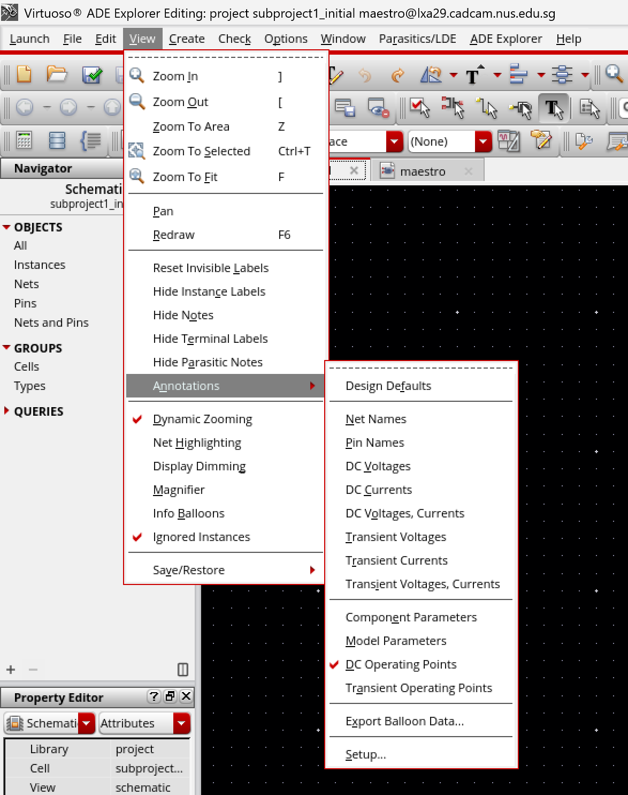<figcaption></figcaption></figure>

#### Component Parameters

**Component Parameters** display the key parameters of each device directly on the schematic, such as the **width** $$W$$ and **length** $$L$$ of an NMOS transistor or the **resistance** $$L$$ of a resistor, etc. An example is shown below.

<figure>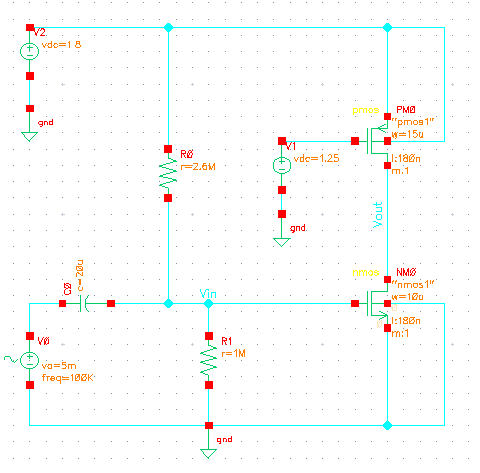<figcaption></figcaption></figure>

#### DC Operating Points

To display the **DC operating points** of the circuit, which are particularly useful for checking whether the MOS devices are operating in the **saturation region**, we first need to set up a **DC analysis** in Maestro, as shown below.

<figure>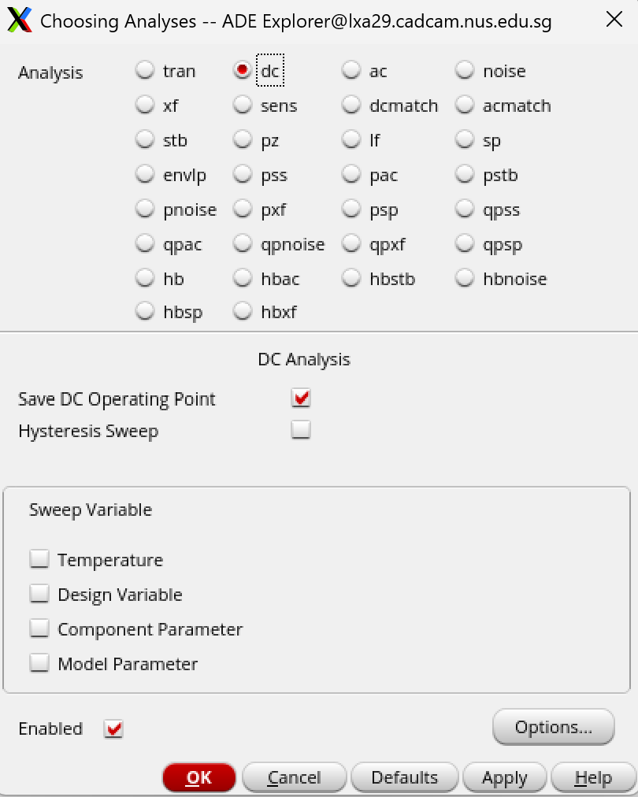<figcaption></figcaption></figure>

After the analysis is configured, select **Simulation -> Netlist and Run**. Then, return to the schematic and use **View -> Annotations** to display the DC operating points. To customize which operating-point parameters are displayed, go to **View -> Annotations -> Setup** and configure the desired parameters as shown below.

<figure>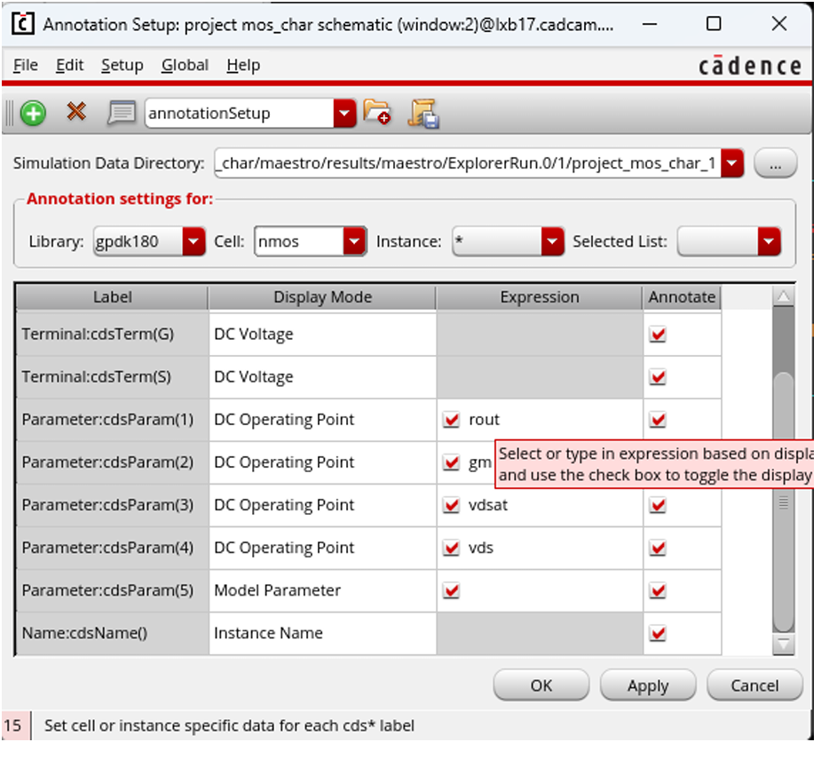<figcaption></figcaption></figure>

### Copy Cells

Sometimes, we may want to **duplicate an entire cell**, including all its views, such as the **schematic and Maestro**. To do this, first **right-click the cell** that we want to copy.

<figure>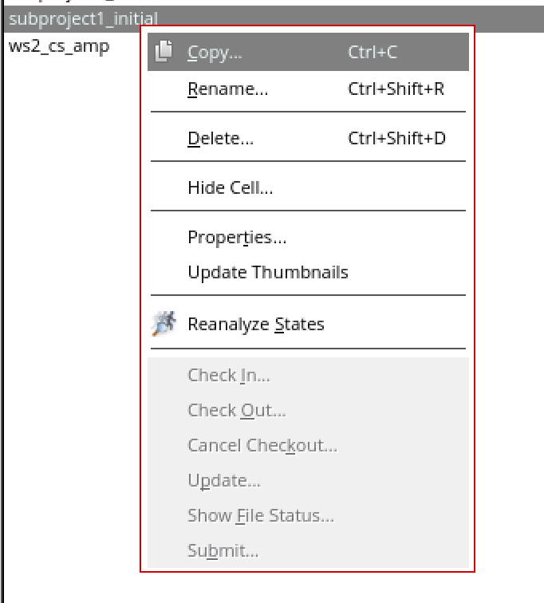<figcaption></figcaption></figure>

Then, configure the copy settings as follows:

<figure>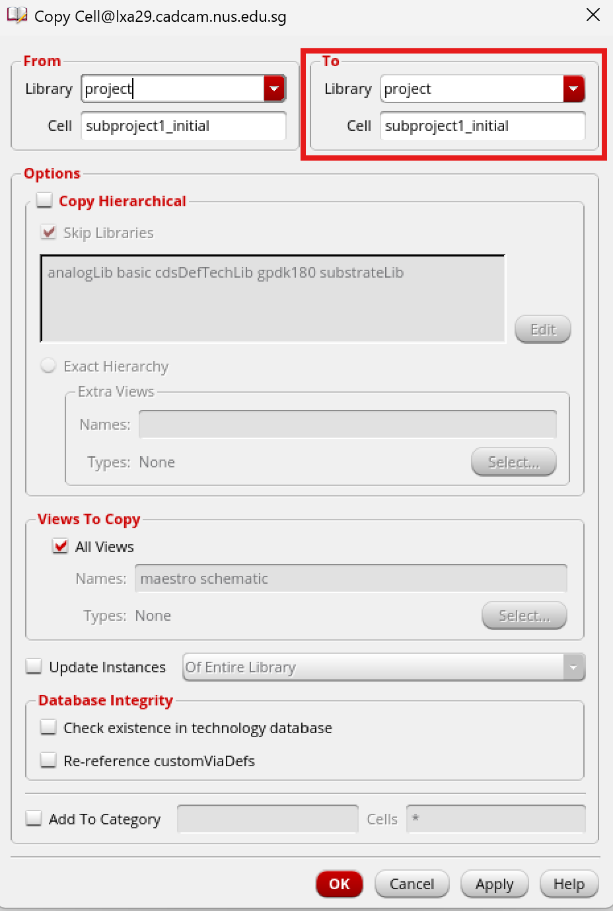<figcaption></figcaption></figure>

If we also copy the **Maestro** view, remember to update its **design reference** so that the copied Maestro uses the **newly copied design**.

<figure>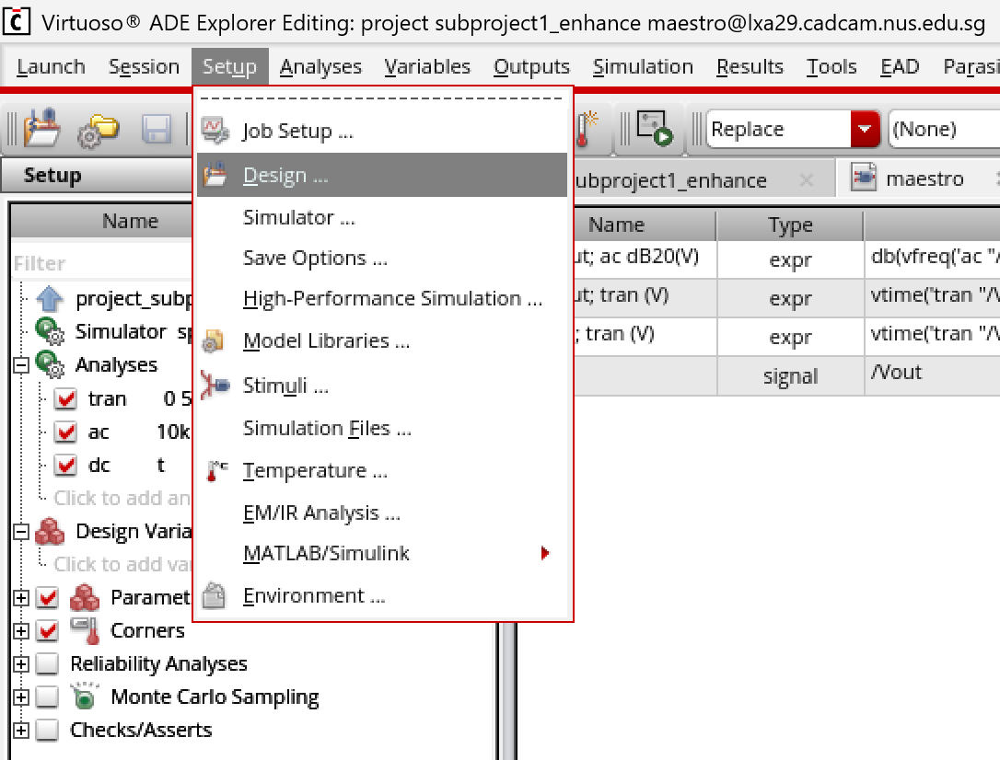<figcaption></figcaption></figure>

### Finger Width

In the gpdk180 PDK, the maximum width of a single MOS finger is **50 μm**. Therefore, for a larger total width, we need to split the device into multiple fingers by setting the **finger width** and **number of fingers** accordingly. For example, for a total NMOS width of $$55.6\,\mu\text{m}$$, we can use

$$
W_f=27.8\,\mu\text{m}, N_f=2
$$

giving

$$
W=W_fN_f=27.8\times2=55.6\,\mu\text{m}
$$

### Model Libraries

When running simulations from the **Maestro** view opened through **ADE Explorer**, we need to set up the appropriate **model libraries**. In the Model Library Setup window, we can select different **process corners**, such as **NN, FF, FS, SF,** and **SS**.

<figure>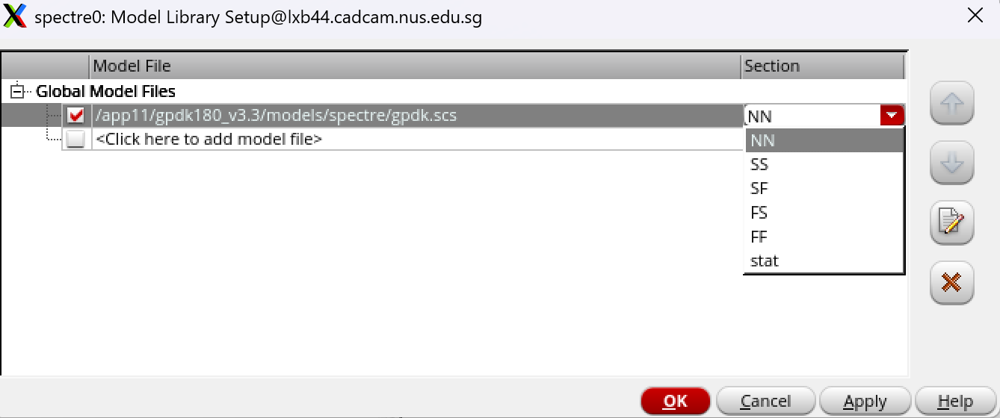<figcaption></figcaption></figure>

These are known as **process corners**. They represent different combinations of manufacturing process variations that affect the electrical characteristics of our MOSFETs, mainly including parameters such as **carrier mobility**. For our discussion, we can use the following intuition based on the [MOSFET I/V characteristics](https://app.gitbook.com/s/FkaT0aUkbzwIwL8qtYDI/razavi/basic-mos-device-physics/mos-i-v-characteristics) we have learned:

> **Higher/Lower carrier mobility -> larger/smaller drain current -> faster/slower MOSFET.**


Sometimes, "faster/slower" can be replaced with "stronger/weaker" that we've used a lot in CG2027.


The two letters in a process corner describe the process condition of the **NMOS** and **PMOS**, respectively:

* **FF** — Fast NMOS, Fast PMOS
* **SS** — Slow NMOS, Slow PMOS
* **FS** — Fast NMOS, Slow PMOS
* **SF** — Slow NMOS, Fast PMOS
* **NN** — Nominal NMOS, Nominal PMOS

Therefore, **process-corner simulations** allow us to investigate how our circuit behaves under different manufacturing conditions. We will see a concrete example of the effects of these process corners in the following **process-corner simulation**.


An easier way to memorize this is that **NMOS** is always at first!


## NMOS Device Characterization

After setting up the simulation environment correctly by following the workshop slides, we can begin characterizing the **NMOS transistor** provided in our **gpdk-180** [**PDK**](https://app.gitbook.com/s/o4JqYVwVk7U2q66ddB5L/textbook/cadence-dfii-and-icfb#process-design-kit). Our main goal is to plot the two fundamental I/V characteristics of the NMOS:

* $$I_D$$-$$V_{DS}$$ characteristics
* $$I_D$$-$$V_{GS}$$ characteristics

To plot these to diagrams in our circuit, we will create a schematic as follows:

<figure>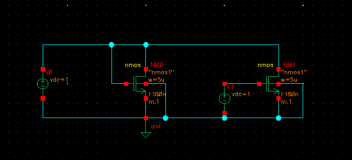<figcaption></figcaption></figure>

Basically, we will sweep the **VDC source** named `V0` and measure the drain current of the two NMOS devices.

* The first NMOS, `NM0`, will be used to obtain the $$I_D$$-$$V_{DS}$$ characteristics.
* The second NMOS will be used to obtain the $$I_D$$-$$V_{GS}$$ characteristics.


#### Why connect both gate and drain of `NM0` to `V0`?

The reason is to ensure that `NM0` operates in the **saturation region**. Since under this circumstance, $$V_{DS}=V_{GS}>V_{GS}-V_{TH}$$, `NM0` will always work in **saturation region**!


The final simulation plot we will get is shown as follows, where the lower plot shows the $$I_D$$-$$V_{DS}$$ characteristic and the upper plot shows the $$I_D$$-$$V_{GS}$$ characteristics.

<figure>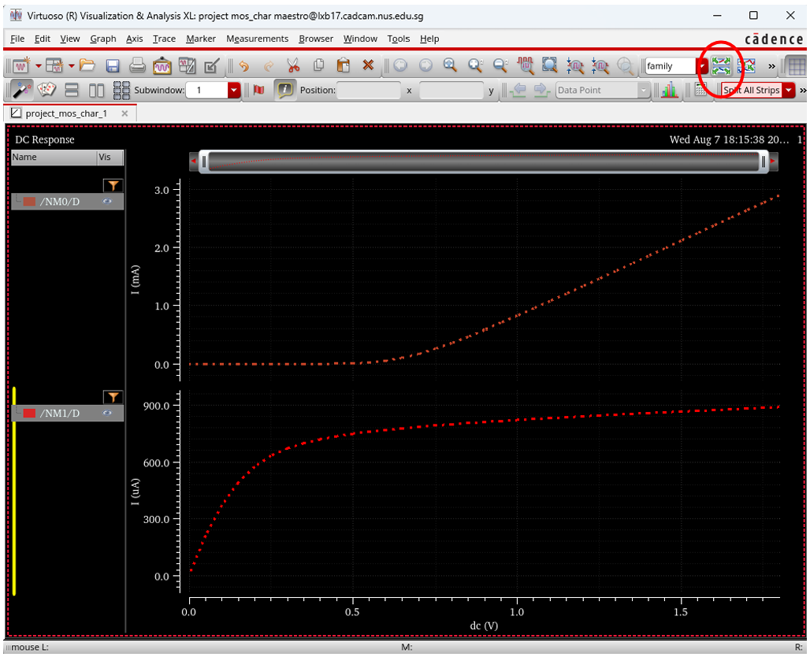<figcaption></figcaption></figure>

Export the plot into CSV

After plotting the simulation results, we may want to **export the waveform data as a CSV file** for further processing and analysis. To export the data,

1. click the plot
2. select: "Send To" -> "Export"
3. Then choose the appropriate export settings and save the waveform data as a CSV file.

<figure>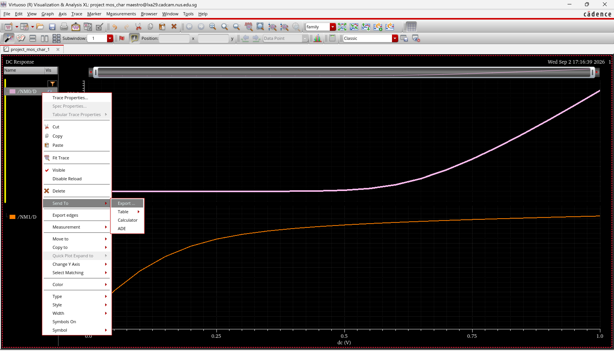<figcaption></figcaption></figure>

### Meausre Threshold Voltage

To measure the **threshold voltage** $$V_{TH}$$ of the NMOS, we use its $$I_D$$-$$V_{GS}$$ characteristics. We manipulate the simulation data to plot $$\sqrt{I_D}$$ **versus** $$V_{GS}$$, giving a plot similar to the one shown below.

<figure>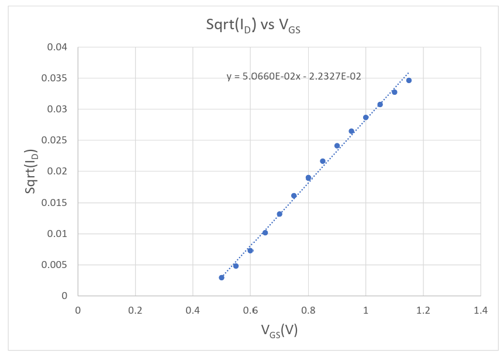<figcaption></figcaption></figure>

In the saturation region, taking the square root of the $$I_D$$ gives:

$$
\sqrt{I_D}=\sqrt{\frac{1}{2}\mu_n C_{ox}\frac{W}{L}}\,(V_{GS}-V_{TH})
$$

This produces an approximately **linear relationship** between $$\sqrt{I_D}$$ and $$V_{GS}$$. From the **slope**, we can extract $$\mu_n C_{ox}$$ (given $$W/L$$), while the **x-intercept** gives the NMOS threshold voltage $$V_{TH}$$.

### Measure the CLM parameter $$\lambda$$

To measure the **channel-length modulation parameter** $$\lambda$$, we need to know the NMOS threshold voltage $$V_{TH}$$ and saturation drain current $$I_{D0}$$. We then use the $$I_D$$-$$V_{DS}$$ characteristics.

1. **Determine the start of the saturation region**: Calculate/Measure the $$V_{DS}$$ at the boundary between the linear and saturation regions: $$V_{DS}=V_{GS}-V_{TH}$$. Since $$V_{GS}$$ and $$V_{TH}$$ are known, this value can be calculated. (Or Prof. Gao mentioned that we can roughly decide this point)
2. **Plot the saturation-region data**: Use the $$I_D$$ values for $$V_{DS}>V_{GS}-V_{TH}$$ and plot $$I_D$$ against $$V_{DS}$$.

<figure>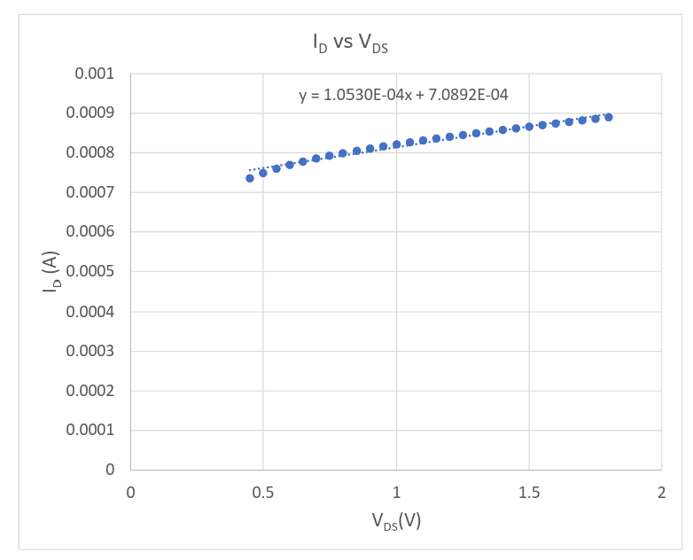<figcaption></figcaption></figure>

In the saturation region,

$$
I_D \approx I_{D0}(1+\lambda V_{DS})
$$

so the **slope of the** $$I_D$$-$$V_{DS}$$ **plot is approximately** $$\lambda I_{D0}$$. Since $$I_{D0}$$ is already known, we can obtain $$\lambda$$ from the slope.

### Process Corner Simulation

We briefly introduced **process corners** in [above](workshop-1-simple-device-characterization.md#model-libraries). By following the setup steps provided in the workshop slides, we can perform a **process corner simulation** and obtain the corresponding simulation plots.

<figure>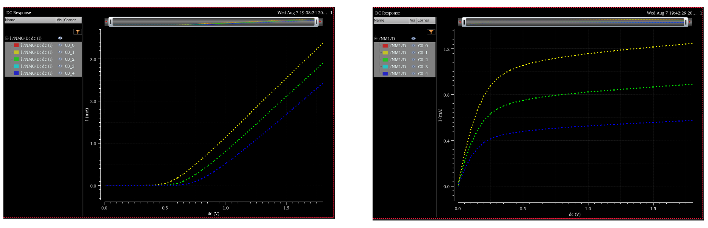<figcaption></figcaption></figure>

As shown in the plots above, the **yellow curve** exhibits the highest drain current among the simulated process corners. This indicates that the corresponding process corner has the **strongest (fastest) NMOS device**, resulting in a larger drain current for the same applied voltage.
