# Workshop 2 - Amplifier Design

In this workshop, we will learn how to design the following two amplifiers, from schematic capture to running **AC** and **transient analyses** in [**Maestro**](https://app.gitbook.com/s/o4JqYVwVk7U2q66ddB5L/textbook/cadence-dfii-and-icfb#maestro) using **Cadence Virtuoso**:

* Single-stage common-source amplifier
* Op-amp

## Single-Stage CS Amplifier

In this section, we will learn a **systematic procedure for designing a single-stage common-source (CS) amplifier** and optimizing its voltage gain. The schematic of the amplifier is shown below.

<figure>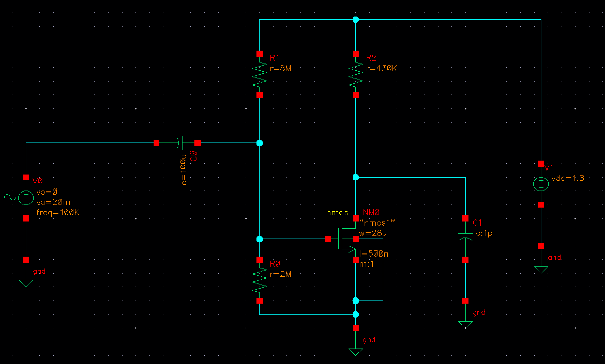<figcaption></figcaption></figure>

From my experience of doing subproject 1, the general procedure to design a CS stage amplifier with a current source load should be as follows:



#### **Choose the reference drain current** $$I_D$$ based on the current/power constraint

For example, if the total current limit is $$100\,\mu A$$, an initial choice of $$I_D\approx50\,\mu A$$ may provide sufficient margin.



#### **Perform the initial transistor sizing**

* From the required voltage gain, estimate the required $$g_m$$ (Use the given value for threshold voltages and the other constants, and then use $$g_m\approx\frac{1}{\lambda_{n/p}\cdot I_D}$$)
* Calculate the corresponding overdrive voltage $$V_{OV}$$ ($$V_{OV}=\frac{2I_D}{g_m}$$).
* Use $$I_D$$ and $$V_{OV}$$ to determine the initial $$W/L$$ ratios of the NMOS and PMOS ($$\frac{W}{L}=\frac{2I_D}{k'V_{OV}^2}$$).



#### **Tune the DC operating point**

* Sweep the PMOS gate bias voltage $$V_{G,P}$$.
* Select the value that gives $$V_{out,DC}\approx\frac{V_{DD}}{2}$$, this usually will guarantee both MOSFETs operate in saturation.


If unsure about whether the MOS devices work under saturation or not, just plot the DC bias points in the circuit, especially to include the `vdsat` and `vds` in the [annotations](workshop-1-simple-device-characterization.md#annotations). If |vds| > |vdsat|, then the MOS device works under saturation region.




#### **Improve the voltage gain if necessary**

* If the gain is insufficient, increase the **channel length LL** to reduce channel-length modulation and increase ror\_o.
* Scale WW accordingly to approximately maintain the desired W/LW/L and bias conditions.


Immediately after resizing, the DC operating point may shift significantly, causing distorted transient responses or poor AC gain. Retune the **bias** (introduce as follows) before evaluating the new design.




#### **Retune and verify the operating point**

* Sweep $$V_{G,P}$$ again until $$V_{out,DC}\approx V_{DD}/2$$.
* Verify that both MOSFETs remain in saturation.
* Rerun the AC and transient analyses to check the gain and output swing.



#### **Optional: replace the ideal PMOS bias with a current mirror**

* Match the reference PMOS to the PMOS current-source load.
* Calculate an initial reference resistor $$R_{REF}$$ from the desired bias current.
* Sweep $$R_{REF}$$ around the calculated value and select the value that restores $$V_{out,DC}\approx\frac{V_{DD}}{2}$$.
* Finally, verify **DC bias, saturation, gain, output swing, and total current** against all design specifications.



### **AC Simulation**

In NUS EE4415, we have so far only used **DC analysis** in Maestro. We will now introduce **AC analysis**, which evaluates the circuit's response to the small-signal AC voltage source in our schematic.

<figure>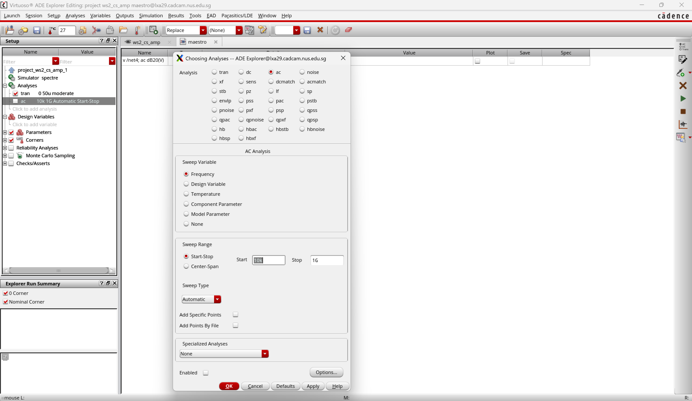<figcaption></figcaption></figure>

The AC analysis allows us to plot the amplifier's **gain-frequency response**, which is the goal of [Step 3](workshop-2-amplifier-design.md#perform-ac-analysis) above.

<figure>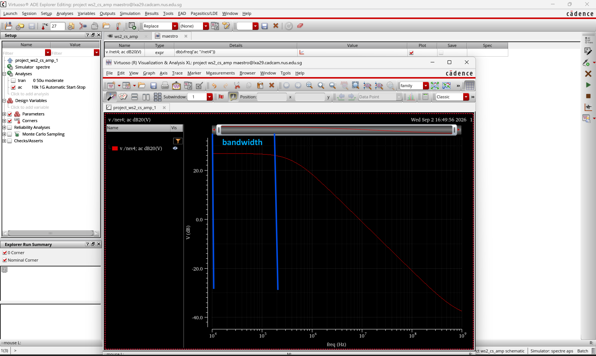<figcaption></figcaption></figure>

The **bandwidth** is the blue frequency range shown in the example above. For the subsequent transient analysis, we should choose an input frequency **within this range**, where the amplifier provides approximately highest and constant gain.


In **Maestro**, we can only have **one analysis of each type** at a time, e.g., one **AC**, one **DC**, and one **Transient (tran)** analysis.


Steps to do AC Analysis

For **AC analysis in Cadence**, it is recommended to plot the **gain-frequency response** through **Results** -> **Direct Plot -> Main Form** and configure the appropriate AC analysis settings:

<figure>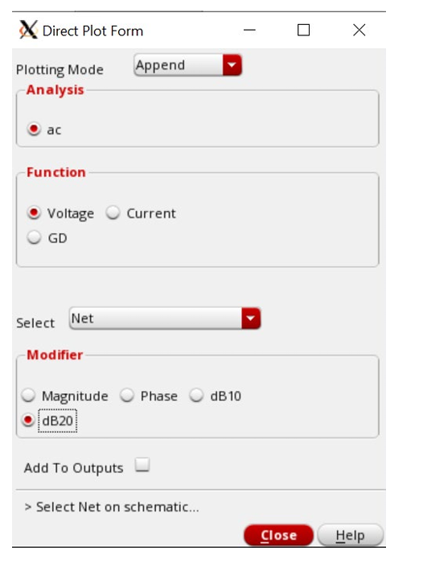<figcaption></figcaption></figure>


It is also recommended to select **Add to Outputs**, which saves the plot configuration so that it can be generated automatically in future simulations without repeating the setup.


Finally, select the $$V_{\text{out}}$$ wire in the schematic and press <kbd>ESC</kbd> to generate the gain-frequency plot. Below is an example if we add these settings to outputs automatically:

<figure>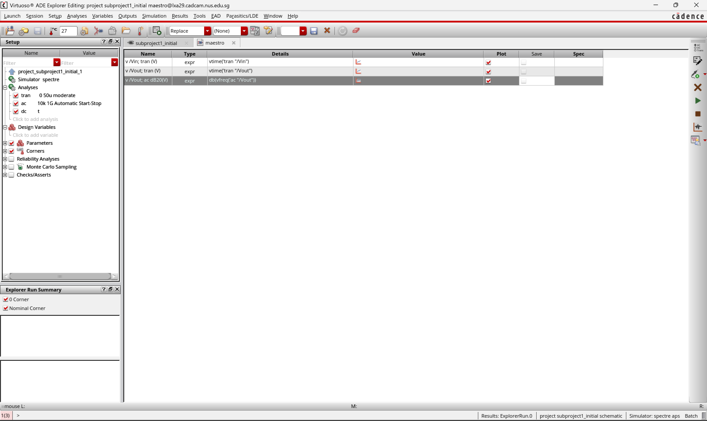<figcaption></figcaption></figure>

To do the AC analysis on a differential amplifier (project 2), we just need to set the properties  of our two AC input voltage sources as follows:

<figure>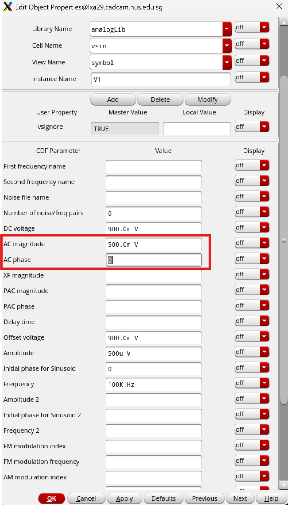<figcaption>
An example of one AC voltage source
</figcaption></figure>

Make sure the "AC phase" matches with the "initial phase for sinusoid" and the "AC magnitude" are correct. Then follow the steps above to only choose $$V_{\text{out}}$$ to plot the AC simulation diagram.


"AC Magnitude" is used in AC analysis while "Amplitude" is used in transient analysis.


### Transient Simulation

In **transient analysis**, we study how circuit voltages and currents, such as $$V_{\text{in}}$$ and $$V_{\text{out}},$$ change **over time**. This is the third type of analysis we will cover. For our amplifier, transient analysis allows us to measure the input and output signal amplitudes and calculate the **actual voltage gain**:

$$
A_v=\frac{V_{\text{out}}}{V_{\text{in}}}
$$

<figure>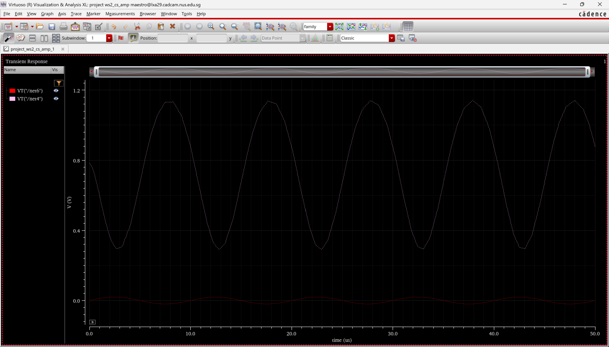<figcaption></figcaption></figure>

Steps to do transient analysis

After setting the **transient analysis**, the transient waveform will not appear automatically. Open it by selecting: "Results -> Direct Plot -> Transient Signal".


An alternative (but recommended) is to directly open "**Results -> Direct Plot -> Main Form**" and select both $$V_{\text{in}}$$ and $$V_{\text{out}}$$. We can then choose **Save to Outputs** so that the transient waveforms can be plotted automatically in future simulations.


<figure>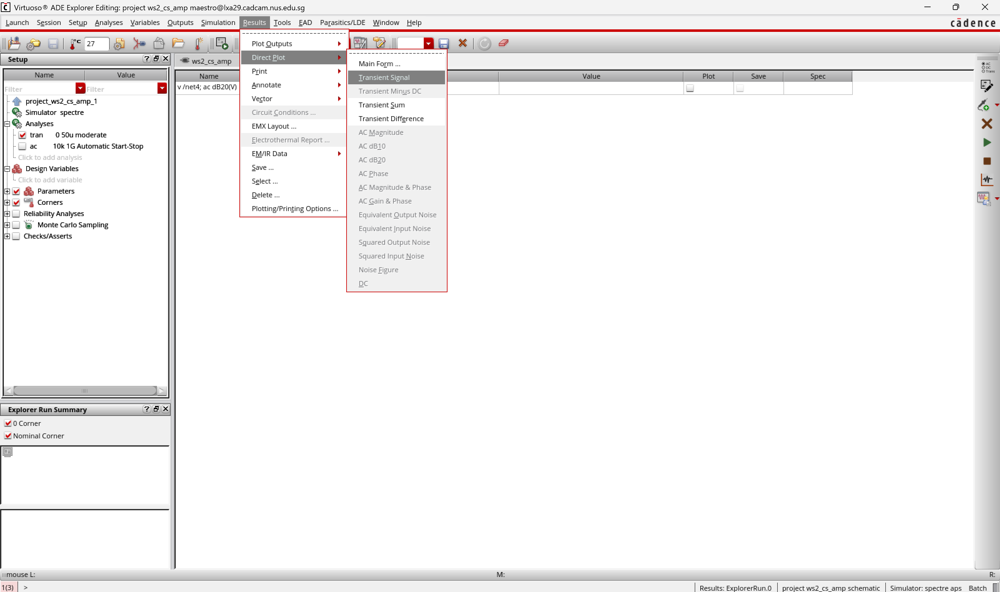<figcaption></figcaption></figure>

Once the plot window opens, return to the schematic and select the signals for the **x- and y-axes**. In this case, select $$V_{\text{in}}$$ and $$V_{\text{out}}$$. Press <kbd>ESC</kbd> after making the selections, and the transient waveforms should appear in the plot window.

<figure>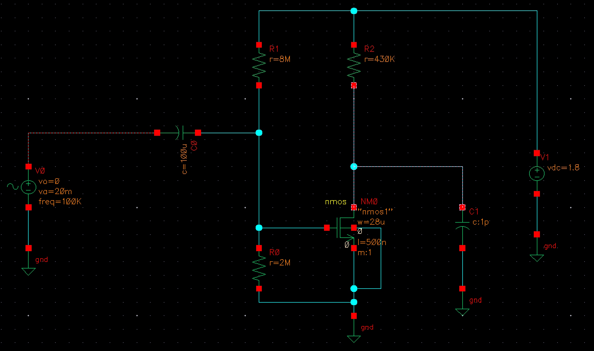<figcaption></figcaption></figure>

### DC Analysis

DC analysis is useful for finding a **suitable gate voltage bias** for a MOSFET.

<figure>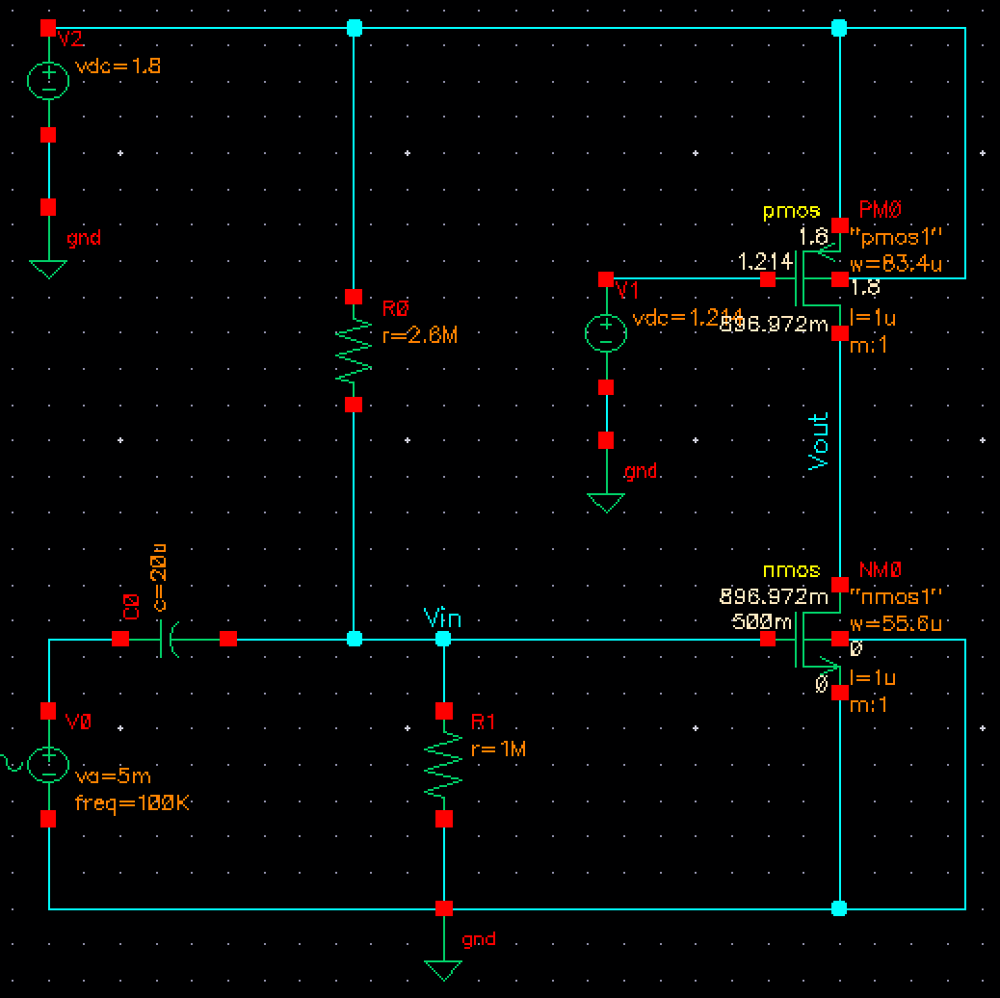<figcaption></figcaption></figure>

For example, if we want to sweep the voltage at V1 shown above, we can set up the **DC analysis** as follows:

<figure>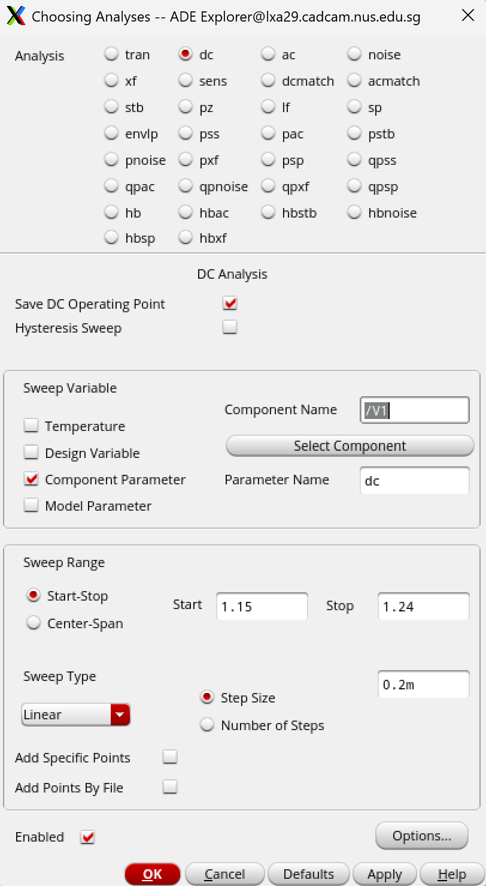<figcaption></figcaption></figure>

Besides sweeping the DC voltage, it is also possible to sweep the resistance, an example is shown below:

<figure>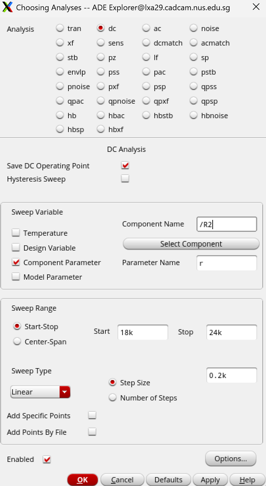<figcaption></figcaption></figure>

## Op-amp

> Since we haven't covered this part in the lecture, will leave this as a TODO for the future.
