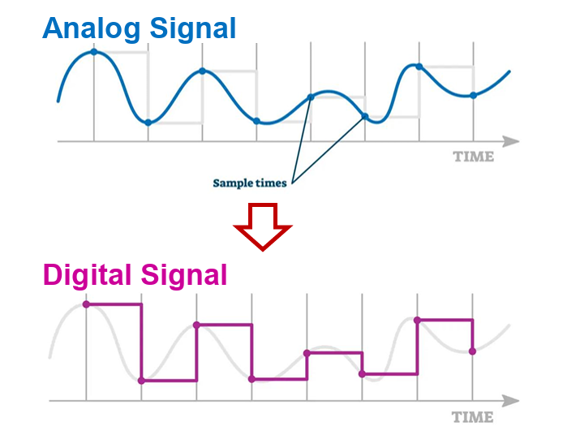
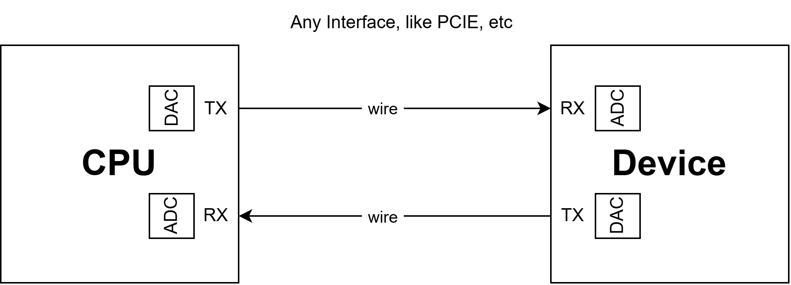
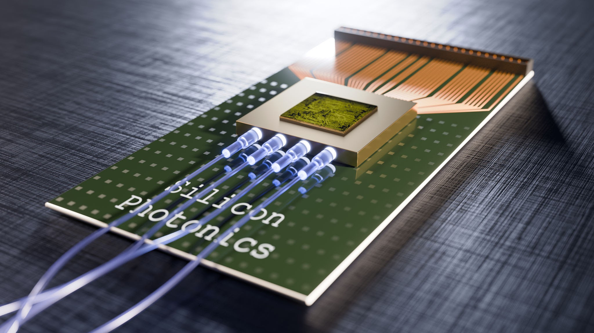
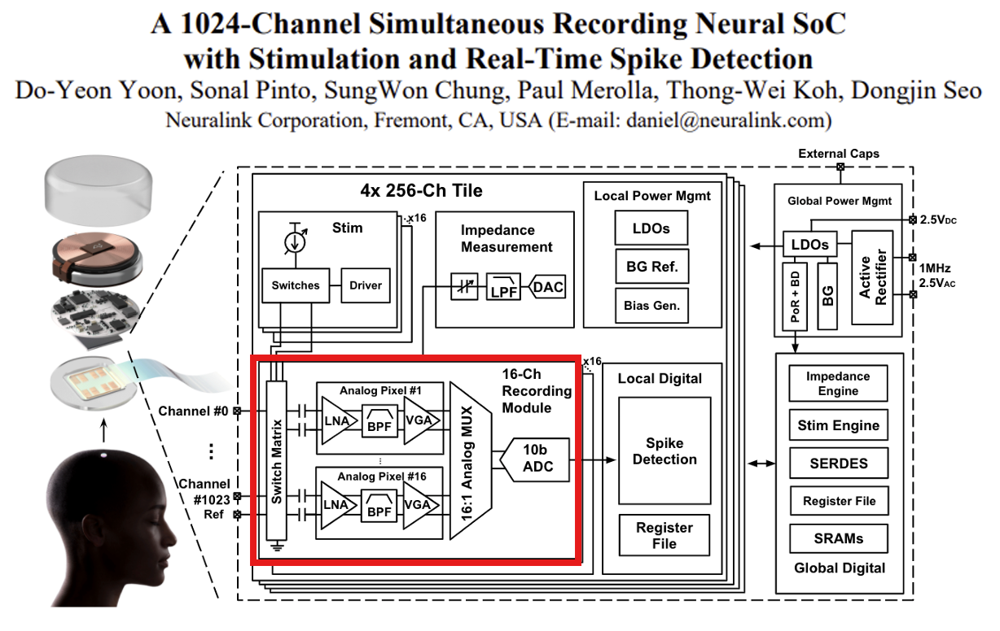

# Lec 1 - Module Introduction

## The World of Analog ICs

In this module we will learn how to **design** analog integrated circuits that process **analog signals**, which are **continous in time**. An example of analog vs. digital signal can be shown as follows:

<figure><figcaption></figcaption></figure>

Because the physical world is fundamentally **analog**, analog circuitry remains essential in modern electronics. Currently, one of the largest applications for analog design is in Power Management ICs (PMICs). But, the following applications of Analog ICs which Prof. Gao and Prof. Jang is doing are also very promising!

### High-Speed Interconnects

According to Prof. Gao, the next major frontier will be **high-speed GPU interconnects** in data centers. More specifically, from my discussion with Prof. Gao, I learned that his research focuses on the development of **high-speed interconnects**, such as PCIe, UCIe, and NVLink, which play an increasingly important role in modern AI infrastructure by enabling high-bandwidth communication between processors, accelerators, and other devices.

<figure><figcaption>
For more Info on the interconnectin the computer systems, please look at my notes on I/O devices in OSTEP
</figcaption></figure>

An interesting aspect of this research is how **analog circuit design contributes to high-speed digital communication**. For example, in a high-speed interface such as PCIe, the CPU and the connected device communicate through separate **transmit (TX) and receive (RX) channels**, as illustrated above.

When the CPU sends data to the device, the digital information is converted into an analog electrical waveform by the **transmitter (TX)**, which uses analog circuitry to drive the signal through the interconnect. At the receiving end, the **receiver (RX)** processes the incoming analog waveform and recovers the transmitted digital data. The same process occurs in the opposite direction.

The key reason for using analog circuitry is that **physical interconnects introduce resistance, capacitance, and other parasitic effects**, which distort signals and limit transmission speed. In particular, the RC characteristics of the wire slow down signal transitions, making it increasingly difficult to distinguish between digital 0s and 1s at high data rates.

By employing **high-speed analog and mixed-signal circuits**, such as ADCs, DACs, output drivers, equalizers, and receivers, we can compensate for channel distortion and recover digital information reliably, enabling much higher data rates.


#### SerDes Circuit

According to Prof. Jang, one of the key technologies used in modern high-speed interconnects is **SerDes (Serializer/Deserializer)**, which enables high-speed data transmission between chips or devices.

* **Serializer (TX):** Converts a wide stream of parallel digital data (e.g., 8-bit, 16-bit, or wider) into a high-speed serial bitstream for transmission over a physical channel, typically a differential pair of wires or PCB traces.
* **Deserializer (RX):** Receives the high-speed serial signal, recovers the transmitted data and timing information, and converts the serial bitstream back into parallel digital data.

The design of a SerDes involves both **digital and analog/mixed-signal circuits**. In particular, high-speed transmitters, receivers, equalizers, and clock and data recovery (CDR) circuits rely heavily on analog/mixed-signal design.


The performance of these circuits is crucial in determining the **maximum achievable data rate of the interconnect**, typically measured in **Gbps (gigabits per second)** and hence the **bandwidth of the interconnect (GB/s)**.

> How is this different from the memory bottleneck commonly discussed in computer architecture, where accessing the physical memory is significantly slower than accessing the registers within the processor itself?

The **memory bottleneck** and the **interconnect bottleneck** are related but distinct concepts.

* **Memory Bottleneck:** Arises from limitations in the memory subsystem itself, including DRAM access latency, bandwidth, and internal operations. For example, DRAM requires time to activate a row, develop and sense small voltage differences using sense amplifiers, restore the stored data, and precharge the bitlines before subsequent accesses. These operations contribute to memory access latency. Furthermore, memory bandwidth may be insufficient to keep up with the processor's demand.
* **Interconnect Bottleneck:** Arises when the communication link between components cannot transfer data quickly enough. Even if the memory or processing devices are fast, insufficient interconnect bandwidth can limit overall system performance.

In modern AI infrastructure, **both memory bandwidth and interconnect bandwidth can become major bottlenecks**, depending on the workload. For example, accessing model parameters may be limited by GPU memory bandwidth, while exchanging data between GPUs during distributed training may be limited by interconnect bandwidth.

#### Optical Interconnect

While today's electrical interconnects already rely heavily on analog circuits, the impending shift to **optical** interconnects will still fundamentally depend on analog engineering.

<figure><figcaption></figcaption></figure>

### Brain Computer Interface

According to Prof. Jang, if you have a good knowledge of all the materials covered in this module, you will be able to design the analog part in red rectangle in the following SoC design! Quite cool right!

<figure><figcaption></figcaption></figure>

In this course, essentially we are going to learn how to design amplifers and filters from scratch using the MOSFETs, these will be the building blocks for the circuits in the red-circled part in the image above:

1. LNA: Low Noise Amplifier
2. BPF: Band-Pass Filter
3. VGA: Variable-Gain Amplifier

### Analog IC Design Flow

In EE4415, we have already learned the[ **digital ASIC design flow**](https://app.gitbook.com/s/Sp0XaarBjbEX3JIMrRaR/part-1-lec-digital-design-flow/lec-3a-digital-design-flow#the-design-flow-lifecycle), where we write RTL code in Verilog/SystemVerilog to describe the desired hardware. EDA tools then synthesize the RTL into a gate-level netlist and automate much of the **placement and routing** process. After physical design and verification, the chip can be sent for fabrication.

<figure><figcaption>
Analog IC Design Flow
</figcaption></figure>

Similarly, in **analog IC design**, instead of writing RTL code, we typically begin by

1. **Schematic Design**: **designing and drawing transistor-level schematics in Cadence Virtuoso**, which is what we will be doing in our EE3408C projects.
2. **Pre-layout simulation**: perform schematic-level simulations to verify that the circuit meets the design specifications.
3. **Layout Design**: Once the schematic is finalized, analog IC designers proceed to the **physical layout**, where transistors, passive components, and interconnections are placed and routed, often **manually**, with careful consideration of matching, parasitics, and noise. This is conceptually equivalent to the placement and routing stage in digital ASIC design.
4. **Physical Verification**: After completing the layout, we perform **DRC (Design Rule Check)** and **LVS (Layout Versus Schematic)** verification,
5. **Parasitic extraction**: Extract the parasitics such as resistances and capacitances from the layout,
6. **Post-layout Simulation**: Run **post-layout simulations** to ensure that the fabricated circuit is expected to meet its specifications.

The key difference is that **digital ASIC design relies heavily on automated synthesis and physical design tools**, whereas **custom analog IC design requires much more manual transistor-level design and layout optimization**.

## Logistics

In this course, we will cover

* The understanding of CMOS circuit operation through [**analytical analysis**](#user-content-fn-1)[^1] using MOSFET [**small-signal models**](#user-content-fn-2)[^2].
* How to use [Cadence Virtuoso](https://app.gitbook.com/o/MnEKr5A4lYXtOfhoXGj5/s/o4JqYVwVk7U2q66ddB5L/) (a continuation on EE4415!)

For a better learning experience, students are recommended to have a good knowledge of

* Digital Circuits at transistor Level (EE2027)
* Several important transform functions covered in signals and systems (EE/CG2023)


CG2027 is not included here as we don't cover small signal model in CG2027! So, emmm, might be a challenge for CEG peeps to self-study the small signal models.


To study this module well, it is recommended to not to be a "spice monkey", meaning doing a lot of nonsense simulations without hand calculations. Prof. Gao recommends us always do some hand calculations and then run simulations!


One last sentence mentioned by Prof. Gao is that, "Put enough effort and time in this module and you will legit learn a lot!"


For the project that we are going to do in this course, it is actually **linked** together! Be ready to find the link!


According to Prof. Jang, the finals for AY26/27 Sem 1 will focus equally on the first-half and second-half of this course, there are 4 big questions, 2 from the first-half and two from the second-half. And there will be 5-6 small questions within each question. Thus, in total there will be around 20-24 questions.


[^1]: This is nothing but **equations**!

[^2]: According to Prof. Gao, this is the easiest model to help us understand analog circuits.
