# Lec 10 - Frequency Response Part 2

So far, we have mainly focused on the **low-frequency gain** (or [**DC gain**](lec-9-operational-amplifiers.md)) of an amplifier, where the effects of parasitic capacitances are neglected. Under this assumption, the amplifier gain appears to remain constant regardless of frequency. However, in reality, amplifiers contain parasitic capacitances and capacitive loads that cause their gain to vary with frequency. This frequency-dependent behaviour is known as the **frequency response** of an amplifier, which we will explore in detail in this lecture.

In this part, we will first review the fundamental techniques introduced in Part 1, which are essential for performing frequency response analysis. We will then explore several new concepts, including phase margin, gain margin, and frequency compensation. Finally, we will apply these concepts to rigorously analyze the frequency response of two-stage and telescopic op-amps.

## Recap for Lec 6

The essential information describing the frequency response of an amplifier can be captured by its transfer function, which incorporates the voltage gain, poles, and zeros. In general, the transfer function can be expressed as:

$$
H(s)=A_v\times\frac{(1-s/z_1)(1-s/z_2)\cdots}{(1+s/\omega_1)(1+s/\omega_2)(1+s/\omega_3)\cdots}
$$


In EE3408C, since we assume all impedances are positive, thus we can only have **LHP poles**. For zeros, according to Prof. Gao, we will only encounter **RHP zeros** if the zeros is createdly by the $$C_{GD}$$ capacitance with only one exception of the LHP zero introduced in the D-to-S differential amplifier!


Therefore, to analyze the frequency response of an amplifier or analog circuit, we need to be able to derive its complete transfer function. To do so efficiently, we should master three essential techniques:

1. **Voltage gain** $$A_v$$: Determine the low-frequency gain using the intuitive analysis techniques introduced in the [Lecture 8 recap](lec-8-differential-amplifiers.md#a-recap-for-lec-1-to-lec-7) and practiced throughout the semester.
2. **Poles**: Identify and estimate the pole frequencies using the [association of poles](https://app.gitbook.com/s/FkaT0aUkbzwIwL8qtYDI/razavi/frequency-response-of-amplifiers/cg-amplifier#association-of-poles-with-nodes) technique. (There is no need to draw out the full small-signal diagram!)
3. **Zeros**: Identify and estimate the zeros using a quick analysis technique that we will revisit later in this lecture.

By combining these three pieces of information, we can construct an approximate transfer function and then use the summary introduced earlier to draw the bode plot and thus comprend the frequency analysis of the amplifier.

### Draw the Bode Plot

The general rules to draw a bode plot has been introduced [here](https://app.gitbook.com/s/FkaT0aUkbzwIwL8qtYDI/razavi/frequency-response-of-amplifiers/general-considerations#general-rules-for-drawing-bode-plots).  One important point to note is that, in the **magnitude Bode plot**, we plot the magnitude of the transfer function, $$|H(j\omega)|$$, rather than its signed value. Therefore, regardless of whether the DC gain is positive or negative, its magnitude is always non-negative. As a result, the magnitude Bode plot starts with a horizontal line at the low-frequency gain magnitude, typically expressed as $$20\log_{10}|A_v|$$ in dB, before the effects of poles and zeros become significant.


The gain magnitude in dB is **not necessarily positive**. If $$|A_v|<1$$, the starting value will be negative in dB.


For example, if we have a transfer function as follows, we can draw its magnitude and phase bode plot as follows:

<figure>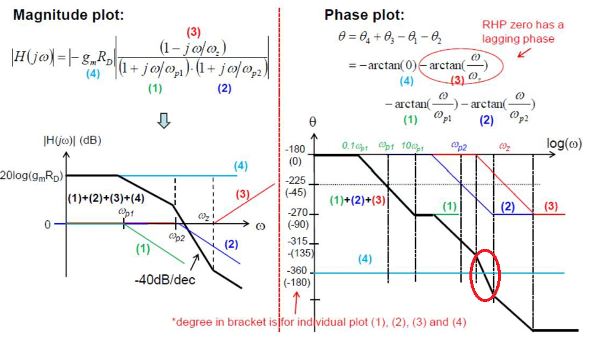<figcaption></figcaption></figure>

Notice that in the phase Bode plot, the zero frequency $$\omega_{z}$$ lies between $$\omega_{p2}$$ and $$10\omega_{p2}$$. As a result, the phase experiences a steeper drop in the red-circled region due to the overlapping contributions of the pole and zero. However, beyond $$10\omega_{p2}$$, the phase slope returns to its previous value as the phase contribution of the second pole approaches its final value.

### Quickly Find Zeros

We have briefly introduced two techniques for quickly identifying zeros in an amplifier in [Tutorial 2](../tut/tut-2-frequency-response.md). To recap, these techniques are:

1. **DC Zero**: Check whether the circuit contains an input **coupling capacitor**. If the input signal must pass through this capacitor, the transfer function typically has a zero at DC, e.g., $$s=0$$ (or $$\omega_z=0$$).
2. **High-Frequency Zero**: Check whether the circuit contains a feedforward path, often introduced by the gate-drain parasitic capacitance $$C_{GD}$$. To determine the value/location of this zero, we can usually set $$V_{out}=0$$ while applying a nonzero input signal, then solve the circuit equations using KCL for the value of $$s$$ that satisfies this condition.

To find the high-frequency zero, it is recommended to draw out the full small-signal diagram, but you will see soon that it is not required to solve for the complex $$V_{gs}$$ as they will be cancelled!

<figure>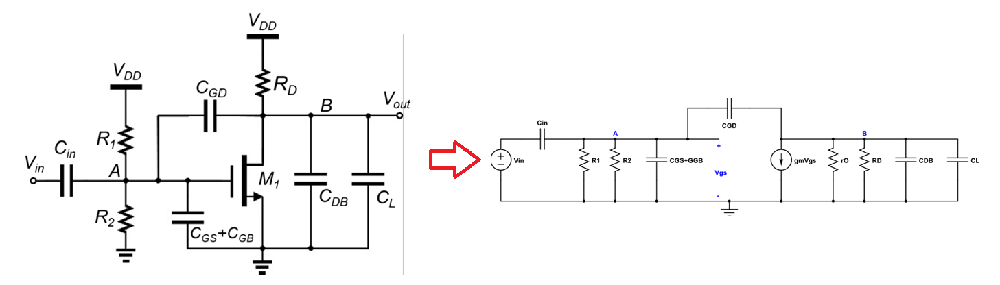<figcaption>
An example to find high-frequency zero from Tutorial 2
</figcaption></figure>

In the circuit above, after setting the output node to 0, we can easily ignore all the capacitors and resistors at the output node and just use $$V_{gs}$$ to write out the following KCL node B.

$$
V_{gs}sC_{GD}=g_mV_{gs}\Rightarrow s=\frac{g_m}{C_{GD}}
$$

Thus, we don't even need to solve for the $$V_{gs}$$ to get the high-frequency zero! Another example is to find the zeros quickly in the following circuit, but this time we should use the idea of **propagation of the ground effect**.

<figure>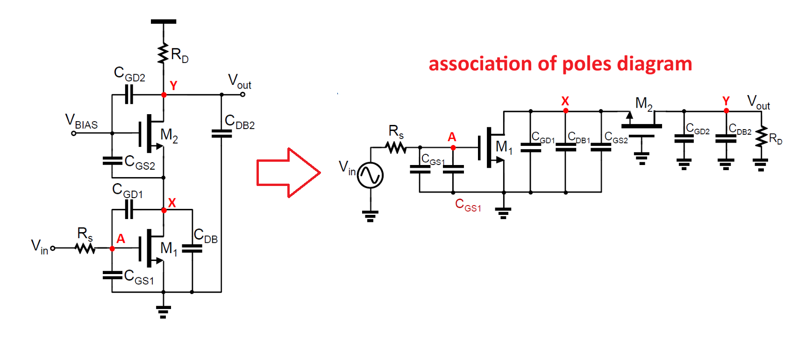<figcaption>
Another example, but actually we don't need to draw the association of poles diagram to find the zeros
</figcaption></figure>

In this circuit, to find the high-frequency zero, we set the output node, which is the node Y to 0, as the gate for NMOS M2 is connected to a bias voltage, it is treated as virtual ground in the small signal diagram. This will make node X to be a virtual ground also! After this propagation of ground effect, we will find out that the amplifier formed between A and X is just a normal CS amplifier and the high-frequency zero is thus:

$$
\omega_z=\frac{g_m}{C_{GD}}
$$

## Feedback and Stability

Recall that in the previous lecture, we saw that an op-amp circuit can have a **feedback path** from its output back to its input. Such a configuration is known as a **feedback amplifier**.

<figure>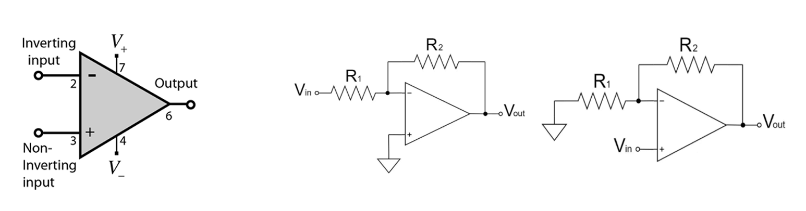<figcaption>
Op-amp figures from Lec 9
</figcaption></figure>

A feedback amplifier is also called a **closed-loop amplifier**, as opposed to an **open-loop amplifier**, which operates without feedback. However, introducing feedback does not necessarily guarantee that an amplifier will be stable. In fact, feedback can sometimes cause an amplifier to become unstable. The techniques used to improve the stability of feedback amplifiers are known as **frequency compensation**.


We will explore what **stability** means in more detail later in this lecture! For now, just remember that a **stable amplifier** is one whose output settles to a finite, well-defined value rather than exhibiting oscillations that grow uncontrollably.


### Open- and Closed-loop Amplifier

A general **closed-loop amplifier** can be represented by the following feedback block diagram:

<figure>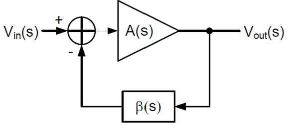<figcaption></figcaption></figure>

where:

* $$A(s)$$ is the **open-loop transfer function (open-loop gain)**, representing the gain of the forward amplifier.
* $$\beta(s)$$ is the **feedback transfer function (feedback factor)**, representing the fraction of the output signal fed back to the input.
* $$A(s)\beta(s)$$ is the **loop gain**, which describes the gain accumulated around the feedback loop. (Loop gain is different from the closed-loop gain!)


Notice that, for the standard **negative-feedback configuration** where the feedback path is connected to the negative input pin of the forward amplifier, the subtraction is already represented at the input summing junction. Therefore, $$\beta(s)$$ itself does not need to be negative. (See more from the [example](lec-10-frequency-response-part-2.md#finding) below!)


The **closed-loop gain** can then be derived as follows:

$$
V_{\text{out}}(s)=A(s)\left[V_{\text{in}}(s)-\beta(s)V_{\text{out}}(s)\right]
$$

Rearranging, we obtain:

$$
\frac{V_{\text{out}}(s)}{V_{\text{in}}(s)}=\frac{A(s)}{1+A(s)\beta(s)}\tag{9.1}
$$

Furthermore, if the **loop gain is sufficiently large**, i.e., $$|A(s)\beta(s)|\gg 1$$, the closed-loop gain can be approximated as:

$$
\frac{V_{\text{out}}(s)}{V_{\text{in}}(s)}\approx\frac{1}{\beta(s)}
$$

This is an important result! It tells us that, when the loop gain is sufficiently large, the **closed-loop gain is primarily determined by the feedback network**, rather than the open-loop gain of the amplifier itself.

Finding \beta(s)

Consider the op-amp circuit shown below:

<figure>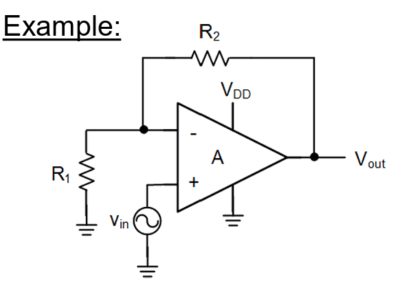<figcaption></figcaption></figure>

In this circuit, the output voltage is fed back to the **inverting (negative) input terminal** through a resistive voltage divider formed by $$R_1$$ and $$R_2$$. Since $$R_1$$ is connected between the inverting input and ground, while $$R_2$$ is connected between the output and the inverting input, the feedback factor is:

\beta(s)=\frac{V_f(s)}{V_{\text{out}}(s)}=\frac{R_1}{R_1+R_2}

Since the feedback signal is applied to the **inverting input**, it is subtracted from the input signal, resulting in negative feedback.


Notice that $$\beta(s)$$ **remains positive** in our convention, since the negative sign is already accounted for by the subtraction at the input.


Therefore, assuming a sufficiently large loop gain, the closed-loop gain becomes:

\frac{V_{\text{out}}}{V_{\text{in}}}\approx\frac{1}{\beta}=1+\frac{R_2}{R_1}

#### Barkhausen's Criterion

Recall from Equation (9.1) that the closed-loop gain is given by: $$\frac{V_{\text{out}}(s)}{V_{\text{in}}(s)}=\frac{A(s)}{1+A(s)\beta(s)}$$. Notice that if $$A(s)\beta(s)=-1$$, the denominator becomes zero, causing the closed-loop transfer function to become unbounded. This condition is closely related to the **Barkhausen criterion**.


In EE3408C, we usually use $$s=j\omega$$.


So, what makes $$A(j\omega)\beta(j\omega)=-1$$? There are two conditions that must be satisfied simultaneously:

1. **Gain condition:** The magnitude of the loop gain must equal unity.

$$
|A(j\omega)\beta(j\omega)|=1~(0\text{ dB})
$$

2. **Phase condition:** The phase shift around the loop must equal $$-180^\circ$$ (or an equivalent odd multiple of $$180^\circ$$).

$$
\angle A(j\omega)\beta(j\omega)=-180^\circ
$$

When both conditions are satisfied at the same frequency, the negative feedback effectively becomes positive feedback, allowing oscillations to add themselves and finally go to infinity. Therefore, a stable amplifier means that the Barkhausen Criterion should **NOT** be met at any time! This means that an amplifier should have enough **phase or gain margin** (the margin before Barkhausen Criterion can be met)!

Intuitive Understanding of the Unstability

Suppose we apply an input signal to a general feedback amplifier, as shown below:

<figure>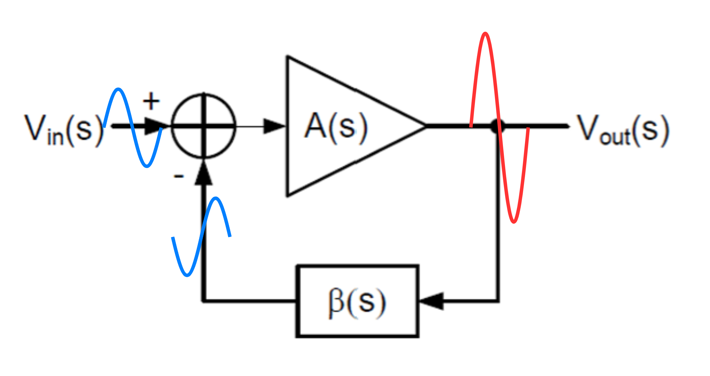<figcaption></figcaption></figure>

Now, imagine that a signal(the blue sinusoidal wave) enters the amplifier. When the **Barkhausen criterion** is satisfied, the signal experiences a total phase shift of $$-180^\circ$$ and a magnitude gain of **unity** after travelling around the loop through $$A(s)$$ and $$\beta(s)$$.

This means that the feedback signal returns with **exactly the same magnitude but opposite polarity**. Since the feedback signal is subtracted at the input summing junction, subtracting this inverted signal effectively becomes addition!

As a result, the feedback reinforces the original signal instead of suppressing it. The reinforced signal then travels around the loop again, producing the same effect. This is how the originally intended negative feedback effectively becomes **positive feedback** at that frequency.

Therefore, **instability occurs when feedback reinforces signals rather than allowing them to decay**, potentially resulting in sustained or growing oscillations.


According to Prof. Jang, since the input signal is very small, the feedback signal must have a phase shift of exactly $$180^\circ$$ to reinforce the original input signal perfectly. Otherwise, the signals will not add constructively in phase.


### Phase and Gain Margin

The **gain margin (GM)** is measured at the frequency where the **phase condition** is satisfied, i.e., when the loop-gain phase shift reaches $$-180^\circ$$. It tells us how much the loop gain can increase before the gain condition $$(0\text{ dB})$$ is also satisfied. Therefore, the gain margin can be calculated as:

$$
\text{GM}=0\text{ dB}-|A(j\omega)\beta(j\omega)|{\text{dB}}\big|_{\angle A\beta=-180^\circ}
$$

Similarly, the **phase margin (PM)** is measured at the frequency where the **gain condition** is satisfied, i.e., when the magnitude of the loop gain reaches unity $$(0\text{ dB})$$. It tells us how much additional phase lag can be introduced before the phase condition $$(-180^\circ)$$ is also satisfied. Therefore, the phase margin can be calculated as:

$$
\text{PM}=180^\circ+\angle A(j\omega)\beta(j\omega)\big|_{|A\beta|=1}
$$

The phase margin and the gain margin can be illustrated in the following diagram:

<figure>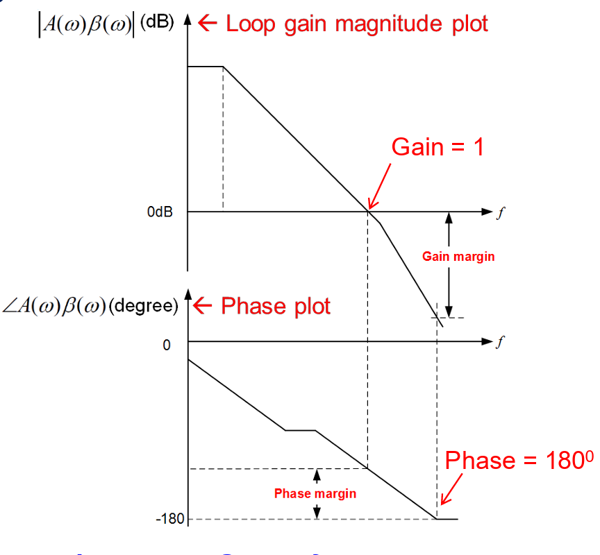<figcaption></figcaption></figure>


Notice that,

* for a **conventionally stable negative-feedback amplifier**, we generally want both gain margin and phase margin to be positive. A larger margin indicates that the amplifier is further away from the critical oscillation condition.
* In practical op-amp design, a **phase margin of approximately** $$60^\circ$$ **or higher** is often preferred, as it generally provides a good balance between stability, transient response, and bandwidth.
* Furthermore, since gain margin and phase margin both describe the stability of the same feedback loop, they are related. For many conventional op-amp designs, we therefore focus primarily on the **phase margin**, although checking the gain margin can still be important, especially for more complicated feedback systems.


### Frequency Compensation

As we've discussed above, **frequency compensation** aims to improve the stability of a feedback amplifier. This is usually achieved by ensuring that the amplifier has a sufficiently large **phase margin**.

Ideally, a single-pole response introduces a maximum phase lag of only $$90^\circ$$. Therefore, for a conventional negative-feedback amplifier with a positive, frequency-independent feedback factor, a true single-pole response guarantees stability, since the phase shift can never reach the critical $$-180^\circ$$. This motivates the main idea behind **frequency compensation**:

> to modify the frequency response of an amplifier so that it behaves approximately like a **single-pole system around the unity loop-gain frequency**.

More specifically, we want one **dominant pole** to determine the frequency response before the loop gain reaches $$0\text{ dB}$$, while the remaining higher-frequency poles are sufficiently far away to avoid introducing excessive phase lag. The following two diagrams illustrate the difference between a **dominant single-pole response** and a **multiple-pole response**.

<figure>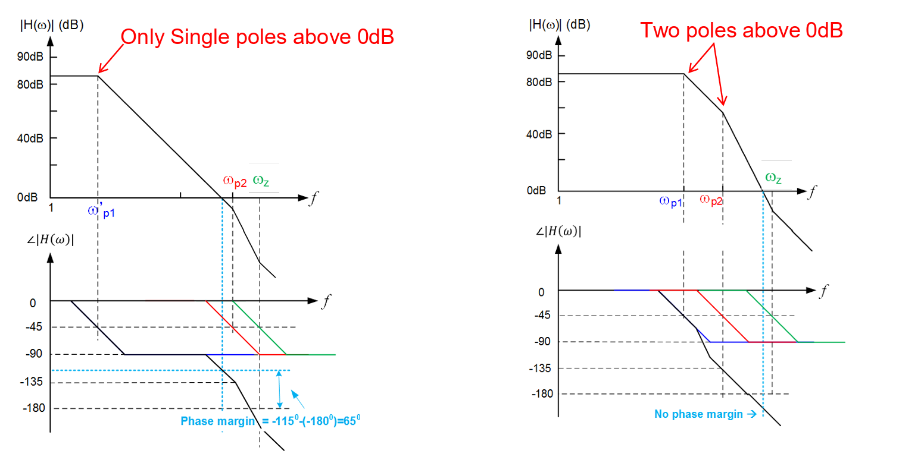<figcaption></figcaption></figure>


In this lecture, we generally assume that the **feedback factor** $$\beta(s)=1$$ when drawing the magnitude Bode plots. However, in practical inverting and non-inverting amplifier circuits, the feedback factor is often smaller than 1, resulting the entire bode plot to shift downward.


## Frequency Response of Two-stage Op-amp

Recall that we've studied the **two-stage op-amp** in the [previous lecture](lec-9-operational-amplifiers.md#two-stage-op-amp), as well as the frequency response of a differential amplifier in Lecture 8 (notes will be merged to somewhere else). Initially, the two-stage op-amp shown below contains **three poles and two zeros**:

1. **Two poles and one zero** from the differential amplifier (Lecture 8).
2. **One pole and one zero** from the common-source (CS) amplifier in the second stage (Lecture 6).

<figure>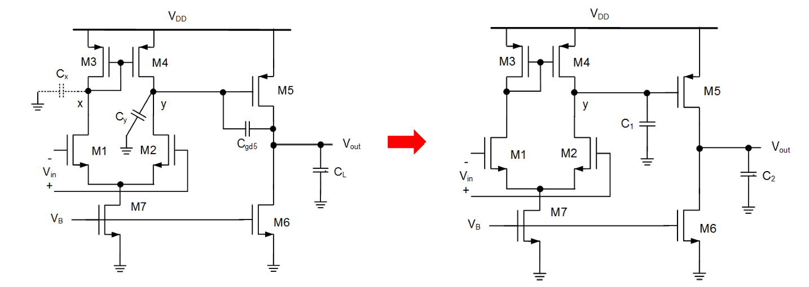<figcaption></figcaption></figure>


Notice that $$C_1$$ and $$C_2$$ are the equivalent capacitances obtained by applying the **Miller approximation** to the parasitic gate-drain capacitance $$C_{gd5}$$:

1. $$C_1=C_y+(1+A_{v2})C_{gd5}$$
2. $$C_2=C_L+C_{gd5}$$

where $$A_{v2}$$ is the magnitude of the voltage gain of the second-stage CS amplifier, which is inverting.


Now, suppose that the additional pole and zero associated with $$C_x$$ are located at sufficiently high frequencies, well beyond the **unity loop-gain frequency** (where the loop gain reaches $$0\text{ dB}$$). Their effects on the phase margin can therefore be neglected in our initial analysis.


This assumption is justified because, at node x, the equivalent resistance is approximately $$R_{\text{eq}}\approx 1/g_{m3}$$, while the equivalent capacitance is $$C_{\text{eq}}\approx C_x$$. Therefore, the pole frequency at node x is: $$\omega_{pX}\approx\frac{1}{R_{\text{eq}}C_{\text{eq}}}=\frac{g_{m3}}{C_x}$$. Since this pole is located at a much higher frequency than those at nodes y and the output, its effect on the frequency response near the unity loop-gain frequency can be neglected.


Under this assumption, the transfer function of the two-stage op-amp can be approximated as:

$$
\frac{V_{\text{out}}(s)}{V_{\text{in}}(s)}
\approx
\frac{g_{m2}R_1g_{m5}R_2(1-s/\omega_z)}
{(1+s/\omega_{p1})(1+s/\omega_{p2})} \tag{10.1}
$$

where $$\omega_{p1}\approx\frac{1}{R_1C_1}, \omega_{p2}\approx\frac{1}{R_2C_2}, \omega_z\approx\frac{g_{m5}}{C_{gd5}}$$ and $$R_1=r_{o2}\parallel r_{o4}, R_2=r_{o5}\parallel r_{o6}$$.


Notice that we have an RHP zero here and according our [summary in Lec 6](https://app.gitbook.com/s/FkaT0aUkbzwIwL8qtYDI/razavi/frequency-response-of-amplifiers/general-considerations#general-rules-for-drawing-bode-plots), an RHP zero introduces additional phase lag, which can further reduce the phase margin.


The corresponding magnitude and phase Bode plots are shown below:

<figure>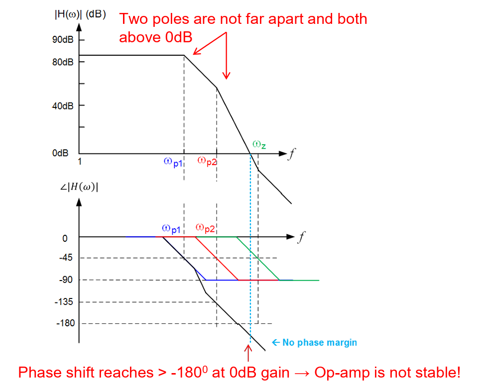<figcaption></figcaption></figure>

From these plots, we can observe that the two poles are relatively close to each other. Consequently, the second pole introduces significant additional phase lag before the loop gain reaches $$0\text{ dB}$$, resulting in a **negative phase margin**.

Therefore, to improve the stability of the two-stage op-amp, we need to **separate the two poles**, ideally moving the dominant pole to a lower frequency and the non-dominant pole to a higher frequency. This technique is known as **pole splitting**, which we will explore in the following section!

### Pole Splitting

To address the problem of the second pole being too close to the first pole, we introduce a relatively large **compensation capacitor** $$C_c$$ (typically on the order of a few pF) between node Y and the output. This technique is known as **Miller compensation**, which aims to separate the two poles and improve the phase margin.


The intuition behind using a much larger compenstation capacitor is to make $$C_{gd5}$$ equivalent bigger and thus reducing the $$\omega_{p1}$$!


The resulting circuit is shown below:

<figure>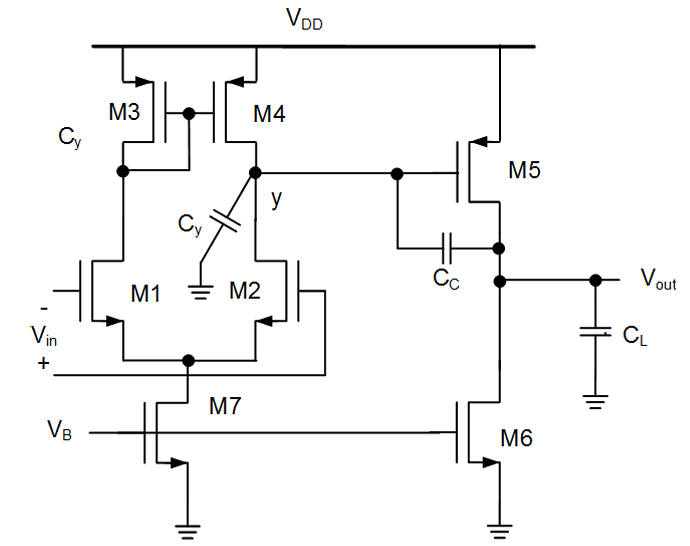<figcaption></figcaption></figure>

where:

* $$C_y$$ is the lumped parasitic capacitance at node Y.
* $$C_L$$ includes the lumped parasitic capacitance and load capacitance at the output node.
* $$C_{gd5}$$ is absorbed into $$C_c$$, since $$C_c\gg C_{gd5}$$.

Now, we can derive the new pole frequencies using two methods: **small-signal analysis** and **association of poles**. Both methods should give approximately the same results.


However, according to Prof. Jang, for the exam, we only need to **remember the pole-frequency expressions obtained from small-signal analysis**, rather than deriving them from scratch.




#### Association of Poles

Using the expressions derived in Section 10.1, we can obtain an initial approximation by replacing $$C_{gd5}$$ with the much larger **compensation capacitor** $$C_c$$. Assuming a sufficiently large second-stage gain and neglecting $$C_y$$, the resulting two pole frequencies and one zero frequency are approximately:

1. **Dominant pole:** $$\omega_{p1}\approx\frac{1}{(r_{o2}\parallel r_{o4})[1+g_{m5}(r_{o5}\parallel r_{o6})]C_c}$$
2. **Non-dominant pole:** $$\omega_{p2}\approx\frac{1}{(r_{o5}\parallel r_{o6})(C_L+C_c)}$$
3. **Right-half-plane (RHP) zero:** $$\omega_z\approx\frac{g_{m5}}{C_c}$$

Notice that these are **initial approximations**. We will later obtain a more accurate expression for $$\omega_{p2}$$ using small-signal analysis.



#### Small Signal Analysis

The **small-signal equivalent circuit** is shown below.

<figure>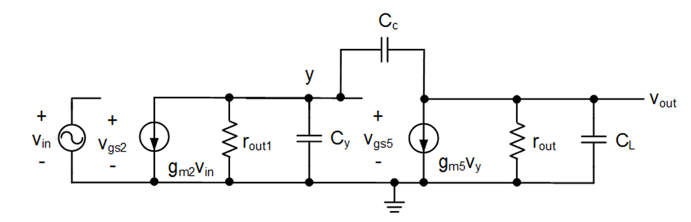<figcaption></figcaption></figure>

The detailed KCL derivation is omitted here due to its complexity, but the final results are summarised as follows:

1. **Dominant pole:** $$\omega_{p1}\approx\frac{1}{(r_{o2}\parallel r_{o4})[1+g_{m5}(r_{o5}\parallel r_{o6})]C_c}$$
2. **Non-dominant pole:** $$\omega_{p2}\approx\frac{g_{m5}C_c}{C_yC_L+C_cC_y+C_cC_L}$$
3. **Right-half-plane (RHP) zero:** $$\omega_z\approx\frac{g_{m5}}{C_c}$$


Notice that, in practical two-stage op-amp designs, $$C_c$$ and $$C_L$$ are typically on the order of **pF**, while the parasitic capacitance $$C_y$$ is often much smaller, on the order of **fF**.




With these results, we can achieve **pole splitting** by increasing the compensation capacitance $$C_c$$. This reduces the dominant pole frequency $$\omega_{p1}$$ while generally pushing the non-dominant pole $$\omega_{p2}$$ to a higher frequency, increasing the separation between the two poles.

<figure>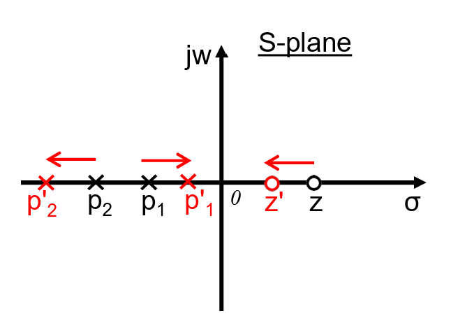<figcaption>
S-plane illustration
</figcaption></figure>

Ideally, after pole splitting, we want the **dominant pole to occur before the loop gain reaches 0 dB**, while the **non-dominant pole occurs after the 0 dB crossover**. In this case, assuming the RHP zero is also sufficiently far beyond the unity loop-gain frequency, the amplifier behaves approximately like a **single-pole system near the 0 dB crossover**, providing a sufficiently large phase margin and improving stability.

<figure>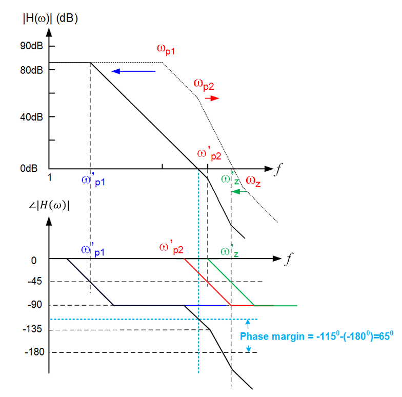<figcaption>
Scenario 1: Enough Phase Margin
</figcaption></figure>

However, as we increase $$C_c$$, the **RHP zero frequency** $$\omega_z=g_{m5}/C_c$$ decreases. If the non-dominant pole $$\omega_{p2}$$ is slightly above the **0 dB unity gain frequency**, while the RHP zero is also close to it, their combined effects introduce additional phase lag, causing the phase to decrease more rapidly. As a result, despite achieving pole splitting, the op-amp may still have an **insufficient phase margin**, leading to poor stability. This scenario is illustrated in the following diagram:

<figure>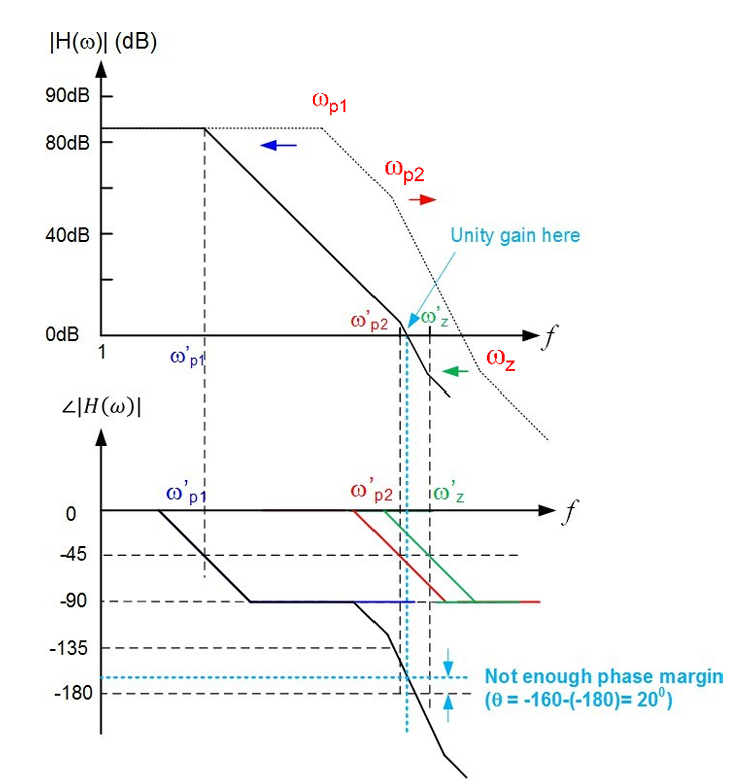<figcaption>
Scenario 2: Not Enough Phase Margin
</figcaption></figure>

In this case, the **RHP zero is a major contributor to the insufficient phase margin**, as it introduces additional phase lag near the unity loop-gain frequency. To address this problem, we can introduce another **frequency compensation technique** after pole splitting, specifically aimed at reducing or eliminating the destabilising effect of the RHP zero!

### Lead Compensation

To reduce the destabilising effect of the RHP zero, we can introduce a **compensation resistor** $$R_c$$ in series with the compensation capacitor $$C_c$$. The resulting circuit and its small-signal equivalent are shown below:

<figure>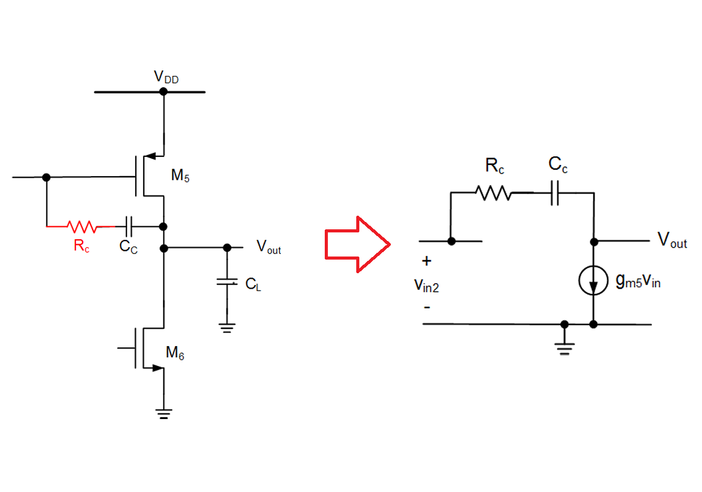<figcaption>
Lead Compensation KCL
</figcaption></figure>

By applying KCL to the small-signal circuit and solving for the zero location, we obtain:

$$
\omega_z=s_z=\frac{1}{C_c\left(\frac{1}{g_{m5}}-R_c\right)}
$$


Notice that, with the introduction of $$R_c$$, the zero is **no longer necessarily a right-half-plane (RHP) zero**. Instead, its location depends on the value of $$R_c$$!


Therefore, we observe that there are two ways to choose $$R_c$$:

1. $$R_c=1/g_{m5}$$**:** The zero is pushed to infinity, effectively eliminating it.
2. $$R_c>1/g_{m5}$$**:** The zero moves to the LHP, introducing phase lead instead of phase lag (Refer back our [summary](https://app.gitbook.com/s/FkaT0aUkbzwIwL8qtYDI/razavi/frequency-response-of-amplifiers/general-considerations#general-rules-for-drawing-bode-plots) if you forgot about how LHP zero will affect the phase bode plot).

So, how should we choose $$R_c$$ when $$R_c>1/g_{m5}$$? Ideally, we want to choose $$R_c$$ such that the **LHP zero coincides with the non-dominant pole** $$\omega_{p2}$$, allowing their effects to cancel each other. This technique is known as **pole-zero cancellation**. To achieve this, we set $$\omega_{p2}=\omega_z'$$. Substituting the expressions derived earlier:

$$
\underbrace{\frac{g_{m5}C_c}{C_yC_L+C_yC_c+C_LC_c}}_{\omega_{p2}}=
\underbrace{\frac{1}{C_c\left(R_c-\frac{1}{g_{m5}}\right)}}_{\omega_z'}
$$

Rearranging and after the approximation, we can obtain:

$$
R_c\approx\frac{1}{g_{m5}}\left(\frac{C_c+C_L}{C_c}\right)
$$

With this choice of $$R_c$$, the LHP zero approximately cancels the non-dominant pole, giving us an ideal single-pole like frequency response as follows:

<figure>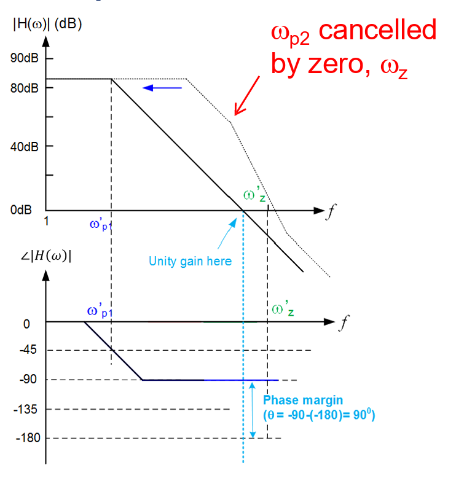<figcaption></figcaption></figure>

In this ideal frequency response, where the non-dominant pole is perfectly cancelled by the LHP zero, the amplifier behaves like a **single-pole system**, giving a phase margin approaching $$90^\circ$$.

#### Unity Gain Bandwidth

Besides the PM, we can also determine the **unity-gain frequency (UGF)**, which is the frequency at which the gain magnitude reaches 0 dB (unity). For a single-pole amplifier, the unity-gain frequency can be derived using the following shortcut:

$$
\left|\frac{V_{\text{out}}(j\omega)}{V_{\text{in}}(j\omega)}\right|
=\frac{A_v}{\sqrt{1+\left(\frac{\omega_u}{\omega_{3\text{dB}}}\right)^2}}=1
$$

Assuming that $$\omega_u\gg\omega_{3\text{dB}}$$, we can approximate $$\frac{A_v}{\omega_u/\omega_{3\text{dB}}}\approx1$$. Rearranging, we obtain:

$$
\omega_u\approx A_v\omega_{3\text{dB}}\text{ or }f_u\approx A_vf_{3\text{dB}}
$$

<figure>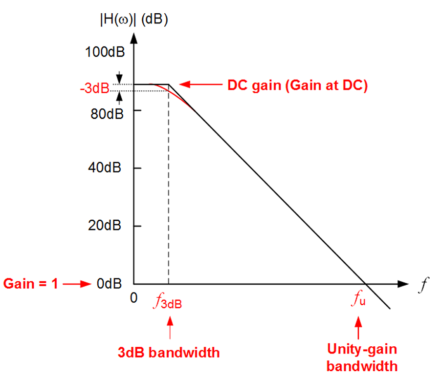<figcaption></figcaption></figure>

Since in the OTA example above, our dominant pole, which iis our 3-dB pole is $$\omega_{p1}$$, which is around $$\omega_{p1}\approx\frac{1}{(r_{o2}\parallel r_{o4})[1+g_{m5}(r_{o5}\parallel r_{o6})]C_c}$$. And the voltage gain $$A_v=g_{m2}(r_{o2}\parallel r_{o4})g_{m5}(r_{o2}\parallel r_{o4})$$, we can get the unity-gain frequency for the OTA is

$$
\omega_u=A_v\omega_{p1}\approx\frac{g_{m2}}{C_c}
$$

## Frequency Response of Telescopic Op-amp

Unlike the two-stage op-amp, a **telescopic op-amp** generally exhibits a dominant single-pole frequency response, making it easier to achieve stability.

<figure>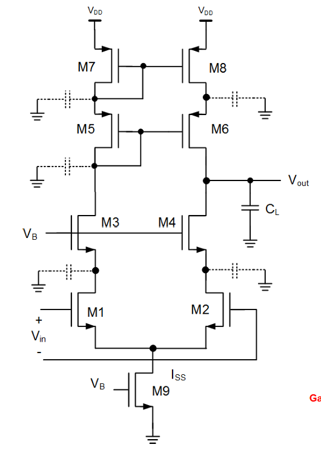<figcaption>
Telescopic op-amp
</figcaption></figure>

This is because the internal nodes (indicated by the dotted lines in the figure above) have relatively low equivalent resistances, typically on the order of $$1/g_m$$. Therefore, the poles associated with their parasitic capacitances are located at relatively high frequencies:

$$
\omega_{pi}\approx\frac{g_{mi}}{C_i}
$$

Meanwhile, the output node has a very high resistance $$r_{\text{out}}$$, which, together with the load capacitance $$C_L$$, determines the **dominant pole (3-dB frequency)** $$\omega_{p1}\approx\frac{1}{r_{\text{out}}C_L}$$ where $$r_{\text{out}}\approx(g_{m6}r_{o6}r_{o8})\parallel(g_{m4}r_{o2}r_{o4})$$. Since the low-frequency voltage gain is approximately $$A_v=g_{m2}r_{\text{out}}$$, the **unity-gain frequency** can be calculated using the single-pole approximation:

$$
\omega_u\approx A_v\omega_{p1} =\frac{g_{m2}r_{\text{out}}}{r_{\text{out}}C_L}=\frac{g_{m2}}{C_L}
$$

So, for telescopic op-amp, large C makes dominant pole frequency lower and has no impact on non-dominant poles, which means the two poles are further apart and hence large phase margin.
