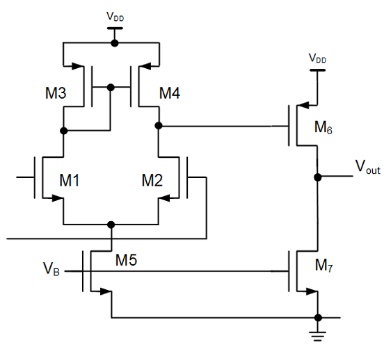
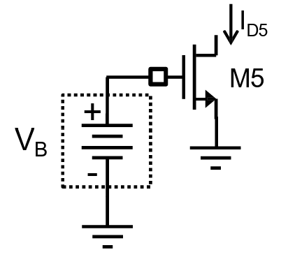
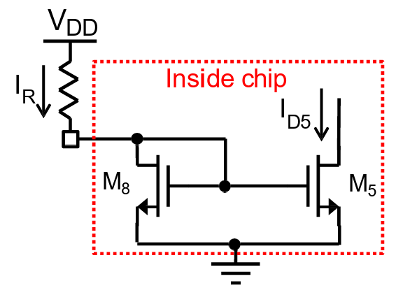
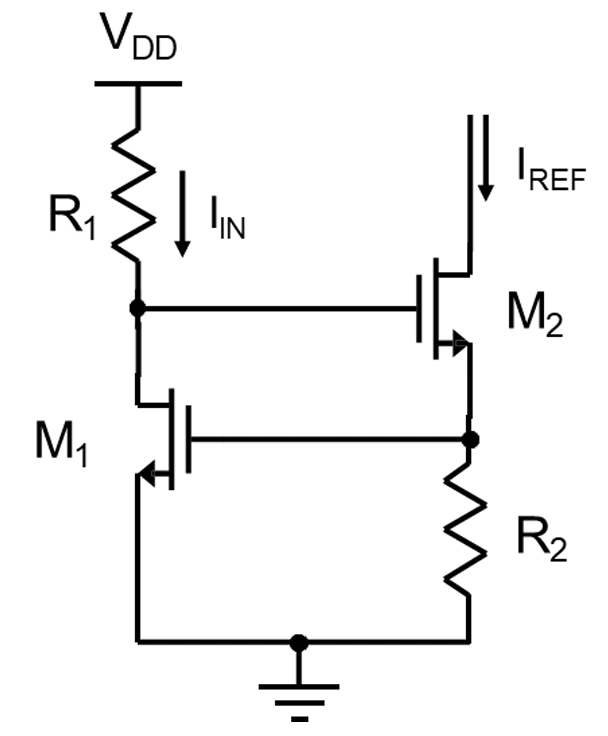
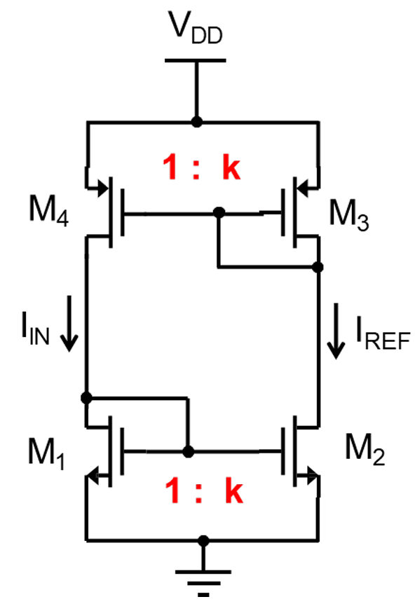
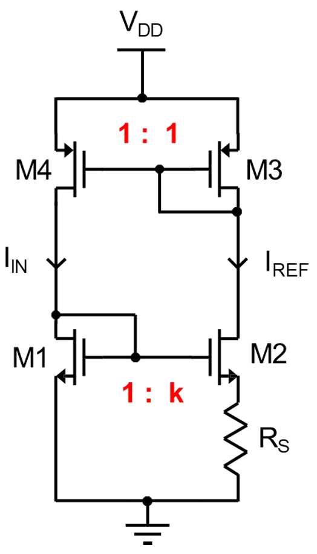
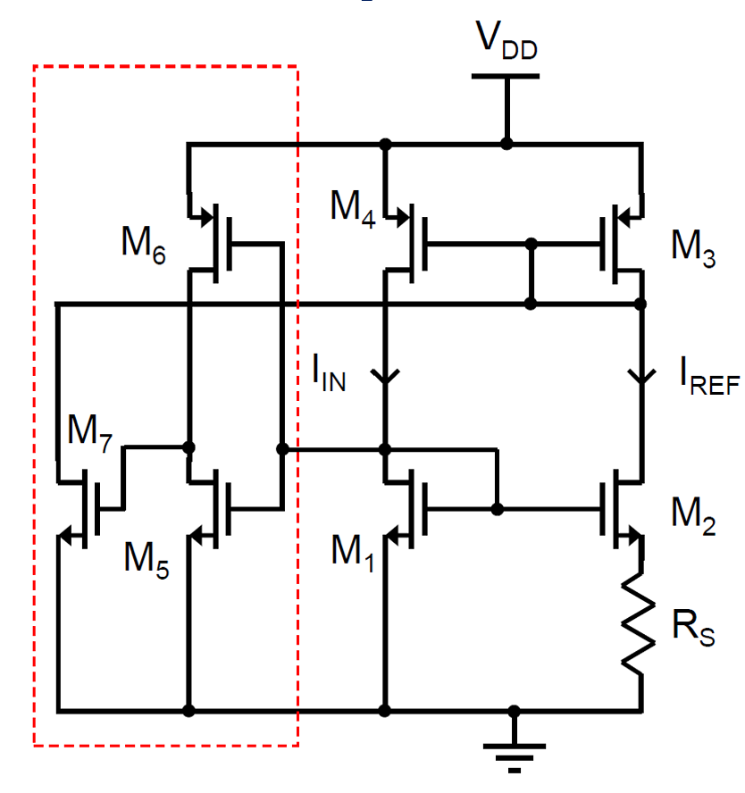
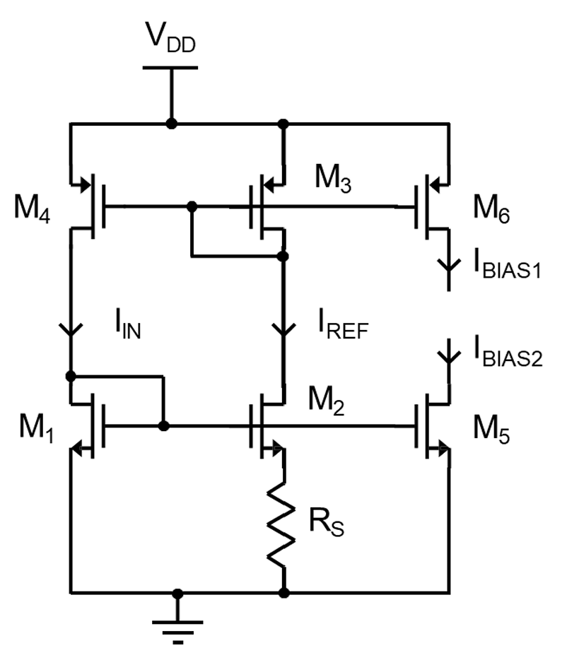
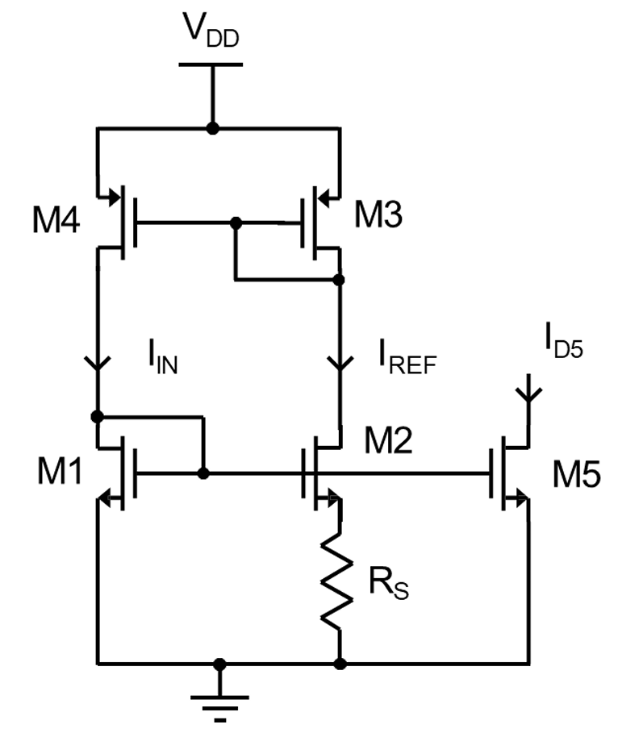

# Lec 11 - Bias Circuits

In the differential amplifiers and operational amplifiers introduced earlier, we have seen that a **tail current source** is needed to establish the bias current of the amplifier. This current source is usually implemented using a MOSFET, which must be properly biased to provide the desired current.

As we have already seen in Subproject 2, these **bias voltages** are typically generated from a reference voltage or current using **current mirrors**. The reference can be generated either **on-chip** or **off-chip**:

* **On-chip:** A reference circuit is integrated into the chip during the design stage to generate the required reference voltage or current.&#x20;
* **Off-chip:** An external reference voltage or current is supplied to the chip after fabrication.

Ideally, a good reference voltage or current should remain stable and be insensitive to **PVT (Process, Voltage, and Temperature) variations**. In this lecture, we will explore how to design such stable reference circuits for biasing amplifiers.


According to Prof. Jang, this lecture won't be the test focus in the finals. But it's good to have a basic understanding as this will be useful in practical IC design!


## Introduction

For example, in the following two-stage op-amp, we only need one **DC bias voltage**, $$V_B$$, to establish the bias currents for both the first-stage differential amplifier and the second-stage common-source amplifier.

<figure><figcaption>
Two-stage op-amp example for bias currents
</figcaption></figure>

There are two common methods to generate this bias voltage using an **off-chip reference**.



#### Use a Precision Voltage Source

As shown in the circuit below, we can directly apply an external precision voltage $$V_B$$ to bias transistor M5. Assuming M5 operates in saturation, its drain current is

$$
I_{D5}=\frac{1}{2}k_n'\left(\frac WL\right)5(V_B-V_{TH})^2(1+\lambda V_{DS5})
$$

<figure><figcaption></figcaption></figure>

The main drawback is that **a constant** $$V_B$$ **does not guarantee a constant** $$I_{D5}$$. Since transistor parameters such as $$k_n'$$, $$V_{TH}$$, and $$\lambda$$ are sensitive to **PVT variations**, the resulting bias current may vary even when the external reference voltage remains constant.



#### Use a Current Mirror

Alternatively, we can use an **on-chip current mirror** driven by an external (off-chip) reference current $$I_R$$.

<figure><figcaption></figcaption></figure>

Assuming matched transistors operating in saturation and neglecting channel-length modulation, the resulting bias current is

$$
I_{D5}=\frac{(W/L)_5}{(W/L)_8}I_R
$$

Unlike the previous method, the bias current now depends primarily on the **transistor geometry ratio**, which is relatively insensitive to PVT variations because both transistors experience similar changes in their device parameters. Therefore, with a stable external reference current $$I_R$$, we can generate a more stable bias current for the amplifier.



**However, both methods still require an external reference voltage or current. Can we generate the reference entirely on-chip?** The answer is **yes**, and this is what we will explore next!

## Supply Independent Current Source

For practical IC designs, we generally prefer an **on-chip reference** that does not require external adjustment. In other words, we want to integrate a reference circuit into our chip design before fabrication to generate the required bias voltage or current.


Ideally, this reference should be **insensitive to PVT (Process, Voltage, and Temperature) variations**.


In this section, we will focus on designing **supply-independent reference current sources**, whose output currents remain approximately constant despite changes in the supply voltage $$V_{DD}$$.


These reference circuits may still be affected by process and temperature variations. For now, we will focus on minimizing the effect of **supply-voltage variations**, while assuming other variations are negligible.


In particular, we will introduce two designs:

1. Threshold Reference Current Source
2. Self-Biased Current Mirror

### **Threshold Reference Current Source**

The idea behind the **Threshold Reference Current Source** is to exploit the fact that the MOSFET threshold voltage is relatively insensitive to the supply voltage $$V_{DD}$$. Therefore, we can use $$V_{TH}$$ to generate a **supply-independent reference current**. The circuit design is shown below:

<figure><figcaption>
Threshold Reference Voltage Source
</figcaption></figure>

For this circut, assume M1 operates in saturation, meaning that $$V_{OV1}=\sqrt{\frac{2I_{\mathrm{in}}}{k_n'(W/L)_1}}$$. We have

$$
I_{\mathrm{ref}}=\frac{V_{GS1}}{R_2} =\frac{V_{THN}+V_{OV1}}{R_2}=\frac{V_{THN}+\sqrt{\frac{2I_{\mathrm{in}}}{k_n'(W/L)_1}}}{R_2}
$$

However, $$I_{\mathrm{in}}$$ still varies with $$V_{DD}$$, meaning that our reference current is **not completely supply-independent**. To reduce this dependence, we can choose a **large** $$(W/L)_1$$. For a given $$I_{\mathrm{in}}$$, increasing $$(W/L)_1$$ reduces the overdrive voltage $$V_{OV1}$$, making it approximately zero:

$$
V_{OV1}\approx 0 \Rightarrow V_{GS1}\approx V_{THN}
$$

Hence, our reference current becomes

$$
I_{\mathrm{ref}}\approx\frac{V_{THN}}{R_2}
$$

Since $$V_{THN}$$ is relatively insensitive to $$V_{DD}$$, this design **reduces the sensitivity of the reference current to supply-voltage variations**.


**However**, $$V_{THN}$$ is still affected by process and temperature variations. Therefore, we will explore a better reference circuit design next!


### Self-Biased Current Mirror

The second approach is to use **two current mirrors connected in a self-biased loop**, as shown in the following circuit.

<figure><figcaption></figcaption></figure>

We choose the transistor sizing ratios as $$\left(\frac WL\right)_2=k\left(\frac WL\right)_1, \left(\frac WL\right)_3=k\left(\frac WL\right)_4$$. Neglecting **channel-length modulation** and assuming the transistors operate in saturation, the current mirrors give

$$
I_{\mathrm{ref}}\approx kI_{\mathrm{in}}
$$

However, since this is a **self-biased loop**, the current-mirror ratios alone do not determine the absolute value of $$I_{\mathrm{in}}$$. In other words, the loop only establishes a relationship between the currents, rather than fixing their values.


For example, even $$I_{\mathrm{in}}=0$$ satisfies the current-mirror relationships, corresponding to an undesirable **zero-current operating point**.


Therefore, we need an **additional constraint to establish a well-defined, nonzero reference current**. We will see how to achieve this in the following circuit design.

#### Insert $$R_S$$

To solve the previous problem, we introduce a **source degeneration resistor** $$R_S$$ into the self-biased current mirror, providing an additional constraint to establish a well-defined reference current. The circuit can be shown as follows:

<figure><figcaption></figcaption></figure>

For this circuit, we choose $$\left(\frac WL\right)_3=\left(\frac WL\right)_4$$ so that $$I_{\mathrm{in}}=I_{\mathrm{ref}}$$.


In the general case, $$I_{\mathrm{IN}}$$ and $$I_{\mathrm{REF}}$$ are related by $$I_{\mathrm{IN}}=\frac{(W/L)_4}{(W/L)3}I_{\mathrm{REF}}$$.


Meanwhile, we maintain the sizing ratio between M1 and M2: $$\left(\frac WL\right)_2=k\left(\frac WL\right)_1$$. From the circuit, we have

$$
V_{GS1}=V_{GS2}+I_{\mathrm{ref}}R_S
$$

Using $$V_{GS}=V_{THN}+V_{OV}$$ and $$V_{OV}=\sqrt{\frac{2I_D}{k_n'(W/L)}}$$, we obtain

$$
\underbrace{\sqrt{\frac{2I_{\mathrm{ref}}}{k_n'(W/L)_1}}}_{V_{OV1}}+V_{THN}
=
\underbrace{\sqrt{\frac{2I_{\mathrm{ref}}}{k_n'(W/L)_2}}}_{V_{OV2}} + V_{THN}
+I_{\mathrm{ref}}R_S
$$

Substituting $$(W/L)_2=k(W/L)_1$$ and solving for $$I_{\mathrm{ref}}$$, we get

$$
I_{\mathrm{ref}}\approx
\frac{2}{k_n'(W/L)_1R_S^2}
\left(1-\frac{1}{\sqrt{k}}\right)^2
$$

Therefore, the reference current is **approximately independent of the supply voltage** $$V_{DD}$$, provided that all transistors remain in saturation and channel-length modulation is negligible.


**However**, $$I_{\mathrm{ref}}$$ is still sensitive to **process and temperature variations**, mainly through $$k_n'$$ and $$R_S$$. For now, we will accept these limitations and focus on achieving supply independence.


#### Start Up

Before power-up, all node voltages are initially zero. Even after the supply is applied, the self-biased current mirror may remain at $$V_{GS1}=V_{GS2}=0$$, giving $$I_{\mathrm{ref}}=0$$. Notice that this condition still satisfies our previous equation:

$$
V_{GS1}=V_{GS2}+I_{\mathrm{ref}}R_S
$$

Therefore, the circuit has an **undesirable zero-current operating point**. If the circuit becomes trapped in this state, it may remain there instead of reaching the desired nonzero reference current.

To solve this problem, we introduce a **startup circuit** that temporarily injects current into the self-biased loop, forcing it away from the zero-current state and towards normal operation.


Ideally, the startup circuit should only operate during startup and **automatically turn off once the reference circuit reaches its normal operating point**, so that it does not disturb the reference current.


We can improve our **self-biased current mirror** by introducing a **startup circuit**, consisting of an inverter (M5 and M6) and a startup transistor M7, as shown below.

<figure><figcaption>
self-biased current mirror with a start-up circuit
</figcaption></figure>


The inverter should have a **low switching threshold**, which can be achieved using a strong NMOS (M5) and a weak PMOS (M6). This ensures that the startup circuit turns off once the reference circuit begins normal operation.


1. **During Power-Up**
   1. As $$V_{DD}$$ rises from 0 to its nominal value, the circuit may initially remain in the **zero-current state**, where M1 to M4 are off. This means that the gate voltages of M3 and M4 are approximately $$V_{DD}$$, while those of M1 and M2 are approximately 0.
   2. Since the inverter input is low ($$V_{GS1}\approx 0$$), M5 is off and M6 is on, producing a high inverter output that **turns on M7**.
   3. M7 pulls down the gate voltages of M3 and M4, turning on these PMOS transistors.
   4. Current begins to flow through the current-mirror loop, allowing $$I_{\mathrm{ref}}$$ to increase from zero towards its desired value.
2. **During Normal Operation**
   1. As $$I_{\mathrm{ref}}$$ increases, $$V_{GS1}$$ rises above the inverter's switching threshold, turning on M5 and turning off M6.
   2. The inverter output becomes low, **turning off M7**.
   3. The startup circuit is now effectively disabled and no longer interferes with the normal operation of the self-biased current mirror.

The **self-biased reference current source** can be extended using additional current mirrors to generate multiple bias currents, including both **current sources and current sinks**, as shown in the figure below.

<figure><figcaption></figcaption></figure>

For the PMOS current mirror formed by M3 and M6, the output bias current is

$$
I_{\mathrm{BIAS1}}=\frac{(W/L)_6}{(W/L)3}I{\mathrm{REF}}
$$

Similarly, for the NMOS current mirror formed by M1 and M5, we have $$I_{\mathrm{BIAS2}}=\frac{(W/L)_5}{(W/L)1}I_{\mathrm{IN}}$$. Since the PMOS current mirror formed by M3 and M4 gives $$I_{\mathrm{IN}}=\frac{(W/L)_4}{(W/L)3}I_{\mathrm{REF}}$$, we can express $$I_{\mathrm{BIAS2}}$$ in terms of $$I_{\mathrm{REF}}$$

$$
I_{\mathrm{BIAS2}}=
\frac{(W/L)_5}{(W/L)_1}
\frac{(W/L)_4}{(W/L)3}
I_{\mathrm{REF}}
$$

#### Constant $$g_m$$ Biasing

From the reference current equation derived earlier, we have

$$
I_{\mathrm{REF}}=\frac{2}{k_n'(W/L)_1R_S^2}\left(1-\frac{1}{\sqrt{k}}\right)^2
$$

Using the definition of transconductance for a MOSFET operating in saturation, $$g_{m1}=\sqrt{2k_n'(W/L)_1I_{\mathrm{IN}}}$$. Assuming $$I_{\mathrm{IN}}=I_{\mathrm{REF}}$$, substituting the reference current equation gives

$$
g_{m1}=\frac{2}{R_S}\left(1-\frac{1}{\sqrt{k}}\right)
$$

In particular, when k=4, $$g_{m1}=\frac{1}{R_S}$$. This shows that $$g_{m1}$$h **depends only on** $$R_S$$ **and the transistor sizing ratio k**, making it approximately independent of $$V_{DD}$$, $$V_{TH}$$, and $$k_n'$$. Now, suppose we generate another bias current using transistor M5, as shown in the previous circuit.

<figure><figcaption>
Constant gm biasing example
</figcaption></figure>

Since M1 and M5 share the same gate-source voltage and are assumed to have the same threshold voltage, we have $$V_{OV1}=V_{OV5}$$. Using the [definition of transconductance](https://app.gitbook.com/s/FkaT0aUkbzwIwL8qtYDI/razavi/basic-mos-device-physics/mos-i-v-characteristics#mos-transconductance), we have $$g_m=\frac{\partial I_D}{\partial V_{GS}} =k_n'\left(\frac WL\right)V_{OV}$$. Thus, $$g_{m5}=k_n'\left(\frac WL\right)_5V_{OV1}$$ and $$g_{m1}=k_n'\left(\frac WL\right)_1V_{OV1}$$. Therefore,

$$
g_{m5}=\frac{(W/L)_5}{(W/L)_1}g_{m1}
$$

Substituting our previous result,

$$
g_{m5}=
\frac{(W/L)_5}{(W/L)_1}
\frac{2}{R_S}
\left(1-\frac{1}{\sqrt{k}}\right)
$$

Thus, by choosing the **transistor sizing ratios**, we can generate different bias currents while maintaining a **well-defined transconductance** that is approximately independent of supply voltage and MOSFET process parameters.
