# Lec 8 - Differential Amplifiers

## A Recap for Lec 1 to Lec 7


This is probably the most useful information in this lecture! Prof. Jang is the goat!


### MOS I-V Characteristics

From the Part 1, the most important stuff about MOS devices that we should take away is that in analog designs, we always want to make sure that the MOS devices operate under **saturation region**. Thus, we need to intuitively understand the following three equations (for NMOS):

$$
\begin{align*}
g_m &= \frac{\partial I_D}{\partial V_{GS}} = \frac{2I_D}{V_{GS} - V_{TH}} \\
r_o &= \frac{\partial V_{DS}}{\partial I_D} = \frac{1}{\lambda I_D} \\
g_{mb} &= \frac{\partial I_D}{\partial V_{BS}} = g_m \frac{\gamma}{2\sqrt{|2\Phi_F - V_{BS}|}} = \eta g_m
\end{align*}
$$

1. the transconductance $$g_m$$ determines how well the MOS device can convert a small change in $$V_{GS}$$ to $$I_D$$.
2. the output resistance, which is the equivalent impedance when we look into the drain of a pure MOS device.
3. the body transconductance $$g_{mb}$$ has the similar effect as $$g_m$$ but is much smaller than $$g_m$$, so according to Prof. Jang, we will ignore this in the second part of our lecture.


Note that all these three quantities depend on the **large signal** quantities, but they have a huge impact on our small-signal voltage gain. Thus, this also explains why in the analog design, it's important for us to fix the DC operating point, thus fixing these 3 terms and then we use the small-signal analysis to see how signal propagates around that DC operating point!


### Small-Signal Analysis

Similar to what I have included in the subproject 1 tips, the traditional flow of designing an analog circuit is

1. Do the large signal analysis to find the DC operating point, specifically the $$W/L$$ of a MOS device.
   1. We usually assume $$V_{out}=\frac{V_{DD}}{2}$$ and we set an arbitrary value for $$I_D$$ or $$V_{OD}$$ according to the requirement of the design.
2. We find the **signal path** of the circuit and draw the small-signal model along that signal path.
   1. The signal path is usually from $$V_{in}$$ to $$V_{out}$$.
   2. Only the MOS devices that appear along this signal path will be drawn/considered in the small-signal model.
3. (Optional) Use KCL/KVL to solve for the voltage gain of the amplifier.

The whole flow can be shown in the following diagram, where the red curve represents the signal path in the circuit.

<figure>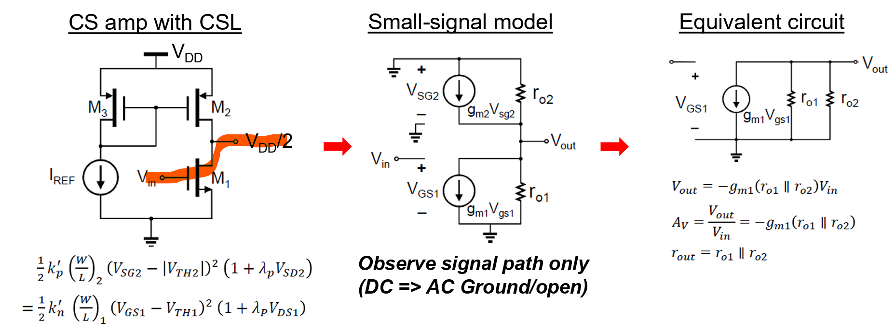<figcaption></figcaption></figure>

Since only M1 and M2 are on the signal path, in our middle small-signal model, we only draw M1 and M2. (This also aligns with our explanation that to ignroe M3, which is because M3 only acts as a biasing circuit for M2!)

### Intuitive Small-Signal Analysis

However, as Prof. Jang points out, it is not always easy to deal with the small-signal analysis in a complex analog circuit. But, we should still know the basics of circuit analysis for easy small-signal model! Thus, in this module, we should know how to **intuitively** analyse an analog circuit and quickly derive its voltage gain and output resistance! This can be done in the following 3 steps:

1. Find the output resistance $$R_{out}$$ of the circuit
2. Find the equivalent $$G_M$$ of the circuit
3. Calculate the voltage gain using $$A_V=-G_M\times R_{out}$$

#### Resistance/Impedance looking into the terminals of MOSFETs

To find the $$R_{out}$$ of the circuit, we usually look **into** the output node. Thus, it is super important to **memorize** (according to Prof. Jang) the following four sceneraios.

<figure>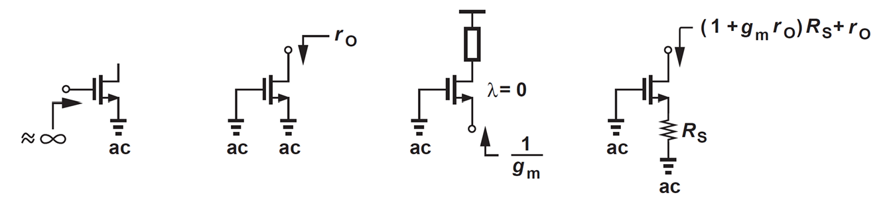<figcaption></figcaption></figure>

The third one's result holds for no matter what impedance is connected at the drain node. The fourth one is approximately $$g_mr_OR_S$$. In a nutshell, for both pure NMOS and PMOS without any load,

* Looking into the gate terminal gives us an $$+\infty$$ resistance.
* Looking into the **drain terminal** gives us a resistance of $$r_o$$.
* Looking into the **source terminal** gives us a resistance of $$\frac{1}{g_m}$$.

Besides all of these, to find the equivalent impedance of a node, we usually use the **Thevenin equivalent** technique. More specifically, the **test-voltage** method. To do this method, we follow the following steps:

1. Add a test-voltage source at the node we want to look into. (Suppose the voltage source's voltage $$V_X$$ is given)
2. Measure the current $$I_X$$ flowing into the node.
3. Solve for $$R_{out}=\frac{V_X}{I_X}$$ using KCL.

<figure>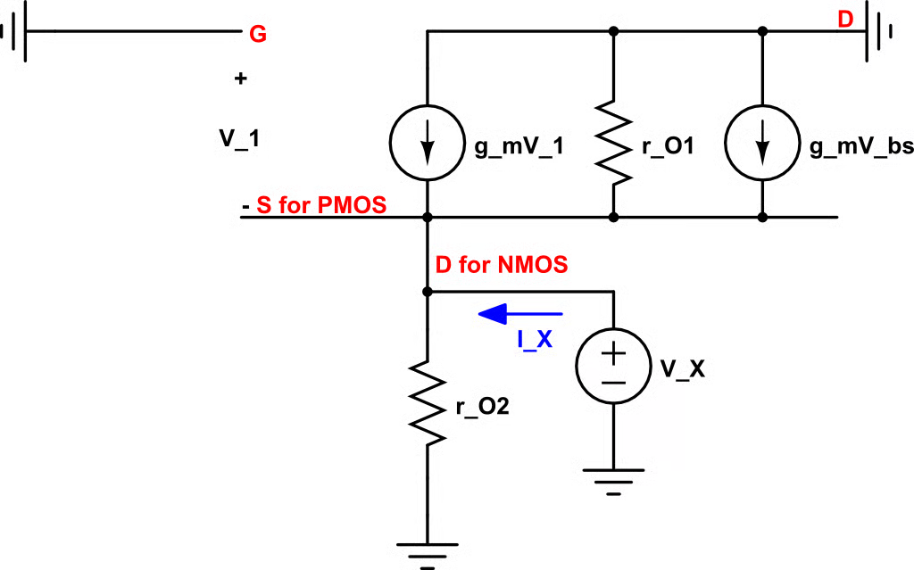<figcaption>
Source Follower Output resistance <a href="https://app.gitbook.com/s/FkaT0aUkbzwIwL8qtYDI/razavi/single-stage-amplifiers/source-follower#consider-clm-1">calculation</a> when considering CLM
</figcaption></figure>


Remember that when we calculate the output resistance of a circuit, we should always consider the parallel of the equivalent resistance from the upper branch as well as the lower branch.


#### Calculate the transconductance of the circuit

In this step, we extend the knowledge of transconductance of a MOS device into the **circuit level**. Denoted as $$G_m$$, this represents the ability for our amplifier circuit to convert a small change from the input to the current change from the output.

<figure>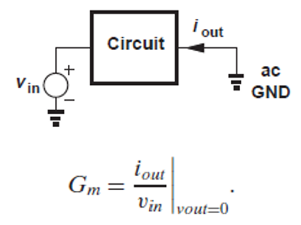<figcaption></figcaption></figure>

To calculate the $$G_m$$,

1. we set $$v_{out}=0$$ to mimic the condition when we define the transcoducatnce in a MOS device, which is when $$V_{DS}=\text{const}$$.
2. Suppose we already know $$v_{in}$$, we then measure the $$i_{out}$$ **flowing into** the circuit. (The current that we measure should always flow into the circuit)
   1. In the circuit analysis, this can be done using the KCL.

For example, in the circuit below, after we set output node to GND, there is no current flowing through the resistor $$R_D$$. Thus, as there is no body effect here, the equivalent $$G_m$$ in this circuit is just $$g_{m1}$$.

<figure>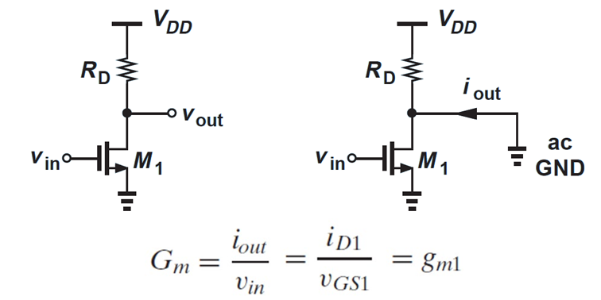<figcaption></figcaption></figure>

#### Calculate the gain of an amplifier

This can be done easily using the two steps we've just mentinoed

1. How strongly does the circuit convert voltage to current? This is given by $$G_m=\frac{i_{out}}{v_{in}}|_{v_{out}=0}$$.
2. How strongly does the output convert current to voltage? This is given by $$v_{out}=-i_{out}R_{out}$$.
   1. The minus sign comes from the way we define $$i_{out}$$ to be **flowing into** the circuit.

Thus, our voltage gain is

$$
\frac{v_{out}}{v_{in}}=-G_mR_{out}
$$


The minus sign here always have and for a non-inverting amplifier, the minus sign will be cancelled with the minus sign in the $$G_m$$.


For example, let's now calculate the most complex analog circuit we've learned in the first-half, which is the cascode amplifier with stacked current source load.

<figure>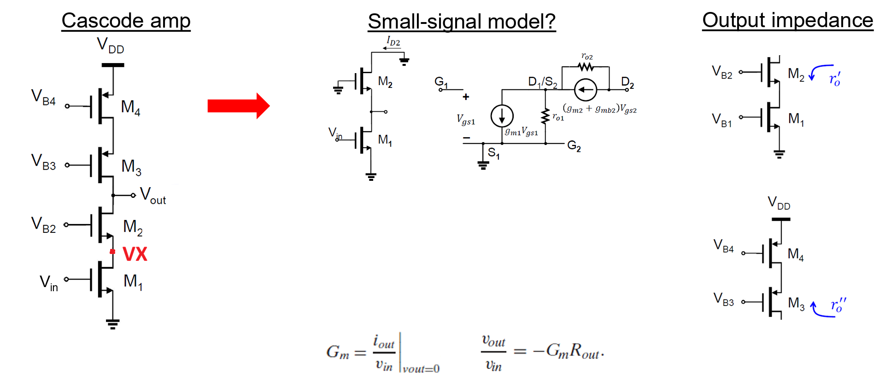<figcaption></figcaption></figure>



#### Calculate the $$G_m$$

To calculate thte $$G_m$$, we first notice that after setting the output to ground, since $$V_{DD}$$ is considered as an AC ground, there is no current flowing through M3 and M4. Thus, in our small signal model to calculate $$G_m$$, we only have M1 and M2 to be considered. Then, we split the calculation of $$G_m$$ into two parts:

1. From $$V_{in}\to V_X$$, we calculate the voltage gain of this CS amplifier here.
2. From $$V_X\to i_{out}$$, we calculate the equivalent transconductance of this CG amplifier here.

From $$V_{in}\to V_X$$, we can easily see that

1. The transconductance is $$g_{m1}$$
2. The output resistance seen from node X is $$r_{o1}\parallel \frac{1}{g_{m2}}\approx\frac{1}{g_{m2}}$$
3. Thus, the gain here is $$\frac{V_X}{V_{in}}=-\frac{g_{m1}}{g_{m2}}$$

Now $$V_X\to i_{out}$$, since it's a CG amplifier, the transconductance is just $$-g_{m2}$$ (suppose we ignore the body effect. Thus, our final $$G_m$$ is

$$
G_m=\frac{i_{out}}{V_{in}}=\frac{V_X}{V_{in}}\times\frac{i_{out}}{V_X}=g_{m1}
$$



#### Calculate the output resistance

For the output resistance, we can just use the fourth scenario in the notes above and replace $$R_S$$ with $$r_{o1}$$ or $$r_{o4}$$. Thus, our final output resistance is just

$$
R_{out}=g_{m2}r_{o1}r_{o2}\parallel g_{m3}r_{o3}r_{o4}
$$



#### Calculate our final gain

Thus, our final gain will be just

$$
A_v=-G_m\times R_{out}=-g_{m1}\times(g_{m2}r_{o1}r_{o2}\parallel g_{m3}r_{o3}r_{o4})
$$



## Intro to Differential Amplifier

A **differential amplifier** is essentially two identical **common-source (CS) amplifiers** connected together. It has two inputs, $$V_{i1}$$ and $$V_{i2}$$, and two outputs, $$V_{o1}$$ and $$V_{o2}$$. The sources of $$M_1$$ and $$M_2$$ are connected together and biased by a tail current source $$I_{SS}$$.


The reason that we use a biasing current $$I_{SS}$$ is that it makes the drain current flowing through the two CS amplifiers more **robust** as both of them will be strictly $$I_{SS}/2$$ now if the two CS amplifiers match exactly. Without this biasing current source, as $$V_{in}$$ is an AC signal, the small fluctuation in the input will cause a **weak** fluctuation in the output voltage, thus causing the drain current to fluctuate also. But since this fluctuation is weak, so we ignore it when designing a simple CS amplifier. But here, in a differential amplifer, as we want it to be more robust, we add this current source at the bottom.


Also notice that at the source node of the two CS amplifiers, we actually have two **source-follower**, meaning that the source node will follow whatever the signal shape at the input node. Since later we will see that the input AC signal applied at gate 1 and gate 2 are symmetrically opposite, thus, at the source node, these two signal will cancel out. Thus, making the source node act as a virtual AC ground.

<figure>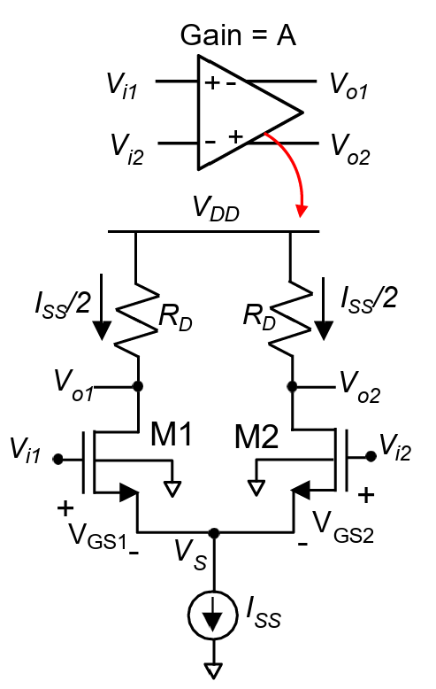<figcaption></figcaption></figure>

The symbol for a differential amplifier is shown below:

<figure>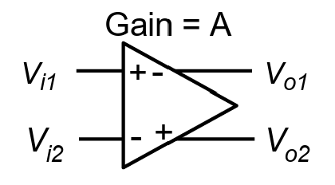<figcaption></figcaption></figure>

Notice that we define the positive input and output end as above so that our differential amplifier's gain will be **non-inverting** and thus is always a positive number.

1. Differential Input: $$V_{id}=V_{i1}-V_{i2}$$
2. Differential Output: $$V_{od}=V_{o2}-V_{o1}$$

### Differential and Common-Mode Signals

A differential amplifier can describe its two input signals using two components: the **difference** between them and their **average**. The differential component is the signal we want to amplify, while the common-mode component represents the signal shared by both inputs, including the DC bias level and unwanted common interference.

#### Common-Mode Signal

The **common-mode input** is the average of the two inputs:

$$
v_{ic}=\frac{v_{i1}+v_{i2}}{2}
$$

and similarly,

$$
v_{oc}=\frac{v_{o1}+v_{o2}}{2}
$$

The significance of $$v_{ic}$$ is that it sets the proper **bias point** of the amplifier. Thus, we treat $$v_{ic}$$ as a fixed constant after we using large-signal analysis to determine its value. Also notice that any unwanted AC variation that appears equally at both inputs is common-mode interference and is ideally rejected, so it does not appear in the differential output.


A **single-ended output** is simply taken from either $$v_{o1}$$ or $$v_{o2}$$, whereas a differential output uses the difference between the two outputs.


#### Differential-Mode Signal

The **differential input** is the difference between the two inputs $$v_{id}=v_{i1}-v_{i2}$$ and the **differential output** is $$v_{od}=v_{o2}-v_{o1}$$. The two input voltages can therefore be written as

$$
v_{i1}=v_{ic}+\frac{v_{id}}{2}, v_{i2}=v_{ic}-\frac{v_{id}}{2}
$$

This can be shown vividly in the circuit below, where the $$v_{ic}$$ acts as a common DC bias and it's actually the two opposite input $$\frac{v_{id}}{2}$$ at the two inputs nodes that get amplified.

<figure>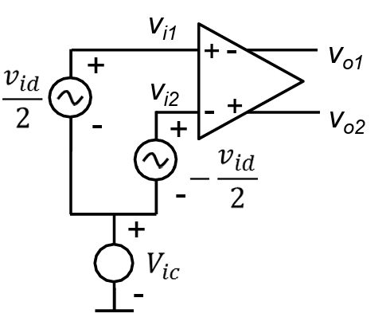<figcaption></figcaption></figure>

This means the differential signal appears as **equal** (both are $$v_{id}/2$$) and opposite (the $$\pm$$) changes around the common-mode level $$v_{ic}$$.

<figure>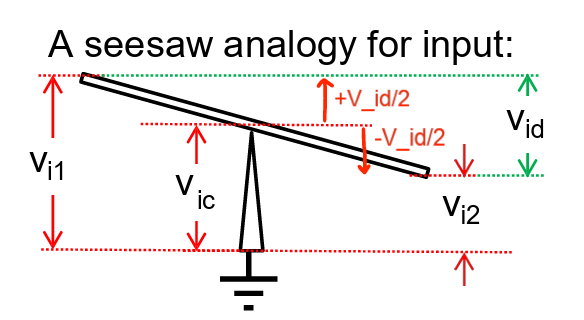<figcaption></figcaption></figure>

Think of $$v_{i1}$$ and $$v_{i2}$$ as the two ends of a seesaw. A differential signal tilts the seesaw: when one input increases, the other decreases relative to the center level.

### Small Signal Analysis

For **differential-mode small-signal analysis**, the common-mode voltage $$V_{ic}$$ is only a DC bias, so it becomes **AC ground**. From the previous section, $$v_{i1}=+\frac{v_{id}}{2}, v_{i2}=-\frac{v_{id}}{2}$$. Thus, the two transistors receive **equal but opposite small-signal inputs**.

<figure>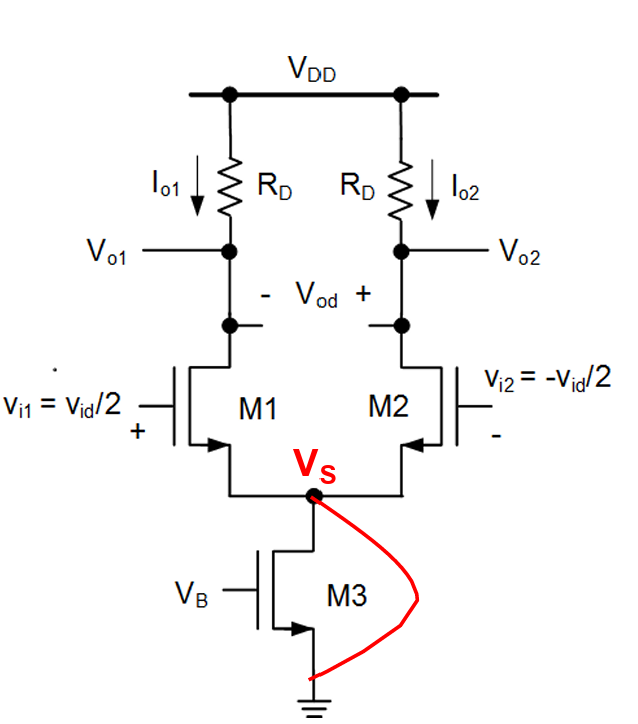<figcaption></figcaption></figure>


The transistor $$M_3$$ is used to implement the current source $$I_{SS}$$!


#### Virtual Ground at the Common Source

For a matched differential pair, $$g_{m1}=g_{m2}=g_m$$. Since the two input signals are equal and opposite, the small-signal gate-source voltages are also equal and opposite:

$$
v_{gs1}=-v_{gs2}
$$

Therefore, assume that the differential pair is fully matched and **ignore** the currents from $$r_{o1}$$ and $$r_{o2}$$, the small-signal currents entering the tail transistor cancel:

$$
i_{o3} = g_{m1}v_{gs1}+g_{m2}v_{gs2} =0
$$

Hence, there is no small-signal voltage variation at the common-source node $$S$$, meaning that $$v_s=0$$, so $$S$$ acts as a **virtual AC ground**.

<figure>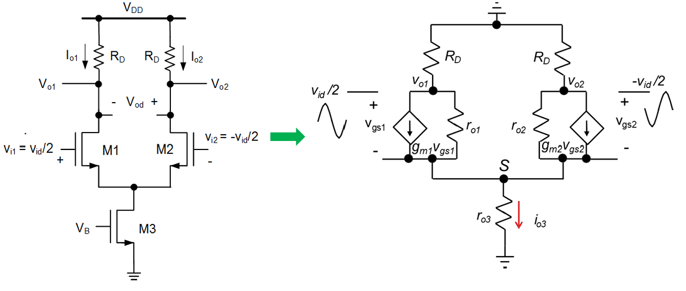<figcaption></figcaption></figure>

This is very useful because the differential pair can now be viewed as **two separate CS amplifiers**, each driven by $$\pm v_{id}/2$$. Thus, the output resistor $$r_{o3}$$ can be removed!

#### Small-Signal Gain

Since node $$S$$ is at AC ground,

$$
v_{gs1}=\frac{v_{id}}{2}, v_{gs2}=-\frac{v_{id}}{2}
$$

Each side behaves like a familiar CS amplifier with effective output resistance

$$
R_{\text{out}}=r_o\parallel R_D
$$

For $$M_1$$,

$$
v_{o1} = -g_m v_{gs1}(r_o\parallel R_D) = -\frac{1}{2}g_m(r_o\parallel R_D)v_{id}
$$

For $$M_2$$,

$$
v_{o2} = -g_m v_{gs2}(r_o\parallel R_D) = +\frac{1}{2}g_m(r_o\parallel R_D)v_{id}
$$

Therefore, the two **single-ended gains** are

$$
\begin{align*}
A_{v1} &= \frac{v_{o1}}{v_{id}} = -\frac{1}{2} g_m (r_o \parallel R_D) \\
A_{v2} &= \frac{v_{o2}}{v_{id}} = +\frac{1}{2} g_m (r_o \parallel R_D)
\end{align*}
$$

The two outputs have the same magnitude but opposite signs. If we choose

$$
v_{od}=v_{o2}-v_{o1}
$$

the differential output is

$$
v_{od} = \frac{1}{2}g_m(r_o\parallel R_D)v_{id} - \left[-\frac{1}{2}g_m(r_o\parallel R_D)v_{id}\right]
$$

so

$$
A_{vd} = \frac{v_{od}}{v_{id}} = g_m(r_o\parallel R_D)
$$

Since we can also choose $$v_{od}=v_{o1}-v_{o2}$$ and thus get an oppositive result. Hence, the key results are

$$
|A_{v,\text{single-ended}}| = \frac{1}{2}|A_{vd}|
$$

and

$$
|A_{vd}|=g_m(r_o\parallel R_D)
$$

which has the **same magnitude as the gain of a single-stage CS amplifier**.


#### Half-Gain Loss

If we take the output from only one node of a differential amplifier, the voltage gain is actually **half of the full differential voltage gain** obtained by taking the difference between both outputs. This is known as the **half-gain loss**.


### DC Analysis

DC analysis determines the **operating point**, the allowable **input/output voltage range**, and the effect of device mismatch. Unlike small-signal analysis, we now consider the actual DC voltages and currents, so all transistors should remain in the required operating region, typically **saturation**.

#### DC Operating Point

<figure>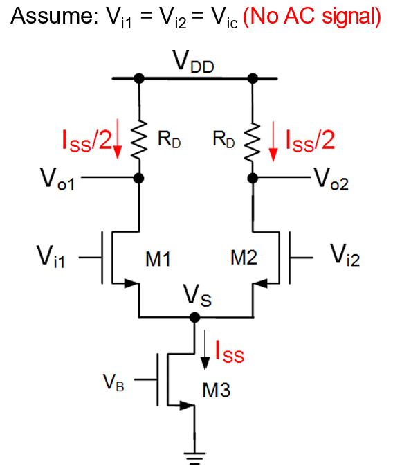<figcaption></figcaption></figure>

Start with no differential input, so $$V_{i1}=V_{i2}=V_{ic} \Rightarrow V_{id}=0$$. For a matched pair, symmetry causes the tail current to split equally, so we have $$I_{D1}=I_{D2}=\frac{I_{SS}}{2}$$. Thus, by using the drain-current equation when NMOS operates under **saturation**, we have

$$
\frac{I_{SS}}{2} = \frac{1}{2}k_n' \left(\frac WL\right) (V_{GS}-V_{TH})^2
$$

Also, the DC output voltages are also equal:

$$
V_{o1}=V_{o2} = V_{DD}-\frac{I_{SS}}{2}R_D
$$

The common-mode input $$V_{ic}$$ must also be high enough to keep the tail transistor $$M_3$$ in saturation. Since $$V_S=V_{ic}-V_{GS}$$, we require approximately $$V_S\geq V_{OV3}$$. If we expressing $$V_{S}$$ using $$V_S=V_{G}-V_{GS}$$. We can get the minimum **input** **common-mode voltage**

$$
V_{ic,\min} \approx V_{GS}+V_{OV3}
$$

or, using $$V_{GS}=V_{TH}+V_{OV}$$

$$
V_{ic,\min} \approx V_{TH}+V_{OV}+V_{OV3}
$$


For transistor $$M_1$$ and $$M_2$$, we can replace $$V_{TH}$$ and $$V_{OV}$$ above with $$V_{TH1/2}$$ or $$V_{OV1/2}$$. The voltage at the source node $$V_S$$ is important because:

1. It supplies the bias/tail current $$I_{SS}$$
2. It determines whether $$M_3$$ is in saturation or not ($$M_3$$ must be in saturation)


#### Output Swing

When the inputs become different, the fixed tail current is **steered between** $$M_1$$ **and** $$M_2$$. For example, $$V_{i1}>V_{i2} \Rightarrow I_{D1}>I_{D2} \Rightarrow V_{o1}<V_{o2}$$. At the extreme, all the tail current flows through one side ($$I_{D1}=I_{SS},I_{D2}=0$$), thus giving $$V_{o1}=V_{DD}-I_{SS}R_D, V_{o2}=V_{DD}$$. Therefore, each single-ended output can ideally vary between

$$
V_{DD}-I_{SS}R_D \leq V_o\leq V_{DD}
$$

around its quiescent value $$V_{OQ}=V_{DD}-\frac{I_{SS}}2R_D$$. Hence, the maximum peak-to-peak single-ended swing is

$$
V_{\text{swing,SE}}=I_{SS}R_D
$$

while the maximum peak-to-peak differential swing is twice as large.

$$
V_{\text{swing,diff}}=2I_{SS}R_D
$$

This can be vividly shown in the image below where assume that we define the $$V_{od}=V_{i1}-V_{i2}$$.

<figure>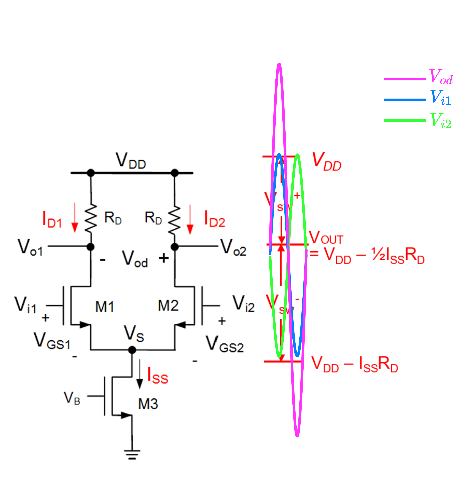<figcaption>
Circuit for output swing analysis
</figcaption></figure>

#### Max Differential Input Range

The DC transfer curve shows how $$V_{od}$$ changes with $$V_{id}$$. The maximum differential input range can be intuitively derived from the [output swing](lec-8-differential-amplifiers.md#output-swing) discussed above! But before that, let's first understand the graphical or geometric meaning of a DC transfer curve. This understanding can also be applied to the other types of single-stage amplifiers we've learned in Part 1!

<figure>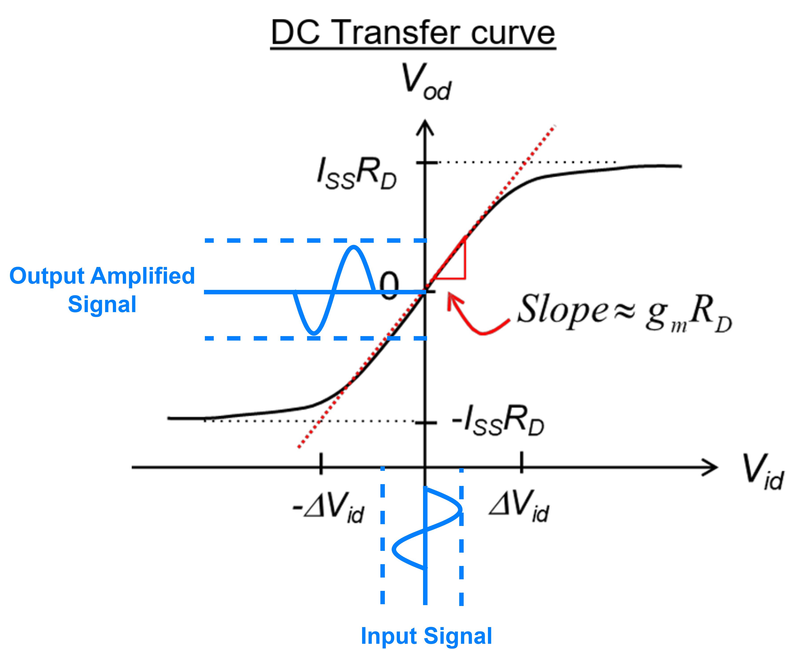<figcaption>
Example Diagram to understand DC Transfer curve
</figcaption></figure>

Essentially, the DC transfer curve tells us how an input signal is translated into an output signal. As illustrated above, when we apply an input signal along the x-axis, we obtain an amplified output signal along the y-axis.

The **slope of the DC transfer curve represents the voltage gain** of the amplifier. For our differential amplifier, the small-signal voltage gain near the center of the curve is approximately $$g_mR_D$$. Thus, an input siganl within the maximum differential input range will be **amplified** by $$g_mR_D$$.

Now, let's define $$\Delta V_{id}$$ as the **maximum positive differential input voltage measured from the center of the linear region**. Since the maximum differential output swing is $$2I_{SS}R_D$$, we can intuitively estimate the corresponding maximum differential input range using the slope of the curve:

$$
2\Delta V_{id}=\frac{2I_{SS}R_D}{g_mR_D}=\frac{2I_{SS}}{g_m}
$$

From the following figure, we can also observe that **a higher voltage gain corresponds to a steeper DC transfer curve**. Since the available output swing is limited, a steeper slope means that a smaller input voltage is needed to produce the same output swing.

<figure>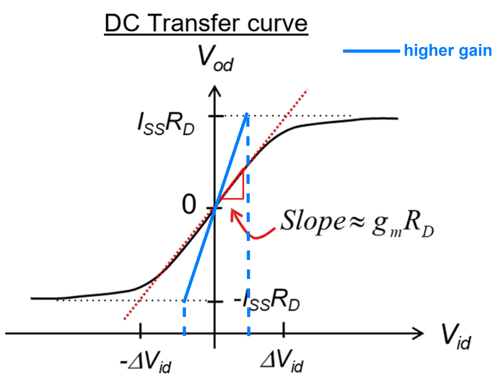<figcaption>
Higher gain causes small maximum input range
</figcaption></figure>

In other words, **a higher voltage gain generally results in a smaller input range** for a given output swing.

#### DC Offset Voltage

<figure>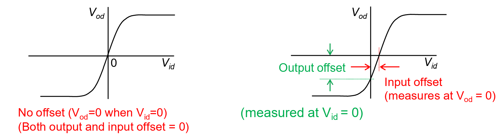<figcaption></figcaption></figure>

Ideally, a perfectly matched differential pair gives $$V_{id}=0\Rightarrow V_{od}=0$$. In practice, transistor and resistor mismatches shift the DC transfer curve, producing **offset voltages**.

1. Output offset is to measure $$V_{od}$$ at $$V_{id}=0$$.
2. Input offset is to measure $$V_{id}$$ at $$V_{od}=0$$.

Therefore, given either the input or output offset, we can easily calculate the other as long as we know the voltage gain of the amplifier, which corresponds to the slope of the DC transfer curve. For example, suppose we are given an output offset of $$V_o$$. The corresponding input offset can be calculated as:

$$
V_{\text{in,offset}} \approx \frac{V_o}{A_v}
$$

where $$A_v$$ is the small-signal voltage gain of the amplifier.

### Other FYI Variants

The basic differential pair uses resistors $$R_D$$ as loads. In practical IC design, these resistors can be replaced by **MOSFET active loads**. This provides a large small-signal output resistance and can also convert the differential output into a single-ended output without losing half of the gain.

#### Differential Pair with Current-Source Load (CSL)

<figure>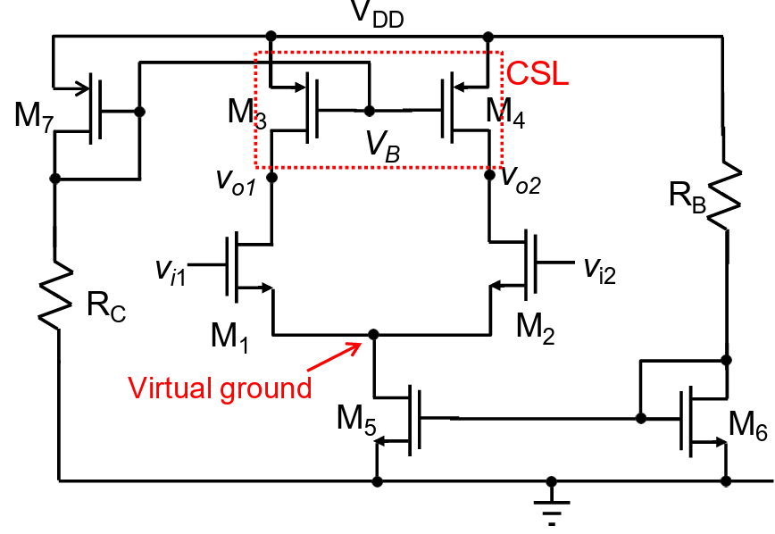<figcaption></figcaption></figure>

Instead of the resistive loads $$R_D$$, PMOS transistors $$M_3$$ and $$M_4$$ can be used as **current-source loads (CSL)**. Since a MOSFET in saturation has a relatively large output resistance $$r_o$$, the effective load becomes $$R_D \longrightarrow r_{o1}\parallel r_{o3}$$ on the $$M_1$$ side, and similarly $$r_{o2}\parallel r_{o4}$$ on the $$M_2$$ side. For matched devices, the differential gain is therefore

$$
A_{vd} = \frac{v_{o2}-v_{o1}}{v_{id}} \approx g_m(r_o\parallel r_{o,\text{load}})
$$

while taking only one output still gives half the differential gain:

$$
A_{v,\text{single}} =\frac{v_{o1/2}}{v_{id}}\approx \pm\frac{1}{2}g_m(r_o\parallel r_{o,\text{load}})
$$

Hence, the operation is essentially the same as the resistively loaded differential pair — the main difference is that the **MOSFET output resistance** $$r_o$$ **acts as the load instead of** $$R_D$$.

#### Differential Pair with Differential-to-Single-Ended (D-to-S) Converter

A limitation of the previous differential amplifier circuits is that taking the output from only one node results in a **half-gain loss**. To overcome this, we can introduce a **current-mirror active load**, formed by M3 and M4 in the figure below. This allows us to convert the differential signal into a single-ended output $$v_{out}$$, while recovering the full differential voltage gain. To find the small-signal voltage gain of this amplifier, we can follow a systematic four-step approach:

1. Identify the number of signal paths from the inputs to the output.
2. Determine how the signal paths interact with each other.
3. Calculate the voltage gain of each signal path.
4. Add or subtract the contributions from each signal path to obtain the overall voltage gain.


According to Prof. Jang, this systematic approach is particularly important because we will use it again when analysing more complex circuits in the operational amplifier section!




#### Identify the Signal Paths

<figure>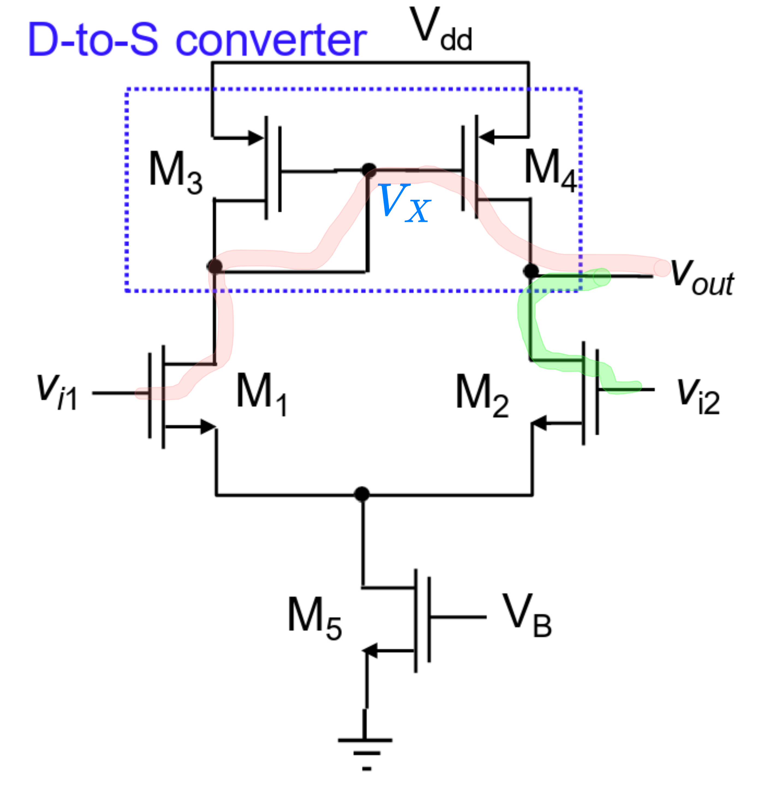<figcaption></figcaption></figure>

From the circuit above, we can identify **two signal paths** from the differential inputs to the single-ended output $$v_{out}$$:

* **Path 1:** $$v_{i2}\rightarrow v_{out}$$, through M2.
* **Path 2:** $$v_{i1}\rightarrow V_X\rightarrow v_{out}$$, through M1, M3, and M4.

The second path passes through the current mirror, which transfers the current variation from the left branch to the right branch.



#### Determine How the Signal Paths Interact

Before calculating the gain, let's first understand how the two signal paths interact. Suppose we define the differential input as $$v_{id}=v_{i2}-v_{i1}$$. For a purely differential input, we have:

$$
v_{i1}=-\frac12v_{id},v_{i2}=+\frac12v_{id}
$$

Now, consider what happens when $$v_{id}$$ increases:

1. **Left branch (M1):** Since $$v_{i1}$$ decreases, the drain current of M1 decreases by $$\Delta I$$. This current variation is mirrored through M3 and M4, causing the current supplied by M4 to decrease by $$\Delta I$$.
2. **Right branch (M2):** Since $$v_{i2}$$ increases, the drain current of M2 increases by $$\Delta I$$.

<figure>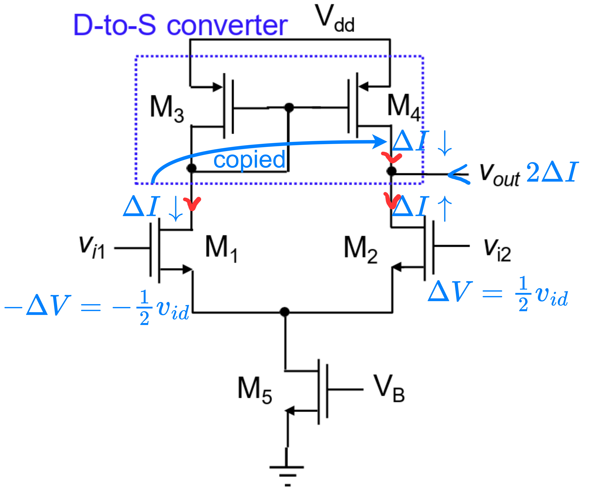<figcaption></figcaption></figure>

Therefore, their effects **add together**, resulting in an effective output current variation of:

$$
\Delta i_{out}=2\Delta I
$$

Here, $$\Delta i_{out}$$ represents the net current variation drawn from the output node. Consequently, the output voltage decreases. This explains why the current-mirror active load eliminates the half-gain loss: **both halves of the differential input contribute to the same output node!**



#### Calculate the Gain of Each Signal Path

Now, let's calculate the voltage gain of each path separately. We denote the intermediate node between M1 and M3 as $$V_X$$, and continue using $$v_{i1}=-\frac12v_{id},v_{i2}=+\frac12v_{id}$$.

**Path 1:** $$v_{i2}\rightarrow v_{out}$$

This path behaves like a common-source amplifier with an active load. Therefore, its voltage gain is:

$$
\frac{v_{out}}{v_{i2}}\approx-g_{m2}(r_{o2}\parallel r_{o4})
$$

Since $$v_{i2}=\frac12v_{id}$$, the contribution of this path to the overall differential gain is:

$$
A_{v1}\approx-\frac12g_{m2}(r_{o2}\parallel r_{o4})
$$

**Path 2:** $$v_{i1}\rightarrow V_X\rightarrow v_{out}$$

This path can be divided into two stages.

1. **Stage 1:** $$v_{i1}\rightarrow V_X$$. This is a common-source amplifier with a diode-connected PMOS load M3. Neglecting channel-length modulation at node $$V_X$$, the gain is approximately:

$$
\frac{v_X}{v_{i1}}\approx-\frac{g_{m1}}{g_{m3}}
$$

2. **Stage 2:** $$V_X\rightarrow v_{out}$$. Here, M4 acts as a common-source amplifier, giving:

$$
\frac{v_{out}}{v_X}\approx-g_{m4}(r_{o2}\parallel r_{o4})
$$

Multiplying the gains of both stages, we have $$\frac{v_{out}}{v_{i1}} \approx \left(-\frac{g_{m1}}{g_{m3}}\right) \left[-g_{m4}(r_{o2}\parallel r_{o4})\right]$$. Assuming M3 and M4 are matched:

$$
\frac{v_{out}}{v_{i1}}\approx+g_{m1}(r_{o2}\parallel r_{o4})
$$

However, recall that $$v_{i1}=-\frac12v_{id}$$. Therefore, the contribution of Path 2 is:

$$
A_{v2}\approx-\frac12g_{m1}(r_{o2}\parallel r_{o4})
$$



#### Calculate the Overall Voltage Gain

Finally, the overall voltage gain is the sum of the contributions from both signal paths, $$A_v=A_{v1}+A_{v2}$$. Substituting:

$$
A_v\approx-\frac12g_{m2}(r_{o2}\parallel r_{o4})-\frac12g_{m1}(r_{o2}\parallel r_{o4})
$$

Assuming M1 and M2 are also matched, such that $$g_{m1}=g_{m2}=g_m$$, we obtain:

$$
A_v\approx-g_m(r_{o2}\parallel r_{o4})
$$


If we define $$v_{id}=v_{i1}-v_{i2}$$, we obtain $$A_v=g_m(r_{o2}\parallel r_{o4})$$. As Prof. Jang mentioned, **the definition of** $$v_{id}$$ **is chosen by us!** However, in a conventional differential amplifier with two output nodes, $$v_{od}$$ is typically defined with the opposite subtraction order to $$v_{id}$$. Thus, the voltage gain remains positive when both definitions are reversed together.




## Common-mode Gain and Rejection Ratio

The **common-mode gain** of a differential amplifier refers to the small-signal voltage gain when both inputs receive the same signal, meaning $$v_{i1}=v_{i2}=v_{ic}$$. In other words, there is no differential input signal. Thus, the differential-output common-mode gain is defined as:

$$
A_{cm}=\frac{v_{o2}-v_{o1}}{v_{ic}}=\frac{v_{od}}{v_{ic}}
$$

Ideally, for a **perfectly matched differential amplifier**, where the left and right halves are identical, both outputs respond equally to the common-mode input. Therefore, their difference is zero, and the common-mode gain is 0.

> But what happens if the left and right halves are not perfectly matched?

Before discussing the mismatch case, let's first analyze the common-mode gain of each half under the perfectly matched condition.

<figure>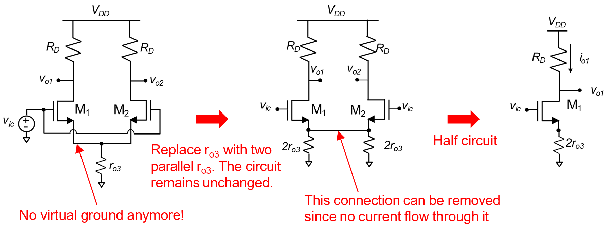<figcaption></figcaption></figure>

Since both inputs receive the same signal, the circuit is symmetrical, and the tail current is shared equally between the two branches. Therefore, we can split the tail resistance $$r_{o3}$$ into two equivalent resistances of $$2r_{o3}$$, giving the common-mode half-circuit shown on the right of the figure above.


Notice that this is essentially a **common-source amplifier with source degeneration!**


Using our intuitive analysis, the output resistance is:

$$
R_{out}=[g_mr_{o1}(2r_{o3})]\parallel R_D\approx R_D
$$

The equivalent transconductance requires a small-signal analysis (left as homework for interested readers!), but assuming $$g_m(2r_{o3})\gg1$$, we obtain:

$$
G_m\approx\frac{1}{2r_{o3}}
$$

Therefore, the common-mode gain of each half is:

$$
A_{v,cm}\approx-G_mR_{out}\approx-\frac{R_D}{2r_{o3}}
$$

Since both halves are identical, their output voltages are also identical $$v_{o1}=v_{o2}\approx-\frac{R_D}{2r_{o3}}v_{ic}$$. Thus, the differential output is zero, as expected!

***

Now, suppose there is a mismatch between the two load resistors. For example, the right-hand load resistance is slightly larger than the left-hand one, $$R_{D2}=R_{D1}+\Delta R_D$$.

<figure>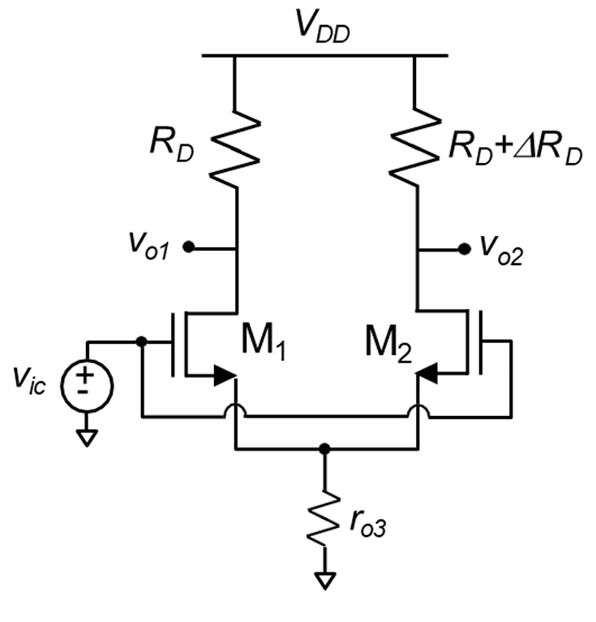<figcaption></figcaption></figure>

Using our previous result, the common-mode gains of the two halves become:

1. $$A_{v1}\approx-\frac{R_{D1}}{2r_{o3}}$$
2. $$A_{v2}\approx-\frac{R_{D2}}{2r_{o3}}$$

Since we define $$v_{od}=v_{o2}-v_{o1}$$, the overall common-mode gain is $$A_{cm}=A_{v2}-A_{v1}$$. Substituting $$A_{cm}\approx-\frac{R_{D2}-R_{D1}}{2r_{o3}}$$. Therefore:

$$
A_{cm}\approx-\frac{\Delta R_D}{2r_{o3}}
$$

This tells us something important: **when the two halves of a differential amplifier are mismatched, a common-mode input can produce a nonzero differential output!** In other words, common-mode interference can be converted into a differential signal, which interferes with the desired amplified signal. This is why good matching between the two halves is essential for achieving strong common-mode rejection.

### Differential Pair with D-to-S

We've already seen this configuration from above! Now let's analyze its common-mode gain! Unlike a conventional differential amplifier with two output nodes, a **differential-to-single-ended (D-to-S) amplifier has a nonzero common-mode gain even under perfect matching**, since we only take the output from one node.

<figure>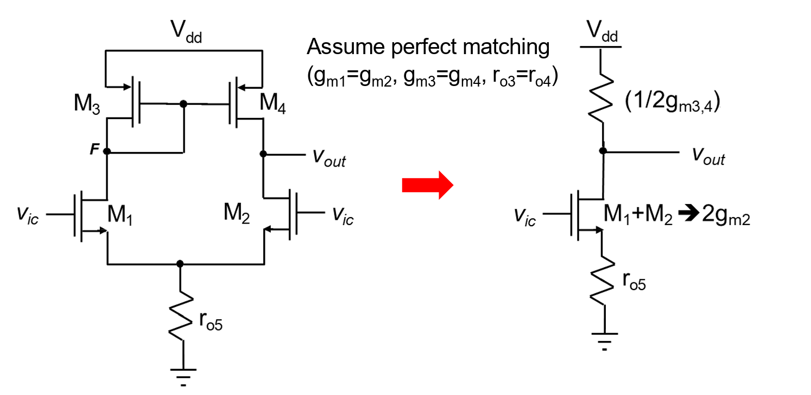<figcaption></figcaption></figure>

To analyze the common-mode gain, we apply the same input signal to both transistors: $$v_{i1}=v_{i2}=v_{ic}$$. Assuming perfect matching, both branches have the same drain current. Therefore, the two output nodes have the same small-signal voltage: $$v_F=v_{out}$$. This allows us to combine the two halves into an **equivalent common-source amplifier with source degeneration**, as shown on the right of the figure. Using our intuitive analysis:

* **Equivalent transconductance:** Since M1 and M2 are in parallel, $$G_m=2g_{m2}$$.
* **Equivalent load resistance:** Since M3 and M4 behave as parallel diode-connected loads,

$$
R_L
\approx\frac{1}{2g_{m3}}
$$

Therefore, using the familiar gain expression for a source-degenerated CS amplifier:

$$
A_{cm,s}\approx-\frac{G_mR_L}{1+G_mR_S}
$$

Substituting $$A_{cm,s} \approx -\frac{2g_{m2}\left(\frac{1}{2g_{m3}}\right)}{1+2g_{m2}r_{o5}}$$, we obtain:

$$
A_{cm,s}\approx-\frac{g_{m2}/g_{m3}}{1+2g_{m2}r_{o5}}\ne0
$$

Thus, **even with perfect matching, a D-to-S differential amplifier has a nonzero single-ended common-mode gain** due to the finite output resistance of the tail current source.


Notice that increasing $$r_{o5}$$ reduces the common-mode gain, improving the amplifier's ability to reject common-mode interference.


### Common-mode Rejection Ratio

To evaluate how well a differential amplifier **rejects** common-mode interference, we introduce another important parameter called the **Common-Mode Rejection Ratio (CMRR)**. CMRR is defined as the ratio of the differential voltage gain to the common-mode voltage gain, usually expressed in decibels (dB):

$$
\text{CMRR (dB)}=20\log_{10}\left|\frac{A_{vd}}{A_{cm}}\right|
$$

where:

* $$A_{vd}$$ is the differential voltage gain.
* $$A_{cm}$$ is the common-mode voltage gain.

From the equation, we can make two important observations:

1. **Smaller common-mode gain** $$(|A_{cm}|)$$ **leads to higher CMRR**, meaning better rejection of common-mode interference.
2. **Larger differential gain** $$(|A_{vd}|)$$ **also leads to higher CMRR**, assuming the common-mode gain remains unchanged.

Therefore, **a higher CMRR is always desirable**, as it indicates that the amplifier can amplify the desired differential signal while effectively rejecting unwanted common-mode interference.


Do the Example 6.1 from the lecture slides b4 final and the response frequency part of the differential part is moved to the future lectures!

