# Lec 9 - Operational Amplifiers

We first encountered operational amplifiers (op-amps) in EPP1, where we treated them as black boxes that amplify signals. Now, with the analog circuit knowledge we've developed, we can open this black box and understand how op-amps work internally.

An **op-amp** is essentially a **high-gain differential amplifier**, typically with a DC voltage gain exceeding 80 dB.


#### DC Gain

Here, **DC gain** refers to the low-frequency small-signal gain, where the effects of parasitic capacitances can be neglected.


An op-amp has two input terminals (inverting and non-inverting) and can have either a single-ended or differential output. The polarity of the output depends on which input receives the signal:

* **Non-inverting input (+)**: A positive input change produces a positive output change.
* **Inverting input (−)**: A positive input change produces a negative output change.

This is consistent with what we learned about the differential-to-single-ended (D-to-S) amplifier in the [previous lecture](lec-8-differential-amplifiers.md#calculate-the-overall-voltage-gain), where we find out that if we define $$v_{id}$$ in an opposite way, the DC gain will have an opposite sign.

<figure>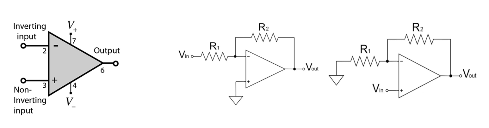<figcaption>
Inverting and Non-inverting input on an op-amp
</figcaption></figure>

In this lecture, we will explore two common op-amp architectures:

1. Two-stage op-amp
2. Telescopic (cascode) op-amp

And for each type of op-amp, we will analyze its small-signal gain, DC analysis and systematic offset. We will leave the frequency response analysis of these two op-amps as well as last lecture's differential amplifier to the next lecture!

## Two-Stage Op-amp

As mentioned earlier, an op-amp typically requires a high DC gain of around 80 dB or more. However, as we observed in Project 2, a single-stage differential amplifier (D-to-S) provides only around 40 dB of gain in our design. To achieve a higher gain, we can **add multiple amplifier stages**. In this case, we add a common-source (CS) amplifier after the differential stage, forming a two-stage op-amp.

<figure>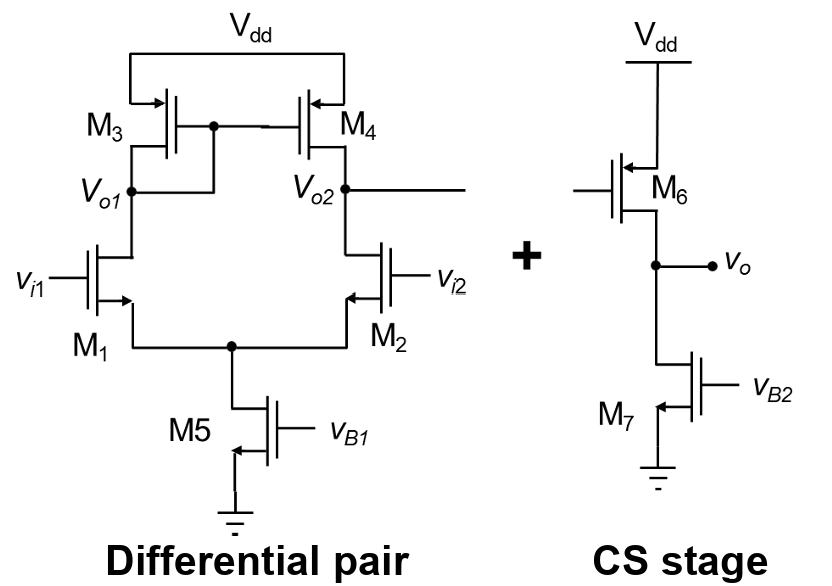<figcaption></figcaption></figure>

To implement a two-stage op-amp, we typically consider two configurations:

1. NMOS-input differential stage (D-to-S) followed by a PMOS common-source (CS) stage.
2. PMOS-input differential stage (D-to-S) followed by an NMOS common-source (CS) stage.

Why NMOS + PMOS or PMOS + NMOS instead of both NMOS or both PMOS?

The main reason for using an NMOS-input differential stage followed by a PMOS CS stage (or vice versa) is to ensure **DC bias compatibility** between the two stages.

Although NMOS and PMOS CS amplifiers can theoretically achieve the same maximum output swing, using opposite transistor polarities makes it easier to establish the desired DC operating point without additional level shifting.

For example, an NMOS-input differential stage typically produces a relatively high DC output voltage $$V_{d2}$$. If we use another NMOS for the second stage, this high gate voltage may cause excessive drain current, making it difficult to bias $$V_{out}$$ near $$V_{DD}/2$$. Using a PMOS instead provides a more suitable gate-to-source voltage, making it easier to achieve the desired output bias and a large output swing.

> TODO: Add missing PMOS differential stage + NMOS input

<figure>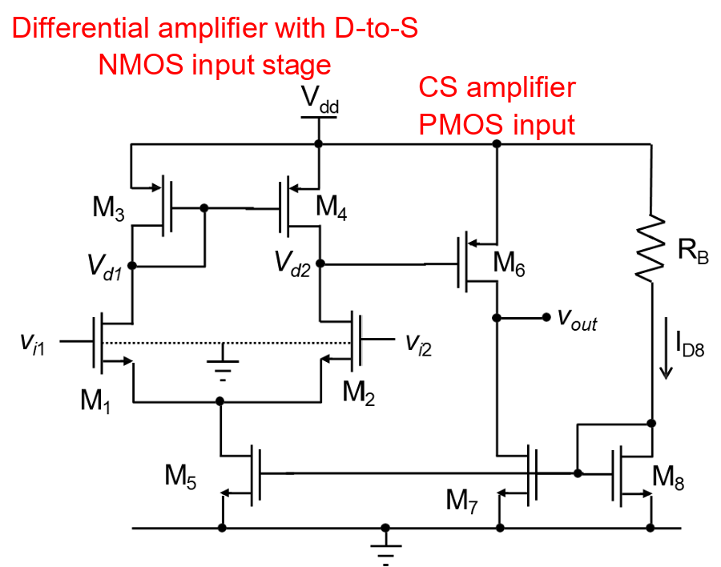<figcaption>
NMOS Differential Amplifier with PMOS CS Amplifier
</figcaption></figure>

For example, the circuit above shows the two-stage op-amp with a differential amplifier with D-to-S NMOS input stage + a CS amplifier with PMOS input. Transistor M5 mirrors the current from M8 and biases the differential input stage while transistor M7 also mirrors the current from M8 and biases the second stage. (It's also a CSL for the second stage CS amplifier)


We will be using NMOS Differential Amplifier with PMOS CS Amplifier as an example for the following analysis!


### Small Signal Gain

Suppose we define the polarity of our differential input as follows (the positive polarity is at M2):

<figure>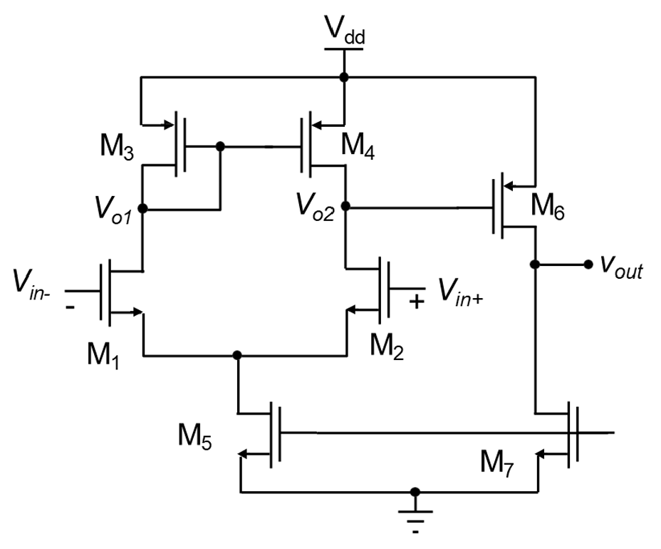<figcaption></figcaption></figure>



#### First Stage Gain

The first stage now is exactly the same as the D-to-S differential we've analyzed in [Lec 8](lec-8-differential-amplifiers.md#calculate-the-overall-voltage-gain)! So, the small-signal gain here is

$$
A_{v1} = \frac{v_{o2}}{v_{in+} - v_{in-}} = -g_{m2} (r_{o2} \parallel r_{o4})
$$


Again, notice that the negative sign comes purely from the polarity of the input differential signal!




#### Second Stage Gain

The second stage is a classic CS amplifier with a gain of

$$
A_{v2} = \frac{v_{out}}{v_{o2}} = -g_{m6} (r_{o7} \parallel r_{o6})
$$



#### Overall Gain

The overall gain is the **product** of the two stages, which is

$$
A_{v} = \frac{v_{out}}{v_{in+} - v_{in-}} = A_{v1} \cdot A_{v2} = g_{m1} g_{m6} (r_{o2} \parallel r_{o4})(r_{o7} \parallel r_{o6})
$$



#### Symbol

In this case, our op-amp is **non-inverting** and thus its symbol is as follows:

<figure>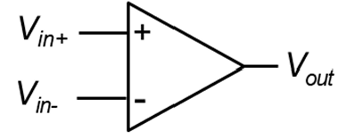<figcaption></figcaption></figure>



### DC Analysis

The goal of the DC analysis is:

1. Ensure that **all** transistors should be biased properly so that they operate in the **saturation region**.
2. The DC output voltage is designed such that the **output swing** is maximized and the transistors in the second stage CS amplifier still can always work under saturation.
3. The input DC voltage is designed such that the two transistors that are connected to the input (M1 and M2) and the tail current transistor (M5) work in **saturation**.
4. Systematic offset (input & output offset) should be minimized.

For point 2, the maximum output swing can be illustrated vividly using the following diagram, where the maximum output voltage is $$V_{DD}-V_{OV6}$$ while the mimum output voltage is $$V_{OV7}$$ so that both M6 and M7 will work under **saturation**.

<figure>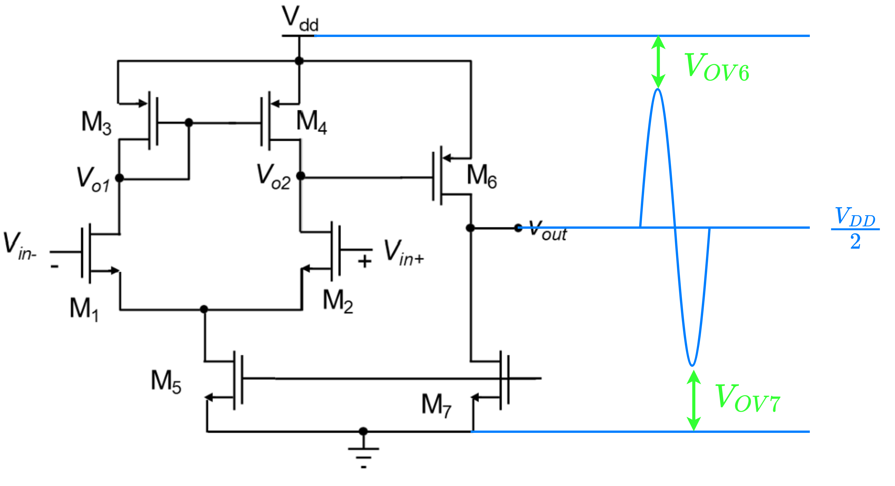<figcaption>
Two-stage op-amp Output Swing Illustration
</figcaption></figure>



#### Prove that $$V_{o1}=V_{o2}$$ in the D-to-S differential amplifier

Assume that the differential pair is perfectly matched and both inputs receive the same DC voltage. Thus

$$
I_{D1}=I_{D2}=I_{D3}=I_{D4}=\frac{I_{D5}}{2}, (W/L)_1=(W/L)_2, (W/L)_3=(W/L)_4
$$

Since the sources of PMOS transistors M3 and M4 are connected to $$V_{DD}$$, their drain voltages are $$V_{o1}=V_{DD}-V_{SD3},V_{o2}=V_{DD}-V_{SD4}$$. Furthermore, M3 is diode-connected, meaning its gate and drain are shorted. Therefore, $$V_{SD3}=V_{SG3}$$. Using the MOSFET drain current equation in saturation,

$$
I_D=\frac{1}{2}\mu_p C_{ox}\frac WL(V_{SG}-|V_{THp}|)^2(1+\lambda V_{SD})
$$

Since M3 and M4 are matched, carry equal drain currents and they are biased by the same gate voltage (thus having the same $$V_{SG}$$), assuming identical channel-length modulation parameters and $$\lambda\neq0$$, we obtain

$$
V_{SD4}=V_{SD3}=V_{SG3}
$$

Hence,

$$
V_{o2}=V_{DD}-V_{SD4}=V_{DD}-V_{SD3}=V_{o1}
$$



#### Design the CS amplifier to make DC output voltage $$\frac{V_{DD}}{2}$$

Now, we focus on design the second stage CS amplifier so that the final DC output voltage is around $$V_{DD}/2$$, allowing approximately equal headroom for positive and negative output swings. Thus, assuming $$V_{out}=\frac{V_{DD}}{2}$$, we have $$V_{SD6}=V_{DS7}=\frac{V_{DD}}{2}$$. Since M6 and M7 are connected in series, their drain currents must be equal. Assuming both transistors operate in saturation, we can write:

$$
\begin{aligned} I_{D6}=I_{D7}\quad\Rightarrow\quad &\frac{k_p'}{2}\left(\frac WL\right)_6 (V_{SG6}-|V_{TH6}|)^2(1+\lambda_p V_{SD6})\\ ={}&\frac{k_n'}{2}\left(\frac WL\right)_7 (V_{GS7}-V_{TH7})^2(1+\lambda_n V_{DS7}) \end{aligned}
$$

Substituting $$V_{SD6}=V_{DS7}=V_{DD}/2$$ and rearranging:

$$
\frac{V_{OV6}}{V_{OV7}} = \sqrt{ \frac{k_n'(W/L)_7(1+\lambda_n V_{DD}/2)} {k_p'(W/L)_6(1+\lambda_p V_{DD}/2)} }
$$

This equation provides a design relationship between the transistor sizes and bias voltages required to achieve our desired DC output voltage.



### Systematic Offset

Ideally, when the differential input voltage is zero ($$V_{id}=V_{in+}-V_{in-}=0$$), we want the DC output voltage to be $$V_{DD}/2$$, allowing approximately symmetrical output swings. However, even when the input transistors are perfectly matched, the output may not be exactly $$V_{DD}/2$$. This is known as systematic offset (another name for the [DC offset](lec-8-differential-amplifiers.md#dc-offset-voltage) that we learned in the previous lecture).

After determining the required $$V_{SG6}$$ to achieve $$V_{out}=V_{DD}/2$$, recall that the gate of M6 is connected to the first-stage output $$V_{o2}$$. Thus, $$V_{SG6}$$ is set by the first stage actually ($$V_{SD4}=V_{SD3}=V_{SG3}$$). Therefore, if the $$V_{SG6}$$ provided by the first stage differs from the value required to achieve $$V_{out}=V_{DD}/2$$, a systematic offset will occur.

An example to better understand when the systematic offset will be generated

Suppose $$V_{DD}=5\text{ V}$$. We temporarily disconnect the first and second stages and find that, to achieve $$V_{out}=V_{DD}/2=2.5\text{ V}$$, the second stage requires $$V_{SG6}=1\text{ V}$$.

<figure>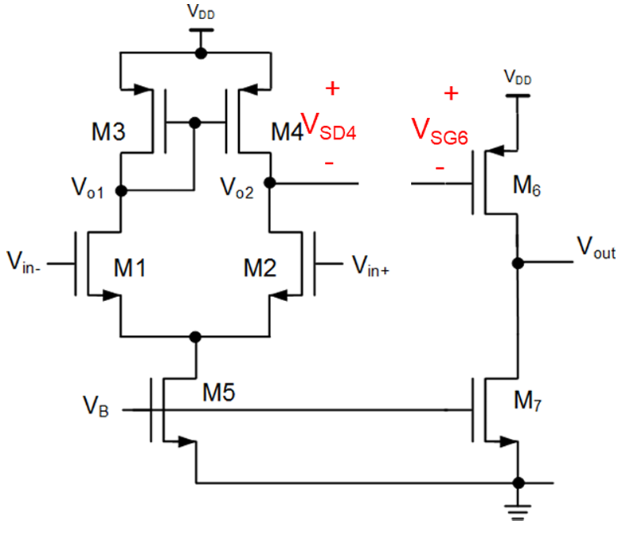<figcaption></figcaption></figure>

However, when $$V_{in+}=V_{in-}$$, the first stage provides $$V_{SD4}=V_{SG3}=0.8\text{ V}$$. After reconnecting the two stages, we have

V_{SG6}=V_{SD4}=0.8\text{ V}\neq 1\text{ V}

Therefore, the second stage is no longer biased to produce $$V_{out}=V_{DD}/2$$, resulting in a systematic offset!

<figure>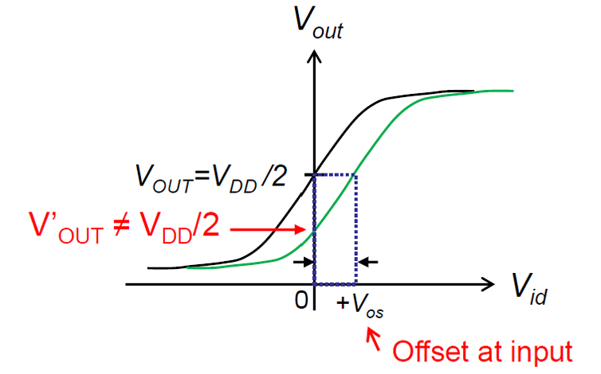<figcaption></figcaption></figure>

To eliminate systematic offset, we want the second stage to produce $$V_{out}=V_{DD}/2$$ when $$V_{id}=0$$. Therefore, the required condition is $$V_{SG6}=V_{SG3}$$.

<figure>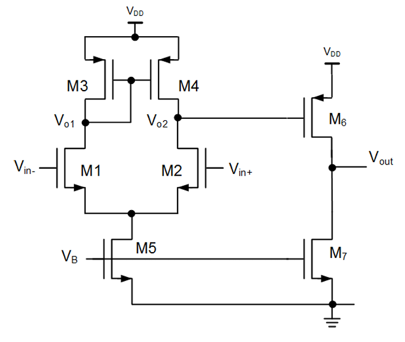<figcaption></figcaption></figure>

Assuming both PMOS transistors operate in saturation and neglecting channel-length modulation:

$$
I_D=\frac{k_p'}{2}\left(\frac WL\right)(V_{SG}-|V_{THp}|)^2
$$

Rearranging in terms of the overdrive voltage:

$$
V_{OV} = V_{SG}-|V_{THp}| = \sqrt{\frac{2I_D}{k_p'(W/L)}}
$$

For M3 and M6, assuming identical threshold voltages:

$$
\begin{align*}
V_{SG3} &= |V_{THp}| + \sqrt{\frac{2I_{D3}}{k_p'(W/L)_3}} \\
V_{SG6} &= |V_{THp}| + \sqrt{\frac{2I_{D6}}{k_p'(W/L)_6}}
\end{align*}
$$

Setting $$V_{SG6}=V_{SG3}$$:

$$
\frac{I_{D3}}{(W/L)_3}=\frac{I_{D6}}{(W/L)_6}
$$

Rearranging,

$$
\frac{(W/L)_6}{(W/L)_3}=\frac{I_{D6}}{I_{D3}}
$$

Since $$I_{D3}=I_{D5}/2$$,

$$
\frac{(W/L)_6}{(W/L)_3}=\frac{2I_{D6}}{I_{D5}}
$$

This gives us a design relationship between the **transistor sizes** and **bias currents** to eliminate systematic offset under the ideal assumptions. In other words, once the transistor dimensions are chosen, we can adjust the bias currents $$I_{D5}$$ and $$I_{D6}$$ (where $$I_{D6}=I_{D7}$$) to satisfy this relationship. Or vice versa.

> TODO: Do the PMOS example b4 final on slide 17-18 (may off by 1)

## Telescopic Op-amp

Recall the [single-stage cascode amplifier](https://app.gitbook.com/s/FkaT0aUkbzwIwL8qtYDI/razavi/single-stage-amplifiers/cascode-stage#cascode-stage-with-resistive-load) we learned in Part 1, which provides a very high voltage gain due to its large output resistance:

$$
A_v = -g_{m1}(r_o' \parallel r_o'') = -g_{m1}\left[ (g_{m2} + g_{mb2})r_{o1}r_{o2} \parallel (g_{m3} + g_{mb3})r_{o3}r_{o4} \right]
$$

We can apply the same cascode structure to a differential amplifier to build a **telescopic op-amp**, which is essentially a cascode differential pair where each branch consists of a cascode amplifier with a cascode current-source load.

<figure>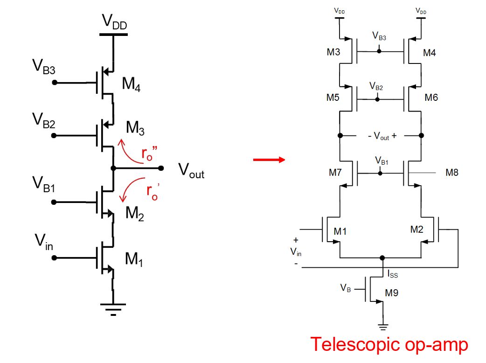<figcaption>
Telescopic Op-amp Illustration
</figcaption></figure>

In the telescopic op-amp, M9 acts as the tail current source, providing the bias current for the differential pair, while $$V_{B1}–V_{B3}$$ provide the necessary DC bias voltages to keep M3 to M8 operating in saturation. Similar to the two-stage op-amp, we will analyze the telescopic op-amp from three aspects:

1. Small-Signal Gain
2. DC Analysis
3. Telescopic op-amp with D to S converter

### Small-Signal Gain

Similar to our analysis of the [differential amplifier](lec-8-differential-amplifiers.md#small-signal-gain), we assume that both branches are **perfectly matched and symmetrical**. Therefore, we can use the **half-circuit method**, where the common-source node acts as a virtual AC ground.

<figure>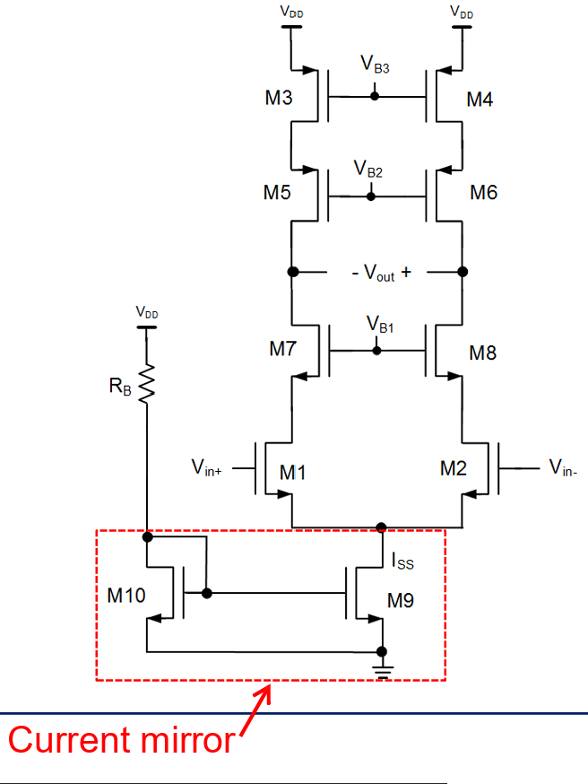<figcaption>
Telescopic Op-amp with current mirror as the biasing circuit
</figcaption></figure>

Each half-circuit is essentially a cascode amplifier with a cascode current-source load. Therefore, using the gain expression derived previously, the overall differential voltage gain is

$$
A_v=\frac{V_{od}}{V_{id}}\approx g_{m1}\left[(g_{m7}r_{o1}r_{o7})\parallel(g_{m5}r_{o3}r_{o5})\right]
$$


Note that the differential voltage gain is always **positive** under our chosen input and output polarity conventions. Although each half-circuit has an inverting gain, the definitions of $$V_{od}$$ and $$V_{id}$$ account for the opposite polarities, resulting in a positive overall differential gain. This is consistent with our previous analysis of the differential amplifier.


Telescopic Op-amp as Operational Transconductance Amplifier (OTA)

Due to its very high output resistance, the output of a telescopic op-amp can be considered a current source rather than a voltage source.


An ideal current source has infinite output resistance, while an ideal voltage source has zero output resistance. This explains why, when deactivating independent sources in Thévenin equivalent circuit analysis, we replace a current source with an open circuit and a voltage source with a short circuit (wire).


Since it also converts an input voltage into an output current, it behaves like a transconductor (voltage input, current output). For this reason, a telescopic op-amp is also called an **Operational Transconductance Amplifier** (OTA). The main difference between a conventional op-amp and an OTA lies in their output characteristics:

* Op-amp: Usually designed to provide a voltage output with **low output resistance**.
* OTA: Provides a current output with **high output resistance**.

However, both can achieve high voltage gain!

### DC Analysis

Similar to the two-stage op-amp, in the DC analysis, we will first determine the maximum output voltage swing of the telescopic op-amp, then explore how to choose the appropriate bias voltages to achieve this swing while keeping all transistors in saturation.

#### Maximum Output Swing

Similarly, we can use the intuitive diagram below to determine the maximum output voltage swing of each half-circuit of the telescopic op-amp: $$V_{\text{swing}}=V_{DD}-5|V_{OV}|$$.

<figure>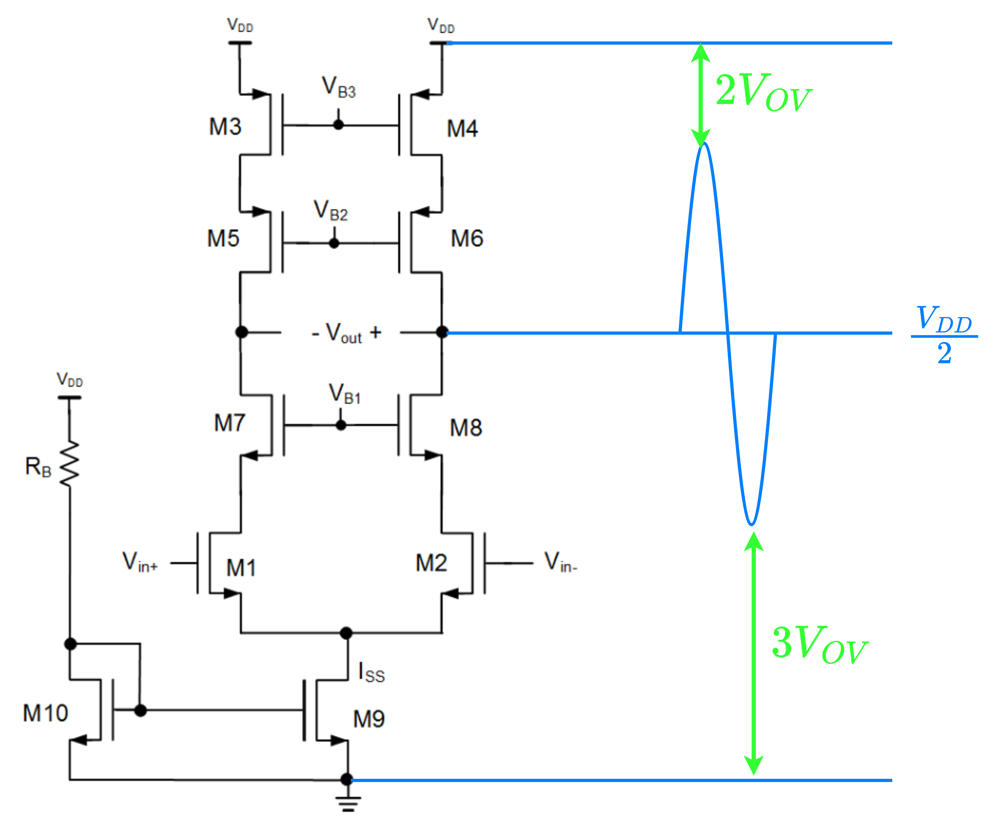<figcaption></figcaption></figure>


Sometimes, we express the available **positive** and **negative** output swings relative to the DC output voltage $$V_{out}$$ as:

1. $$V_{sw}^+=V_{DD}-V_{out}-2|V_{OV}|$$
2. $$V_{sw}^-=V_{out}-3|V_{OV}|$$

Here, $$V_{sw}^+$$ and $$V_{sw}^-$$ represent the maximum upward and downward voltage excursions, respectively, while keeping all transistors in saturation. Thus, the total peak-to-peak output swing can be simply expressed as the sum of $$V_{sw}^+$$ and $$V_{sw}^-$$, which is $$V_{sw}=V_{sw+}+V_{sw-}=V_{DD}-5|V_{OV}|$$.


Since the two branches produce output signals with opposite polarities under differential excitation, the maximum differential output swing is twice that of a single-ended output:

$$
V_{\text{swing,diff}}=2V_{\text{swing}}=2V_{DD}-10|V_{OV}|
$$


The PMOS and NMOS might have different $$V_{OV}$$, but understand the spirit here!


#### Biasing the Op-amp

To achieve the maximum output swing, we need to choose the bias voltages $$V_{B1}$$, $$V_{B2}$$, and $$V_{B3}$$ such that all transistors M3 to M8 remain in saturation throughout the output swing. The main ideas are:

1. Short-Cut Saturation conditions:
   * NMOS: $$V_{GD}\le V_{THN}$$
   * PMOS: $$V_{DG}\le |V_{THP}|$$
2. Worst-case analysis: Consider the maximum or minimum node voltage that makes each transistor most likely to leave saturation.



#### Bias Voltage $$V_{B1}$$

For the NMOS cascode transistor, the worst case occurs when $$V_{out}$$ is minimum. Applying the saturation condition: $$V_{B1}-V_{out,\min}\le V_{THN}$$. Therefore,

$$
V_{B1}\le V_{THN}+V_{out,\min}
$$

where $$V_{out,\min}=\frac{V_{DD}}2-3V_{OV}$$



#### Bias Voltage $$V_{B2}$$

For the PMOS cascode transistor, the worst case occurs when $$V_{out}$$ is maximum. Applying the saturation condition: $$V_{out,\max}-V_{B2}\le |V_{THP}|$$. Therefore,

$$
V_{B2}\ge V_{out,\max}-|V_{THP}|
$$

where $$V_{out,\max}=\frac{V_{DD}}2+2V_{OV}$$.



#### Bias voltage $$V_{B3}$$

Similarly, for the upper PMOS transistor, the worst case occurs when its drain voltage $$V_{D4}$$ is maximum: $$V_{D4,\max}-V_{B3}\le |V_{THP}|$$. Therefore,

$$
V_{B3}\ge V_{D4,\max}-|V_{THP}|
$$

where $$V_{D4,\max}$$ can be determined after choosing $$V_{B2}$$, using the corresponding PMOS source-to-gate voltage: $$V_{D4,\max}=V_{B2}+V_{SG6}$$.



### Telescopic OTA with D to S Converter

Similar to the differential amplifier with a D-to-S converter, we can also implement a telescopic OTA with a D-to-S converter to obtain a single-ended output without losing half of the differential voltage gain. The circuit is shown as follows:

<figure><figcaption>
Telescopic OTA with D-to-S converter
</figcaption></figure>

Using the input and output polarity conventions defined above, the DC voltage gain remains the same as that of the fully differential telescopic OTA, and is positive:

$$
A_v=g_{m2}\left[(g_{m4}r_{o2}r_{o4})\parallel(g_{m6}r_{o8}r_{o6})\right]
$$


Note that, unlike the fully differential telescopic OTA, reversing the input polarity of the telescopic OTA with a D-to-S converter results in a **negative** DC voltage gain, since the single-ended output polarity remains fixed.


The only thing that is different compared with the fully differential telescopic OTA is a **smaller output swing**, particularly in the positive direction $$V_{sw}^+$$. This is because the two diode-connected PMOS transistors, M5 and M7, set the gate voltage of M6 via the connected drain to gate to $$V_{G6}=V_{DD}-2V_{SG}$$. To ensure M6 remains in saturation, we apply the PMOS saturation condition ($$V_{DG6}\le |V_{THP}|$$) under the worst case, when the output voltage is maximum:

$$
\underbrace{V_{sw}^+ + V_{out}}_{V_{D6}} - \left(\underbrace{V_{DD} - 2V_{SG}}_{V_{G6}}\right) \le |V_{THP}|
$$

Rearranging and using $$V_{SG}=|V_{THP}|+|V_{OV}|$$, we obtain

$$
V_{sw}^+\le V_{DD}-V_{out}-(|V_{THP}|+2|V_{OV}|)
$$

Meanwhile, the negative output swing remains unchanged, since the lower NMOS cascode structure is the same $$V_{sw}^-=V_{out}-3|V_{OV}|$$. Thus, the maximum **output swing is**

$$
V_{\text{swing,diff}}=2\times\min(V_{sw}^+,V_{sw}^-)
$$


Note that the output swing is further reduced. But it can be improved by using a [low-voltage current mirror](https://app.gitbook.com/s/FkaT0aUkbzwIwL8qtYDI/razavi/passive-and-active-current-mirrors/cascode-current-mirror#low-voltage-cascode-current-mirror) to replace the conventional cascode current mirror.

