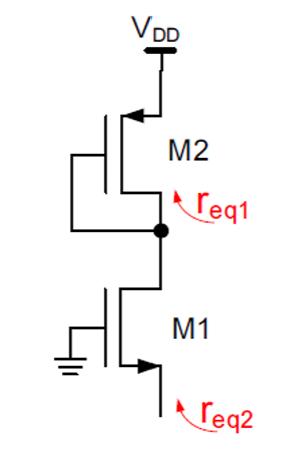

# Tut 1 - MOSFET and Single-Stage Amplifier

## Problems



The official solutions are as follows:



### 1. Transconductance

In NUS EE3408C, we treat strong inversion region is nothing but saturation region.

### 2. Equivalent Resistance

In NUS EE3408C, the convention we use is to find the **equivalent resistance of a specific branch**. For example, in the figure below, $$r_{\mathrm{eq1}}$$ refers only to the equivalent resistance of the branch **above the middle node**; the branch below the middle node is **not included**.


Why writing KCL equations to find the req1 using the test-voltage method, we should try to use $$i_x$$ and $$V_x$$ to represent the unknown node voltage, e.g., $$V_{\text{out}}$$.


<figure><figcaption></figcaption></figure>

Thus, the relationship between **output resistance** and **branches** is that the output resistance can often be found as the parallel combination of the equivalent resistances of the branches connected to the output node:

$$
R_{\mathrm{out}}=r_{\mathrm{eq1}}\parallel r_{\mathrm{eq2}}
$$

where $$r_{\mathrm{eq1}}$$ and $$r_{\mathrm{eq2}}$$ are the equivalent resistances of the **two separate branches extending upward and downward from the same output node**, respectively.


In any circuit, the **equivalent resistance seen looking into the source and drain of the same MOSFET can be different**, because the resistance depends on **which terminal we look into and how the other terminals are connected**. $$R_{\mathrm{eq,source}} \neq R_{\mathrm{eq,drain}}$$ in general, even for the same transistor.


### \*3. Current Source Mirror

1. Whether we are calculating the equivalent transconductance $$G_m$$ of a black box, the output resistance $$R_{out}$$ of an amplifier, or the equivalent resistance $$r_{eq}$$ of a branch, **always apply approximations at the final stage**, after obtaining the general expression.
2. **Razavi's textbook, Chapter 2**, contains many useful exercises on small-signal analysis and is worth practicing!
