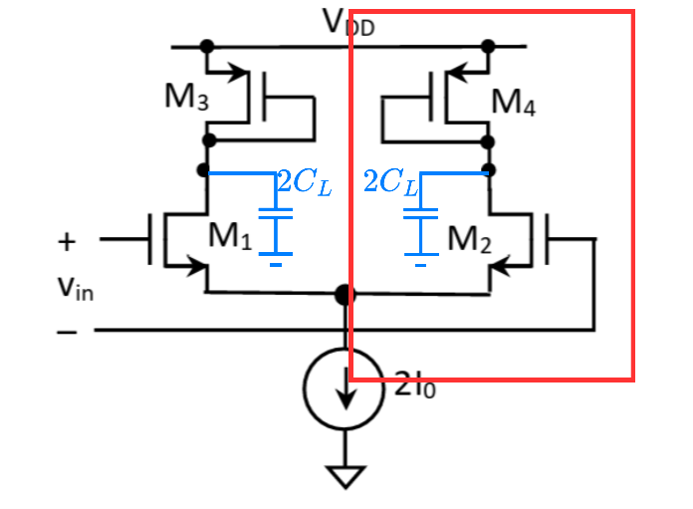
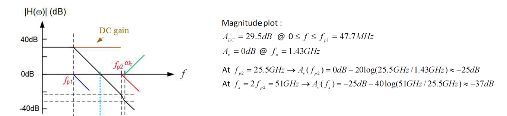

# Tut 3 - Differential Amplifier

## Problems

### 1. Basic Analysis

When analyzing a **differential amplifier**, we can usually simplify the circuit using **half-circuit analysis**. Since the two output signals are equal in magnitude but opposite in phase, we can replace the load capacitor $$C_L$$ connected between the two output nodes with two capacitors of $$2C_L$$ connected in series. The midpoint between them becomes a **virtual AC ground** due to symmetry.


This is similar to how to use intuitive analysis to derive that the common source of M1 and M2 is virtual ground in the [Lec 8](../lec/lec-8-differential-amplifiers.md#intro-to-differential-amplifier).


Therefore, we can analyze just one half of the equivalent circuit, with a load capacitance of $$2C_L$$, to determine the output pole of the differential amplifier.

<figure><figcaption></figcaption></figure>

### \*2. Bias Voltage

This is similar to the initial hand calculation for our project 2!

### 3. Differential Amplifier and Bode Plot

The most important takeaway from this question is learning how to **calculate the gain at different pole and zero frequencies** using the magnitude Bode plot. The general procedure is as follows:

1. Identify the **starting frequency and its corresponding gain**. Then, determine whether we need to find the gain at a given ending frequency or the ending frequency corresponding to a given gain.
2. Based on the magnitude Bode plot we've drawn, identify the **slope between these two frequencies** (e.g., -20 or -40 dB/decade).
3. Apply the following formula: $$G_{\text{end}}=G_{\text{start}}+S\log_{10}\left(\frac{f_{\text{end}}}{f_{\text{start}}}\right)$$, where G is the gain in dB and S is the slope in dB/decade (usually -20 or -40).

By substituting the known values, we can easily calculate the unknown gain or frequency!


The slope must be determined from the magnitude Bode plot. Also, this formula assumes a **constant slope between the starting and ending frequencies**. If we cross another pole or zero, we must divide the calculation into separate frequency intervals.


An example is shown in the follow figure:

<figure><figcaption></figcaption></figure>


For the phase Bode plot, we are not required to know how to get the exact phase values and according to Prof. Jang, we also won't be tested on this during the finals!

