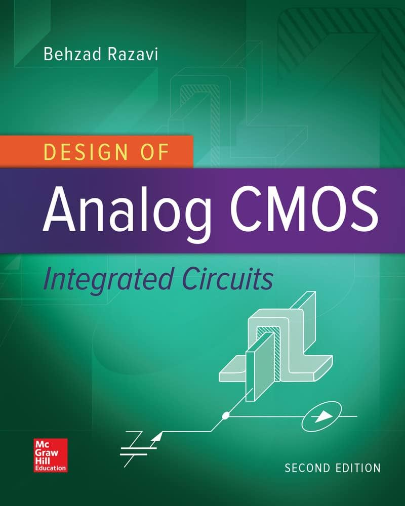
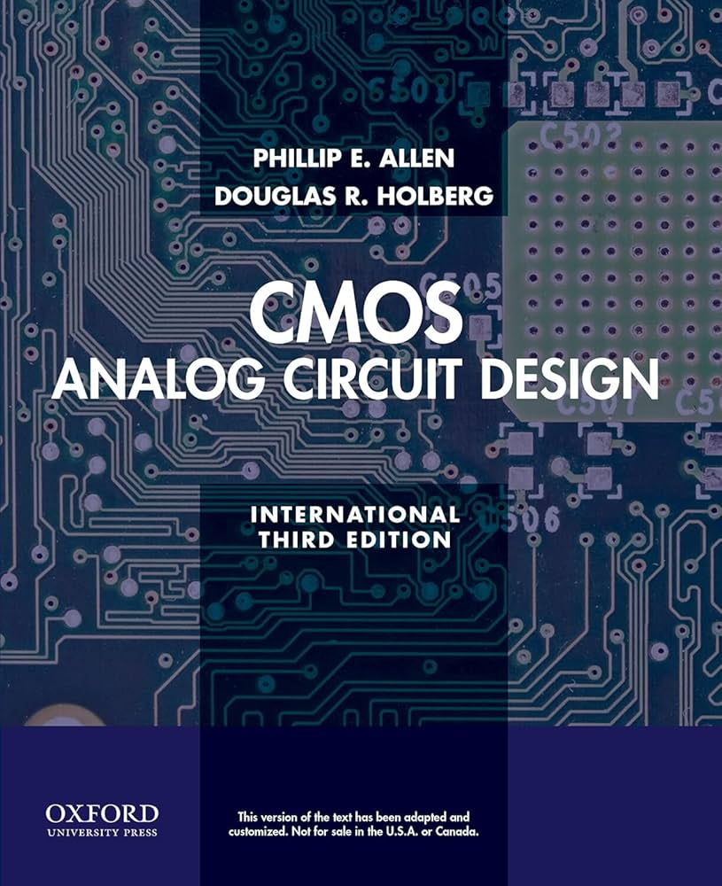
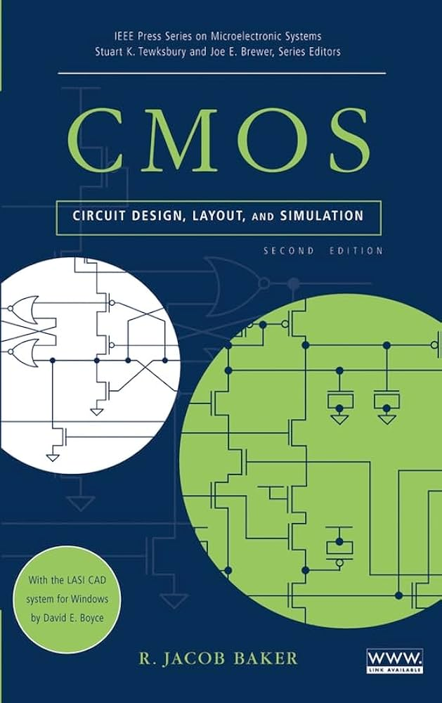
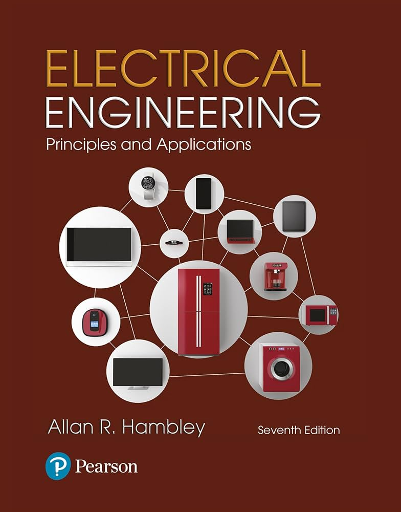

# Welcome

Welcome to the textbook section of EE3408C! In this course, there are several textbooks recommended by the lecturer.

**Textbook 1**: _Design of Analog CMOS Integrated Circuits (2nd edition)_ by Behzad Razav&#x69;_._

<figure><figcaption></figcaption></figure>


This is probably the most famous textbook in the field of analog IC design!


**Textbook 2**: _CMOS Analog Circuit Design_ by Allen & Holberg.

<figure><figcaption></figcaption></figure>

**Textbook 3**: _CMOS: Circuit Design, Layout, and Simulation_ by R J Baker.

<figure><figcaption></figcaption></figure>

**Reference boook 1**: Electrical Engineering: Principles and Applications, 7th Edition.

<figure><figcaption></figcaption></figure>


As EE3408C also requires some basic knowledge on circuit analysis, I found this textbook used for NUS EPP1 back again! Nostalgic!

