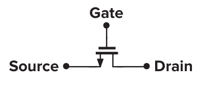
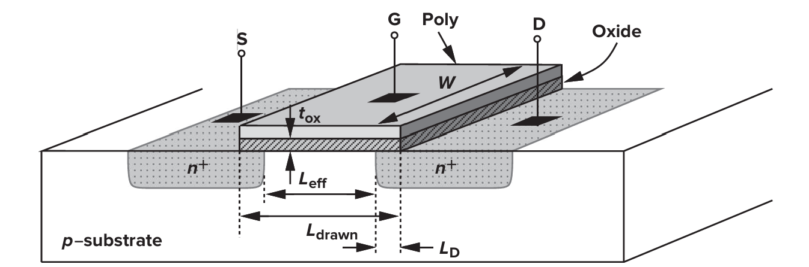
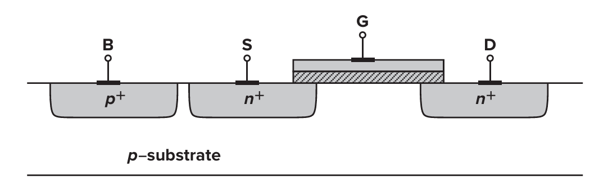
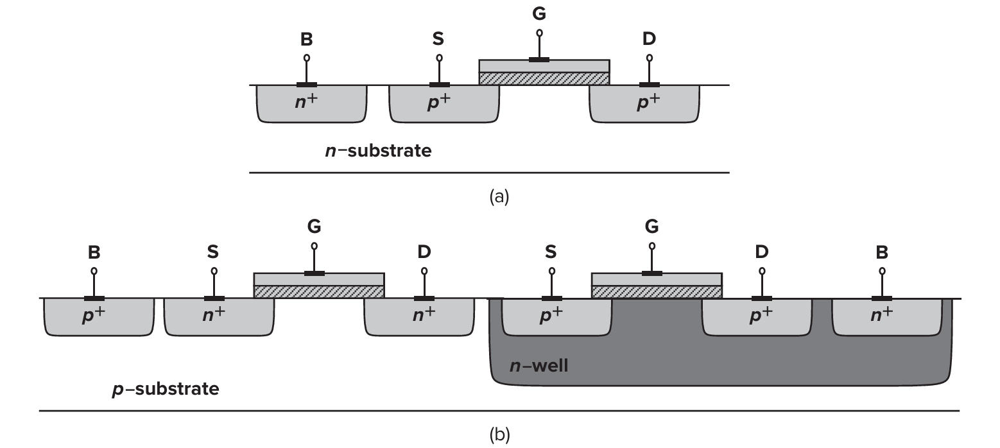
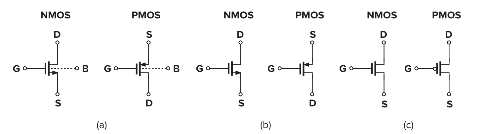

# General Considerations

## MOSFET as a Switch

Before delving into the actual operation of the MOSFET, we consider a simplistic model of the device so as to gain a feel for

1. what the transistor is expected to be and
2. which aspects of its behavior are important.

Shown in Fig. 2.1 is the symbol for an n-type MOSFET, revealing three terminals: gate (G), source (S), and drain (D). The latter two are interchangeable because the device is symmetric.

<figure><figcaption>
Figure 2.1: Simple view of a MOS device.
</figcaption></figure>

When operating as a switch, the transistor "connects" the source and the drain together if the gate voltage, $$V_G$$, is "high" and isolates the source and the drain if $$V_G$$ is "low."


Very succinct and clear explanation when we treat MOSFET as a swtich!


Even with this simplified view, we must answer several questions.

1. For what value of $$V_G$$ does the device turn on? In other words, what is the "threshold" voltage?
2. What is the resistance between S and D when the device is on (or off)?
3. How does this resistance depend on the terminal voltages?
4. Can we always model the path between S and D by a simple linear resistor?
5. What limits the speed of the device?

While all of these questions arise at the circuit level, they can be answered only by analyzing the structure and physics of the transistor.

## MOSFET Structure

Figure 2.2 shows a simplified structure of an n-type MOS (NMOS) device. Fabricated on a p-type substrate (also called the "bulk" or the "body"), the device consists of two heavily-doped n regions forming the source and drain terminals, a heavily-doped (conductive) piece of polysilicon (simply called "poly") operating as the gate, and a thin layer of silicon dioxide (SiO2) (simply called "oxide") insulating the gate from the substrate. **The useful action of the device occurs in the substrate region under the gate oxide**. Note that the structure is symmetric with respect to S and D.

<figure><figcaption>
Figure 2.2: Structure of a MOS device
</figcaption></figure>

The lateral[^1] dimension of the gate along the source-drain path is called the length, $$L$$, and that perpendicular to the length is called the width, $$W$$. Since the S/D junctions "side-diffuse" during fabrication, the actual distance between the source and the drain is slightly less than $$L$$. To avoid confusion, we write, $$L_{\text{eff}} = L_{\text{drawn}} - 2L_D$$, where $$L_{\text{eff}}$$ is the "effective" length, $$L_{\text{drawn}}$$ is the total length, and $$L_D$$ is the amount of side diffusion.


#### Attention

As we will see later, $$L_{\text{eff}}$$ and the gate oxide thickness, $$t_{\text{ox}}$$, play an important role in the performance of MOS circuits. Consequently, the principal thrust in MOS technology development is to reduce both of these dimensions from one generation to the next without degrading other parameters of the device.&#x20;


Typical values at the time of this writing are $$L_{\text{eff}} \approx 10,\text{nm}$$ and $$t_{\text{ox}} \approx 15~\overset{\circ}{A}$$.


In the remainder of this book, we denote the effective length by $$L$$ unless otherwise stated.


Why call one n region source and the other drain if the MOS structure is symmetric?

This is a very good question and it becomes clear if the **source** is defined as the terminal that provides the charge carriers (electrons in the case of NMOS devices and holes in the case of PMOS devices) and the **drain** as the terminal that collects them. Thus, as the voltages at the three terminals of the device vary, the source and the drain may exchange roles. These concepts are practiced in the problems at the end of the chapter.

We have thus far ignored the **substrate** on which the device is fabricated. In reality, the substrate potential greatly influences the device characteristics. That is, the MOSFET is a **four**-terminal device. Since in typical MOS operation, the S/D junction diodes (forming between the S/D with the substrate) must be **reverse-biased** (in the NMOS example that we used here, this means that the voltage at S/D[^2] must be **bigger than or equal to** the voltage at the substrate), we assume that the substrate of NMOS transistors is connected to the **most negative** supply in the system. For example, if a circuit operates between zero and 1.2 volts, $$V_{\text{sub,NMOS}} = 0$$. The actual connection is usually provided through an ohmic $$p^+$$ region, as depicted in the side view of the device in Fig. 2.3.

<figure><figcaption>
Figure 2.3: Substrate Connection
</figcaption></figure>

In **complementary MOS** (CMOS) technologies, both NMOS and PMOS transistors are available. From a simplistic viewpoint, the PMOS device is obtained by negating all of the doping types (including the substrate) \[Fig. 2.4(a)], but in practice, NMOS and PMOS devices must be fabricated on the same wafer, i.e., the same substrate. For this reason, one device type can be placed in a "local substrate," usually called a "well." In today's CMOS processes, the PMOS device is fabricated in an n-well \[Fig. 2.4(b)].

<figure><figcaption>
Figure 2.4: (a) Simple PMOS device; (b) PMOS inside an n-well
</figcaption></figure>

Note that the n-well must be connected to a potential such that the S/D junction diodes of the PMOS transistor remain reverse-biased under all conditions. In most circuits, the n-well is tied to the **most positive supply voltage**. For the sake of brevity, we sometimes call NMOS and PMOS devices "NFETs" and "PFETs," respectively.


Figure 2.4(b) indicates an interesting difference between NMOS and PMOS transistors: while all NFETs share the same substrate, each PFET can have an independent n-well. This flexibility of PFETs is exploited in some analog circuits.


## MOS Symbols

The circuit symbols used to represent NMOS and PMOS transistors are shown in Fig. 2.5. The symbols in Fig. 2.5(a) contain all four terminals, with the substrate denoted by "B" (bulk) rather than "S" to avoid confusion with the source. The source of the PMOS device is positioned on top as a visual aid because it has a higher potential than its gate.


You may notice that in Fig. 2.5.(a), the current direction for NMOS and PMOS is both from **top** to **bottom** so we only need to change the S/D position when we draw NMOS/PMOS.


Since in most circuits the bulk terminals of NMOS and PMOS devices are tied to ground and $$V_{\text{DD}}$$, respectively, we usually omit these connections in drawing \[Fig. 2.5(b)].

<figure><figcaption>
Figure 2.5: MOS symbols.
</figcaption></figure>

In digital circuits, it is customary to use the "switch" symbols depicted in Fig. 2.5(c) for the two types, but we prefer those in Fig. 2.5(b) because the visual distinction between S and D proves helpful in understanding the operation of circuits.

[^1]: This is nothing but the same as **horizontal**.

[^2]: To be more precise, for a pn junction to be reverse-biased, the voltage at the n region should be **bigger** than the voltage at the p region.
