# MOS Device Models

## MOS Device Layout

For the developments in subsequent sections, it is beneficial to have some understanding of the layout of a MOSFET. We describe only a simple view here, deferring the fabrication details and structural subtleties to later chapters if I have time LOL :joy:.

The layout of a MOSFET is determined by both the electrical properties required of the device in the circuit and the "design rules" imposed by the technology. For example,

* $$W/L$$ is chosen to set the [transconductance](mos-device-models.md#mos-transconductance) or other circuit parameters (electrical properties)
* the minimum $$L$$ is dictated by the process. (design rule imposed by the technology)

In addition to the gate, the source and drain areas must be defined properly as well. Shown in Fig. 2.29 are the "bird's-eye view" and the top view of a MOSFET.

<figure>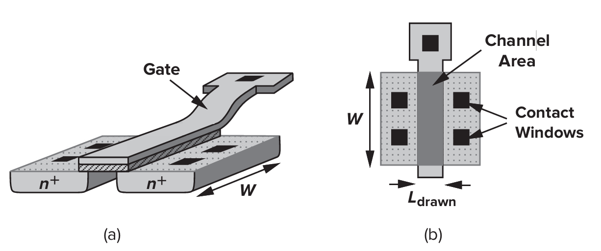<figcaption>
Figure 2.29: Bird's-eye and vertical views of a MOS device
</figcaption></figure>

The gate polysilicon and the source and drain terminals must be tied to metal (aluminum) wires that serve as interconnects with low resistance and capacitance. To accomplish this, one or more "contact windows" must be opened in each region, filled with metal, and connected to the upper metal wires.


Note that the gate poly extends beyond the channel area by some amount to ensure reliable definition of the "edge" of the transistor.


The source and drain junctions[^1] play an important role in the performance. To minimize the capacitance of S and D, the total **area** of each junction must be minimized. We see from Fig. 2.29 that one dimension of the junctions is equal to $$W$$. The other dimension[^2] must be large enough to accommodate the contact windows and is specified by the technology design rules.

Draw the MOSFET Layout.

Draw the layout of the circuit shown in Figure 2.30(a).

<figure>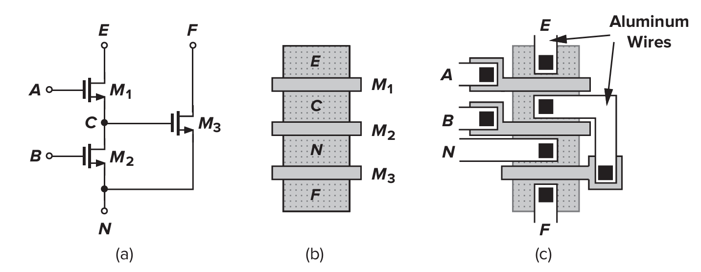<figcaption>
Figure 2.30
</figcaption></figure>

**Sol**. Observing that $$M_1$$ and $$M_2$$ share the same S/D junctions at node C and $$M_2$$ and $$M_3$$ also do so at node N, we surmise that the three transistors can be laid out as shown in Fig. 2.30(b). Connecting the remaining terminals, we obtain the layout in Fig. 2.30(c). Note that the gate polysilicon of $$M_3$$ cannot be [directly tied](#user-content-fn-3)[^3] to the source material of $$M_1$$, thus requiring a metal interconnect.


$$M_1,M_2$$ and $$M_3$$ are all NMOS.



We've also covered the MOSFET layout in EE4415, feel free to have a look at the [notes](https://app.gitbook.com/s/Sp0XaarBjbEX3JIMrRaR/part-2-lec-analog-design-flow/lec-4-layout-and-parasitics#layout) there!


## MOS Device Capacitances

The basic [quadratic I/V relationships](mos-device-models.md#how-does-the-device-conduct-current-in-the-presence-of-pinch-off) derived in the previous section, along with corrections for [body effect](mos-device-models.md#channel-effect) and [channel-length modulation](mos-device-models.md#channel-length-modulation), provide some understanding of the **low-frequency** behavior of CMOS circuits. In many analog circuits, however, the capacitances associated with the devices must also be taken into account so as to predict the **high-frequency** behavior as well.

Why capacitances matter when the voltage signal is in high-frequency?

The current required to charge or discharge a capacitor is governed by the equation:

I = C \frac{dV}{dt}

where $$\frac{dV}{dt}$$ is the rate of change of the voltage, which is directly tied to **frequency**.

* At **Low Frequencies** (or DC): The voltage signals change very slowly. Because $$\frac{dV}{dt}$$ is practically zero, the current ($$I$$) drawn by the parasitic capacitors is effectively zero.
* At **High Frequencies**: The voltage signals change incredibly fast (high $$\frac{dV}{dt}$$). Now, the parasitic capacitors require substantial current to charge and discharge.

We consider that a capacitance exists between **every two** of the **four** terminals of a MOSFET (Fig. 2.31). Moreover, the value of each of these capacitances may depend on the bias conditions of the transistor.


The capacitance between S and D is negligible. Thus, there are $$C_4^2-1=6-1=5$$ capacitances shown in Fig 2.31.


<figure>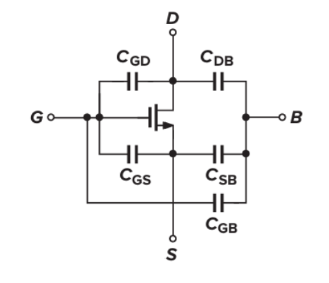<figcaption>
Figure 2.31: MOS Capacitance
</figcaption></figure>


This part has also been introduced a litte bit in [NUS EE4415](https://app.gitbook.com/s/Sp0XaarBjbEX3JIMrRaR/part-2-lec-analog-design-flow/lec-4-layout-and-parasitics#mos-capacitance), feel free to go back to the notes there and have a look to gain a deeper understanding.


### MOS Capacitance Calculation

To look at these capacitances in the MOSFET physical structure, we have Fig 2.32(a).

<figure>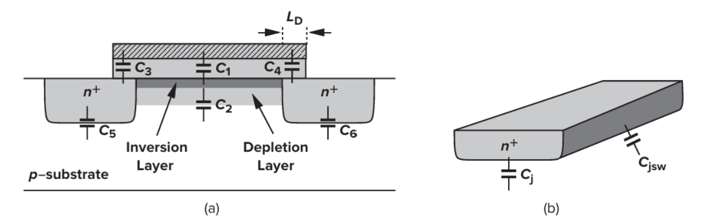<figcaption>
Figure 2.32: (a) MOS device capacitances; (b) decomposition of S/D junction capacitance into bottom-plate and sidewall components.
</figcaption></figure>

Considering the physical structure in Fig. 2.32(a), we identify the following:

1. Oxide Capacitance
2. Depletion Capacitance
3. Gate-source/drain Overlap Capacitance
4. Junction Capacitance

#### Oxide Capacitance

In Figure 2.32(a), this is denoted as $$C_1$$, the **oxide capacitance** is the capacitance between the gate and the channel. It is calculated by,

$$
C_1 = WLC_{ox}
$$

#### Depletion Capacitance

In Figure 2.32(a), this is denoted as $$C_2$$, the [**depletion**](mos-device-models.md#threshold-voltage) **capacitance** is the capacitance between the channel and the substrate. It is calculated by

$$
C_2 = WL\sqrt{q\epsilon_{si}N_{sub}/(4F)}
$$


The **series** combination of [#oxide-capacitance](mos-device-models.md#oxide-capacitance "mention") and [#depletion-capacitance](mos-device-models.md#depletion-capacitance "mention")is called $$C_{GB}$$ (Gate-to-Bulk Capacitance), meaning that $$C_{GB} = \frac{C_1 \times C_2}{C_1 + C_2}$$.


#### Gate-source/drain Overlap Capacitance

In Figure 2.32(a), they are denoted as $$C_3$$ and $$C_4.$$ These capacitances are due to the overlap of the gate poly with the source and drain areas. Owing to fringing electric field lines, $$C_3$$ and $$C_4$$ **cannot** be simply written as $$WL_D C_{ox}$$, and are usually obtained by more elaborate calculations. Thus, we introduce the $$C_{ov}$$, which is the **overlap capacitance per unit width** and expressed in F/m (or fF/μm). We simply multiply $$C_{ov}$$ by $$W$$ to find the **gate-source** and **gate-drain overlap capacitances**.

$$
C_{3/4}=C_{ov}W
$$


$$C_{3/4}$$ is the $$C_{GS/D}$$ (Gate-to-Source/Drain Capacitance).


#### Junction Capacitance

In Figure 2.32(a), these are denoted as $$C_5$$ and $$C_6$$. These capacitances are between the source/drain areas and the substrate. As shown in Fig. 2.32(b), this last capacitance is decomposed into two components:

1. the **bottom-plate capacitance** associated with the bottom of the junction, $$C_j$$, and
2. the **sidewall capacitance** due to the perimeter of the junction, $$C_{jsw}$$.

The distinction is necessary because different transistor geometries yield different area and perimeter values for the S/D junctions. We specify $$C_j$$ and $$C_{jsw}$$ as **capacitance per unit area** (in $$F/m^2$$) and **unit length** (in F/m), respectively. Thus, $$C_j$$ is multiplied by the S/D area, and $$C_{jsw}$$ by the S/D [perimeter](https://en.wikipedia.org/wiki/Perimeter).


Note that each junction capacitance **density** can be expressed as $$C_j = C_{j0}/[1 + V_R/(B)]^m$$, where $$V_R$$ is the reverse voltage across the junction, $$B$$ is the junction built-in potential, $$m$$ is a power typically in the range of 0.3 and 0.4, and $$C_{j0}$$ is the zero-bias junction capacitance density.


During the calculation,

$$
C_{5/6}=C_jWL+C_{jsw}W
$$


$$C_{5/6}$$ is the $$C_{S/DB}$$ (Source/Drain-to-Bulk Capacitance).


MOS Capacitance Calculation Example

Calculate the source and drain junction capacitances of the two structures in Fig. 2.33.

<figure>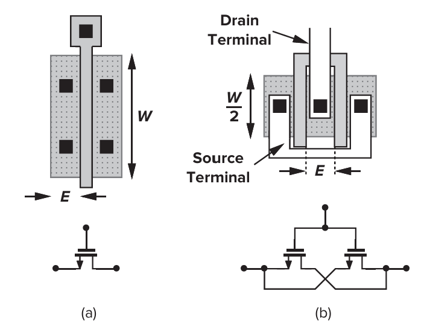<figcaption>
Figure 2.33
</figcaption></figure>

**Sol**. For the transistor in Fig 2.33(a), we have

C_{DB} = C_{SB} = WEC_j + 2(W+E)C_{jsw}

The reason we have 2W is because one outer W and one inner W touching the gate. 2E is one top and one bottom.

For the transistors in Fig. 2.33(b),

\begin{align*} C_{DB} &#x26;= \frac{W}{2} E C_j + 2 \left( \frac{W}{2} + E \right) C_{jsw}  \\[6pt] C_{SB} &#x26;= 2 \left[ \frac{W}{2} E C_j + 2 \left( \frac{W}{2} + E \right) C_{jsw} \right] \\[6pt] &#x26;= WEC_j + 2(W + 2E)C_{jsw} \end{align*}

This is called a "folded" structure, the geometry in Fig. 2.33(b) exhibits **substantially less** drain junction capacitance than that in Fig. 2.33(a) while providing the same $$W/L$$.

### MOS Capacitance Application

We now derive the capacitances between terminals of a MOSFET in different regions of operation.


In NUS EE3408C, according to Prof. Gao, we are not required to know how to calculate the different capacitances in the MOSFET. Instead, we just need to know

* under what operating region, which capacitance will be how much.
* and the **location of each capacitance** in the [small-signal model](mos-device-models.md#small-signal-model-with-capacitance)

that will be pretty enough.


#### OFF Region



#### $$C_{GD}$$ and $$C_{GS}$$

If the device is **off**, we have:

$$
C_{GD} = C_{GS} = C_{ov}W
$$


Sometimes we will also denote $$C_{ov}W$$ as $$C_{GS0}$$ and $$C_{GD0}$$




#### $$C_{GB}$$

The gate-bulk capacitance consists of the **series** combination of the [gate-oxide capacitance](mos-device-models.md#oxide-capacitance) and the [depletion-region](mos-device-models.md#depletion-capacitance) capacitance \[Fig. 2.32(a)], i.e.,

$$
C_{GB} = \frac{(WLC_{ox})C_d}{(WLC_{ox}+C_d)}
$$

where $$L$$ is the effective length, $$C_d = WL\sqrt{q\epsilon_{si}N_{sub}/(4F)}$$, and $$\epsilon_{si} = \epsilon_{r,si} \times \epsilon_0 = 11.8 \times (8.85 \times 10^{-14})F/cm$$.



#### $$C_{SB}$$ and $$C_{DB}$$

The value of $$C_{SB}$$ and $$C_{DB}$$ is a function of the source and drain voltages with respect to the substrate.


$$C_{S/DB}$$ remains the same as in the deep triode mode and saturation mode while only the $$V_R$$ changes. And according to Prof. Gao, in NUS EE3408C, we **don't need to consider** $$C_{SB}$$ and $$C_{DB}$$.




#### Deep Triode Region

The **gate-bulk capacitance** $$C_{GB}$$ is usually neglected in the [triode](mos-device-models.md#deep-triode-region) and [saturation](mos-device-models.md#saturation-region-1) regions because the inversion layer acts as a "shield" between the gate and the bulk. In other words, if the gate voltage varies, the charge is supplied by the source and the drain rather than the bulk.



#### $$C_{GD}$$ and $$C_{GS}$$

If the device is in the deep triode region, i.e., if S and D have approximately equal voltages, then the [gate-channel capacitance](mos-device-models.md#oxide-capacitance) (oxide capacitance), $$WLC_{ox}$$, is divided equally between the gate and source terminals and the gate and drain terminals (Fig. 2.34).

<figure>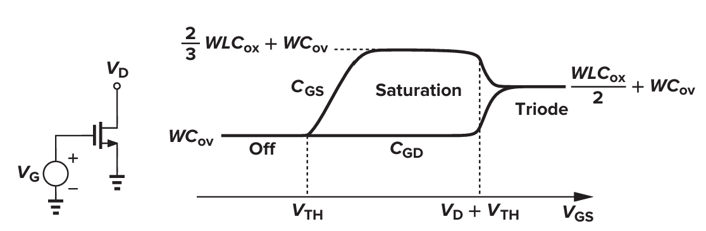<figcaption>
Figure 2.34: Variation of gate-source and gate-drain capacitance versus V_{GS}.
</figcaption></figure>

This is because a change of $$V$$ in the gate voltage draws equal amounts of charge from S and D. Thus:

$$
C_{GD} = C_{GS} = WLC_{ox}/2 + WC_{ov}
$$



#### Saturation Region



#### $$C_{GD}$$

Let us now consider $$C_{GD}$$ first. If in saturation, a MOSFET exhibits a gate-drain capacitance $$C_{GD}$$ roughly equal to $$WC_{ov}$$.

$$
C_{GD}=C_{ov}W
$$



#### $$C_{GS}$$

As for $$C_{GS}$$, we note that the [potential difference between the gate and the channel](mos-device-models.md#determine-the) varies from $$V_{GS}$$ at the source to $$V_{TH}$$ at the pinch-off point, resulting in a nonuniform vertical electric field in the gate oxide as we travel from the source to the drain. It can be proved that the equivalent capacitance of this structure, excluding the gate-source overlap capacitance, equals $$(2/3)WLC_{ox}$$. Thus,

$$
C_{GS} = 2W L_{\text{eff}} C_{ox}/3 + WC_{ov}
$$

The behavior of $$C_{GD}$$ and $$C_{GS}$$ in different regions of operation is plotted in Fig. 2.34.


Note that the above equations do not provide a **smooth transition** from one region of operation to another, creating convergence difficulties in simulation programs.




## MOS Small-Signal Model

The quadratic characteristics described by (2.8) and (2.9) along with the [voltage-dependent capacitances](#user-content-fn-4)[^4] derived above form the **large-signal model** of MOSFETs. Such a model proves essential in analyzing circuits in which the signal significantly disturbs the bias points, particularly if nonlinear effects are of concern.


Ini particular, if we understand the DC bias point as the steady baseline, signals that "disturb" it are large AC signals whose voltage swings are wide enough to push the transistor out of its linear operating region.


By contrast, if the perturbation in bias conditions is small, a **"small-signal" model**, i.e., an approximation of the large-signal model around the operating point, can be employed to simplify the calculations. Since in many analog circuits, MOSFETs are biased in the **saturation region**, we derive the corresponding small-signal model here.


Please read these two notes on [DC bias point](../single-stage-amplifiers/#static-operating-point) and [movitation for small signal model](../single-stage-amplifiers/#small-signal-analysis) in the next chapter first! Specifically, we want to study how tiny variations in $$V_{GS}$$, $$V_{DS}$$, and $$V_{BS}$$ affect the drain current ($$I_D$$), under the assumption that these changes are small enough to keep the MOSFET operating strictly within the saturation region.


For transistors operating as switches, a linear resistor given by (2.11) together with device capacitances serves as a rough small-signal equivalent. But, let's see how a proper small-signal model of a MOSFET can be derived as follows:


Just a reminder, in all the three derivations below, we strictly assume that the MOSFET always operates in the **saturation** region.


This process can be understood simply as adding stuff between the Drain and the Source.

<figure>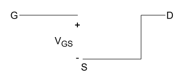<figcaption>
MOSFET small siganl initial state
</figcaption></figure>

### Small change in the Gate Voltage

From Equation 2.9, we can clearly see that a small change in $$V_{GS}$$ ($$\Delta V_{GS}$$) will correspondingly change the drain current. So to quantify this change, we can use the [#mos-transconductance](mos-device-models.md#mos-transconductance "mention") we learned earlier. To demonstrate this, we can incorporate a voltage-dependent **current source** equal to $$g_mV_{GS}$$ or $$g_m \Delta V_{GS}$$ into our small signal model.

<figure>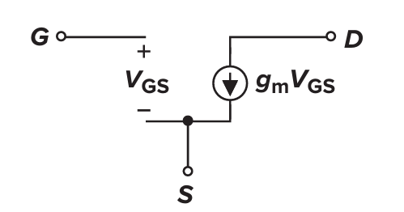<figcaption></figcaption></figure>

Use Taylor Series to prove the first-order relationship between I_d/\Delta I_D and V_{gs}/\Delta V_{GS}

From the previous notes, we can plot the $$I_D$$–$$V_{GS}$$ characteristic as shown below. The bias point $$V_{GS0}, I_{D0}$$ is chosen such that the MOSFET operates in the **saturation region**.

<figure>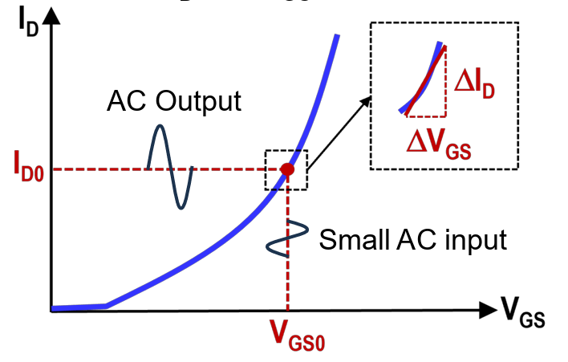<figcaption></figcaption></figure>

We now want to see how a **small change in** $$V_{GS}$$ around $$V_{GS0}$$ affects the drain current $$I_D$$. Since the $$I_D$$-$$V_{GS}$$ relationship is nonlinear, we use a [**Taylor series expansion**](https://en.wikipedia.org/wiki/Taylor_series) around the bias point $$V_{GS0}$$:

I_D(V_{GS})=I_D(V_{GS0}) + \left.\frac{\partial I_D}{\partial V_{GS}}\right\vert{}_{V_{GS0}} (V_{GS}-V_{GS0}) + \text{higher-order terms}


An interesting thing here is that the total drain current can be decomposed into its DC operating bias, $$I_D(V_{GS0})$$, plus its higher-order responses to the small-signal voltage perturbation (but here we are only interested in the first-order response!)


For a sufficiently small change

\Delta V_{GS}=V_{GS}-V_{GS0}

the higher-order terms can be neglected. Therefore,

\Delta I_D \approx \left.\frac{\partial I_D}{\partial V_{GS}}\right\vert{}_{V_{GS0}} \Delta V_{GS}

so the small-signal relationship becomes

I_d=g_m V_{gs}

where $$I_d=\Delta I_D$$ and $$V_{gs}=\Delta V_{GS}$$. Thus, although the large-signal $$I_D$$–$$V_{GS}$$ characteristic is nonlinear, near the bias point it can be approximated as linear. The slope of the curve at the bias point is $$g_m$$.

### Small change in Drain Voltage

From the [#channel-length-modulation](mos-device-models.md#channel-length-modulation "mention"), we also see that when MOSFET is operating under the **saturation region**, the drain current can also depend of $$V_{DS}$$. And based on the equation 2.27, we can see that the relationship between $$V_{DS}$$ and $$I_{D}$$ is **linear**.

$$
I_D \approx \frac{1}{2}\mu_n C_{ox}\frac{W}{L}(V_{GS}-V_{TH})^2(1+\lambda V_{DS}) \tag{2.27}
$$


Interestingly, the drain current with channel-length modulation ($$I_D$$) is simply the baseline ideal current without the consideration of CLM ($$I_{D0}$$) plus a correction factor of $$\lambda V_{DS} \cdot I_{D0}$$. This can be understood by the Kirchhoff's Current Law (KCL) that we learned in NUS CG1111A!


Thus, we can simply add another voltage-dependent current source as follows, where $$\alpha=\frac{1}{2}\mu_n C_{ox}\frac{W}{L}(V_{GS}-V_{TH})^2\cdot\lambda\approx\lambda\cdot I_D$$:

<figure>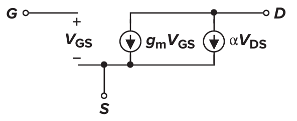<figcaption></figcaption></figure>

But a current source whose value **linearly** depends on the voltage across it is equivalent to a **linear resistor**.


The linear resistor here is not a physical resistor. It is an **imaginary small-signal resistance** that exists only in the **small-signal model**.


So, our small-signal model can be refined to as follows:

<figure>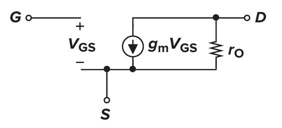<figcaption></figcaption></figure>

Tied between the drain and the source, the resistor $$r_O$$ is given by:

$$
\begin{align}
r_O &= \frac{\partial V_{DS}}{\partial I_D} \tag{2.44} \\
&= \frac{1}{\partial I_D / \partial V_{DS}} \tag{2.45} \\
&= \frac{1}{\dfrac{1}{2} \mu_n C_{ox} \dfrac{W}{L} (V_{GS} - V_{TH})^2 \cdot \lambda} \tag{2.46} \\
&=\frac{1 + \lambda V_{DS}}{\lambda I_D} \tag{2.47} \\
&\approx \frac{1}{\lambda I_D} \tag{2.48}
\end{align}
$$

where $$\lambda V_{DS}\ll1$$ as we treat $$V_{DS}$$ as a **small pertubation** around its bias value. And Equation 2.46 simply uses the Equation 2.27 for the partial derivation.


The value of the resistor $$r_O$$ is called the **output resistance** of the MOSFET because later in the chapter of amplifier, we will see that it is related to the **voltage gain** of the amplifier. The $$I_D$$ in Eq. 2.47 is the one that takes the CLM into account (a.k.a, Equation. 2.27)


Trade-off when trying to increase r_O

From **Equation 2.48**, there are two ways to increase the output resistance:

1. Decrease $$I_D$$
2. Decrease $$\lambda$$

However, decreasing $$I_D$$ also reduces the transconductance $$g_m$$, which is undesirable for [amplifier design](../single-stage-amplifiers/common-source-stage.md#small-signal-model). This highlights the **trade-offs involved in analog circuit design**.

Therefore, the preferred approach is to **decrease** $$\lambda$$ **by increasing the channel length** $$L$$:

L\uparrow \;\Rightarrow\; \lambda\downarrow \;\Rightarrow\; r_O\uparrow


In NUS EE3408C, we use the **GPDK180** process, with a minimum channel length of $$180\,\text{nm}$$. According to Prof. Gao, we can use a **longer** channel length to increase $$r_O$$, which is also recommended for the project.


### Small change in the Body Voltage

As we have seen in [#body-effect](mos-device-models.md#body-effect "mention"), the change in the body voltage $$V_B$$ will affect $$V_{TH}$$ and thus affect the drain current as well. Thus, to take the change in body voltage into account in our MOSFET small-signal model, we can use the idea of **transconductance** again, but this time we let it be the transconductance between the body-source voltage $$V_{BS}$$ and the drain current. Let's call this transconductance to be $$g_{mb}$$ and by the definition of transconductance, we have

$$
\begin{align}
g_{mb} &= \frac{\partial I_D}{\partial V_{BS}} \tag{2.49} \\
&= \mu_n C_{ox} \frac{W}{L} (V_{GS} - V_{TH}) \left( -\frac{\partial V_{TH}}{\partial V_{BS}} \right) \tag{2.50}
\end{align}
$$


From the first step to the second step, we use the chain rule of partial derivation, which is $$\frac{\partial I_D}{\partial V_{BS}}=\frac{\partial I_D}{\partial V_{TH}}\cdot \frac{\partial V_{TH}}{\partial V_{BS}}$$. And we may notice that the first term in front of the negtive partial derivative is nothing but the **transconductance** between the $$I_D$$ and $$V_{GS}$$.


We also have,

$$
\begin{align}
\frac{\partial V_{TH}}{\partial V_{BS}} &= -\frac{\partial V_{TH}}{\partial V_{SB}} \tag{2.51} \\
&= -\frac{\gamma}{2} (2\Phi_F + V_{SB})^{-1/2} \tag{2.52}
\end{align}
$$


This derivation uses the Equation 2.23 that we've seen in my [body effect](second-order-effects.md#body-effect) notes.


Thus,

$$
\begin{align}
g_{mb} &= g_m \frac{\gamma}{2\sqrt{2\Phi_F + V_{SB}}} \tag{2.53} \\
&= \eta g_m \tag{2.54}
\end{align}
$$

where $$\eta=g_{mb}/g_m$$ and it's usually around 0.25. And this will add the third **current source** into our small-signal model.


In NMOS, $$\eta$$ can also be expressed as $$\frac{\partial V_{TH}}{\partial V_{SB}}$$ while in PMOS $$\eta = \frac{\partial \vert{}V_{THP}\vert{}}{\partial V_{BS}}$$, while $$\eta=g_{mb}/g_m$$ applies universally for both NMOS and PMOS!


<figure>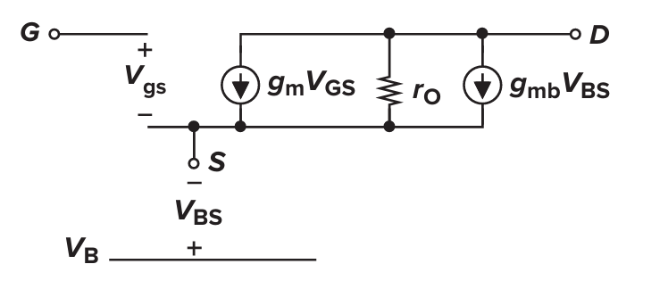<figcaption></figcaption></figure>

The significance here is that we found out increasing $$V_{BS}$$ has a similar qualitative effect as increasing $$V_{GS}$$. Both increase the drain current ($$I_D$$). However, the body's influence is much weaker, which is why body transconductance is scaled by a fraction ($$g_{mb} = \eta g_m$$).


The significance above is particularly important, so it is worth examining carefully. For an **NMOS**, increasing $$V_{BS}$$ makes $$V_{TH}$$ smaller. As a result, the effective overdrive voltage $$V_{GS}-V_{TH}$$ increases, leading to a **larger drain current** $$I_D$$.


At this point of view, our MOSFET small signal model is kind of complete and we can write the following formula:

$$
I_d = g_m V_{gs} + g_{mb} V_{bs} + \frac{V_{ds}}{r_o} = g_m (V_{gs} + \eta V_{bs}) + \frac{V_{ds}}{r_o}
$$


Here, it's more precise to use $$V_{gs},V_{ds},V_{bs}$$ to represent that we are interested only in the **small voltage chanegs** instead of the DC bias voltage at these three terminals!


The big picture of how small-signal model works

Applying a small AC voltage source to the gate triggers a simultaneous set of interactions that instantly settle into a new equilibrium:

1. **The Primary Drive** ($$v_{gs}$$): The small change in gate voltage dictates the primary change in drain current (via transconductance, $$g_m$$).
2. **The Load Reaction** ($$v_{ds}$$): If the drain is connected to a load, this changing current alters the voltage drop across the load, forcing the drain voltage $$v_{ds}$$ to fluctuate.
3. **The Internal Feedback** ($$r_o$$): This fluctuation in $$v_{ds}$$ also affects the output resistance of the transistor, slightly modifying the drain current again due to channel-length modulation.
4. **The Body Effect** ($$v_{bs}$$): Any simultaneous small changes in the body voltage will independently adjust the current (via $$g_{mb}$$).

Because the small-signal model is linear, these individual voltage fluctuations do not cause an endless loop. Instead, they **superimpose** instantly, balancing against the load to reach a stable AC equilibrium.

### Small Signal Model with Capacitance

Now, we can combine our small-signal model with all the capacitances we've learned. Shown in Fig. 2.39, the complete small-signal model includes the device capacitances as well. The value of each capacitance is calculated according to the equations derived in [#mos-device-capacitances](mos-device-models.md#mos-device-capacitances "mention").

<figure>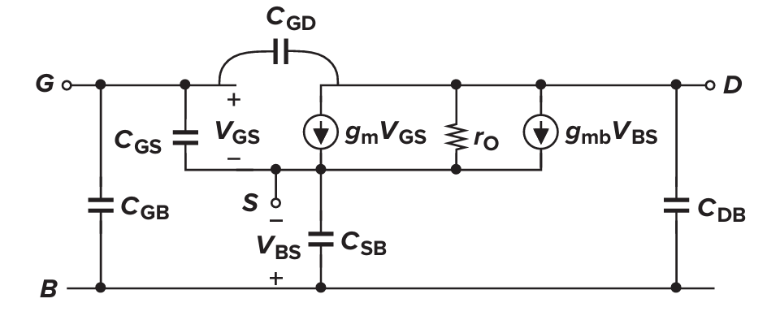<figcaption></figcaption></figure>


In NUS EE3408C, we will be only dealing with **low-frequency circuits**, thus the capacitance always matters but we will always be given the values of these capacitances during our assignments or exams.


The reader may wonder how a complex circuit is analyzed intuitively if each transistor must be replaced by the model of Fig. 2.39.

> The first step is to determine the **simplest** device model that can represent the role of each transistor with reasonable accuracy.

We provide some guidelines for this task at the end of the next Chapter.

PMOS Small Signal Model

Usually, the PMOS small signal model is the **same** as the NMOS one, but sometimes for better visuals, we may use the flipped version of the PMOS small signal model as follows:

<figure>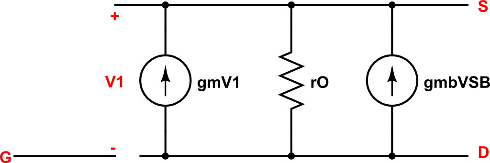<figcaption></figcaption></figure>

$$V_1$$ can usually be represented by $$V_{in}$$ so that we can continue the small signal analysis.

## MOS SPICE Models

In order to represent the behavior of transistors in circuit simulations, simulators such as SPICE and Cadence require an accurate model for each device. Over the last three decades, MOS modeling has made tremendous progress, reaching sophisticated levels so as to represent high-order effects in short-channel devices.

In this section, we describe the simplest MOS SPICE model, known as "Level 1," and provide typical values for each parameter in the model corresponding to a 0.5-μm technology. Table 2.1 shows the model parameters for NMOS and PMOSdevices.

<figure>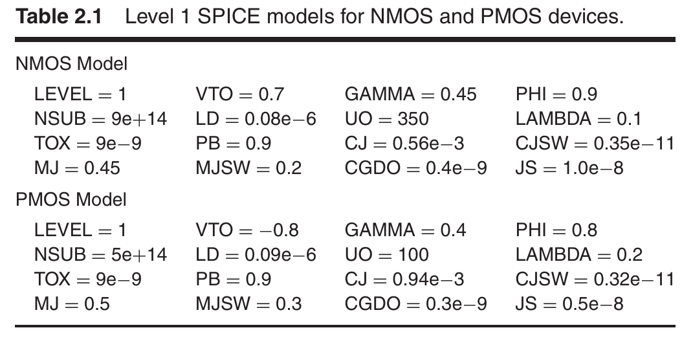<figcaption></figcaption></figure>

The parameters are defined as follows:

| Abbreviation in SPICE | Symbol used in the MOSFET formula | Explanation                                                                    |
| --------------------- | --------------------------------- | ------------------------------------------------------------------------------ |
| VTO                   | $$V_{T0}$$                        | threshold voltage with zero $$V_{SB}$$ (unit: V)                               |
| GAMMA                 | $$\gamma$$                        | body-effect coefficient (unit: $$V^{1/2}$$ )                                   |
| PHI                   | $$2\Phi_F$$                       | (2\Phi\_F) (unit: V)                                                           |
| TOX                   | $$t_{ox}$$                        | gate-oxide thickness (unit: m)                                                 |
| NSUB                  | $$N_{sub}$$                       | substrate doping (unit: $$cm^{-3}$$)                                           |
| LD                    | $$L_D$$                           | source/drain side diffusion (unit: m)                                          |
| UO                    | $$\mu_0$$                         | channel mobility (unit: $$cm^2/V/s$$)                                          |
| LAMBDA                | $$\lambda$$                       | channel-length modulation coefficient (unit: $$V^{-1}$$)                       |
| CJ                    | $$C_{j0}$$                        | source/drain bottom-plate junction capacitance per unit area (unit: $$F/m^2$$) |
| CJSW                  | $$C_{jsw0}$$                      | source/drain sidewall junction capacitance per unit length (unit: F/m)         |
| PB                    | $$\Phi_0$$                        | source/drain junction built-in potential (unit: V)                             |
| MJ                    | $$m_j$$                           | exponent in CJ equation (unitless)                                             |
| MJSW                  | $$m_{jsw}$$                       | exponent in CJSW equation (unitless)                                           |
| CGDO                  | $$C'_{GDO}$$                      | gate-drain overlap capacitance per unit width (unit: F/m)                      |
| CGSO                  | $$C'_{GSO}$$                      | gate-source overlap capacitance per unit width (unit: F/m)                     |
| JS                    | $$J_S$$                           | source/drain leakage current per unit area (unit: $$A/m^2$$)                   |

### NMOS Versus PMOS Devices

In most CMOS technologies, PMOS devices are quite inferior to NMOS transistors. For example, due to the lower mobility of holes, $$\mu_p C_{ox} \approx 0.5 \mu_n C_{ox}$$, yielding low current drive and transconductance.

Moreover, for [**given dimensions and bias currents**](#user-content-fn-5)[^5], NMOS transistors exhibit a higher [output resistance](mos-device-models.md#small-change-in-drain-voltage), providing more ideal current sources and higher gain in amplifiers. For these reasons, incorporating NFETs rather than PFETs wherever possible is preferred.


The main reason that NMOS transistors exibit a higher **output resistance** is because NMOS transistors have a **higher channel length modulation coefficient** $$\lambda$$.


[^1]: These junctions are the **pn junctions** formed between the source/drain and the substrate. They are the **dotted area** in Figure 2.29.

[^2]: This dimension is typically three to four times the minimum allowable channel length and it is decided by the chip manufacturer like TSMC.

[^3]: Here, what we mean is that we cannot put a gate polysilicon above the source of M1 to the gate of M3, this will create an **unwanted** fourth transistor. However, they can be connected electrically by using an aluminum wire, which is what we did here.

[^4]: This simply means that different $$V_{GS}$$ and $$V_{DS}$$ will put the MOSFET into different operation modes:

    1. cut-off
    2. linear
    3. saturation

    And under different operations modes, the capacitances are different.

[^5]: This means that we assume that the drain current for NMOS and PMOS is **the same**.
